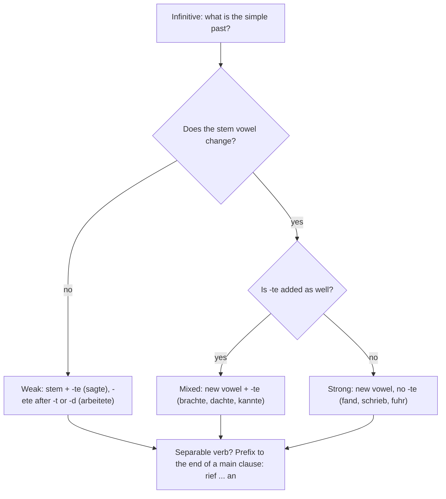

## What this lesson is for

At A2 you learned to *recognise* the **simple past** (*Präteritum*) in stories: *ging, kam, sah, fand*. You also learned to *use* it for *sein, haben, werden* and the modal verbs. At B1 that is not enough. You read novels, news and biographies, and you are expected to write a short story or a report yourself. Those texts are written in the simple past, so now you learn to produce it for every kind of verb.

This lesson brings together the three verb types, shows you the vowel patterns that make the strong verbs much easier to learn, explains what happens to separable verbs, and tells you when Germans write *sie fuhr* and when they say *sie ist gefahren*. The theme is stories: novels, heroes, authors, events and a small mystery.

## The endings: one set for every verb

All verbs share the same personal endings in the simple past. The *ich* and *er/sie/es* forms have no ending at all.

| | ending | weak: sagen | strong: finden | mixed: denken |
|---|---|---|---|---|
| ich | – | sagte | fand | dachte |
| du | -st | sagtest | fandest | dachtest |
| er / sie / es | – | sagte | fand | dachte |
| wir | -en / -n | sagten | fanden | dachten |
| ihr | -t | sagtet | fandet | dachtet |
| sie / Sie | -en / -n | sagten | fanden | dachten |

So the whole job is finding the **past stem**: *sagte-*, *fand-*, *dachte-*. Once you have it, the endings are automatic. (A strong stem ending in *-d* or *-t* adds an *-e-* before *-st* and *-t* for easier pronunciation: *du fandest, ihr fandet*. You will rarely need these forms, because the *du* and *ihr* forms almost only appear in speech, where people use the perfect.)

## Weak verbs: stem + -te

A **weak verb** keeps its vowel and adds *-te*: *machen → machte, kaufen → kaufte, berichten → berichtete*. Stems ending in *-t*, *-d* or certain consonant clusters add *-ete* so you can hear the ending: *arbeiten → arbeitete, gründen → gründete, öffnen → öffnete*.

Verbs in *-ieren* are weak too: *studierte, passierte, telefonierte*. Inseparable prefixes stay on: *entdecken → entdeckte, veröffentlichen → veröffentlichte, erzählen → erzählte*.

- *Die Zeitung berichtete über das Ereignis.* — The newspaper reported on the event.
- *Ein Bauer entdeckte die Höhle im Jahr 1923.* — A farmer discovered the cave in 1923.
- *Die Autorin veröffentlichte ihren ersten Roman mit 24.* — The author published her first novel at 24.

## Strong verbs: a new vowel, no -te

A **strong verb** changes its stem vowel and takes no *-te*: *finden → fand, schreiben → schrieb, fahren → fuhr*. You have to learn each one, but you do not have to learn them as 150 separate facts. Most follow a handful of vowel patterns (in German grammar this vowel change is called **ablaut**). Learn the pattern with one model verb, and the others fall into place.

| pattern | model | Präteritum | Perfekt | other verbs like it |
|---|---|---|---|---|
| ei → ie → ie | schreiben | schrieb | hat geschrieben | bleiben, scheinen, steigen, leihen |
| ei → i → i | schneiden | schnitt | hat geschnitten | reiten (ritt), streiten (stritt), leiden (litt) |
| ie → o → o | fliegen | flog | ist geflogen | verlieren, schieben, fliehen (floh) |
| i → a → u | finden | fand | hat gefunden | trinken, singen, springen, verschwinden |
| i → a → o | beginnen | begann | hat begonnen | schwimmen, gewinnen |
| e → a → o | sprechen | sprach | hat gesprochen | helfen, nehmen, treffen, sterben, stehlen |
| e → a → e | geben | gab | hat gegeben | lesen, sehen, essen (aß), vergessen, geschehen |
| a → u → a | fahren | fuhr | ist gefahren | tragen, schlagen, waschen, einladen (lud ein) |
| a → ie → a | schlafen | schlief | hat geschlafen | fallen (fiel), halten (hielt), lassen (ließ) |

A few common verbs follow no pattern and are simply irregular: *gehen → ging*, *stehen → stand*, *kommen → kam*, *sitzen → saß*, *liegen → lag*, *tun → tat*, *rufen → rief*, *laufen → lief*, *heißen → hieß*. The reference sheet at the end of the module lists about seventy verbs grouped like this.

Two memory hooks help:

- **The *ich* form equals the *er* form.** *Ich fand, er fand. Ich schrieb, sie schrieb.* No *-e*, no *-t*. A form like ~~er fande~~ or ~~ich schriebte~~ is never right.
- **Many common *ei* verbs are strong**, and when they are, they go to *ie* or *i*: *bleiben – blieb, scheinen – schien, schneiden – schnitt*. But some everyday *ei* verbs are weak, so check new ones: *arbeiten, heiraten, meinen, reisen, teilen, zeigen*.

Examples from stories:

- *Plötzlich verschwand der Ring.* — Suddenly the ring disappeared.
- *Der Held sprang ins Wasser und schwamm zum Ufer.* — The hero jumped into the water and swam to the shore.
- *Niemand wusste, was in der Nacht geschehen war.* — Nobody knew what had happened in the night.
- *Der Dieb stahl die Krone und floh durch den Garten.* — The thief stole the crown and fled through the garden.

## Mixed verbs: a new vowel and -te

A small group, the **mixed verbs**, does both: the vowel changes like a strong verb, and *-te* is added like a weak one. There are only about eight you need, and you know their participles already from A2 (*gebracht, gedacht, gekannt*).

| infinitive | Präteritum | Perfekt |
|---|---|---|
| bringen | brachte | hat gebracht |
| denken | dachte | hat gedacht |
| kennen | kannte | hat gekannt |
| nennen | nannte | hat genannt |
| rennen | rannte | ist gerannt |
| wissen | wusste | hat gewusst |
| brennen | brannte | hat gebrannt |
| senden | sandte / sendete | hat gesandt / gesendet |

*Er kannte die Antwort, aber er nannte keinen Namen.* — He knew the answer, but he didn't give a name.

The chart sums up how to find the simple past of any verb. The first question is answered by the dictionary or the reference sheet: compare the infinitive with the past form.

## Separable verbs in the simple past

In a main clause a **separable verb** splits in the simple past exactly as it does in the present: the past form goes to position 2, the prefix to the end.

- present: *Sie steht um sechs auf.*
- simple past: *Sie stand um sechs auf.* — She got up at six.
- *Der Zug kam pünktlich an.* — The train arrived on time.
- *Er rief sofort die Polizei an.* — He phoned the police at once.

The two parts of the verb frame the main clause, like a bracket:

In a subordinate clause the verb goes to the end and joins up again: *…, als sie um sechs aufstand*; *…, weil der Zug pünktlich ankam*. This is the same rule you know from the present.

## Written past, spoken past

Both past tenses mean the same thing. The choice depends on the kind of text:

| | simple past (Präteritum) | perfect (Perfekt) |
|---|---|---|
| typical texts | novels, fairy tales, news reports, biographies, history books, formal reports | conversation, chats, informal e-mails and letters |
| verbs | all verbs | most verbs (but *war, hatte*, modals in the simple past) |
| feel | narrative, distant, finished | personal, connected to now |

A newspaper writes *Der Bürgermeister eröffnete gestern die neue Brücke*; a friend tells you *Gestern hat der Bürgermeister die neue Brücke eröffnet*. Same fact, different register.

There is also a regional difference. In northern Germany the simple past is quite common in speech, even for verbs like *ging* and *kam*: *Ich kam gestern nach Hause und …*. In southern Germany, Austria and Switzerland, everyday speech uses almost only the perfect; Swiss German dialects have lost the simple past almost completely. In writing, everyone uses the simple past for stories. For you this means: write stories and reports in the simple past, but in conversation, use the perfect for most verbs.

## Story words: telling a story in order

Stories need words that move the action forward. Some you know (*zuerst, dann, danach, plötzlich, am Ende*). New at B1:

| word | meaning | example |
|---|---|---|
| *eines Tages* | one day | *Eines Tages kam ein Brief aus Amerika.* |
| *zunächst* | at first, initially | *Zunächst glaubte ihr niemand.* |
| *schließlich* | in the end, eventually | *Schließlich fand die Polizei den Dieb.* |
| *im Verlauf* (+ genitive or *von*) | in the course of | *Im Verlauf des Abends wurde es kalt.* |
| *am Ende* | at the end | *Am Ende heirateten der Held und die Heldin.* |

*Eines Tages* is a fixed phrase in the genitive; use it like *an einem Tag*. It opens the story's main event, just like English "one day".

## Text: Das verschwundene Manuskript

> Im Frühling 1987 geschah in einer kleinen Stadt am Bodensee etwas Seltsames. Die ehemalige Lehrerin Margarete Vogt hatte ihr ganzes Leben lang heimlich geschrieben, aber nie etwas veröffentlicht. Eines Tages schickte sie das Manuskript ihres ersten Romans an einen Verlag in München. Die Handlung spielte in ihrer eigenen Stadt, und die Heldin war eine junge Postbotin, die alle Geheimnisse der Nachbarn kannte.
>
> Zwei Wochen später kam ein Brief: Der Verlag wollte das Buch drucken. Doch am nächsten Morgen war das Manuskript aus ihrem Schreibtisch verschwunden. Frau Vogt rief sofort die Polizei an. Ein Nachbar erzählte, er habe nachts ein Licht im Garten gesehen, aber er war kein guter Zeuge, denn er trug keine Brille.
>
> Zunächst fand die Polizei keine Spur. Dann bemerkte ein junger Polizist etwas: Einige Figuren im Roman sahen den Nachbarn sehr ähnlich, und nicht alle kamen gut weg. Schließlich gab der Bäcker von gegenüber zu, dass er das Manuskript gestohlen hatte. Er hatte sich im dritten Kapitel wiedererkannt und schämte sich.
>
> Das Buch erschien im Herbst. Am Ende des Romans stand ein neuer Satz: „Alle Figuren sind frei erfunden.“ Die Leser glaubten es natürlich nicht.

Translation:

> In the spring of 1987 something strange happened in a small town on Lake Constance. The former teacher Margarete Vogt had secretly written all her life but had never published anything. One day she sent the manuscript of her first novel to a publisher in Munich. The plot was set in her own town, and the heroine was a young postwoman who knew all the neighbours' secrets.
>
> Two weeks later a letter came: the publisher wanted to print the book. But the next morning the manuscript had disappeared from her desk. Mrs Vogt phoned the police at once. A neighbour said he had seen a light in the garden at night, but he was not a good witness, because he wasn't wearing his glasses.
>
> At first the police found no trace. Then a young policeman noticed something: some characters in the novel looked very similar to the neighbours, and not all of them came off well. In the end the baker from across the road admitted that he had stolen the manuscript. He had recognised himself in the third chapter and was ashamed.
>
> The book came out in the autumn. At the end of the novel there was a new sentence: "All characters are entirely fictional." The readers didn't believe it, of course.

Notes: almost every verb is in the simple past, as in any written story. Weak: *schickte, wollte, erzählte, bemerkte, schämte sich, glaubten*. Strong: *geschah, kam, war, trug, fand, sahen, gab … zu, erschien, stand*. Mixed: *kannte*. Separable: *rief … an, gab … zu*. *hatte geschrieben, war verschwunden, gestohlen hatte* are the past perfect, the topic of the next lesson. *er habe … gesehen* is reported speech, which you only need to recognise for now. *der Verlag* = publishing house; *heimlich* = secretly; *das Geheimnis* = secret; *gut wegkommen* = to come off well; *zugeben* (gab zu) = to admit; *frei erfunden* = entirely made up.

## Pronunciation

- *geschah*: ge-SCHAH, a long *a*. The present is *es geschieht*.
- *der Held*: the *d* at the end sounds like *t*: [hɛlt]. Plural *die Helden*: HEL-den.
- *erschien*: er-SCHIEN, long *ie*; *verschwand*: ver-SCHWANT.
- *die Biografie*: stress on the last syllable, bi-o-gra-FIE. The same for *die Fantasie*: fan-ta-SIE.
- *das Kapitel*: ka-PI-tel, stress on the second syllable.

## Common mistakes

- Adding *-te* to a strong verb: ~~er fandte~~, ~~sie gingte~~ → *er fand, sie ging*.
- Adding an ending to the *ich* or *er* form: ~~er kame~~, ~~ich sahe~~ → *er kam, ich sah*.
- Mixing up the vowel with the participle: the past of *finden* is *fand*, not ~~fund~~ (*gefunden* is the participle); the past of *sprechen* is *sprach*, not ~~sproch~~.
- Not separating the prefix in a main clause: ~~Sie aufstand um sechs~~ → *Sie stand um sechs auf.*
- Forgetting the *-e-* in weak verbs in *-t*/*-d*: ~~er arbeitte~~, ~~sie berichtte~~ → *er arbeitete, sie berichtete*.
- Writing a whole conversation in the simple past. *Ich ging gestern ins Kino und sah einen Film* is fine in a story but sounds bookish in a chat with a friend in southern Germany; say *Ich bin gestern ins Kino gegangen*.

## Key points

- Every verb uses the same endings in the simple past: *ich –, du -st, er –, wir -en, ihr -t, sie -en*. The *ich* and *er* forms are identical.
- Weak verbs: stem + *-te* (*sagte*), or *-ete* after *-t/-d* (*berichtete*).
- Strong verbs: new vowel, no *-te* (*fand, schrieb, fuhr*). Learn them in vowel-pattern groups.
- Mixed verbs: new vowel + *-te* (*brachte, dachte, kannte, wusste*).
- Separable verbs split in main clauses: *Sie stand auf. Er rief an.*
- Write stories, reports and biographies in the simple past; speak mostly in the perfect, especially in the south.

The words from this lesson are listed below; they join your vocabulary reviews when you complete the lesson.
