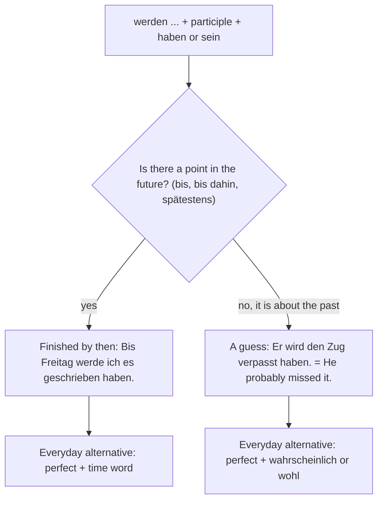

## What this lesson is for

In lesson 2 the past perfect let you stand at a point in the past and look back at something that had already happened: *Als wir ankamen, war der Zug schon abgefahren.* In lesson 4 you used *werden* to look ahead (*Es wird regnen*) and, with *wohl*, to guess about the present (*Er wird wohl im Büro sein*).

This honors lesson puts those two ideas together. The **Futur II** (English "future perfect": *will have done*) lets you stand at a point in the *future* and look back: *Bis Freitag werde ich den Bericht geschrieben haben.* — By Friday I will have written the report. And, just as *wird wohl* guesses about the present, *wird wohl … haben* guesses about the past: *Er wird den Zug verpasst haben.* — He has probably missed the train.

Strictly speaking the Futur II belongs to B2. You won't need to produce it in the B1 exam, but you will meet it in crime novels and TV detective series, in news and in formal letters. The theme is crime stories: detectives, suspects and alibis.

## The form: werden + perfect infinitive

The Futur II has two parts. *werden* in position 2 is conjugated exactly as in the Futur I. At the end of the clause comes the **perfect infinitive**: the past participle plus *haben* or *sein*.

| | werden | | perfect infinitive |
|---|---|---|---|
| ich | werde | … | gelesen haben |
| du | wirst | … | gelesen haben |
| er / sie / es | wird | … | angekommen sein |
| wir | werden | … | angekommen sein |
| ihr | werdet | … | gelesen haben |
| sie / Sie | werden | … | angekommen sein |

The helper is the same as in the perfect. *Sie hat das Buch gelesen* → *Sie wird das Buch gelesen haben.* *Er ist angekommen* → *Er wird angekommen sein.* Separable verbs keep their prefix on the participle (*angekommen, eingeschlafen*), and inseparable ones have no *ge-* (*verpasst, entdeckt*).

You will meet the perfect infinitive again in lesson 25, after *scheinen* … *zu* (*Er scheint die E-Mail nicht gelesen zu haben*). Here it simply follows *werden*, without *zu*.

Word order follows the rules of the sentence bracket:

- main clause: *Bis Montag werden die Handwerker das Dach repariert haben.* — By Monday the builders will have repaired the roof.
- subordinate clause, *werden* goes to the very end: *Ich hoffe, dass die Handwerker das Dach bis Montag repariert haben werden.*
- question: *Wirst du das bis morgen geschafft haben?* — Will you have managed that by tomorrow?

So the end of a Futur II clause always reads participle, then *haben/sein*, then (in a subordinate clause) *werden*: *… repariert haben werden.*

## Use 1: finished by a point in the future

The first use mirrors the past perfect. Pick a point in the future, usually with *bis* (by), *bis dahin* (by then), *spätestens* (at the latest) or *in* + time, and say what will be complete at that point.

- *In zwei Jahren werde ich mein Studium abgeschlossen haben.* — In two years I will have finished my degree.
- *Bis zum Abend werden wir alle Zeugen befragt haben.* — By the evening we will have questioned all the witnesses.
- *Wenn du zurückkommst, werde ich die Küche aufgeräumt haben.* — When you come back, I'll have tidied the kitchen.

In everyday German, people usually avoid the long form. Just as the present often replaces the Futur I when a time word makes the future clear (lesson 4), the perfect often replaces the Futur II:

- *Bis Freitag habe ich den Bericht geschrieben.* — By Friday I'll have written the report.
- *Morgen um diese Zeit sind wir schon in Rom angekommen.* — This time tomorrow we'll already have arrived in Rome.

The Futur II sounds more formal or more emphatic, as in a promise or an official plan: *Bis Ende des Jahres wird die neue Brücke fertiggestellt worden sein* is the kind of sentence you read in a press release. (That one is even in the passive; just recognise it.)

## Use 2: a guess about the past

In conversation, this second use is probably the one you will hear more often. Remember *Er wird wohl krank sein* — he's probably ill (now). Move the guess into the past and you get the Futur II: *Er wird wohl krank gewesen sein* — he was probably ill.

| guess about … | form | example | English |
|---|---|---|---|
| now | Futur I (+ *wohl*) | *Sie wird wohl schon zu Hause sein.* | She's probably home by now. |
| the past | Futur II (+ *wohl*) | *Sie wird wohl den Bus genommen haben.* | She probably took the bus. |

Nothing in these sentences is about the future. *werden* here does not mean "will"; it marks a supposition: the speaker thinks something is likely but has not checked it. *wohl*, *sicher*, *schon* or *bestimmt* usually come with it, but even without them the meaning is a guess, and context tells you which use you are hearing:

- *Wo ist mein Schlüssel?* — *Du wirst ihn wieder im Auto gelassen haben.* — Where's my key? You'll have left it in the car again.
- *Das Licht im Büro ist aus. Die Kollegen werden schon gegangen sein.* — The office light is off. The colleagues will have left already.
- *Er hat nicht geantwortet. Er wird die Nachricht nicht gesehen haben.* — He hasn't replied. He probably didn't see the message.

English does the same with "will have": "That'll have been the postman." If the time point is already past and there is no *bis*, read the Futur II as a guess.

You can say the same thing without the Futur II, using the perfect and an adverb: *Er hat die Nachricht wahrscheinlich nicht gesehen. Vermutlich ist er schon gegangen.* You will also hear *muss* with the perfect infinitive for a strong conclusion: *Er muss die Nachricht gesehen haben* — he must have seen the message. That modal form is B2; recognise it.

## The whole tense system on one line

With the Futur II you have met all six German tenses of the indicative. The picture shows them on one timeline. Two tenses look back from a reference point: the past perfect from a point in the past, the Futur II from a point in the future.

### Example 1: a plan with a deadline

*Task:* A detective tells her boss what the team will have done by the evening. Turn *Wir befragen die Nachbarn* into the Futur II with *bis heute Abend*.

1. Find the perfect: *Wir haben die Nachbarn befragt.* The helper is *haben*, the participle *befragt* (inseparable *be-*, so no *ge-*).
2. Make the perfect infinitive: *befragt haben*.
3. Put *werden* in position 2 and the perfect infinitive at the end: *Bis heute Abend werden wir die Nachbarn befragt haben.* (*Bis heute Abend* takes position 1, so the subject *wir* follows the verb.)
4. Everyday version: *Bis heute Abend haben wir die Nachbarn befragt.*

### Example 2: a guess about the past

*Task:* There is mud on the carpet and the window is open. Say what the burglar probably did, first in the Futur II, then in a *dass* clause.

1. The facts you guess at: *Der Einbrecher ist durch das Fenster gekommen.* (*kommen* takes *sein*.)
2. Futur II: *Der Einbrecher wird durch das Fenster gekommen sein.* — The burglar probably came through the window.
3. Inside *Ich vermute, dass …*, *werden* goes to the very end: *Ich vermute, dass der Einbrecher durch das Fenster gekommen sein wird.* Correct but heavy: *vermuten* already marks the guess, so most people write *Ich vermute, dass der Einbrecher durch das Fenster gekommen ist.*

## Text: Der Einbruch in der Bäckerei

Crime stories (*Krimis*) are hugely popular in German-speaking countries. The best known is *Tatort*, which has run on Sunday evenings on German public television since 1970, with teams of detectives in different cities, including Austrian and Swiss ones. Here is an original scene in that style.

> Kommissarin Yilmaz steht am Tatort, einer kleinen Bäckerei. Die Kasse ist leer, das Fenster zum Hof ist offen. „Der Täter wird durch dieses Fenster eingestiegen sein“, sagt sie. „Sehen Sie die Spuren an der Wand?“
>
> Ihr Kollege, Kommissar Berger, nickt. „Und er wird Handschuhe getragen haben. Es gibt keine Fingerabdrücke.“
>
> „Wer hat den Einbruch gemeldet?“
>
> „Der Bäcker selbst, um halb fünf. Er sagt, er war die ganze Nacht zu Hause. Seine Frau bestätigt das. Ein gutes Alibi.“
>
> „Vielleicht zu gut.“ Die Kommissarin schaut auf den Boden. „Der Täter hat nur die Kasse geöffnet und den Tresor nicht angefasst. Er wird gewusst haben, dass dort kein Geld war. Wer weiß so etwas?“
>
> „Jemand, der hier arbeitet“, sagt Berger. „Ich habe einen Verdacht. Die Aushilfe war gestern sehr nervös.“
>
> „Gut. Wir ermitteln weiter. Bis heute Abend werden wir alle Angestellten befragt haben. Und spätestens morgen wissen wir mehr.“

Translation:

> Detective Yilmaz is standing at the crime scene, a small bakery. The till is empty and the window to the yard is open. "The culprit will have climbed in through this window," she says. "Can you see the marks on the wall?"
>
> Her colleague, Detective Berger, nods. "And he'll have worn gloves. There are no fingerprints."
>
> "Who reported the break-in?"
>
> "The baker himself, at half past four. He says he was at home all night. His wife confirms it. A good alibi."
>
> "Perhaps too good." The detective looks at the floor. "The culprit only opened the till and didn't touch the safe. He'll have known that there was no money in it. Who knows something like that?"
>
> "Someone who works here," says Berger. "I have a suspicion. The temp was very nervous yesterday."
>
> "Good. We'll keep investigating. By this evening we'll have questioned all the employees. And by tomorrow at the latest we'll know more."

Notes: three Futur II sentences are guesses about the past (*wird … eingestiegen sein, wird … getragen haben, wird … gewusst haben*); one is a plan finished by a future point (*werden … befragt haben*). The last sentence uses the present for the future (*spätestens morgen wissen wir*). *einsteigen* (ist eingestiegen) = to climb in, get in; *der Fingerabdruck* = fingerprint; *melden* = to report; *bestätigen* = to confirm; *der Tresor* = safe; *anfassen* = to touch; *die Aushilfe* = temporary worker, temp. *einbrechen* (brach ein, ist eingebrochen) = to break in. How does it end? *Zwei Tage später nimmt die Polizei die Aushilfe fest. Die Vermutung der Kommissarin war richtig: Die Täterin hatte Schulden.* — Two days later the police arrest the temp. The detective's assumption was right: the culprit had debts.

## Pronunciation

- *der Kommissar*: ko-mi-SAR, stress on the last syllable; *die Kommissarin*: ko-mi-SA-rin.
- *das Alibi*: A-li-bi, stress on the first syllable.
- *ermitteln*: er-MIT-teln.
- *der Verdacht*: fer-DACHT, *ch* as in *ach*; *verdächtig*: fer-DÄCH-tig, *ch* as in *ich*.

## Common mistakes

- Using the infinitive alone: ~~Bis Freitag werde ich den Bericht schreiben haben~~ → *… geschrieben haben*. The Futur II needs the participle.
- Wrong helper: ~~Er wird den Zug verpasst sein~~ → *verpasst haben*; ~~Sie wird angekommen haben~~ → *angekommen sein*. Use the same helper as in the perfect.
- Wrong order at the end: ~~… geschrieben werde haben~~ → main clause *werde … geschrieben haben*; subordinate clause *… geschrieben haben werde*.
- Reading every Futur II as the future: *Er wird den Zug verpasst haben* is usually "he has probably missed the train", not "he will have missed".
- Overusing it in speech: *Bis Freitag habe ich es geschafft* is what most people say. Keep the Futur II for formal plans and for guesses.

## Key points

- Futur II = *werden* (position 2) + participle + *haben/sein* (the perfect infinitive) at the end: *Sie wird es geschafft haben. Er wird gegangen sein.*
- Use 1: something will be finished by a point in the future (*bis, bis dahin, spätestens*). In speech the perfect often replaces it.
- Use 2: a guess about the past, often with *wohl, sicher, schon*: *Er wird den Zug verpasst haben* = he probably missed the train.
- Futur I + *wohl* guesses about now; Futur II + *wohl* guesses about the past.
- In a subordinate clause *werden* comes last: *dass er gegangen sein wird*.

The words from this lesson are listed below; they join your vocabulary reviews when you complete the lesson.
