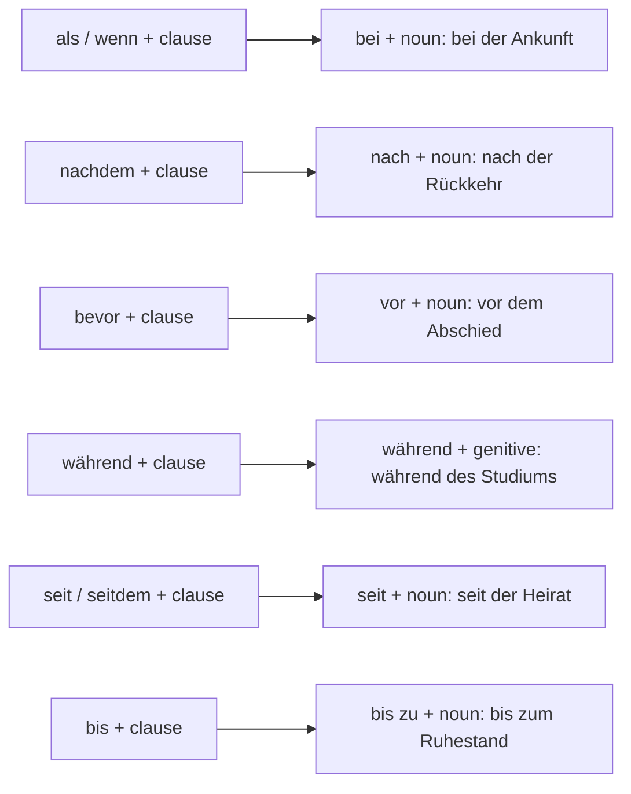

## What this lesson is for

In lesson 2 you learned to keep *nach* and *nachdem* apart: *nach dem Krieg* (a preposition with a noun) but *nachdem der Krieg zu Ende war* (a conjunction with a clause). In lesson 3 you met the whole family of time conjunctions: *während, seit, bis, sobald, solange*. This honors lesson connects the two halves. Almost every **temporal clause** has a shorter twin: a **prepositional phrase** made of a time preposition and a noun.

- *Nachdem sie aus New York zurückgekehrt war, fotografierte sie den Wiederaufbau.*
- *Nach ihrer Rückkehr aus New York fotografierte sie den Wiederaufbau.*

Both mean "After her return from New York, she photographed the reconstruction." Speech prefers the first; CVs, museum labels, news and reports prefer the second. Turning clauses into phrases and back again is part of what German teachers call **nominal style**, and it is a B2 skill. Lesson 20 shows it in the news; here you practise it for time, where it is most useful. The theme is life stories: biographies, CVs and a museum plaque.

## The pairs

Each time conjunction has a preposition that does the same job. All of these prepositions except *während* take the dative, which you know well.

| clause (conjunction) | phrase (preposition + noun) | example phrase |
|---|---|---|
| *als / wenn* (when) | *bei* + dative | *bei unserer Ankunft* — when we arrived |
| *nachdem* (after) | *nach* + dative | *nach ihrer Rückkehr* — after she returned |
| *bevor* (before) | *vor* + dative | *vor dem Abschied* — before saying goodbye |
| *während* (while) | *während* + genitive | *während seines Studiums* — while he was studying |
| *seit / seitdem* (since) | *seit* + dative | *seit ihrer Heirat* — since they got married |
| *bis* (until) | *bis zu* + dative | *bis zu seinem Ruhestand* — until he retired |
| *sobald* (as soon as) | *gleich nach / sofort nach* + dative | *gleich nach dem Essen* — straight after the meal |

*während* + genitive is a preview of lesson 14; for now, learn *während des Urlaubs, während des Studiums, während der Woche* as fixed phrases. *solange* (as long as) has no neat partner: *für die Dauer* + genitive exists in official language, but you will almost always keep the clause.

Watch two contractions: *bei dem → beim* and *zu dem → zum*, *zu der → zur*: *beim Essen, bis zum Ende, bis zur Rente*.

## Building the noun

To make the phrase, you need a noun for the verb in the clause. There are three main ways.

1. Nouns in *-ung* (always feminine): *gründen → die Gründung, eröffnen → die Eröffnung, trennen → die Trennung, ausbilden → die Ausbildung, einwandern → die Einwanderung*.

2. Short nouns from the verb stem, which you have to learn one by one, often with a vowel change: *beginnen → der Beginn, ankommen → die Ankunft, abfahren → die Abfahrt, zurückkehren → die Rückkehr, heiraten → die Heirat, sterben → der Tod, Abschied nehmen → der Abschied, sich aufhalten → der Aufenthalt*.

3. The infinitive as a noun. Any verb can become a neuter noun with a capital letter: *essen → das Essen, lesen → das Lesen, Auto fahren → das Autofahren*. This **nominalised infinitive** is especially common after *beim* (while doing, when doing) and *zum* (for doing):

- *Beim Autofahren soll man nicht telefonieren.* — You shouldn't make phone calls while driving.
- *Beim Lesen schläft mein Vater oft ein.* — My father often falls asleep while reading.
- *Ich brauche eine Brille zum Lesen.* — I need glasses for reading.

If there is an -ung noun or a short stem noun, use it: *nach der Ankunft*, not ~~nach dem Ankommen~~. The nominalised infinitive is for activities that have no other noun.

## Who did it? Subjects and objects in the phrase

A clause has a subject; a phrase has none. The subject usually turns into a possessive article:

- *Seit sie geheiratet haben, …* → *Seit ihrer Heirat …* (*sie* → *ihre*)
- *Als wir ankamen, …* → *Bei unserer Ankunft …* (*wir* → *unsere*)

If the subject is a noun, written German puts it in the genitive after the new noun; in speech, *von* + dative is common:

- *Nachdem meine Großeltern geheiratet hatten, …* → *Nach der Heirat meiner Großeltern …* (written) / *nach der Heirat von meinen Großeltern* (spoken)

An object turns into a genitive in the same way: *Nachdem die Stadt die Brücke eröffnet hatte, …* → *Nach der Eröffnung der Brücke …* Here the city (the subject) disappears completely, which is often exactly what a news text wants.

## What happens to the tense?

A phrase has no verb, so it has no tense. *nach dem Krieg* works in a story about 1946, in a sentence about today and in a plan for the future. This is another reason written German likes phrases: the reader doesn't need the past perfect.

Going the other way, you have to choose the tense yourself, with the rules from lessons 2 and 3:

- *Nach dem Essen gingen wir spazieren.* → *Nachdem wir gegessen hatten, gingen wir spazieren.* (*nachdem*: one step further back)
- *Seit seinem Umzug wohnt er allein.* → *Seit er umgezogen ist, wohnt er allein.* (the move is finished, the living alone continues)
- *Vor der Abfahrt kontrollierte der Fahrer die Reifen.* → *Bevor der Bus abfuhr, kontrollierte der Fahrer die Reifen.* (*bevor*: same tense as the main clause)

### Example 1: from clause to phrase (a CV)

*Task:* Shorten *Nachdem ich die Ausbildung abgeschlossen hatte, arbeitete ich drei Jahre in Wien* for a CV.

1. The conjunction is *nachdem*, so the preposition is *nach* + dative.
2. The verb *die Ausbildung abschließen* has a noun ready: *der Abschluss der Ausbildung*, or simply *die Ausbildung*.
3. The subject *ich* becomes the possessive *meiner* (feminine dative): *nach meiner Ausbildung*.
4. The tense vanishes: *Nach meiner Ausbildung arbeitete ich drei Jahre in Wien.* In a CV line in note form even the verb goes: *nach der Ausbildung drei Jahre in Wien tätig* (*tätig* = working, employed).

### Example 2: from phrase to clause (reading aloud)

*Task:* A museum label says *1949 nach ihrer Rückkehr Fotos vom Wiederaufbau*. Say it as a full sentence.

1. *nach* + noun becomes *nachdem* + clause; the clause needs a subject and a verb: *sie* + *zurückkehren*.
2. The main event (she took photos) is in the past, so the *nachdem* clause goes one step back, into the past perfect. *zurückkehren* takes *sein*: *nachdem sie zurückgekehrt war*.
3. Put it together, with the main clause starting with its verb: *Nachdem sie 1949 zurückgekehrt war, fotografierte sie den Wiederaufbau.*

## Three more time conjunctions to recognise

These belong to written or careful German. Recognise them; you don't need to use them yet.

| conjunction | meaning | example |
|---|---|---|
| *ehe* | before (formal, literary; = *bevor*) | *Ehe er antworten konnte, war sie schon gegangen.* — Before he could answer, she had already left. |
| *sooft* | whenever, every time that | *Sooft ich meine Oma besuche, erzählt sie von früher.* — Whenever I visit my grandma, she talks about the old days. |
| *kaum …, als* / *kaum dass* | hardly … when, no sooner … than | *Er war kaum zu Hause, als das Telefon klingelte.* — He had hardly got home when the phone rang. |

All three send the verb to the end, like every subordinating conjunction. In *Er war kaum zu Hause, als …*, *kaum* is an adverb (hardly) in the main clause, and *als* starts the time clause. *Kaum dass er zu Hause war, klingelte das Telefon* means the same.

## Text: Clara Brenner, Fotografin

The plaque below hangs next to a photo exhibition. It is written in phrases. Underneath, a museum guide tells the same life story to a group, in clauses. (Clara Brenner is invented for this course.)

> Clara Brenner wurde 1891 in Lübeck geboren. Nachdem sie das Abitur gemacht hatte, begann sie eine Ausbildung in einem Fotoatelier. 1919, als sie 28 Jahre alt war, gründete sie in Hamburg ihr eigenes Atelier.
>
> 1933 ging sie nach New York, und sie blieb sechzehn Jahre dort. Sobald sie 1949 zurückgekehrt war, fing sie an, den Wiederaufbau der zerstörten Städte zu fotografieren. Diese Bilder sehen Sie hier im ersten Raum.
>
> Als sie 1960 in den Ruhestand ging, zog sie an die Ostsee. Aber sie fotografierte weiter, sooft das Wetter schön war. 1974 starb sie in Travemünde.

Translation:

> Clara Brenner was born in Lübeck in 1891. After she had passed her school-leaving exam, she began an apprenticeship in a photo studio. In 1919, when she was 28, she founded her own studio in Hamburg.
>
> In 1933 she went to New York, and she stayed there for sixteen years. As soon as she had returned in 1949, she started to photograph the reconstruction of the destroyed cities. You can see these pictures here in the first room.
>
> When she retired in 1960, she moved to the Baltic coast. But she kept on taking photographs whenever the weather was nice. She died in Travemünde in 1974.

Notes: compare each line of the plaque with the guide's sentence. *Geburt* → *wurde geboren*; *nach dem Abitur* → *nachdem sie das Abitur gemacht hatte*; *Gründung* → *gründete*; *Aufenthalt* → *blieb … dort*; *nach ihrer Rückkehr* → *sobald sie zurückgekehrt war*; *Beginn des Ruhestands* → *als sie in den Ruhestand ging*; *Tod* → *starb*. Use *wurde geboren* for people who have died, *ist geboren* for people who are alive. *das Atelier* = studio; *der Wiederaufbau* = reconstruction; *in den Ruhestand gehen* = to retire; *die Ostsee* = the Baltic Sea.

## Pronunciation

- *die Rückkehr*: RÜCK-kehr, stress on the first part; *ck* and *k* make one long k sound.
- *der Ruhestand*: RU-he-stand, long *u*, the *h* is silent.
- *ehe*: E-he, two syllables with a long first *e*; the *h* is silent.
- *sooft*: so-OFT, stress on the second syllable.
- *der Aufenthalt*: AUF-ent-halt, stress on the first syllable.

## Common mistakes

- A conjunction before a noun: ~~nachdem dem Essen~~ → *nach dem Essen*; ~~bevor der Abfahrt~~ → *vor der Abfahrt*.
- A preposition before a clause: ~~bei wir ankamen~~ → *als wir ankamen* or *bei unserer Ankunft*.
- A small letter for the nominalised infinitive: ~~beim lesen~~ → *beim Lesen*.
- *vor* with a time span means "ago", not "before": *vor zwei Jahren* = two years ago; *zwei Jahre vor der Hochzeit* = two years before the wedding.
- Forgetting the tense when you turn a phrase back into a clause: ~~Nachdem wir aßen, …~~ → *Nachdem wir gegessen hatten, …*
- Too many nouns: a sentence like *Nach der Beendigung der Durchführung der Renovierung …* is correct but hard to read. In your own writing, use one phrase per sentence at most.

## Key points

- Time conjunctions and prepositions come in pairs: *als/wenn – bei, nachdem – nach, bevor – vor, während – während, seit – seit, bis – bis zu, sobald – gleich nach*.
- The noun comes from the verb: -ung nouns (*die Gründung*), short stem nouns (*die Ankunft, der Tod*), or the infinitive (*beim Lesen*).
- The subject becomes a possessive (*ihre Rückkehr*) or a genitive (*die Heirat meiner Großeltern*).
- Phrases have no tense; when you turn one back into a clause, choose the tense with the rules of lessons 2 and 3.
- Speech prefers clauses; CVs, plaques, news and reports prefer phrases.
- Recognise *ehe* (before), *sooft* (whenever) and *kaum …, als* (hardly … when).

The words from this lesson are listed below; they join your vocabulary reviews when you complete the lesson.
