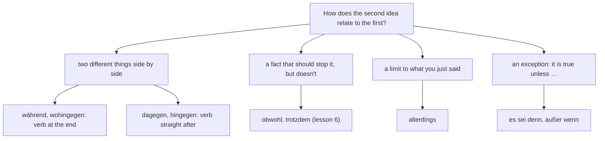

## What this lesson is for

In lesson 6 you learned to concede: *obwohl* and *trotzdem* say that a fact should have stopped something, and yet it didn't. In lesson 9 you set two options side by side with *entweder … oder* and *sowohl … als auch*. This honors lesson adds the connectors that educated German uses when it compares and qualifies: *während* and *wohingegen* (whereas), *dagegen* and *hingegen* (on the other hand), *im Gegensatz zu* (in contrast to), *allerdings* (however, mind you), and two ways to state an exception, *es sei denn* and *außer wenn* (unless). These words turn up constantly in newspaper articles, reviews and forum posts, and they help you write the comparisons that the B1 exam asks for ("Wie ist das in Ihrem Heimatland?").

The theme is comparing everyday life: what is different in Germany, Austria or Switzerland from where you live, and which clichés are true.

## Contrast is not concession

English uses *but* for both ideas, and so does German *aber*. But they are different kinds of logic, and the more precise connectors only do one job each:

- **Concession** (lesson 6): one fact should prevent another, but doesn't. *Obwohl es regnet, gehen wir spazieren.* The rain should keep us at home.
- **Contrast**: two different facts stand side by side, and neither should prevent the other. *Mein Bruder liebt Berge, während ich lieber am Meer bin.* Nobody expects my brother's taste to change mine.

Connectors that express pure contrast are called **adversative connectors**. A quick test: if you can swap the two halves without changing the meaning, it is contrast (*I like the sea, whereas my brother loves mountains* says the same thing). With concession you can't swap (*Although we go for a walk, it's raining* is nonsense).

## während and wohingegen: whereas

You met *während* in lesson 3 as "while" in time, and saw that it can also contrast two people or things. *wohingegen* means only "whereas", never "while", so it is useful in writing when *während* could be misread. Both send the verb to the end:

- *In Deutschland sind sonntags die meisten Geschäfte geschlossen, während in den USA viele Läden auch am Sonntag offen sind.* — In Germany most shops are closed on Sundays, whereas in the US many shops are open on Sunday too.
- *Meine Eltern zahlen fast immer bar, wohingegen ich alles mit dem Handy bezahle.* — My parents almost always pay cash, whereas I pay for everything with my phone.

*wohingegen* is formal and fairly rare in speech; in conversation people say *während* or simply *aber*. Learn to recognise it in reading and use it now and then in a written comparison.

How do you know which *während* you are reading? If both events happen at the same time and the point is the time, it's "while". If the point is the difference, it's "whereas". *Während ich koche, deckt sie den Tisch* (at the same time) vs *Während ich gern koche, isst sie lieber im Restaurant* (different tastes).

## dagegen, hingegen, im Gegensatz dazu: on the other hand

These three do the same job as *während*, but from the other half of the sentence and with main-clause word order. They are linking adverbs, like *trotzdem*: in position 1 the verb comes straight after.

- *In Deutschland zahlen viele Menschen noch bar. In Schweden dagegen zahlt man fast nur mit Karte.* — In Germany many people still pay cash. In Sweden, on the other hand, people pay almost only by card.
- *Die Miete in München ist sehr hoch. Hingegen ist sie in Leipzig noch relativ niedrig.* — Rent in Munich is very high. In Leipzig, by contrast, it is still relatively low.
- *Unser Zug war pünktlich. Im Gegensatz dazu hatte der Zug unserer Freunde zwei Stunden Verspätung.* — Our train was on time. In contrast, our friends' train was two hours late.

*dagegen* and *hingegen* have a special place that most adverbs can't take: straight after the first element, before the verb. This "after the first element" position is very common in good writing, because it puts the stress on the thing being contrasted:

- *Ich trinke morgens Kaffee. Meine Frau hingegen trinkt nur Tee.* — I drink coffee in the morning. My wife, on the other hand, drinks only tea.
- *Das Stadtzentrum ist laut. Unser Viertel dagegen ist sehr ruhig.*

*hingegen* is a little more formal than *dagegen*. Be careful with *dagegen*: it is also the da-word of *gegen* (against it), which lesson 19 teaches: *Ich bin dagegen* (I'm against it). In a comparison of two things it means "on the other hand"; after *sein* or a verb with *gegen* it means "against it".

*im Gegensatz zu* + dative (in contrast to, unlike) does the same job inside one clause: *Im Gegensatz zu meinem Bruder spreche ich kein Französisch.* — Unlike my brother, I don't speak French. *der Gegensatz* means contrast or opposite (plural *die Gegensätze*).

### Example 1: one comparison, four ways

Facts: *In Österreich sind sonntags die meisten Geschäfte zu. In Kanada sind viele Geschäfte sonntags offen.*

1. With *während* (verb at the end, either half first): *Während in Österreich sonntags die meisten Geschäfte zu sind, sind in Kanada viele offen.* The *während* clause fills position 1, so the next verb (*sind*) comes straight after the comma.
2. With *wohingegen* (written style; usually second): *In Österreich sind sonntags die meisten Geschäfte zu, wohingegen in Kanada viele offen sind.*
3. With *dagegen* in position 1: *In Österreich sind sonntags die meisten Geschäfte zu. Dagegen sind in Kanada viele offen.* Verb straight after *dagegen*, subject after the verb.
4. With *hingegen* after the first element: *In Österreich sind sonntags die meisten Geschäfte zu. In Kanada hingegen sind viele offen.* Here *In Kanada hingegen* counts as one block in position 1, so *sind* is still second.

All four are correct; the last sounds the most polished in writing.

## allerdings: however, mind you

*allerdings* doesn't contrast two things. It limits what you have just said: it adds a "but" that makes your first statement less absolute. English uses *however*, *though*, *mind you*:

- *Die Wohnung ist schön. Allerdings ist sie ziemlich klein.* — The flat is nice. It's fairly small, though.
- *Der Kurs ist kostenlos, man muss sich allerdings vorher anmelden.* — The course is free; you do have to register in advance, though.

Like *trotzdem*, it can take position 1 (verb next) or stand after the verb. It can also stand after the first element: *Die Lage allerdings ist nicht ideal.* Compare it with its neighbours:

| word | job | example |
|---|---|---|
| *aber* | but (position 0, very general) | *Die Wohnung ist schön, aber klein.* |
| *jedoch* | however (formal *aber*) | *Die Wohnung ist schön, jedoch klein.* |
| *allerdings* | however, though: limits the first statement | *Die Wohnung ist schön. Allerdings ist sie klein.* |
| *trotzdem* | anyway: a result despite a fact | *Die Wohnung ist klein. Trotzdem nehmen wir sie.* |

As a short answer, *allerdings* means something quite different: strong agreement. *War das teuer? – Allerdings!* — Was that expensive? – It certainly was! Context and tone make it clear.

## Exceptions: es sei denn, außer wenn, sonst, andernfalls

You know how to give a condition with *wenn* or *falls*. Often you want to say the opposite: something is true in every case except one. English says *unless*. German has two common ways.

***es sei denn*** (unless) is followed by a comma and a normal main clause, with the verb in second place. It always comes after the main statement:

- *Wir gehen morgen wandern, es sei denn, es regnet.* — We're going hiking tomorrow unless it rains.
- *Ich komme um acht, es sei denn, der Zug hat Verspätung.* — I'll come at eight unless the train is late.

*es sei denn* is a frozen old subjunctive form (Konjunktiv I, which you'll study at B2); you don't need to analyse it, just learn it as a fixed phrase. It can also be followed by a *dass* clause with the verb at the end: *…, es sei denn, dass es regnet.* The comma after *denn* is optional (both *es sei denn, es regnet* and *es sei denn es regnet* are allowed); this course writes it.

***außer wenn*** (except when, except if, unless) works like *wenn*: verb at the end.

- *Ich fahre immer mit dem Rad zur Arbeit, außer wenn es schneit.* — I always cycle to work, except when it snows.

Both say the same as *wenn … nicht*: *Wir gehen wandern, wenn es nicht regnet.* Notice that *es sei denn* and *außer wenn* already contain the "not": ~~es sei denn, es regnet nicht~~ would mean "unless it doesn't rain".

*sonst* (otherwise, or else; A2) and its formal partner *andernfalls* look at the same logic from the other side: they introduce what happens if the condition is not met. Both are linking adverbs: verb straight after.

- *Wir müssen jetzt los, sonst verpassen wir den Zug.* — We have to go now, or else we'll miss the train.
- *Bitte überweisen Sie den Betrag bis zum 15. Mai. Andernfalls müssen wir eine Mahngebühr berechnen.* — Please transfer the amount by 15 May. Otherwise we will have to charge a reminder fee.

A clause introduced by *es sei denn* or *außer wenn* is an **exceptive clause**: it names the one case in which the main statement doesn't hold.

### Example 2: one rule, four ways

Rule: the bakery takes cards only for purchases of 10 euros or more.

1. *wenn … nicht*: *Man kann nur bar bezahlen, wenn man nicht mindestens 10 Euro ausgibt.* (Correct, but clumsy with two negatives.)
2. *es sei denn*: *Man kann nur bar bezahlen, es sei denn, man gibt mindestens 10 Euro aus.* Main-clause order after the comma: *gibt* second, prefix *aus* at the end.
3. *außer wenn*: *Man kann nur bar bezahlen, außer wenn man mindestens 10 Euro ausgibt.* Verb at the end, so the separable verb joins up: *ausgibt*.
4. *sonst*, from the other side: *Man muss mindestens 10 Euro ausgeben, sonst kann man nicht mit Karte bezahlen.*

Versions 2 and 3 are the most natural. The sign below says the same thing in shop language.

## Shop hours and the German Sunday

In Germany, Sundays and public holidays are protected by law as days of rest, and most shops must stay closed. The detailed rules on opening hours (*der Ladenschluss*, closing time; *die Öffnungszeiten*) are set by each federal state (*Bundesland*), so they differ a little from place to place. Typical exceptions are shops at railway stations and airports, petrol stations, and in many states bakeries for a few hours on Sunday morning. Austria and most of Switzerland also keep Sunday largely free of shopping. Visitors from countries where shops open every day often find this strange at first; many later enjoy the quiet.

## Reading: Das ist bei uns anders

Jake, an exchange student from the US, writes a blog about his year in Leipzig.

> Seit sechs Monaten studiere ich als Austauschstudent in Leipzig. Vorher hatte ich viele Klischees über Deutschland im Kopf: Alle sind pünktlich, alle trinken Bier, niemand lacht. Manche Vorurteile waren falsch, andere hatten allerdings einen wahren Kern.
>
> Der größte Unterschied für mich ist der Sonntag. In meiner Heimatstadt in Ohio kann man an jedem Tag der Woche einkaufen, während in Deutschland die meisten Geschäfte sonntags geschlossen sind. Am Anfang fand ich das schrecklich. Inzwischen genieße ich den ruhigen Sonntag. Man muss allerdings am Samstag an alles denken, sonst steht man am Sonntag vor einem leeren Kühlschrank, es sei denn, man geht zum Bahnhof, wo einige Läden auch sonntags geöffnet sind.
>
> Auch beim Bezahlen unterscheiden sich unsere Länder. Zu Hause zahle ich fast alles mit Karte. Hier zahlen viele Leute noch bar, wohingegen meine Mitstudierenden oft mit dem Handy bezahlen. In meiner Lieblingsbäckerei kann man nur bar bezahlen, außer wenn man mehr als zehn Euro ausgibt.
>
> Und die Pünktlichkeit? Im Gegensatz zu meinen Erwartungen kommen auch Deutsche manchmal zu spät, und die Züge sowieso. Zu Terminen kommen die meisten allerdings wirklich pünktlich. Meine Mitbewohnerin sagt: „Komm lieber fünf Minuten zu früh, andernfalls denken die Leute, du hast kein Interesse.“
>
> Es gibt aber auch viele Gemeinsamkeiten. Meine Freunde hier sind genauso hilfsbereit wie meine Freunde zu Hause. Die Leute hier sagen oft direkter, was sie denken. Bei uns dagegen ist man im Small Talk vielleicht freundlicher, aber weniger ehrlich. Am Ende habe ich gelernt: Vergleichbar ist vieles, gleich ist nichts.

In English:

> For six months I've been studying in Leipzig as an exchange student. Before that I had lots of clichés about Germany in my head: everyone is punctual, everyone drinks beer, nobody laughs. Some prejudices were wrong; others, though, had a grain of truth.
>
> The biggest difference for me is Sunday. In my home town in Ohio you can go shopping on any day of the week, whereas in Germany most shops are closed on Sundays. At first I found that terrible. Now I enjoy the quiet Sunday. You do have to think of everything on Saturday, though, or else on Sunday you're standing in front of an empty fridge, unless you go to the station, where some shops are open on Sundays too.
>
> Our countries also differ when it comes to paying. At home I pay for almost everything by card. Here many people still pay cash, whereas my fellow students often pay with their phones. In my favourite bakery you can only pay cash, except when you spend more than ten euros.
>
> And punctuality? Contrary to my expectations, Germans are sometimes late too, and the trains certainly are. For appointments, though, most people really are on time. My flatmate says: "Better come five minutes early, otherwise people think you're not interested."
>
> But there's also a lot we have in common. My friends here are just as helpful as my friends at home. People here often say more directly what they think. Back home, on the other hand, people are perhaps friendlier in small talk, but less honest. In the end I've learned: a lot is comparable, nothing is the same.

Notes: *der wahre Kern* = the grain of truth; *genießen* = to enjoy (*genoss, hat genossen*); *sowieso* = anyway, in any case; *die Mitstudierenden* = fellow students (an adjectival noun, lesson 5); *hilfsbereit* = helpful (lesson 27); *ehrlich* = honest. Jake's comparisons of "the Germans" and "the Americans" are his personal impressions: generalisations like these are exactly what *das Klischee* and *das Vorurteil* mean, and plenty of people on both sides don't fit them. Find the connectors: two *allerdings*, one *während*, one *wohingegen*, one *dagegen*, one *im Gegensatz zu*, one *es sei denn*, one *außer wenn*, one *sonst*, one *andernfalls*.

## Pronunciation

- *wohingegen*: wo-hin-GE-gen; *hingegen*: hin-GE-gen. The stress is on *ge*.
- *allerdings*: AL-ler-dings, stress on the first syllable; as an emphatic answer (*Allerdings!*) many speakers stress the last syllable: al-ler-DINGS.
- *andernfalls*: AN-dern-falls.
- *Gegensatz*: GE-gen-satz, *z* = *ts*; *Gemeinsamkeit*: ge-MEIN-sam-keit.
- *Klischee*: kli-SCHEE, from French, stress at the end.

## Common mistakes

- Using *obwohl* for a plain contrast: ~~Ich mag Tee, obwohl mein Mann Kaffee mag.~~ His taste doesn't stop mine, so it is *während* (or *aber*).
- Main-clause order after *während / wohingegen*: ~~wohingegen ich bezahle mit Karte~~ → *wohingegen ich mit Karte bezahle*.
- Subject before the verb after *dagegen / allerdings* in position 1: ~~Allerdings sie ist klein.~~ → *Allerdings ist sie klein.*
- Verb at the end after *es sei denn*: ~~es sei denn, es morgen regnet~~ → *es sei denn, es regnet morgen* (or *es sei denn, dass es morgen regnet*).
- Adding *nicht* to *es sei denn* or *außer wenn*: ~~außer wenn es nicht schneit~~ when you mean "except when it snows".
- Wrong case after *im Gegensatz zu*: *zu* takes the dative: ~~im Gegensatz zu meinen Bruder~~ → *im Gegensatz zu meinem Bruder*.
- Reading *dagegen* as "against" in a comparison: *In Wien dagegen ist es ruhiger* means "In Vienna, on the other hand, …".

## Key points

- Contrast puts two different facts side by side; concession (lesson 6) says a fact fails to stop something.
- *während* and *wohingegen* (whereas): verb at the end. *wohingegen* is only "whereas", never "while".
- *dagegen*, *hingegen*, *im Gegensatz dazu*: verb straight after in position 1; *dagegen* and *hingegen* can also follow the first element (*Meine Frau hingegen trinkt Tee*). *im Gegensatz zu* + dative.
- *allerdings* limits what you just said (however, though); *Allerdings!* as an answer means "It certainly is!"
- *es sei denn* + main clause, *außer wenn* + verb at the end: unless, except when. *sonst / andernfalls* + verb next: otherwise.

The words from this lesson are listed below; they join your vocabulary reviews when you complete the lesson.
