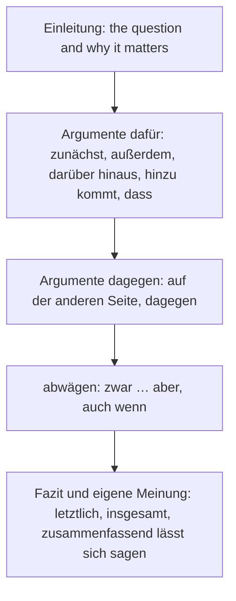

## What this lesson is for

With *obwohl* (lesson 6) you admit a fact that doesn't stop the main event: *Obwohl es teuer ist, kaufe ich es.* The price really is high. But often you want to say something stronger: the main event happens *whatever* the condition, whether it is true or not, even in the most extreme case. English says *even if*, *no matter how*, *whatever*. German uses *auch wenn*, *selbst wenn* and *egal wie / was / ob*.

These are the tools of argument, so the second half of this lesson puts them to work in a longer text, the **argumentative essay** (*die Erörterung*): a structured text that weighs the arguments for and against a question and ends with your own view. The forum post in the B1 exam is a short version of it; at B2 and in German schools it is a standard writing task. The question we argue about continues the money theme of lesson 6: should we get rid of cash?

## auch wenn and selbst wenn: even if

Both are subordinating conjunctions with the verb at the end, and both say: the condition doesn't change the result. A clause like this is a **concessive conditional clause**, a mix of *wenn* (a condition) and *obwohl* (it doesn't stop anything).

- *Auch wenn es regnet, gehen wir raus.* — Even if it rains, we're going out.
- *Ich zahle lieber bar, auch wenn es manchmal unpraktisch ist.* — I prefer to pay cash, even if it's sometimes impractical.
- *Selbst wenn ich im Lotto gewinnen würde, würde ich weiterarbeiten.* — Even if I won the lottery, I would keep working.

*selbst* here means "even", and *selbst wenn* is stronger: it takes the most extreme case. Like *sogar wenn* (a less common synonym), it often talks about something imagined, so you'll see it with *würde*, *hätte* and *wäre* (Konjunktiv II, module 5): *Selbst wenn ich mehr Geld hätte, würde ich kein Auto kaufen.*

Word order is the same as after *wenn*: verb at the end, and when the clause comes first, the main verb follows straight after the comma (*Auch wenn es regnet, gehen wir …*).

### obwohl, auch wenn or selbst wenn?

| | the condition is … | example |
|---|---|---|
| *obwohl* | a real fact | *Obwohl es regnet, gehen wir raus.* (It is raining.) |
| *auch wenn* | a fact or a possibility | *Auch wenn es regnet, gehen wir raus.* (Rain or no rain.) |
| *selbst wenn* | an extreme or imagined case | *Selbst wenn es stürmt, gehen wir raus.* (Even in a storm.) |

When the fact is true, *auch wenn* and *obwohl* often both work: *Ich kaufe es, auch wenn es teuer ist* is everyday speech for *obwohl es teuer ist*. But when the condition is only possible, *obwohl* is wrong: ~~Obwohl es morgen regnet, gehen wir raus~~ claims to know tomorrow's weather.

In older or literary texts you will also meet a split form, *wenn … auch*: *Wenn das Hotel auch teuer war, wir haben es nicht bereut.* — Even though the hotel was expensive, we didn't regret it. Just recognise it.

### Example 1: choosing the connector

Complete each sentence with *obwohl*, *auch wenn* or *selbst wenn*.

1. *___ ich gestern kaum geschlafen habe, bin ich heute fit.* It already happened, it's a fact: *obwohl* (*auch wenn* is possible in speech).
2. *Wir fahren morgen los, ___ es schneien sollte.* *sollte* marks a mere possibility, so *obwohl* is out: *auch wenn* (or *selbst wenn* for extra force).
3. *___ man mir eine Million bieten würde, würde ich mein Haus nicht verkaufen.* An extreme, imagined case with *würde*: *selbst wenn*.

## No matter what: egal, wie … auch

For "no matter how / what / whether", spoken German uses *egal* + a question word or *ob*:

- *Egal, wie teuer es ist: Ich kaufe es.* — No matter how expensive it is, I'm buying it.
- *Egal, was du sagst, ich bleibe hier.* — Whatever you say, I'm staying here.
- *Egal, ob du mitkommst oder nicht, ich gehe.* — Whether you come along or not, I'm going.

Notice the order after the comma: these clauses stand outside the main sentence, so the main clause usually keeps its normal order, subject first (*ich gehe*). In writing you'll also see *Wie teuer es auch ist, …* and *Was du auch sagst, …* with the same meaning; *wie man es auch dreht* (however you look at it) is a fixed phrase.

## Building an argument

An argumentative essay has a fixed shape. Each part has typical phrases that tell the reader where they are.

| job | phrases |
|---|---|
| start the first argument | *Zunächst spricht für … , dass …* · *Ein wichtiges Argument für … ist …* |
| add another | *Außerdem …* · *Darüber hinaus …* (moreover) · *Hinzu kommt, dass …* (added to this) · *Ein weiteres Argument ist …* |
| switch sides | *Auf der anderen Seite …* · *Dagegen spricht, dass …* · *Ein wichtiges Gegenargument ist …* |
| concede, then answer | *Es stimmt zwar, dass …, aber …* · *Auch wenn …, …* |
| conclude | *Letztlich …* (in the end) · *Insgesamt …* (all in all) · *Zusammenfassend lässt sich sagen, dass …* (to sum up) |

Two notes on word order. *darüber hinaus*, *außerdem*, *letztlich* and *insgesamt* are linking adverbs: verb straight after. *Hinzu kommt, dass …* and *Dagegen spricht, dass …* are complete main clauses, and the argument follows in a *dass* clause with the verb at the end. Lesson 28 adds *einerseits … andererseits* and *erstens, zweitens*.

### Example 2: from notes to a paragraph

Notes: *Karte: schnell, bequem — kein Geld abheben — Diebstahl: Karte sperren.*

1. Open with the strongest point: *Zunächst ist das Bezahlen mit Karte schnell und bequem.* (*zunächst* in position 1, verb next.)
2. Add the second: *Darüber hinaus muss man kein Geld abheben.*
3. Add the third as a clause: *Hinzu kommt, dass man eine gestohlene Karte sofort sperren lassen kann.* (*kann* at the end of the *dass* clause.)
4. Concede and answer, if you want to show balance: *Zwar funktioniert die Karte nicht ohne Strom, aber das passiert selten.*

Each sentence does one job, and the connectors carry the reader from one to the next.

## Model essay: Sollte man das Bargeld abschaffen?

> In vielen Ländern zahlen die Menschen immer seltener bar. Laut einer Studie der Deutschen Bundesbank aus dem Jahr 2023 ist Bargeld in Deutschland an der Kasse zwar noch das meistgenutzte Zahlungsmittel, sein Anteil sinkt aber. Deshalb wird oft diskutiert, ob man Münzen und Geldscheine ganz abschaffen sollte. In diesem Text möchte ich die wichtigsten Argumente abwägen.
>
> Zunächst spricht vieles für die Kartenzahlung. Sie ist schnell und bequem, vor allem kontaktlos. Darüber hinaus muss man kein Geld abheben und verliert keine Münzen. Hinzu kommt, dass Geschäfte weniger Arbeit haben, weil niemand Bargeld zählen und zur Bank bringen muss. Ein weiteres Argument ist die Sicherheit: Selbst wenn jemand meine Karte stiehlt, kann ich sie sofort sperren lassen.
>
> Auf der anderen Seite gibt es wichtige Gegenargumente. Bargeld ist anonym: Wer bar bezahlt, hinterlässt keine Daten. Ohne Bargeld könnten Banken und Firmen jeden Kauf speichern, und der Staat könnte die Bürger leichter überwachen. Außerdem funktioniert Bargeld auch dann, wenn das Internet oder der Strom ausfällt. Und nicht alle Menschen kommen mit Karten und Apps gut zurecht.
>
> Wie man es auch dreht, beide Seiten haben gute Argumente. Ich persönlich zahle meistens mit Karte. Trotzdem bin ich gegen die Abschaffung des Bargelds, auch wenn sie praktisch wäre. Letztlich geht es um Freiheit: Jeder sollte selbst entscheiden, wie er bezahlt. Zusammenfassend lässt sich sagen: Karte ja, aber Bargeld sollte es weiter geben.

In English:

> In many countries people pay cash less and less often. According to a 2023 study by the Deutsche Bundesbank, cash is still the most-used means of payment at the checkout in Germany, but its share is falling. That's why people often discuss whether coins and banknotes should be abolished altogether. In this text I want to weigh up the most important arguments.
>
> First of all, a lot speaks for paying by card. It's quick and convenient, especially contactless. Moreover, you don't need to withdraw money and you don't lose any coins. Added to this, shops have less work, because nobody has to count cash and take it to the bank. Another argument is security: even if someone steals my card, I can have it blocked immediately.
>
> On the other hand, there are important counterarguments. Cash is anonymous: whoever pays cash leaves no data behind. Without cash, banks and companies could store every purchase, and the state could monitor citizens more easily. Besides, cash works even when the internet or the power fails. And not everyone copes well with cards and apps.
>
> However you look at it, both sides have good arguments. Personally, I pay by card most of the time. Even so, I'm against abolishing cash, even if it would be practical. In the end it's about freedom: everyone should decide for themselves how they pay. To sum up: cards yes, but cash should continue to exist.

Notes: *abheben* = to withdraw (money); *sperren lassen* = to have something blocked (*lassen*, lesson 27); *hinterlassen* = to leave behind; *zurechtkommen mit* = to cope with; *die Abschaffung des Bargelds* = the abolition of cash (a genitive, lesson 13); *könnten* and *wäre* are Konjunktiv II (module 5): "could", "would be". Look at the shape: introduction with the question, three paragraphs for, against and weighing up, and a clear conclusion. Find the connectors: *zunächst, darüber hinaus, hinzu kommt, dass, ein weiteres Argument, selbst wenn, auf der anderen Seite, außerdem, wie man es auch dreht, auch wenn, letztlich, zusammenfassend*.

## Pronunciation

- *selbst*: the *s* at the start is voiced (like English *z*), and *-bst* is said clearly: ZELPST.
- *Erörterung*: er-ÖR-te-rung; the *ö* is short before *rt*.
- *darüber hinaus*: da-RÜ-ber hi-NAUS.
- *abwägen*: AP-wä-gen, a long *ä*; *Bargeld*: BAR-geld, final *d* sounds like *t*.
- *kontaktlos*: kon-TAKT-los.

## Common mistakes

- *obwohl* for a possible event: ~~Obwohl es morgen regnet, …~~ → *Auch wenn es morgen regnen sollte, …*
- Main-clause order after *auch wenn / selbst wenn*: ~~selbst wenn ich habe Zeit~~ → *selbst wenn ich Zeit habe*.
- Subject first after a fronted *auch wenn* clause: you may hear ~~Auch wenn es regnet, wir gehen raus~~ in speech, but write *Auch wenn es regnet, gehen wir raus.* (Only *egal* and *wie … auch* clauses normally keep the subject first.)
- Translating "even" as *auch* alone: ~~Auch es regnet …~~ "even if" needs *auch wenn* or *selbst wenn*.
- *darüber hinaus* + subject first: ~~Darüber hinaus man muss …~~ → *Darüber hinaus muss man …*
- An essay that lists arguments without signposts: every new argument deserves a connector, and every essay a conclusion with your own view.

## Key points

- *auch wenn* (even if) and *selbst wenn* (even if, stronger): verb at the end; the condition may be true or only possible. *obwohl* is only for real facts.
- *selbst wenn* often goes with Konjunktiv II: *Selbst wenn ich Zeit hätte, …*
- *Egal, wie / was / ob …* (no matter …): the main clause usually keeps subject-first order. *Wie man es auch dreht* = however you look at it.
- An argumentative essay: *Einleitung → Argumente dafür → Argumente dagegen → abwägen → Fazit*.
- Signposts: *zunächst, außerdem, darüber hinaus, hinzu kommt, dass, auf der anderen Seite, letztlich, insgesamt, zusammenfassend lässt sich sagen*.

The words from this lesson are listed below; they join your vocabulary reviews when you complete the lesson.
