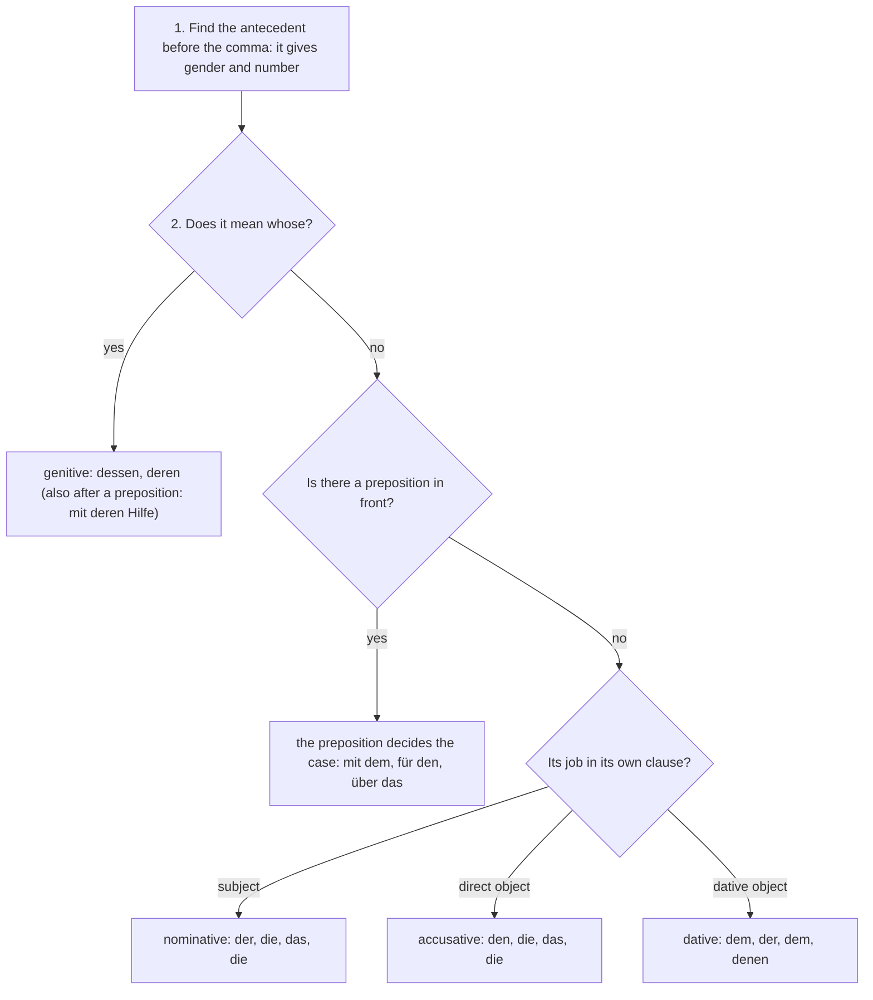

## What this lesson is for

In German A2 you learned to describe a noun with a **relative clause**: *der Laptop, den ich gekauft habe*; *die Kollegin, die neben mir sitzt*. You used the nominative and accusative forms, and you saw the dative forms only as a preview. That is enough for simple descriptions, but as soon as you talk about people, you need more: the friend *you can rely on*, the colleague *you argue with*, the neighbours *you gave the key to*. In English these are often small words at the end of the sentence ("with", "to", "on"); in German they are a preposition and a dative or accusative relative pronoun at the front of the clause.

This module is called "Describing in detail", and this lesson starts it with the full set of relative pronouns: all four cases, after prepositions, and the genitive forms *dessen* and *deren*, which you need to recognize in written texts. The theme is people and how they get on: character, trust, criticism, conflicts and compromises.

## Review: two questions

A **relative pronoun** starts a relative clause and stands for the noun it describes, the **antecedent**. To choose it you ask two questions, and the answers come from two different places:

1. Gender and number come from the antecedent, before the comma: *der Kollege* → masculine; *die Eltern* → plural.
2. Case comes from the job the pronoun does inside its own clause, after the comma: subject → nominative, direct object → accusative, and now also: after a dative verb → dative, after a preposition → whatever case that preposition takes.

The memory hook from A2 still works: gender looks back, case looks inside. And the word order is the same as in every subordinate clause: the relative pronoun first, the conjugated verb last, commas on both sides.

Here are the parts of one relative clause with a preposition, labeled:

## The full table

| | masculine | feminine | neuter | plural |
|---|---|---|---|---|
| nominative | der | die | das | die |
| accusative | den | die | das | die |
| dative | dem | der | dem | *denen* |
| genitive | *dessen* | *deren* | *dessen* | *deren* |

Most of the table is the definite article you already know. Only the forms in italics are different: the dative plural *denen* (the article is *den*), and the four genitive forms *dessen* and *deren* (the articles are *des* and *der*). The longer forms are easy to remember: wherever the article could be confused with another form, the relative pronoun gets an extra syllable. The reference sheet for this module has the table with examples.

## The dative

You need a dative relative pronoun when the verb in the relative clause takes a dative object. You know the most common **dative verbs** from A2: *helfen, danken, gefallen, gehören, vertrauen, verzeihen, zuhören, antworten, gratulieren, schmecken, passen, fehlen*. Inside the relative clause the pronoun is that dative object:

- *Das ist der Nachbar, dem ich beim Umzug geholfen habe.* — That's the neighbour I helped with the move.
- *Meine Schwester ist die einzige Person, der ich alles erzähle.* — My sister is the only person I tell everything to. (*erzählen* has a dative person and an accusative thing.)
- *Das sind die Freunde, denen ich am meisten vertraue.* — Those are the friends I trust most.

Look closely at the last example. The article would be *den Freunden*, but the relative pronoun is *denen*, never ~~den~~. This is the most common mistake with the dative, so it is worth saying aloud a few times: *die Leute, denen …*, *die Kinder, denen …*, *die Kollegen, denen …*.

German always needs a relative pronoun, and it has to be in the right case. A practical method: turn the relative clause back into a main clause. *Ich erzähle ihr alles* → *ihr* is dative → *der ich alles erzähle*.

## After a preposition

When the verb in the relative clause needs a preposition, the preposition goes first, before the relative pronoun, and it decides the case:

- *mit, von, bei, zu, aus, nach, seit* + dative: *die Kollegin, mit der ich ein Büro teile* — the colleague I share an office with.
- *für, um, durch, gegen, ohne* + accusative: *der Freund, für den ich das Geschenk gekauft habe* — the friend I bought the present for.
- With a two-way preposition, the verb fixes the case. *über* and *auf* in fixed verbs take the accusative: *das Problem, über das wir gestern diskutiert haben* — the problem we discussed yesterday. But some take the dative: *Angst haben vor*, *arbeiten an* (*die Präsentation, an der ich gearbeitet habe*).

English puts the preposition at the end ("the colleague I share an office with"). German never does. The preposition and the pronoun stay together as a pair at the front of the clause.

This is where the prepositional verbs from A2 come back. Learn them as chunks, and the relative clause builds itself:

| verb + preposition | relative clause |
|---|---|
| *sich streiten mit* + Dat | *der Bruder, mit dem ich mich oft streite* |
| *sich verstehen mit* + Dat | *die Leute, mit denen ich mich gut verstehe* |
| *umgehen mit* + Dat | *ein Kollege, mit dem man schwer umgehen kann* |
| *sprechen über* + Akk | *das Thema, über das niemand sprechen will* |
| *sich ärgern über* + Akk | *die Kritik, über die ich mich geärgert habe* |
| *sich kümmern um* + Akk | *die Katze, um die sich der Nachbar kümmert* |
| *denken an* + Akk | *die Zeit, an die ich gern denke* |
| *warten auf* + Akk | *der Anruf, auf den sie wartet* |
| *Angst haben vor* + Dat | *der Konflikt, vor dem alle Angst hatten* |

*umgehen mit* is new: it means "to deal with, to handle" a person or situation. It is separable, and its perfect is with *sein*: *Sie geht gut mit Kritik um. Er ist sehr geduldig mit den Kindern umgegangen.* The noun is *der Umgang*: *Der Umgang mit schwierigen Kunden ist nicht leicht.* — Dealing with difficult customers isn't easy.

### wo(r)- instead of preposition + pronoun

For things (never for people), you will sometimes read a *wo(r)-* word instead of preposition + pronoun: *das Thema, worüber wir gesprochen haben*. It is correct but less common than *über das*, and with a noun antecedent you will be understood better with the preposition. *wo(r)-* is the normal choice after *alles, etwas, nichts* and whole clauses, which the next lesson covers.

## The genitive: dessen and deren *(receptive)*

The genitive forms mean "whose". Like the genitive itself (lesson 13), they are mostly written, and you need to recognize them more than use them:

- *Das ist der Autor, dessen Roman ich gerade lese.* — That's the author whose novel I'm reading.
- *Ich habe eine Nachbarin, deren Hund jede Nacht bellt.* — I have a neighbour whose dog barks every night.
- *Das Kind, dessen Eltern noch nicht da sind, wartet im Büro.* — The child whose parents aren't here yet is waiting in the office.
- *Wir sprechen mit Familien, deren Kinder zweisprachig aufwachsen.* — We talk to families whose children grow up bilingual.

Two things are unusual. First, *dessen* and *deren* agree with the owner (before the comma), not with the thing owned: the novel is masculine, but the author is masculine too, so *dessen*; the dog is masculine, but the neighbour is feminine, so *deren*. Second, the noun after *dessen/deren* has no article: ~~deren der Hund~~ is impossible, just *deren Hund*. If an adjective comes in between, it takes the endings you use with no article: *der Kollege, dessen neues Auto …* (lesson 15 has the details).

In speech, people avoid *dessen* and *deren* by making two sentences or using a possessive: *Ich habe eine Nachbarin. Ihr Hund bellt jede Nacht.* That is perfectly fine for you too.

## The whole decision in one chart

Every relative pronoun in this lesson comes from the same few questions. Work through them in this order:

## Where the relative clause goes

A relative clause comes straight after its antecedent. If the antecedent is in the middle of a main clause, the relative clause sits in the middle too. But German doesn't like a long relative clause stuck between the verb and the end of the sentence, so if only a word or two would follow, the relative clause moves behind the verb at the end:

- *Ich habe gestern den Kollegen getroffen, mit dem ich früher gearbeitet habe.* — I met the colleague I used to work with yesterday.
- (Awkward: *Ich habe gestern den Kollegen, mit dem ich früher gearbeitet habe, getroffen.*)

Both are grammatical, but the first is what people say. The rule of thumb: don't leave a single participle or infinitive alone after a long relative clause.

## Talking about character and communication

The words for this lesson describe how people behave towards each other. Many come in families of adjective, noun and verb:

| adjective | noun | verb |
|---|---|---|
| *geduldig / ungeduldig* | *die Geduld* | |
| *zuverlässig* | *die Zuverlässigkeit* | |
| *tolerant* | *die Toleranz* | |
| *eifersüchtig* | *die Eifersucht* | |
| | *der Respekt* | *respektieren* |
| | *die Kritik* | *kritisieren* |
| | *das Lob* | *loben* |
| | *die Diskussion* | *diskutieren* |
| | *das Verhalten* | *sich verhalten* |

- *sich verhalten* (to behave) is strong: *er verhält sich, er verhielt sich, er hat sich verhalten*. *Er hat sich unmöglich verhalten.* — He behaved terribly.
- *das Verständnis* is "understanding" in the sense of sympathy: *Ich habe Verständnis für deine Situation.* — I understand your situation.
- *der Konflikt* is a conflict; you *lösen* (solve) it, often with *ein Kompromiss*: *Wir haben einen Kompromiss gefunden.*
- *die Kritik* is criticism, but also a review of a book or film. "A critic" is *der Kritiker*.

For describing someone's *Persönlichkeit* (personality), add *offen* (open), *zurückhaltend* (reserved), *großzügig* (generous) and *egoistisch* (selfish): *Mein Bruder ist ein offener Mensch, dem man alles sagen kann. Seine Freundin ist eher zurückhaltend.* And when a relationship ends: *Sie haben sich nach zehn Jahren getrennt* (*sich trennen*, to split up); *die Trennung* (separation, break-up). Good *Kommunikation* helps to avoid that.

## Text: Ein Leserbrief

A magazine has a column where readers ask for advice. Read the letter and the answer.

> Liebes Team,
>
> ich arbeite seit zwei Jahren in einem kleinen Büro, in dem wir zu viert sitzen. Mit zwei Kollegen verstehe ich mich gut. Das Problem ist Herr K., mit dem ich jeden Tag ein Projekt bespreche. Er ist zuverlässig und klug, aber er kritisiert alles, was ich mache, und zwar vor allen anderen. Lob, auf das ich mich freuen könnte, gibt es nie. Gestern hat er eine Präsentation, an der ich zwei Wochen gearbeitet hatte, in der Besprechung „chaotisch“ genannt. Ich bin eigentlich ein geduldiger Mensch, aber ich habe keine Lust mehr. Soll ich mit unserer Chefin sprechen, deren Büro gleich nebenan ist?
>
> Lena, 29
>
> Liebe Lena,
>
> Kritik, die vor allen geäußert wird, tut weh. Bevor Sie zur Chefin gehen, sprechen Sie zuerst mit Herrn K. selbst, und zwar allein. Wählen Sie einen ruhigen Moment, in dem keiner von Ihnen gestresst ist. Sagen Sie ihm, wie sein Verhalten auf Sie wirkt, ohne ihm Vorwürfe zu machen: „Ich fühle mich nicht respektiert, wenn …“ ist besser als „Sie sind immer …“. Vielleicht weiß er gar nicht, wie er wirkt. Viele Menschen, denen Qualität sehr wichtig ist, vergessen, dass Lob genauso wichtig ist wie Kritik. Wenn das Gespräch nichts ändert, ist die Chefin die richtige Person, an die Sie sich wenden können. Ein Konflikt, über den man offen spricht, lässt sich meistens lösen.
>
> Ihr Team von „Arbeit & Leben“

In English:

> Dear team, I've been working for two years in a small office where four of us sit. I get on well with two colleagues. The problem is Mr K., with whom I discuss a project every day. He's reliable and clever, but he criticizes everything I do, and in front of everyone else. There's never any praise I could look forward to. Yesterday in the meeting he called a presentation I'd worked on for two weeks "chaotic". I'm actually a patient person, but I've had enough. Should I talk to our boss, whose office is right next door? — Lena, 29
>
> Dear Lena, criticism made in front of everyone hurts. Before you go to the boss, first talk to Mr K. himself, and alone. Pick a quiet moment when neither of you is stressed. Tell him how his behaviour comes across to you, without blaming him: "I don't feel respected when …" is better than "You always …". Perhaps he doesn't even know how he comes across. Many people for whom quality is very important forget that praise is just as important as criticism. If the conversation doesn't change anything, the boss is the right person to turn to. A conflict that people talk about openly can usually be solved. — Your team at "Work & Life"

Notes: *zu viert* = four of us; *und zwar* = and what's more, namely; *äußern* = to express (*Kritik, die geäußert wird* is a passive, module 4); *wirken* = to come across, to seem; *jemandem Vorwürfe machen* = to reproach someone; *sich wenden an* + Akk = to turn to; *lässt sich lösen* = can be solved. Find the relative pronouns: *in dem, mit dem, auf das, an der, deren, die, in dem, denen, an die, über den*. For each one, say why it has that gender and that case.

## Pronunciation

- *Eifersucht, eifersüchtig*: stress on the first syllable, EI-fer-sucht; *ei* as in "eye".
- *Kritik, kritisieren*: kri-TIK with a long *i*; kri-ti-SIE-ren. Verbs in *-ieren* always stress *-ie-*: *diskuTIEren, respekTIEren*.
- *Kompromiss*: kom-pro-MISS, short *i*.
- *Geduld, geduldig*: ge-DULD, ge-DUL-dig; the *ge-* is not stressed.
- *dessen* and *denen*: *dessen* has a short *e* (DESS-en); *denen* has a long first *e* (DEH-nen).

## Common mistakes

- *den* instead of *denen*: ~~die Freunde, den ich vertraue~~ → *die Freunde, denen ich vertraue*.
- Taking the case from the main clause: ~~Ich helfe dem Mann, dem dort wohnt.~~ Inside the relative clause the man is the subject: *dem Mann, der dort wohnt*.
- The preposition at the end, as in English: ~~die Kollegin, die ich mit arbeite~~ → *die Kollegin, mit der ich arbeite*.
- Leaving out the relative pronoun: ~~der Film ich gesehen habe~~ → *der Film, den ich gesehen habe*. German never drops it.
- The wrong genitive form: ~~die Nachbarin, dessen Hund~~ → *deren Hund* (the owner is feminine). And no article after it: ~~dessen das Auto~~ → *dessen Auto*.
- Forgetting the commas. A relative clause always has a comma before it and, if the sentence continues, after it.

## Key points

- Relative pronouns are the definite article, except dative plural *denen* and genitive *dessen/deren*.
- Gender and number from the antecedent; case from the job inside the relative clause.
- Dative verbs (*helfen, vertrauen, gehören …*) need *dem, der, dem, denen*.
- With a preposition: preposition + pronoun at the front of the clause; the preposition decides the case: *mit dem, für die, über das, bei denen*.
- *dessen* (masculine and neuter owner) and *deren* (feminine and plural owner) mean "whose"; no article after them. Recognize them; in speech you can use two sentences instead.
- A long relative clause usually moves behind the participle or infinitive at the end.

The words from this lesson are listed below; they join your vocabulary reviews when you complete the lesson.
