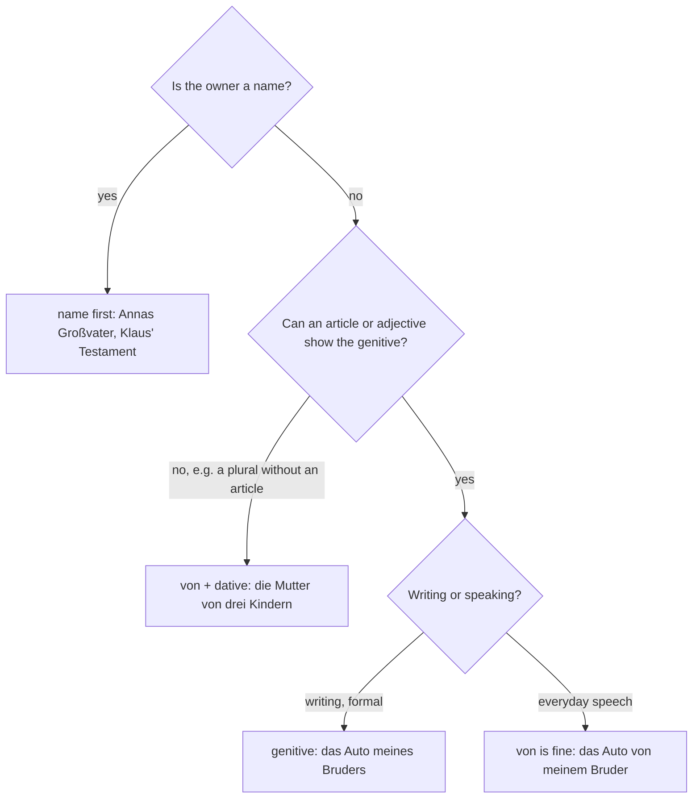

## What this lesson is for

In German A2 you learned to show possession in two everyday ways, *Annas Buch* and *das Buch von meiner Schwester*, and you met a third, more formal one only to recognize it: *das Buch meiner Schwester*. That third way is the **genitive**, the fourth German case. In the last two lessons you saw its relative pronouns, *dessen* and *deren*.

At B1 you meet the genitive constantly in anything written: newspapers, letters from offices, signs, Wikipedia, novels. Phrases like *am Ende des Monats*, *die Geschichte der Stadt* or *im Namen der Familie* are completely normal even in careful speech. This lesson gives you the full system: articles, noun endings, names, adjectives, and when to use *von* instead. The next lesson adds the prepositions that take the genitive (*wegen, trotz, während*).

The theme is family history: ancestors, documents, inheritances and the things people keep.

## What the genitive does

The genitive links two nouns: the second one, in the genitive, is the owner of the first or the thing it belongs to. In English you say "the father's house" or "the house of the father"; German usually puts the genitive after the noun:

- *das Haus des Vaters* — the father's house
- *der Name der Straße* — the name of the street
- *das Ende des Films* — the end of the film
- *die Fotos der Kinder* — the children's photos

The noun in the genitive is called a **genitive attribute**. It answers the question *wessen?* (whose?): *Wessen Haus ist das? — Das Haus meines Großvaters.*

## The articles

| | masculine | feminine | neuter | plural |
|---|---|---|---|---|
| definite | des Vaters | der Mutter | des Kindes | der Eltern |
| indefinite | eines Vaters | einer Mutter | eines Kindes | — |
| possessive | meines Vaters | meiner Mutter | meines Kindes | meiner Eltern |
| negative | keines Vaters | keiner Mutter | keines Kindes | keiner Eltern |

Two patterns to notice:

- Masculine and neuter have *-es* on the article (*des, eines, meines*) and an *-s* or *-es* on the noun too. These are the only forms where the noun itself changes.
- Feminine and plural have *-er* on the article (*der, einer, meiner*), and the noun doesn't change at all. Yes, feminine genitive *der* looks like the nominative masculine and the dative feminine; the noun and the sentence tell you which it is.

The plural has no indefinite form. Without an article, use *von*: *die Fotos von Freunden* (photos of friends).

## The noun ending: -s or -es?

Masculine and neuter nouns add *-s* or *-es*:

- Nouns with more than one syllable usually take *-s*: *des Vaters, des Lehrers, des Zimmers, des Fotoalbums, des Testaments*.
- Many one-syllable nouns take *-es*, especially in writing: *des Kindes, des Mannes, des Tages, des Buches, des Hauses*. With most of them *-s* is possible too (*des Tags*), so don't worry about this choice.
- Nouns ending in *-s, -ß, -x, -z* must take *-es*, because *-s* alone can't be heard: *des Hauses, des Fußes, des Platzes, des Satzes*. Nouns in *-nis* double the *s*: *das Zeugnis → des Zeugnisses*, *das Ereignis → des Ereignisses*.

### n-nouns

The weak nouns from lesson 5 take *-n* or *-en* in the genitive, as in every other case except the nominative, and no *-s*:

- *der Kollege → des Kollegen*; *der Mensch → des Menschen*; *der Herr → des Herrn*; *der Nachbar → des Nachbarn*.
- *der Vorfahr → des Vorfahren*; *der Nachkomme → des Nachkommen*; *der Erbe → des Erben* (the heir).

A few weak nouns take *-ns*: *der Name → des Namens*, *der Gedanke → des Gedankens*. *das Herz* is irregular: *des Herzens*.

## Names: Annas, Klaus', Goethes

With names, the genitive is an *-s* with no article and no apostrophe, and it usually comes before the noun:

- *Annas Großvater* — Anna's grandfather
- *Deutschlands Hauptstadt* — Germany's capital
- *Goethes Gedichte* — Goethe's poems

If the name already ends in an *s*-sound (*-s, -ß, -x, -z*), write only an apostrophe: *Klaus' Testament*, *Max' Schwester*, *Frau Lutz' Haus*. In speech this sounds clumsy, so people say *das Testament von Klaus*.

Don't write ~~Anna's~~. You will see it on shop signs (*Anna's Café*), but it is English influence; the normal spelling in a sentence is *Annas*.

With a title or an article, the name stays as it is and the article shows the genitive: *das Haus des alten Herrn Becker*; *die Briefe der Großmutter*.

## Adjectives in the genitive

After any article in the genitive, the adjective ends in *-en*, in all genders and the plural:

| | masculine | feminine | neuter | plural |
|---|---|---|---|---|
| after *der*-words | des alten Mannes | der alten Frau | des alten Hauses | der alten Leute |
| after *ein*-words | eines alten Mannes | einer alten Frau | eines alten Hauses | meiner alten Freunde |

That is good news: it is the same *-en* you know from the dative. *die Geschichte einer großen Familie*; *am Ende des langen Tages*; *die Wohnung meiner neuen Nachbarn*. Adjectives with no article in the genitive come in lesson 15.

## Genitive or von?

In everyday speech, *von* + dative replaces the genitive almost everywhere:

| written / careful | spoken |
|---|---|
| *das Auto meines Bruders* | *das Auto von meinem Bruder* |
| *die Wohnung der Großeltern* | *die Wohnung von den Großeltern* |
| *am Anfang des Jahres* | (genitive is normal here too) |

But use *von* when there's no article to show the genitive, for example with plurals without an article, and usually with names after a noun: *die Mutter von drei Kindern*; *ein Freund von Paul*; *die Preise von Häusern in München*.

And some genitive phrases are fixed even in speech; learn them as chunks:

- *eines Tages* — one day (in a story); *eines Abends* — one evening
- *am Ende des Monats / der Woche* — at the end of the month / week
- *im Laufe des Tages* — in the course of the day
- *meines Erachtens* — in my view (formal)

Rule for your own German: in a letter, an e-mail to an office or an exam text, use the genitive; in conversation, *von* is fine, but the genitive is never wrong.

The same choice as a chart:

## Questions with wessen

*wessen* (whose) is the genitive of *wer*. It is followed directly by a noun without an article: *Wessen Tagebuch ist das?* In speech most people say *Wem gehört das Tagebuch?* or *Von wem ist das Tagebuch?*

## Family history: the words

- *der Vorfahr* (ancestor), *der Nachkomme* (descendant), *der Urgroßvater, die Urgroßmutter* (great-grandfather, great-grandmother). Both *Vorfahr* and *Nachkomme* are weak nouns: *die Briefe meines Vorfahren*.
- *der Stammbaum* (family tree), *die Verwandtschaft* (relatives, family as a whole), *die Abstammung* (descent), *der Ursprung* (origin), *ursprünglich* (originally).
- *die Urkunde* (official certificate), *die Geburtsurkunde* (birth certificate), *das Dokument*, *das Archiv*.
- *erben* (to inherit), *vererben* (to leave, to pass on), *das Erbe* (inheritance), *der Erbe, die Erbin* (heir, heiress), *das Erbstück* (heirloom), *das Testament* (will), *der Nachlass* (estate, everything someone leaves behind).
- *das Eigentum* (property), *der Besitzer, die Besitzerin* (owner), *der Wert* (value), *wertvoll* (valuable), *das Original*.
- *das Andenken* (keepsake, souvenir), *das Fotoalbum*, *das Tagebuch* (diary), *aufbewahren* (to keep, store), *der Dachboden* (attic).
- *überliefern* (to hand down): *Die Geschichte wurde von Generation zu Generation überliefert.*

Genitive chains are how you describe relatives without a special word for them. Here is Jonas's family, seen from Jonas (*ich*). His grandfather Karl is *der Vater meiner Mutter*, and his cousin Lea is *die Tochter meines Onkels*:

Careful with *das Erbe* and *der Erbe*: same word, different gender and meaning. *Das Erbe meines Onkels* is my uncle's inheritance (what he left); *der Erbe* is the person who gets it.

## Text: Die Kiste auf dem Dachboden

Jonas tells his friend what happened after his grandmother's death.

> Nach dem Tod meiner Großmutter mussten wir im Frühling ihr Haus ausräumen. Das Haus gehörte ursprünglich ihrem Vater, also meinem Urgroßvater, der es 1928 gebaut hatte. Laut Testament sollte meine Mutter das Haus erben, und die Möbel waren für meinen Onkel.
>
> Am letzten Tag stieg ich auf den Dachboden, wo ich seit meiner Kindheit nicht mehr gewesen war. In einer Ecke stand eine alte Holzkiste. Darin lagen Dinge, die meine Großmutter jahrzehntelang aufbewahrt hatte: das Tagebuch ihrer Mutter, die Geburtsurkunden der Geschwister, ein Fotoalbum und ein Ring, dessen Stein im Licht glänzte.
>
> Das Tagebuch war das Interessanteste. Meine Urgroßmutter beschreibt darin das Leben einer großen Familie auf dem Land, die Sorgen eines langen Winters und die Hochzeit ihrer ältesten Tochter. Auf der letzten Seite steht sogar ein kleiner Stammbaum. So habe ich erfahren, dass die Vorfahren meiner Mutter ursprünglich aus Böhmen kamen.
>
> Den Ring haben wir zu einem Juwelier gebracht. Sein Wert ist nicht besonders hoch, aber für uns ist er ein wertvolles Erbstück. Das Original des Tagebuchs bleibt bei meiner Mutter. Ich habe jede Seite fotografiert, denn ich möchte die Geschichte unserer Familie aufschreiben, für die Nachkommen, die irgendwann danach fragen werden.

In English:

> After my grandmother's death we had to clear out her house in the spring. The house originally belonged to her father, my great-grandfather, who had built it in 1928. According to the will my mother was to inherit the house, and the furniture was for my uncle.
>
> On the last day I climbed up to the attic, where I hadn't been since my childhood. In one corner there was an old wooden chest. In it were things my grandmother had kept for decades: her mother's diary, the brothers' and sisters' birth certificates, a photo album and a ring whose stone shone in the light.
>
> The diary was the most interesting thing. In it my great-grandmother describes the life of a big family in the country, the worries of a long winter and the wedding of her oldest daughter. On the last page there's even a small family tree. That's how I found out that my mother's ancestors originally came from Bohemia.
>
> We took the ring to a jeweller. Its value isn't particularly high, but for us it's a precious heirloom. The original of the diary stays with my mother. I've photographed every page, because I want to write down our family's history, for the descendants who will ask about it one day.

Notes: *der Tod* = death; *ausräumen* = to clear out; *laut* + genitive or dative = according to (*laut Testament*, with no article); *jahrzehntelang* = for decades; *glänzen* = to shine; *erfahren* = to find out (strong: *erfuhr, hat erfahren*). Find all the genitives; there are ten, including *dessen*.

## Pronunciation

- *des Kindes, des Tages*: the *d* and *g* before *-es* are voiced: KIN-des, TAH-ges, unlike *Kind* and *Tag* at the end of the word (*Kint, Tahk*).
- *Urkunde, Urgroßvater*: stress on *Ur-*: UR-kun-de, UR-groß-va-ter.
- *Testament*: tes-ta-MENT; *Archiv*: ar-CHIF, with the soft *ch*.
- *Klaus'*: say it like *Klaus* or, more clearly, *das … von Klaus*.

## Common mistakes

- Forgetting the noun ending: ~~das Auto des Vater~~ → *des Vaters*; ~~am Ende des Tag~~ → *des Tages*.
- Adding *-s* to a feminine or plural noun: ~~der Mutters~~ → *der Mutter*; ~~der Kinders~~ → *der Kinder*.
- Adding *-s* to an n-noun: ~~des Kollegens~~ → *des Kollegen* (but *des Namens*).
- English word order: ~~des Vaters Haus~~ is old-fashioned poetry; say *das Haus des Vaters*. Only names come first: *Annas Haus*.
- An apostrophe with names: ~~Anna's Buch~~ → *Annas Buch*.
- Adjective endings: ~~des alter Mannes~~, ~~einer alte Frau~~ → *des alten Mannes, einer alten Frau*: always *-en* after an article.

## Key points

- The genitive shows whose something is or what it belongs to; the genitive noun follows: *das Ende des Films*.
- Articles: *des / eines / meines* (masculine, neuter) with *-s/-es* on the noun; *der / einer / meiner* (feminine, plural) with no ending on the noun.
- n-nouns: *des Kollegen, des Herrn*; *des Namens*.
- Names: *Annas*, *Klaus'*; no apostrophe before *-s*.
- Adjectives after an article in the genitive: always *-en*.
- In speech, *von* + dative often replaces the genitive; in writing and in fixed phrases (*eines Tages, am Ende des Monats*), use the genitive.

The words from this lesson are listed below; they join your vocabulary reviews when you complete the lesson.
