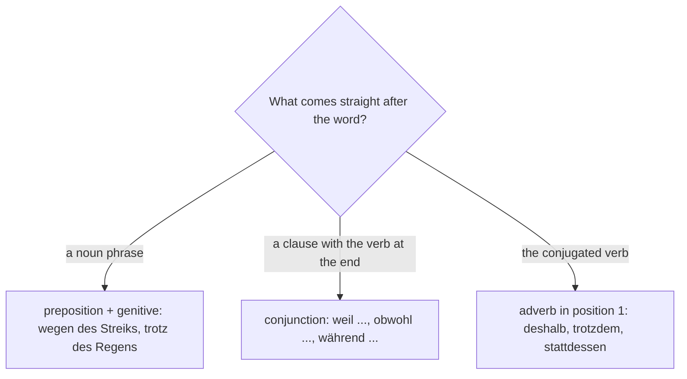

## What this lesson is for

You now know the genitive after a noun: *das Ende des Films*. The genitive has a second job: some prepositions take it. You have heard them in every station and on every motorway radio report: *wegen eines Streiks*, *trotz des Wetters*, *während der Bauarbeiten*. They are the short, written way of saying things you can already say with a whole clause (*weil gestreikt wird*, *obwohl es regnet*).

This lesson teaches the six most important **genitive prepositions**, shows how people really use them in speech (often with the dative), and adds *meinetwegen* and friends. The theme is what goes wrong on the way: strikes, cancellations, diversions, delays and getting your money back.

## The six prepositions

| preposition | meaning | example |
|---|---|---|
| *wegen* | because of | *Wegen des Streiks fahren heute keine Züge.* — Because of the strike there are no trains today. |
| *trotz* | despite, in spite of | *Trotz der Verspätung haben wir den Anschluss bekommen.* — Despite the delay we made the connection. |
| *während* | during | *Während der Fahrt darf man nicht mit dem Fahrer sprechen.* — Don't talk to the driver during the journey. |
| *statt / anstatt* | instead of | *Statt eines ICE kam ein alter Regionalzug.* — Instead of an ICE an old regional train came. |
| *innerhalb* | within, inside | *Die Erstattung kommt innerhalb eines Monats.* — The refund comes within a month. |
| *außerhalb* | outside | *Der Flughafen liegt außerhalb der Stadt.* — The airport is outside the town. |

The noun after them takes the genitive forms from the last lesson: *des, eines, meines* + noun with *-s/-es*; *der, einer, meiner* for feminine and plural; adjectives with *-en*: *wegen des starken Regens*, *trotz einer langen Wartezeit*, *während der ganzen Fahrt*.

*innerhalb* and *außerhalb* work for both place and time: *innerhalb der Stadt* (inside the town), *innerhalb einer Woche* (within a week), *außerhalb der Öffnungszeiten* (outside opening hours).

*statt* and *anstatt* mean exactly the same; *anstatt* is a little more formal. *Statt* also starts the infinitive clause from lesson 7: *Statt zu warten, sind wir mit dem Taxi gefahren.*

## The dative in speech

In everyday spoken German, most people use *wegen*, *trotz* and *statt* with the dative:

| standard (written) | spoken |
|---|---|
| *wegen des Wetters* | *wegen dem Wetter* |
| *trotz des Staus* | *trotz dem Stau* |
| *statt eines Briefes* | *statt einem Brief* |

You will hear the spoken forms everywhere, and nobody will notice if you use them in conversation. But they are not the standard: in writing, in a formal e-mail and in the exam, use the genitive. *während*, *innerhalb* and *außerhalb* usually keep the genitive, also in speech.

### When the genitive can't be seen: the dative takes over

The genitive needs an article or an adjective to show itself. If a plural noun has neither, it would look like any other case, so German switches to the dative:

- *wegen Bauarbeiten* is fine (the meaning is clear), but with a number: *innerhalb von zwei Wochen*, *wegen drei Unfällen*.
- *innerhalb* and *außerhalb* + a noun without an article add *von*: *innerhalb von drei Tagen*, *außerhalb von Berlin*.

And a singular noun without an article often has no ending at all after *wegen* and *trotz*, especially on signs: *wegen Krankheit geschlossen* (closed due to illness), *trotz Regen*, *wegen Umbau* (because of renovation).

## meinetwegen: wegen with a pronoun

*wegen* + a personal pronoun becomes one word: the possessive stem + *-etwegen*:

| | |
|---|---|
| *meinetwegen* | because of me |
| *deinetwegen* | because of you |
| *seinetwegen, ihretwegen* | because of him, because of her / them |
| *unseretwegen, euretwegen* | because of us, because of you (plural) |
| *Ihretwegen* | because of you (formal) |

*Deinetwegen haben wir den Zug verpasst!* — We missed the train because of you! In speech, *wegen mir, wegen dir* is very common.

*meinetwegen* also has a second, everyday meaning: "I don't mind, if you like, fine by me". *Können wir eine Pause machen? — Meinetwegen.* It sounds a bit unenthusiastic, so be careful with tone.

## Preposition, conjunction or adverb?

Several of these words have relatives you know already. The meaning is the same; the grammar is different:

| preposition + noun | conjunction + clause (verb last) | adverb (verb second) |
|---|---|---|
| *wegen des Streiks* | *weil die Bahn streikt* | *deshalb, deswegen* |
| *trotz des Streiks* | *obwohl die Bahn streikt* | *trotzdem* |
| *während des Streiks* | *während die Bahn streikt* | *währenddessen* (meanwhile) |
| *statt eines Zuges* | | *stattdessen* |

- *Wegen des Unwetters fiel der Flug aus.* — Because of the storm the flight was cancelled.
- *Weil es ein Unwetter gab, fiel der Flug aus.* — Because there was a storm …
- *Es gab ein Unwetter. Deshalb fiel der Flug aus.* — There was a storm. That's why …

*während* is both a preposition (*während der Fahrt*, during the journey) and a conjunction (*während wir warteten*, while we were waiting). If a noun follows, it's the preposition; if a clause with the verb at the end follows, it's the conjunction.

To decide which kind of word you need, look at what comes straight after it:

## When things go wrong: the words

| German | English |
|---|---|
| *der Streik, streiken* | strike, to strike |
| *der Ausfall, ausfallen* | cancellation, to be cancelled |
| *die Verzögerung, sich verzögern* | delay, to be delayed |
| *der Stau, die Baustelle, die Umleitung* | traffic jam, roadworks, diversion |
| *das Unwetter, die Panne* | (severe) storm, breakdown |
| *sperren, gesperrt* | to close (a road), closed |
| *der Ersatzverkehr* | replacement service (buses instead of trains) |
| *der Anschluss, die Verbindung* | connection (to another train), connection / route |
| *der Bahnsteig, die Strecke* | platform, route / line / stretch |
| *der Fahrgast, die Wartezeit* | passenger, waiting time |
| *verpassen, umbuchen, stornieren* | to miss, to rebook, to cancel (a booking) |
| *die Entschädigung, die Erstattung, erstatten* | compensation, refund, to refund |

Notes:

- *ausfallen* is separable and strong, with *sein*: *Der Zug fällt aus. Der Unterricht ist ausgefallen.* It means "to be cancelled" for something that was planned; *stornieren* is what you do to a booking: *Ich habe das Hotel storniert.*
- *der Anschluss* is the connecting train: *Ich habe meinen Anschluss verpasst.* *die Verbindung* is any route between two places: *Gibt es eine schnellere Verbindung nach Hamburg?*
- *sich verzögern* (to be delayed) is reflexive: *Die Abfahrt verzögert sich um zehn Minuten.*
- *der Bahnsteig* is the platform you stand on; *das Gleis* is the track number: *Der Zug fährt heute von Gleis 7 ab.*
- *der Fahrgast* (passenger) is used for public transport; on a plane you're *der Passagier*.

A departure board on a bad day uses many of these words, and genitives without an article (*wegen Personalmangels*):

*Personalmangel* is a staff shortage (*das Personal* + *der Mangel*); *ca.* (*circa*) means "about".

## Text: Eine Durchsage und eine E-Mail

First an announcement at a station, then the e-mail Herr Okafor wrote afterwards.

> „Information zu ICE 578 nach Hamburg, Abfahrt 14:12 Uhr: Wegen einer Störung an einem Stellwerk verzögert sich die Abfahrt um voraussichtlich 40 Minuten. Fahrgäste nach Hanau nutzen bitte statt des ICE den Regionalexpress um 14:30 Uhr von Bahnsteig 3. Wir bitten um Entschuldigung.“
>
> Sehr geehrte Damen und Herren,
>
> am 12. Oktober bin ich mit einer Fahrkarte von Frankfurt nach Kiel gereist. Wegen einer technischen Störung fuhr mein ICE 578 nach Hamburg mit 40 Minuten Verspätung ab. Während der Fahrt mussten wir außerdem wegen Bauarbeiten an der Strecke eine Umleitung fahren, sodass wir mit insgesamt 95 Minuten Verspätung in Hamburg ankamen. Dadurch habe ich meinen Anschluss nach Kiel verpasst. Trotz der Hilfe des Personals am Infoschalter gab es keine schnellere Verbindung, und ich kam erst mit zwei Stunden und zehn Minuten Verspätung in Kiel an.
>
> Bei einer Verspätung von 120 Minuten oder mehr am Zielort haben Fahrgäste ein Recht auf eine Entschädigung von 50 Prozent des Fahrpreises. Ich bitte Sie daher, mir diesen Betrag innerhalb der gesetzlichen Frist auf mein Konto zu überweisen. Meine Fahrkarte und meine Bankverbindung finden Sie im Anhang.
>
> Mit freundlichen Grüßen
>
> Daniel Okafor

In English:

> "Information about ICE 578 to Hamburg, departing 14:12: Because of a fault at a signal box, departure will be delayed by an expected 40 minutes. Passengers to Hanau please use the regional express at 14:30 from platform 3 instead of the ICE. We apologize."
>
> Dear Sir or Madam, on 12 October I travelled from Frankfurt to Kiel on one ticket. Because of a technical fault my ICE 578 to Hamburg left 40 minutes late. During the journey we also had to take a diversion because of construction work on the line, so that we arrived in Hamburg a total of 95 minutes late. Because of this I missed my connection to Kiel. Despite the help of the staff at the information desk there was no faster connection, and I arrived in Kiel two hours and ten minutes late.
>
> For a delay of 120 minutes or more at the destination, passengers have a right to compensation of 50 percent of the fare. I therefore ask you to transfer this amount to my account within the legal deadline. You will find my ticket and my bank details attached. Yours faithfully, Daniel Okafor

Notes: *die Störung* (fault, disruption) and *voraussichtlich* (expected) are words from earlier lessons; *das Stellwerk* = signal box; *sodass* = so that (lesson 8); *insgesamt* = in total; *dadurch* = because of this, as a result; *das Personal* = staff; *der Infoschalter* = information desk; *der Zielort* = destination; *der Fahrpreis* = fare; *der Betrag* = amount; *die Frist* = deadline. The amounts are the real EU rule for train passengers: 25 percent of the fare for a delay of 60–119 minutes at your destination, 50 percent for 120 minutes or more. Since June 2023 there is no compensation if the delay was caused by extraordinary circumstances such as a severe storm (a strike by the railway's own staff doesn't count as one), and you have three months to claim. Notice that the announcement and the e-mail use the genitive throughout; in a conversation on the platform you would hear *wegen dem Streik*.

## Pronunciation

- *Streik*: one syllable, *ei* as in "eye": SHTRYKE.
- *Umleitung*: UM-lai-tung, stress on *um-*; *Entschädigung*: ent-SHÄ-di-gung.
- *stornieren*: stor-NIE-ren; *Ersatzverkehr*: er-SATZ-fer-kehr.
- *meinetwegen*: MAI-net-weh-gen, stress on the first syllable.

## Common mistakes

- Accusative after *wegen* and *trotz*: ~~wegen den Streik~~ → *wegen des Streiks* (written) or *wegen dem Streik* (spoken). The accusative is wrong in both.
- Forgetting the noun ending: ~~während des Urlaub~~ → *während des Urlaubs*.
- *wegen* with a clause: ~~Wegen es regnet, …~~ → *Weil es regnet, …* or *Wegen des Regens, …*.
- *trotz* as an adverb: ~~Es regnet, trotz gehen wir spazieren.~~ → *Trotzdem gehen wir spazieren.*
- *innerhalb* + number without *von*: ~~innerhalb zwei Wochen~~ → *innerhalb von zwei Wochen*.
- Mixing up *ausfallen* and *stornieren*: the train *fällt aus* (it is cancelled); you *stornieren* a ticket or booking.

## Key points

- *wegen, trotz, während, statt/anstatt, innerhalb, außerhalb* take the genitive: *wegen des Wetters, trotz der Verspätung, innerhalb einer Woche*.
- In speech, *wegen, trotz* and *statt* often take the dative; write the genitive.
- Plurals without an article switch to the dative, often with *von*: *innerhalb von zwei Tagen*.
- *wegen* + pronoun: *meinetwegen, deinetwegen …*; *meinetwegen* also means "fine by me".
- Preposition + noun (*wegen*), conjunction + clause (*weil*), adverb in position 1 (*deshalb*): same meaning, different structure.

The words from this lesson are listed below; they join your vocabulary reviews when you complete the lesson.
