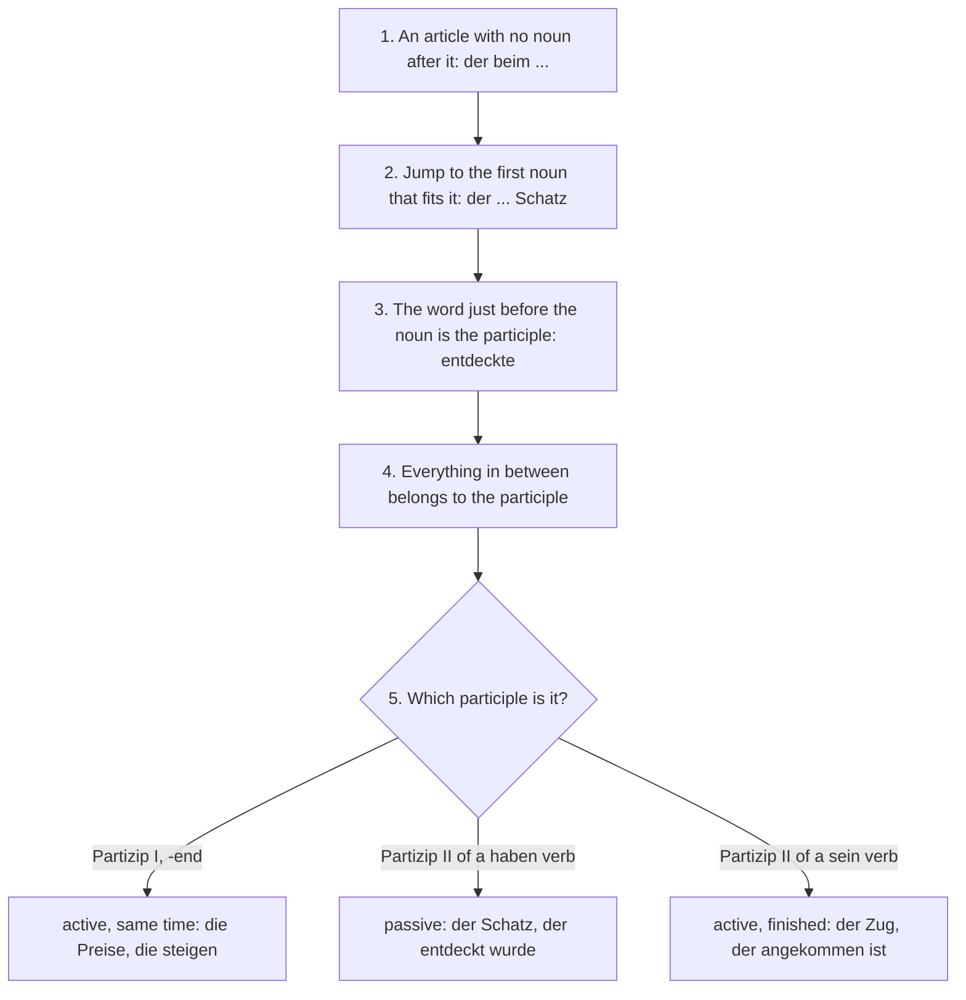

## Beyond das reparierte Fahrrad

In lesson 15 you turned verbs into adjectives: *das weinende Kind*, *das reparierte Fahrrad*, *die gestiegenen Preise*. At the end of that lesson you also saw, for reading only, longer phrases such as *die von uns hergestellten Produkte* (the products made by us). This honors lesson takes those long phrases seriously.

Newspapers, museum signs, instructions and official letters are full of them: *der seit Jahren geplante Neubau* (the new building that has been planned for years), *die im 19. Jahrhundert entdeckten Münzen* (the coins discovered in the 19th century). English can't build phrases like these, so they are hard for English speakers, but they follow strict rules.

The goal is to read them confidently and to build short ones yourself. Courses usually teach them at B2, so this lesson goes a little beyond B1. The theme is archaeology and museums.

## What the phrase looks like

A participle before a noun can take words of its own: an object, a time, a place, an agent with *von*. Grammar books call the result an **extended participial attribute**. Watch one grow:

- *der Schatz* — the treasure
- *der entdeckte Schatz* — the discovered treasure
- *der beim Bau entdeckte Schatz* — the treasure discovered during construction
- *der beim Bau der neuen Brücke entdeckte Schatz* — the treasure discovered during the construction of the new bridge

Three rules hold for every one of them:

1. **The article and the noun frame the phrase.** *der … Schatz* belong together, like the two parts of the sentence bracket (*hat … entdeckt*). Everything in between describes the noun.
2. **The participle stands directly before the noun** and takes a normal adjective ending: *der entdeckte Schatz*, *einen entdeckten Schatz*, *mit dem entdeckten Schatz*.
3. **Everything between the article and the participle belongs to the participle.** It is in the same order as at the end of a subordinate clause, with the participle in the place of the verb.

Memory hook: the phrase is a relative clause turned inside out. Take *der Schatz, der beim Bau der neuen Brücke entdeckt wurde*, delete *der … wurde*, move the rest in front of the noun and give the participle its ending. English keeps the description after the noun ("the treasure discovered during …").

## Back to a relative clause: three types

To understand a phrase, turn it back into a relative clause. How you do that depends on the participle.

| participle phrase | relative clause | meaning |
|---|---|---|
| *die immer weiter steigenden Preise* | *die Preise, die immer weiter steigen* | Partizip I: active, at the same time |
| *der beim Bau entdeckte Schatz* | *der Schatz, der beim Bau entdeckt wurde* | Partizip II of a verb with an object: passive |
| *der gerade angekommene Zug* | *der Zug, der gerade angekommen ist* | Partizip II of a *sein* verb: active, finished |

- **Partizip I** (*-end*): the noun is doing it at the time of the main clause, so use that tense: *Die Archäologen untersuchten die im Boden liegenden Mauern* = *die Mauern, die im Boden lagen*.
- **Partizip II of a verb with an accusative object** (*entdecken, finden, bauen*): passive. An agent stays with *von*: *die von Schülern gefundenen Münzen* = *die Münzen, die von Schülern gefunden wurden*.
- **Partizip II of a *sein* verb** (*ankommen, umfallen, ziehen*): active and finished: *die in die Stadt gezogenen Familien* = *die Familien, die in die Stadt gezogen sind*.

Verbs with *haben* and no object (*arbeiten, schlafen, lachen*) have no Partizip II before a noun: ~~der lange geschlafene Mann~~ is impossible; you need a relative clause (*der Mann, der lange geschlafen hat*). Their Partizip I is fine: *der schlafende Mann*.

The tenses in the table are simplified: the passive could also be *ist entdeckt worden* or *wird entdeckt*. The participle doesn't say which; the context decides.

## Reading strategy: from the article to the noun

When a German sentence suddenly seems to make no sense, look for an article with no noun after it. That is the sign of a participle phrase. Then work through these steps:

In step 2, "fits" means the right gender, number and case for the article. Nouns inside the phrase come with their own preposition or article (*beim Bau*, *der neuen Brücke*), which is how you skip them.

### Example 1

*Die im Sommer 2025 bei Bauarbeiten am Marktplatz entdeckten Münzen stammen aus der Römerzeit.*

1. *Die* is followed by *im*, not a noun: a phrase starts.
2. *Sommer*, *Bauarbeiten* and *Marktplatz* each have their own preposition (*im, bei, am*). The noun that fits *Die* is *Münzen* (plural, nominative).
3. Before *Münzen* stands *entdeckten*: Partizip II of a verb with an object, so passive. The middle says when and where.
4. As a relative clause: *Die Münzen, die im Sommer 2025 bei Bauarbeiten am Marktplatz entdeckt wurden, stammen aus der Römerzeit.*

In English: The coins that were discovered during construction work on the market square in summer 2025 date from Roman times. (*stammen aus* = to come from, to date from.)

### Example 2

*Im Museum sieht man einen aus mehreren Teilen bestehenden, etwa 1.800 Jahre alten Helm.*

1. *einen* is followed by *aus*: a phrase starts. *Teilen* has its own preposition and *Jahre* belongs to *1.800*, so the noun is *Helm* (masculine accusative).
2. There are two attributes, separated by a comma like two adjectives (*ein schöner, alter Helm*): *aus mehreren Teilen bestehenden* (Partizip I of *bestehen aus*, to consist of) and *etwa 1.800 Jahre alten* (the adjective *alt* with its own expansion). Both end in *-en* after *einen*.
3. As a relative clause: *einen Helm, der aus mehreren Teilen besteht und etwa 1.800 Jahre alt ist.*

In English: In the museum you can see a helmet made of several parts and about 1,800 years old.

### Example 3: building your own

Two short sentences: *Die Ausstellung zeigt Gegenstände. Die Gegenstände wurden von Kindern gefunden.*

1. The second sentence is a passive; its participle *gefunden* can describe *Gegenstände*.
2. Put the participle before the noun and its words before it: *von Kindern gefunden + Gegenstände*.
3. There is no article, so the ending is strong (lesson 15): *gefundene*.
4. Result: *Die Ausstellung zeigt von Kindern gefundene Gegenstände.* — The exhibition shows objects found by children.

One more, with an article: *Wir besuchten die Burg, die im 12. Jahrhundert gebaut wurde* → *Wir besuchten die im 12. Jahrhundert gebaute Burg.* The article *die* (feminine accusative) gives the weak ending *-e*.

## Adjectives can do it too

Ordinary adjectives can be extended in exactly the same way, and news writing loves them:

- *eine etwa 2.000 Jahre alte Münze* — a coin about 2,000 years old
- *ein für Kinder geeignetes Programm* — a programme suitable for children
- *die für die Ausgrabung verantwortliche Archäologin* — the archaeologist responsible for the excavation

## zu + Partizip I: what has to be done *(receptive)*

One more type looks strange at first: *zu* + Partizip I before a noun.

- *die noch zu untersuchenden Münzen* = *die Münzen, die noch untersucht werden müssen* — the coins that still have to be examined
- *ein nicht zu unterschätzendes Risiko* = *ein Risiko, das man nicht unterschätzen darf* — a risk not to be underestimated

This is called the **gerundive**, the form before a noun of *sein* + *zu* (lesson 18): *Die Münzen sind noch zu untersuchen* → *die noch zu untersuchenden Münzen*. It is passive and usually means "must be done", sometimes "can be done". With separable verbs, *zu* goes inside: *die noch auszufüllenden Formulare* (the forms still to be filled in). Recognize it; it is typical of official and academic writing.

## When to build them yourself

A guideline, since style is partly taste: in conversation, use a relative clause. In writing, short phrases with one to three words of expansion are natural: *die gestern bestellte Ware*, *der seit Monaten geplante Ausflug*. Long ones are typical of legal and academic texts, and many style guides advise against them, because the reader has to hold everything in mind until the noun arrives.

## The words: archaeology and museums

- *die Ausgrabung* (excavation), *ausgraben* (to dig up: *grub aus, hat ausgegraben*), *der Fund* (find), *der Schatz* (treasure, plural *Schätze*), *die Münze* (coin), *der Gegenstand* (object, plural *Gegenstände*).
- *der Archäologe* (a weak noun: *des Archäologen*), *die Archäologin*, *die Sammlung* (collection), *der Besucher, die Besucherin* (visitor).
- *stammen aus* (to come from, to date from), *zahlreich* (numerous), *bisherig* (previous; only before a noun), *römisch* (Roman), *vermuten* (to suppose).

## Text: Römischer Schatz unter dem Marktplatz

A news report from Kronstein, the invented town from lesson 12.

> Kronstein. Die seit Februar laufenden Bauarbeiten am Marktplatz haben eine unerwartete Wendung genommen: Bei Grabungen für die neue Tiefgarage stießen Arbeiter auf ein mit Steinen abgedecktes Tongefäß. Darin lagen 312 Silbermünzen, die nach ersten Untersuchungen aus dem 2. Jahrhundert stammen.
>
> Die sofort informierte Stadtarchäologin Dr. Miriam Sander ließ die Baustelle sperren. Neben den Münzen fand ihr Team zahlreiche kleinere Gegenstände, darunter einen Ring und zwei Schlüssel. „Solche gut erhaltenen Funde sind in unserer Region sehr selten“, sagt Sander. Sie vermutet, dass ein römischer Händler sein Geld in einer für ihn gefährlichen Zeit versteckt hat.
>
> Der bisherige Rekord in Kronstein war eine Sammlung von nur 40 römischen Münzen. Viele Fragen sind noch offen: Wer war der Besitzer? Warum hat er den vergrabenen Schatz nie geholt? Die bereits ausgegrabenen, aber noch zu untersuchenden Münzen sollen im Herbst im Stadtmuseum ausgestellt werden. Besucher können die Ausgrabung schon jetzt jeden Samstag um 11 Uhr bei einer kostenlosen Führung besichtigen.

In English:

> Kronstein. The construction work on the market square, which has been going on since February, has taken an unexpected turn: while digging for the new underground car park, workers came across a clay pot covered with stones. Inside were 312 silver coins which, according to first examinations, date from the 2nd century.
>
> The town archaeologist, Dr Miriam Sander, who was informed immediately, had the site closed. Besides the coins, her team found numerous smaller objects, including a ring and two keys. "Well-preserved finds like these are very rare in our region," says Sander. She suspects that a Roman trader hid his money at a time that was dangerous for him.
>
> The previous record in Kronstein was a collection of just 40 Roman coins. Many questions are still open: Who was the owner? Why did he never collect the buried treasure? The coins, which have already been dug up but still have to be examined, are to be exhibited in the town museum in the autumn. Visitors can already see the excavation every Saturday at 11 o'clock on a free guided tour.

Notes: *die Wendung* = turn; *die Grabung* = digging; *die Tiefgarage* = underground car park; *stoßen auf* + Akk = to come across (*stieß, ist gestoßen*); *das Tongefäß* = clay pot; *ließ … sperren* = had … closed (*lassen*, lesson 27); *erhalten* = preserved (also "to receive"); *der Händler* = trader; *verstecken* = to hide; *vergraben* = buried; *sollen … ausgestellt werden* = are to be exhibited (passive with a modal, lesson 18). Find the six extended phrases (the last one has two attributes, one of them with *zu*) and turn each into a relative clause.

## Common mistakes

- Taking the first noun after the article as its noun: in *die im Sommer entdeckten Münzen*, *Sommer* has its own preposition; the noun is *Münzen*.
- No ending on the participle: ~~der beim Bau entdeckt Schatz~~ → *der beim Bau entdeckte Schatz*.
- English word order, with the words after the participle: ~~der entdeckte beim Bau Schatz~~ → *der beim Bau entdeckte Schatz*.
- The wrong voice: *die gefundenen Münzen* are coins that were found, never coins that found something.
- A Partizip II from a *haben* verb without an object: ~~der lange gearbeitete Kollege~~ → *der Kollege, der lange gearbeitet hat*.
- Reading *zu* + Partizip I as an infinitive with *zu*: *die zu lösenden Aufgaben* are tasks that must be solved, not "in order to solve tasks".

## Key points

- An extended participle phrase sits between an article and its noun: *der beim Bau entdeckte Schatz*. The participle comes last, with a normal adjective ending.
- To read it: find an article with no noun after it, jump to its noun, and read the middle as the participle's words.
- Partizip I = active, same time (*die steigenden Preise*); Partizip II of a verb with an object = passive (*die gefundenen Münzen*); Partizip II of a *sein* verb = active, finished (*der angekommene Zug*).
- Adjectives can be extended the same way: *eine 2.000 Jahre alte Münze*.
- *zu* + Partizip I = must (or can) be done: *die noch zu untersuchenden Münzen*. Recognize it.
- Build short ones in writing; use relative clauses in speech.

The words from this lesson are listed below; they join your vocabulary reviews when you complete the lesson.
