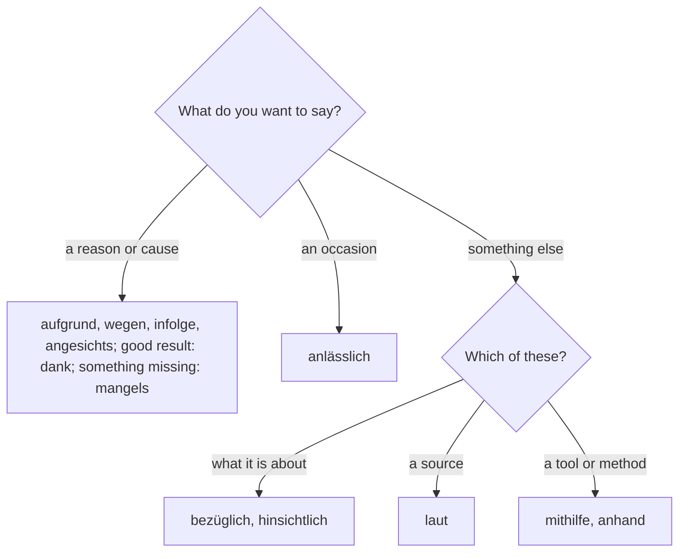

## Beyond wegen and trotz

Lesson 14 taught the six genitive prepositions you need every day: *wegen, trotz, während, statt, innerhalb, außerhalb*. Letters from offices, banks, insurers and landlords, and the news, use about a dozen more. Most of them you only need to understand, but a few (*aufgrund, laut, dank, bezüglich*) are so common in written German that you should use them yourself.

This honors lesson also finishes what lesson 11 started: there you learned to recognize *dessen* and *deren*; here you learn to use them, even after a preposition and before an adjective. And it looks at a question Germans like to argue about: is the genitive dying?

The theme is official letters: the town writes to its residents about roadworks, and you need to understand every line.

## Reasons and causes

| preposition | meaning | example |
|---|---|---|
| *aufgrund* | because of, due to | *Aufgrund der Bauarbeiten bleibt die Straße gesperrt.* |
| *infolge* | as a result of | *Infolge des Unwetters fiel der Strom aus.* |
| *angesichts* | in view of, given | *Angesichts der hohen Kosten verschiebt die Stadt das Projekt.* |
| *dank* | thanks to | *Dank der Hilfe der Nachbarn war der Umzug schnell fertig.* |
| *mangels* | for lack of | *Mangels ausreichender Nachfrage wird die Buslinie eingestellt.* |

- *aufgrund* is the formal *wegen*. Office letters use it constantly. It can also be written *auf Grund*; both spellings are correct. With a noun that has no article, use *aufgrund von*: *aufgrund von Bauarbeiten*.
- *infolge* names a consequence: first something happened, then this followed. Without an article: *infolge von*.
- *angesichts* means "considering this situation": you react to something everyone can see.
- *dank* is only for a cause with a good result. *Dank des Streiks kamen wir zu spät* sounds ironic. It takes the genitive or the dative, and both are correct: *dank seiner Hilfe*, *dank seinem Einsatz*.
- *mangels* (from *der Mangel*, lack) is formal: *mangels Beweisen* (for lack of evidence) uses the dative, because a plural without an article can't show the genitive, the same rule as in lesson 14.

*eingestellt werden* (to be discontinued) and *fiel aus* (*ausfallen*: the power went off) are new uses of verbs you know.

## About, according to, with the help of

| preposition | meaning | example |
|---|---|---|
| *bezüglich* | regarding, concerning | *Bezüglich Ihrer Anfrage teilen wir Ihnen mit, …* |
| *hinsichtlich* | with regard to, in terms of | *Hinsichtlich der Kosten gibt es noch offene Fragen.* |
| *laut* | according to | *Laut Polizei gab es keine Verletzten.* |
| *mithilfe* | with the help of | *Mithilfe eines Kredits haben sie das Haus saniert.* |
| *anhand* | on the basis of, using | *Anhand der Unterlagen prüfen wir Ihren Antrag.* |
| *anlässlich* | on the occasion of | *Anlässlich des Stadtjubiläums gibt es ein großes Fest.* |

- *bezüglich* (abbreviated *bzgl.*) is the classic opening of an official answer: *Bezüglich Ihres Schreibens vom 3. Mai …* (regarding your letter of 3 May). *das Schreiben* is the formal word for a letter.
- *laut* takes the genitive or the dative (*laut des Berichts, laut dem Bericht*), and a noun without an article gets no ending at all: *laut Polizei, laut Fahrplan, laut Gesetz*. You meet it again in lesson 26.
- *mithilfe* can also be written *mit Hilfe*. Without an article: *mithilfe von Freunden*.
- *anhand* is for evidence or examples you use to find something out: *anhand alter Fotos* (using old photos).

## Above, below, along

- *oberhalb, unterhalb* (above, below), mostly for places on a slope or a river: *Die Burg liegt oberhalb des Dorfes.* Without an article: *oberhalb von*.
- *entlang* (along) is unusual. It normally comes after its noun, and then it takes the accusative: *Wir gingen den Fluss entlang.* A preposition that follows its noun is called a **postposition**. Before the noun, *entlang* takes the genitive (sometimes the dative): *entlang des Flusses*. In speech, *am Fluss entlang* is the most common of all.

This chart sums up the new prepositions by meaning:

### Example 1

Rewrite this informal sentence for an official letter: *Weil die Wasserleitungen saniert werden, ist die Straße gesperrt.*

1. The *weil* clause gives a reason, so a formal reason preposition fits: *aufgrund*.
2. Turn the clause into a noun phrase: *die Wasserleitungen werden saniert* → *die Sanierung der Wasserleitungen* (the verb *sanieren* becomes the noun *die Sanierung*, and its object becomes a genitive attribute).
3. Put it in the genitive after *aufgrund*: *die Sanierung* → *der Sanierung*.
4. Result: *Aufgrund der Sanierung der Wasserleitungen ist die Straße gesperrt.* The verb *ist* stays in position 2.

## dessen and deren in use

In lesson 11 you learned to recognize *dessen* and *deren* (whose). Official writing uses them all the time, so here are the rules for using them yourself:

1. **They agree with the owner**, before the comma: masculine or neuter owner → *dessen*; feminine or plural owner → *deren*. *Herr Kaya, dessen Antrag …*; *die Anwohner, deren Garage …*.
2. **The noun after them has no article**, and its case comes from its job in the relative clause: *die Anwohner, deren Garage in der gesperrten Zone liegt* (*Garage* is the subject).
3. **A preposition goes in front of *dessen/deren*** and decides the case of the noun after it, not of *dessen/deren*, which never change: *die Firma, mit deren Hilfe wir das Haus saniert haben* (*mit* + dative *Hilfe*).
4. **An adjective after them takes a strong ending**, because there is no article: *der Nachbar, dessen neues Auto vor meiner Garage steht*; *die Mieterin, mit deren kleinem Sohn ich manchmal spiele* (dative masculine: *-em*).

### Example 2

Join the sentences with *dessen* or *deren*: *Ich habe mit Herrn Kaya gesprochen. Sein Grundstück liegt direkt an der Baustelle.*

1. The owner is *Herr Kaya*, masculine → *dessen*.
2. *Sein Grundstück* becomes *dessen Grundstück*; no article, and *Grundstück* stays the subject of its clause.
3. The verb goes to the end: *Ich habe mit Herrn Kaya gesprochen, dessen Grundstück direkt an der Baustelle liegt.* (I spoke to Mr Kaya, whose plot is right next to the building site.)

Now with a preposition: *Die Stadt bedankt sich bei den Stadtwerken. Mit ihrer Unterstützung wird die Sanierung schneller fertig.* The owner *die Stadtwerke* (the municipal utilities) is plural → *deren*; *mit* stays in front: *… bei den Stadtwerken, mit deren Unterstützung die Sanierung schneller fertig wird.*

## Is the genitive dying? A debate

In 2004 the journalist Bastian Sick, who wrote a popular language column for Spiegel Online, published a book called *Der Dativ ist dem Genitiv sein Tod* (roughly: "The dative is the death of the genitive"). It became a bestseller, and the title is a joke in itself: it uses the **possessive dative**, *dem Genitiv sein Tod* instead of *der Tod des Genitivs*. You hear this pattern in everyday speech in many regions (*dem Vater sein Haus*, *der Oma ihr Garten*), but it is not standard German, and you should never write it.

Writers like Sick defend the genitive and criticize *wegen dem* and *trotz dem*. Many linguists answer that this is language change, not decay: the genitive is still normal in writing, especially after nouns and in fixed phrases, while in speech it has been losing ground for a long time, and *wegen* with the dative means exactly the same as *wegen* with the genitive. Both are opinions about language, and you will hear both. What is not a matter of opinion is the practical rule: in letters, e-mails to offices and exams, write the genitive.

## The words: official letters

- *die Angelegenheit* (matter, affair): *in dieser Angelegenheit* (in this matter).
- *der Anwohner, die Anwohnerin* (resident of a street or area): the people who live right next to something. *der Bewohner* (lesson 5) lives in a building or a town.
- *die Sanierung* (renovation, refurbishment, especially of buildings, roads and pipes) and *sanieren* (to renovate, to refurbish).
- *das Grundstück* (plot of land, property), *erneuern* (to renew, to replace).
- The prepositions: *aufgrund, infolge, angesichts, dank, mangels, bezüglich, hinsichtlich, mithilfe, anhand, anlässlich, entlang*.

## Text: Ein Brief vom Tiefbauamt

Frau Berger asked the town about the roadworks in her street. Here is the answer (the *Tiefbauamt* is the office for roads and pipes).

![An official letter. At the top the sender, labeled der Absender: Stadt Kronstein, Tiefbauamt, Marktplatz 1. Below it the recipient, labeled der Empfänger: Frau Petra Berger, Lindenstraße 14, Kronstein. On the right the date, labeled das Datum: Kronstein, 4. März 2026, with a file number. The subject line in bold, labeled der Betreff: Sanierung der Lindenstraße, Ihre Anfrage vom 27. Februar 2026. The greeting, labeled die Anrede: Sehr geehrte Frau Berger. The first lines of the letter, then the closing, labeled die Grußformel: Mit freundlichen Grüßen, im Auftrag, Jana Albers.](images/de3-m3-h-letter.svg)

> Sehr geehrte Frau Berger,
>
> bezüglich Ihrer Anfrage teilen wir Ihnen mit, dass die Lindenstraße aufgrund der Sanierung der Wasserleitungen vom 13. April bis voraussichtlich 29. Mai gesperrt wird. Die Leitungen, deren Rohre zum Teil über 80 Jahre alt sind, müssen dringend erneuert werden. Infolge eines Rohrbruchs waren im Januar bereits zwölf Haushalte zwei Tage ohne Wasser.
>
> Hinsichtlich der Zufahrt zu Ihrem Grundstück können wir Sie beruhigen: Laut Bauplan bleibt der Gehweg während der gesamten Bauzeit offen. Anwohner, deren Garage in der gesperrten Zone liegt, erhalten auf Antrag einen kostenlosen Parkausweis für den Parkplatz am Rathaus.
>
> Anlässlich des Baubeginns laden wir alle Anwohnerinnen und Anwohner am 7. April um 18 Uhr zu einer Informationsveranstaltung ins Rathaus ein. Mithilfe von Plänen und Fotos erklären wir dort den genauen Ablauf. Dank der Unterstützung der Stadtwerke dauern die Arbeiten zwei Wochen kürzer als ursprünglich geplant. Angesichts der langen Bauzeit bitten wir dennoch um Ihr Verständnis.
>
> Für weitere Fragen in dieser Angelegenheit stehen wir Ihnen gern zur Verfügung.
>
> Mit freundlichen Grüßen
>
> im Auftrag
>
> Jana Albers

In English:

> Dear Ms Berger, regarding your enquiry, we would like to inform you that Lindenstraße will be closed from 13 April until probably 29 May because of the renovation of the water pipes. The pipes, some of which are over 80 years old, urgently need to be replaced. As a result of a burst pipe in January, twelve households were already without water for two days.
>
> As regards access to your property, we can reassure you: according to the construction plan, the pavement will stay open for the whole construction period. Residents whose garage is in the closed zone will receive a free parking permit for the car park at the town hall on application.
>
> On the occasion of the start of construction, we invite all residents to an information evening at the town hall on 7 April at 6 pm. There, with the help of plans and photos, we will explain exactly how the work will proceed. Thanks to the support of the municipal utilities, the work will take two weeks less than originally planned. In view of the long construction period, we nevertheless ask for your understanding.
>
> If you have any further questions about this matter, we will be happy to help. Yours sincerely, p.p. Jana Albers

Notes: *die Leitung* = pipe (also "management", lesson 25); *das Rohr* = pipe, tube; *der Rohrbruch* = burst pipe; *der Haushalt* = household; *die Zufahrt* = access (by car); *beruhigen* = to reassure; *der Gehweg* = pavement, sidewalk; *erhalten* = to receive; *auf Antrag* = on application; *dennoch* = nevertheless; *zur Verfügung stehen* = to be available; *im Auftrag* (*i. A.*) = on behalf of, signed by an employee for the office. *müssen … erneuert werden* is a passive with a modal (lesson 18). Find the ten genitive prepositions (*mithilfe* is used with *von* here, and *laut Bauplan* shows no ending) and the two uses of *deren*.

## Common mistakes

- *dank* for a bad cause: ~~Dank des Regens fiel das Fest aus.~~ → *Wegen des Regens* or *Aufgrund des Regens*.
- *dessen* with a feminine owner: ~~die Firma, dessen Chef~~ → *deren Chef*.
- An article after *dessen/deren*: ~~deren die Garage~~ → *deren Garage*.
- The preposition after *deren*, as in English: ~~die Stadtwerke, deren mit Hilfe~~ → *mit deren Hilfe*.
- A weak ending after *dessen/deren*: ~~dessen neue Auto~~ → *dessen neues Auto*.
- Writing the possessive dative: ~~dem Vater sein Haus~~ → *das Haus des Vaters*.
- An ending after *laut* with no article: ~~laut Plans~~ → *laut Plan*.

## Key points

- Reasons: *aufgrund* (formal *wegen*), *infolge* (as a result of), *angesichts* (in view of), *dank* (thanks to, good results only, genitive or dative), *mangels* (for lack of).
- Reference and means: *bezüglich, hinsichtlich* (regarding), *laut* (according to; *laut Gesetz* with no ending), *mithilfe, anhand* (with the help of, using), *anlässlich* (on the occasion of).
- *entlang* is a postposition with the accusative (*den Fluss entlang*) or a preposition with the genitive (*entlang des Flusses*).
- *dessen* (masculine and neuter owner) and *deren* (feminine and plural owner) never change; no article after them; a preposition goes in front; adjectives after them take strong endings.
- The possessive dative (*dem Vater sein Haus*) is spoken and regional; write the genitive.

The words from this lesson are listed below; they join your vocabulary reviews when you complete the lesson.
