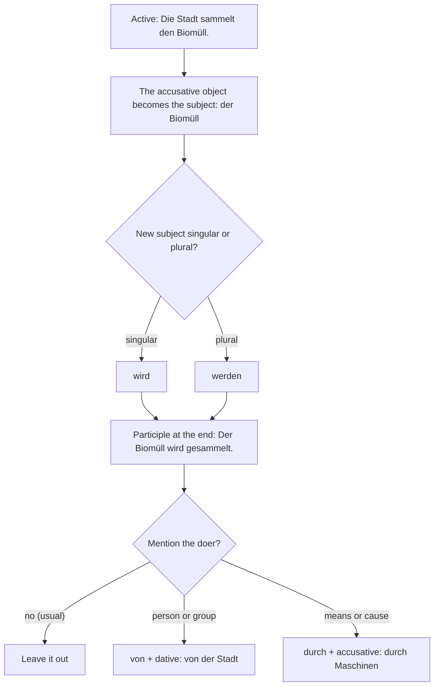
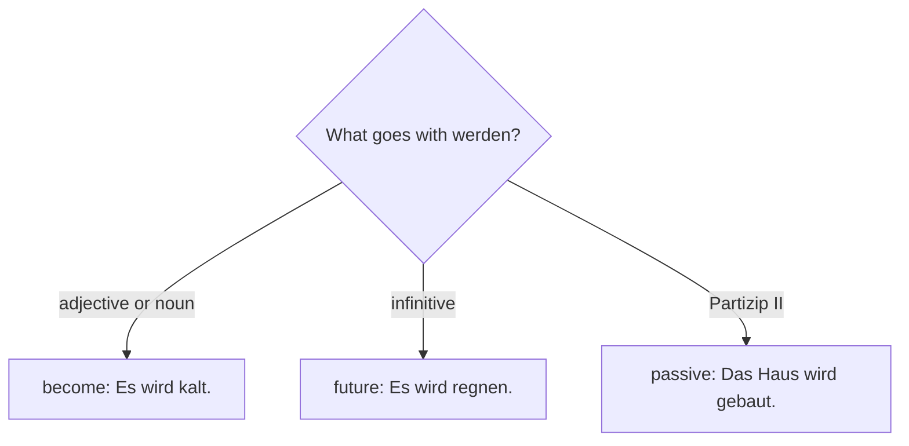

## What this lesson is for

So far almost every German sentence you have built has had a subject that *does* something: *Die Firma produziert Fahrräder. Ich trenne den Müll.* But very often the person who does something isn't important, isn't known, or is obvious. What matters is the thing that happens: *Bikes are produced here. The rubbish is collected on Tuesdays. The bottles are cleaned and filled again.* For this, German uses the **passive**.

The passive is everywhere in written German: in instructions, descriptions of how something works, news and rules. This module builds it up: the present here, the past in lesson 17, modal verbs in lesson 18.

The theme is production and recycling: factories, raw materials, packaging and what happens to your rubbish after you've put it in the bin. These are exactly the texts in which the passive feels natural, because a process has steps, and nobody cares *who* turns on each machine.

## Active and passive

Compare these two sentences:

- *Der Hausmeister leert die Tonnen.* — The caretaker empties the bins.
- *Die Tonnen werden geleert.* — The bins are emptied.

The first sentence is **active**: the subject (*der Hausmeister*) does the action. The second is passive: the subject (*die Tonnen*) is the thing the action is done to, and the person doing it has disappeared. English does exactly the same thing with "is/are + past participle". German uses the same idea with a different helping verb: not *sein*, but *werden*.

## Forming the present passive: werden + Partizip II

You already know both parts. The conjugated form of *werden* stands in position 2, and the past participle (Partizip II) goes to the very end, like in the perfect:

| | werden | … | Partizip II |
|---|---|---|---|
| *ich* | *werde* | *oft* | *gefragt.* |
| *du* | *wirst* | *morgen* | *abgeholt.* |
| *er / sie / es* | *wird* | *in der Fabrik* | *produziert.* |
| *wir* | *werden* | *um acht Uhr* | *geweckt.* |
| *ihr* | *werdet* | *gleich* | *informiert.* |
| *sie / Sie* | *werden* | *nach Farben* | *sortiert.* |

In practice, most passive sentences are about things, so you'll mostly need *wird* and *werden*:

- *Das Altglas wird nach Farben sortiert.* — Old glass is sorted by colour.
- *In dieser Fabrik werden Solaranlagen produziert.* — Solar panels are produced in this factory.
- *Die Ware wird in Kartons verpackt.* — The goods are packed in boxes.
- *Wird das Papier hier gesammelt?* — Is the paper collected here?

Separable verbs keep their prefix in the participle, as always: *Der Müll wird abgeholt. Die Verpackung wird weggeworfen. Die Flaschen werden zurückgegeben.*

### From active to passive

To turn an active sentence into a passive one, follow three steps:

1. The accusative object of the active sentence becomes the subject (nominative) of the passive one.
2. *werden* agrees with this new subject: singular *wird*, plural *werden*.
3. The old subject disappears, or comes back with *von* (see below).

| active | passive |
|---|---|
| *Die Stadt sammelt den Biomüll.* | *Der Biomüll wird gesammelt.* |
| *Maschinen sortieren die Dosen.* | *Die Dosen werden sortiert.* |
| *Man verarbeitet das Holz zu Papier.* | *Das Holz wird zu Papier verarbeitet.* |

Watch the article in the first example: *den Biomüll* (accusative object) becomes *der Biomüll* (subject). Only an accusative object can become the passive subject. A verb with a dative object, like *helfen*, keeps its dative: *Den Kunden wird sofort geholfen* (The customers are helped straight away). You only need to recognise this for now.

The diagram sums up the steps, including the choice of agent explained in the next section.

## Who does it? von and durch

Most passive sentences don't mention who does the action at all. That's the point of the passive. But if you want to add it, this part of the sentence is called the **agent**, and German has two ways to introduce it.

von + dative for the person, animal or organisation that does it:

- *Der Müll wird von der Stadt abgeholt.* — The rubbish is collected by the town.
- *Die Maschinen werden von zwei Technikerinnen kontrolliert.* — The machines are checked by two technicians.
- *Das Fest wird vom Bürgerverein organisiert.* — The party is organised by the residents' association.

durch + accusative for the means, the cause or the process through which something happens:

- *Die Luft wird durch Abgase verschmutzt.* — The air is polluted by exhaust fumes.
- *Viele Arbeitsplätze werden durch Maschinen ersetzt.* — Many jobs are being replaced by machines.
- *Das Metall wird durch einen starken Magneten herausgezogen.* — The metal is pulled out by a strong magnet.

A good rule of thumb: *von* answers "by whom?", *durch* answers "through what? by what means?". With natural forces you will hear both: *Das Dach wird vom Sturm / durch den Sturm beschädigt.* And because *von* also means "from", watch the case: *von* + dative (*vom Hausmeister, von der Firma, von den Kindern*), *durch* + accusative (*durch den Wind, durch die Sonne*).

## When German uses the passive

Use the passive when the action is more interesting than the person:

- Processes and how things work: *Zuerst wird das Glas gereinigt, dann wird es geschmolzen.*
- Rules and routines: *Die Tonnen werden dienstags geleert. Hier wird nicht geraucht.* (The second one, literally "here is not smoked", means "there's no smoking here". It's a passive with no subject at all; lesson 17 explains how that works.)
- News and official texts: *Das Kraftwerk wird im Mai abgeschaltet.*
- When the doer is unknown or obvious: *Mein Fahrrad wird gerade repariert.* (by the mechanic, obviously)

To describe a process in steps, combine the passive with time words: *zuerst* (first), *dann*, *danach*, *anschließend* (afterwards), *im nächsten Schritt* (in the next step), *zum Schluss* (finally).

- *Zuerst werden die Flaschen gesammelt. Im nächsten Schritt werden sie nach Farben sortiert. Danach werden sie gereinigt, und zum Schluss wird das Glas geschmolzen.*

## Words for production and energy

The vocabulary of this lesson is the vocabulary of processes, so most of it fits the passive naturally:

- *In der Fabrik werden Rohstoffe zu Waren verarbeitet.* — In the factory, raw materials are processed into goods.
- *Die Produktion läuft rund um die Uhr; die Maschinen werden nie abgeschaltet.* — Production runs around the clock; the machines are never switched off.
- *Der ganze Prozess hat zwölf Schritte. Der Ablauf wird jeden Tag kontrolliert.* — The whole process has twelve steps. The procedure is checked every day.
- *Die Ware wird verpackt und ins Lager gebracht. Leider wird zu viel Kunststoff für die Verpackung verwendet.* — The goods are packed and taken to the warehouse. Unfortunately too much plastic is used for the packaging.
- *Der Abfall wird in großen Containern gesammelt.* — The waste is collected in big containers.
- *Früher wurde der Strom hier in einem Kohlekraftwerk erzeugt.* — The electricity here used to be generated in a coal power station. (*wurde* is the past passive: lesson 17.)
- *Heute wird ein großer Teil durch erneuerbare Energien produziert: durch Windkraft und Solarenergie.* — Today a large part is produced by renewable energies: by wind power and solar energy.
- *Kohle ist schädlich für das Klima und spielt eine große Rolle beim Klimawandel.* — Coal is harmful to the climate and plays a big part in climate change.
- *Abgase verschmutzen die Luft.* — Exhaust fumes pollute the air.

*die Tonne* has two meanings: a big bin (*die Mülltonne*) and a metric tonne (1,000 kg): *Jedes Jahr werden hier 50.000 Tonnen Abfall sortiert.* *die Menge* is "amount, quantity", or a crowd of people: *eine große Menge Papier*. *Die Industrie braucht riesige Mengen Wasser.* *der Verbrauch* is the noun to *verbrauchen* (to use up, consume) from A2.

## man: the everyday alternative

In speech, Germans often avoid the passive with *man* (one, people, you, they). The meaning is almost the same, and the object stays an object:

| passive | with man |
|---|---|
| *Der Müll wird getrennt.* | *Man trennt den Müll.* |
| *Die Flaschen werden zurückgebracht.* | *Man bringt die Flaschen zurück.* |
| *Wie wird das gemacht?* | *Wie macht man das?* |

Two things to remember: *man* always takes the *er/sie/es* form of the verb (*man sortiert*, never ~~man sortieren~~), and the object keeps its accusative (*Man trennt den Müll*). The passive sounds a little more formal and is typical of written texts; *man* is more personal and typical of conversation. Both are correct.

## The passive in subordinate clauses

In a subordinate clause, the conjugated verb goes to the end as usual, so *wird / werden* comes after the participle:

- *Es ist wichtig, dass der Abfall richtig getrennt wird.* — It's important that the waste is separated correctly.
- *Weißt du, wie Papier wiederverwertet wird?* — Do you know how paper is recycled?
- *Weil die Ware schnell geliefert wird, sind die Kunden zufrieden.* — Because the goods are delivered quickly, the customers are happy.
- *Das ist die Fabrik, in der die Maschinen gebaut werden.* — That's the factory where the machines are built.

The order at the end is always: participle, then *werden*: *getrennt wird, gebaut werden*.

## Three jobs of werden

*werden* is now one of the busiest verbs in German. What follows it tells you which job it is doing:

| werden + … | job | example |
|---|---|---|
| adjective or noun | "to become" (full verb) | *Es wird kalt. Sie wird Ingenieurin.* |
| infinitive | future (lesson 4) | *Es wird regnen. Wir werden umziehen.* |
| Partizip II | passive | *Das Haus wird gebaut.* |

So *Der Strom wird teurer* means "electricity is getting more expensive" (adjective: become), *Der Strom wird teurer werden* is "electricity will get more expensive" (future), and *Der Strom wird durch Windkraft erzeugt* is "the electricity is generated by wind power" (passive).

As a decision chart:

## Text: Was passiert mit unserem Müll?

A local blogger visits a sorting plant (*eine Sortieranlage*) and writes about it.

> Jeden Tag werfen wir Verpackungen weg: Joghurtbecher, Dosen, Folien. Aber was passiert eigentlich damit? Letzte Woche habe ich die Sortieranlage in unserer Stadt besucht, und eine Mitarbeiterin hat mir den ganzen Ablauf erklärt.
>
> Zuerst wird der Inhalt der gelben Tonnen von Lastwagen abgeholt und zur Anlage gebracht. Dort wird alles auf ein langes Band gekippt. Im ersten Schritt werden große Teile von Hand aussortiert, zum Beispiel Kleidung oder Holz, denn die gehören gar nicht in die gelbe Tonne. Danach übernehmen die Maschinen: Metall wird durch starke Magneten herausgezogen, und die verschiedenen Kunststoffe werden durch Sensoren erkannt und getrennt. Anschließend wird das Material gewaschen, zerkleinert und zu Granulat verarbeitet. Dieses Granulat wird an Fabriken verkauft, und dort werden daraus neue Produkte gemacht, zum Beispiel Eimer, Blumentöpfe oder Parkbänke.
>
> „Leider wird nicht alles wiederverwertet“, sagt die Mitarbeiterin. „Ein großer Teil wird verbrannt. Die Wärme wird zwar genutzt, aber der Rohstoff ist dann weg.“ Ihr Tipp: Verpackungen nicht spülen, nur leer machen, und verschiedene Materialien voneinander trennen, also zum Beispiel den Deckel vom Joghurtbecher abziehen.
>
> Mein Fazit: Recycling ist gut, aber jede Verpackung verbraucht Ressourcen und Energie. Der umweltfreundlichste Müll ist immer noch der, der gar nicht produziert wird.

In English:

> Every day we throw away packaging: yoghurt pots, cans, plastic film. But what actually happens to it? Last week I visited the sorting plant in our town, and a member of staff explained the whole process to me.
>
> First the contents of the yellow bins are collected by lorries and taken to the plant. There everything is tipped onto a long belt. In the first step, large items are sorted out by hand, for example clothes or wood, because they don't belong in the yellow bin at all. Then the machines take over: metal is pulled out by strong magnets, and the different plastics are detected by sensors and separated. After that the material is washed, shredded and processed into granules. These granules are sold to factories, and there new products are made from them, for example buckets, flower pots or park benches.
>
> "Unfortunately not everything is recycled," says the staff member. "A large part is burned. The heat is used, it's true, but then the raw material is gone." Her tip: don't rinse packaging, just empty it, and separate different materials from each other, so for example pull the lid off the yoghurt pot.
>
> My conclusion: recycling is good, but every piece of packaging uses up resources and energy. The most environmentally friendly rubbish is still the rubbish that isn't produced at all.

Words to note from the text: *die Folie* (plastic film, foil), *das Band* (here: conveyor belt), *kippen* (to tip), *aussortieren* (to sort out), *der Magnet* (magnet; plural *die Magneten* or *Magnete*), *der Sensor* (sensor), *zerkleinern* (to shred, to break into small pieces), *das Granulat* (granules, pellets), *der Eimer* (bucket), *spülen* (to rinse), *der Deckel* (lid), *das Fazit* (conclusion).

## Recycling in Germany

Germany is famous for sorting its rubbish, and the words come up in everyday life:

| bin | what goes in it |
|---|---|
| *die gelbe Tonne / der gelbe Sack* | packaging made of plastic, metal and composite materials |
| *die blaue Tonne* | paper and cardboard (*das Altpapier*) |
| *die Biotonne* (brown) | food scraps and garden waste (*der Biomüll*) |
| *die Restmülltonne* (grey or black) | everything else (*der Restmüll*) |
| *der Altglascontainer* | glass bottles and jars, sorted into white, green and brown |

Here are the five containers you'll find at almost every German home or on the street. The colours can differ a little from town to town, so check the local rules.

Most drinks bottles and cans carry a deposit (*das Pfand*): you pay it on top of the price and get it back when you return the bottle or can, usually to a machine in the supermarket. On single-use (*Einweg*) plastic bottles and cans it is 25 cents; on refillable (*Mehrweg*) bottles it is less, usually 8 or 15 cents.

## Pronunciation

- *der Prozess*: stress on the second syllable, pro-ZESS. The same for *die Produktion* (pro-duk-TSJOHN) and *produzieren* (pro-du-TSIE-ren).
- *die Ressource* comes from French: re-SUR-se, three syllables.
- *das Recycling* and *der Container* are said roughly as in English: ri-SAI-kling, kon-TEE-ner.
- *wird* and *wirt* sound the same: final *d* is said like *t*.

## Common mistakes

- Using *sein* for the passive because English uses "is": ~~Das Glas ist gesammelt.~~ → *Das Glas wird gesammelt.* (*ist gesammelt* describes a finished state, "is already collected"; more on that in lesson 17.)
- Forgetting agreement: ~~Die Flaschen wird sortiert.~~ → *Die Flaschen werden sortiert.*
- Keeping the accusative: ~~Den Müll wird abgeholt.~~ → *Der Müll wird abgeholt.* The object of the active sentence is the subject of the passive one.
- English word order: ~~Es wird gesammelt das Altpapier.~~ → *Das Altpapier wird gesammelt.* The participle goes to the end.
- *von* or *durch*: *Das Metall wird von einem Magneten herausgezogen* is possible, but for a tool or cause *durch einen Magneten* is the clearer choice. And *by* is never *bei* here: ~~bei der Stadt organisiert~~ → *von der Stadt organisiert*.
- Plural verb with *man*: ~~Man trennen den Müll.~~ → *Man trennt den Müll.*

## Key points

- Present passive: *werden* (position 2) + Partizip II (end): *Das Papier wird gesammelt. Die Dosen werden sortiert.*
- The active accusative object becomes the passive subject in the nominative; *werden* agrees with it.
- The agent is usually left out. If you need it: *von* + dative for a person or organisation, *durch* + accusative for a means or cause.
- Use the passive for processes, rules, news and when the doer doesn't matter; in speech *man* + active verb is a common alternative.
- In subordinate clauses: participle + *wird / werden* at the end: *…, dass der Müll getrennt wird.*
- *werden* + adjective = become; + infinitive = future; + Partizip II = passive.

The words from this lesson are listed below; they join your vocabulary reviews when you complete the lesson.
