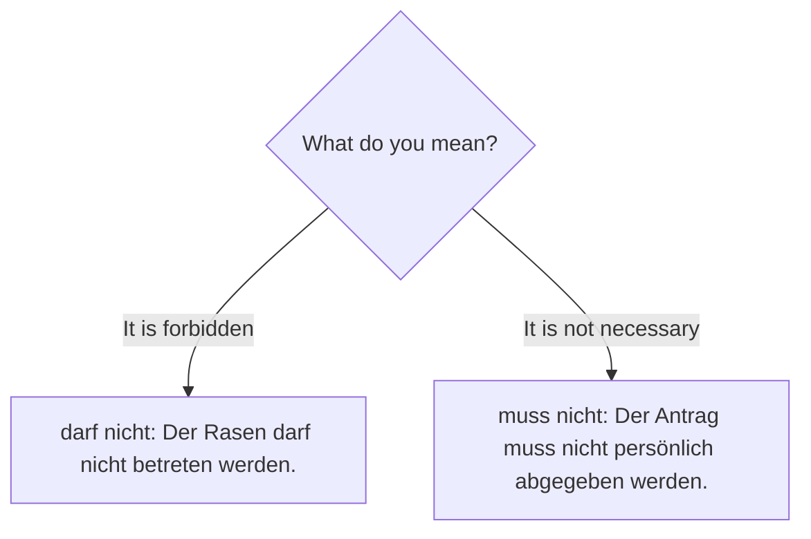
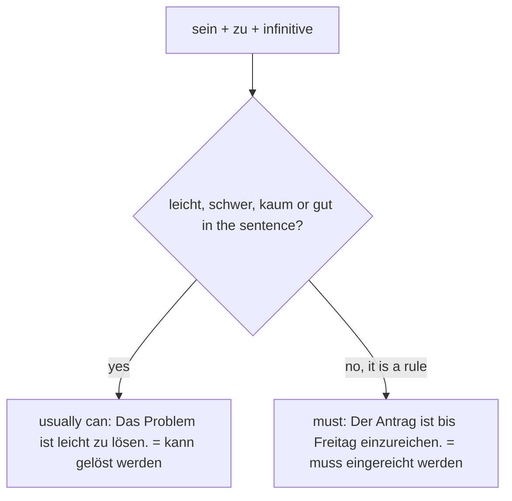

## What this lesson is for

Rules, signs, forms and official letters are full of sentences like *The form must be signed. Dogs must be kept on a lead. Bikes may not be parked here. The application can be submitted online.* None of them says who has to do it: it's "everyone", or "you", or simply not important. German expresses all of these with the passive plus a modal verb: *Das Formular muss unterschrieben werden.*

This lesson adds modal verbs to the passive you learned in lessons 16 and 17, and shows two shorter alternatives that you will read in official texts: *sein + zu* (*Das Formular ist zu unterschreiben*) and adjectives ending in *-bar* (*erreichbar, machbar*). The theme is public life: the town hall, the local council, laws, permits and fines. If you live in a German-speaking country, this is the German of every letter from the authorities.

## Modal verb + Partizip II + werden

Start with the simple passive: *Der Antrag wird eingereicht.* — The application is submitted. Now add a modal verb. As always, the modal takes position 2 and sends the other verb to the end in the infinitive. Here the "other verb" is the passive itself, so the end of the sentence is participle + *werden*:

- *Der Antrag muss eingereicht werden.* — The application must be submitted.

*eingereicht werden* is the **passive infinitive**: "to be submitted". English builds it the same way ("be" + past participle), so the logic should feel familiar; only the order is reversed: *eingereicht werden* = "be submitted".

| modal | example | English |
|---|---|---|
| *müssen* | *Das Formular muss unterschrieben werden.* | The form must be signed. |
| *können* | *Der Antrag kann online gestellt werden.* | The application can be made online. |
| *dürfen* | *Der Rasen darf nicht betreten werden.* | The grass may not be walked on. |
| *sollen* | *Hier soll ein Spielplatz gebaut werden.* | A playground is to be built here. |
| *sollte* | *Die Unterlagen sollten früh vorgelegt werden.* | The documents should be presented early. |

*wollen* and *möchten* are hardly ever used in the passive: a thing can't "want". Instead, say it with *man* or a person: *Die Stadt will hier einen Park bauen.*

### From active to passive

Exactly as in lesson 16, the accusative object becomes the subject, and the modal agrees with it:

| active (with man) | passive |
|---|---|
| *Man muss den Ausweis vorlegen.* | *Der Ausweis muss vorgelegt werden.* |
| *Man kann die Gebühr bar bezahlen.* | *Die Gebühr kann bar bezahlt werden.* |
| *Man darf die Fahrräder hier nicht abstellen.* | *Die Fahrräder dürfen hier nicht abgestellt werden.* |

Note the plural in the last example: *die Fahrräder dürfen*. The modal must agree with the new subject.

### nicht müssen and nicht dürfen

The trap from A2 is still there in the passive:

- *Der Antrag muss nicht persönlich abgegeben werden.* — The application doesn't have to be handed in in person. (You can, but you don't need to.)
- *Der Antrag darf nicht per E-Mail geschickt werden.* — The application may not be sent by e-mail. (It's forbidden.)

English "must not" = German *darf nicht*. German *muss nicht* = "doesn't have to".

### In the past

For the past, use the Präteritum of the modal; the end of the sentence stays the same:

- *Die Straße musste gesperrt werden.* — The road had to be closed.
- *Das Problem konnte schnell gelöst werden.* — The problem could be solved quickly.
- *Früher durfte in Kneipen geraucht werden.* — In the past, smoking was allowed in pubs.

The Perfekt of the modal passive (*hat … werden müssen*) is B2; the Präteritum is what people use.

## In subordinate clauses

In a subordinate clause, the conjugated modal goes to the very end. The chain at the end is: participle, *werden*, modal.

- *Im Brief steht, dass der Antrag bis Freitag eingereicht werden muss.* — The letter says that the application must be submitted by Friday.
- *Wissen Sie, ob die Gebühr auch online bezahlt werden kann?* — Do you know whether the fee can also be paid online?
- *Weil die Straße repariert werden musste, fiel das Fest aus.* — Because the road had to be repaired, the party was cancelled.
- *Das ist ein Gesetz, das unbedingt eingehalten werden muss.* — That's a law that absolutely must be obeyed.

A memory hook: in the main clause the modal is the first verb you hear; in the subordinate clause it's the last. Everything else stays in place.

## Rules, laws and permits

The vocabulary of public life fits these structures perfectly:

- *Die Stadtverwaltung ist für Straßen, Schulen und Parks verantwortlich.* — The city administration is responsible for roads, schools and parks.
- *Der Bürgermeister leitet die Sitzungen des Gemeinderats.* — The mayor chairs the meetings of the local council.
- *In der Sitzung wurde beschlossen, dass die Bibliothek länger geöffnet bleibt.* — At the meeting it was decided that the library will stay open longer. (*beschließen*: *beschloss, hat beschlossen*.)
- *Nach einem Umzug muss die neue Adresse innerhalb von zwei Wochen angemeldet werden. Das ist gesetzlich vorgeschrieben.* — After a move, the new address must be registered within two weeks. That's required by law.
- *Für einen Stand auf dem Markt braucht man eine Genehmigung der Gemeinde.* — For a stall at the market you need a permit from the local authority.
- *Rauchen ist in allen öffentlichen Gebäuden verboten.* — Smoking is forbidden in all public buildings. (*verbieten*: *verbot, hat verboten*.)
- *Wer zu schnell fährt, muss ein Bußgeld bezahlen. Bei schweren Verstößen gibt es höhere Strafen.* — Anyone who drives too fast has to pay a fine. For serious offences there are higher penalties.
- *Im Zug wurden die Fahrkarten kontrolliert. Bei der Kontrolle wurde ein Mann ohne Ticket erwischt und bestraft.* — On the train the tickets were checked. During the check a man without a ticket was caught and fined (punished).
- *Ab 16 muss man in Deutschland einen Personalausweis oder Reisepass haben.* — From 16 you have to have an ID card or passport in Germany.
- *Für die Genehmigung ist ein Nachweis notwendig, zum Beispiel ein Mietvertrag.* — For the permit, proof is necessary, for example a rental contract. *Der Antrag wurde genehmigt.* — The application was approved.
- *Die Bürgermeisterin trägt die Verantwortung für die Verwaltung der Stadt.* — The mayor (a woman) bears the responsibility for running the town.

Some differences in meaning to learn:

- *das Gesetz* is a law passed by a parliament; *die Vorschrift* is any official rule or regulation, often a detail of how something must be done; *die Regel* (A2) is a rule in general.
- *die Erlaubnis* is permission in general (from parents, a teacher, the boss); *die Genehmigung* is official permission, usually on paper: a permit.
- *die Strafe* is any punishment or penalty; *das Bußgeld* is a fine for a minor offence such as parking or speeding; a parking ticket is colloquially *der Strafzettel* or *das Knöllchen*.
- *gelten* (*gilt, galt, hat gegolten*) means "to be valid, to apply": *Die Regel gilt für alle. Der Ausweis gilt zehn Jahre.*
- *einhalten* (*hält ein, hielt ein, hat eingehalten*) means "to keep to, obey" a rule, a law or a deadline: *Bitte halten Sie die Frist ein.*
- *öffentlich* (public) and *privat* (private): *ein öffentlicher Parkplatz, ein privater Garten*.

## sein + zu: a short form for "must" or "can" *(receptive)*

Official texts love a shorter alternative to the modal passive: *sein* + *zu* + infinitive. It means either "must be done" or "can be done", and the context tells you which:

| sein + zu | modal passive | English |
|---|---|---|
| *Der Antrag ist bis 30. Juni einzureichen.* | *… muss eingereicht werden.* | The application must be submitted by 30 June. |
| *Der Ausweis ist auf Verlangen vorzulegen.* | *… muss vorgelegt werden.* | ID must be shown on request. |
| *Das Problem ist leicht zu lösen.* | *… kann leicht gelöst werden.* | The problem can easily be solved. |
| *Die Schrift war kaum zu lesen.* | *… konnte kaum gelesen werden.* | The writing could hardly be read. |

Rules come out as "must": instructions, forms, laws. With words like *leicht, schwer, kaum, nicht* it usually means "can": *Das ist nicht zu ändern* (that can't be changed). With separable verbs, *zu* goes between prefix and verb, as you know from *um … zu*: *einzureichen, vorzulegen, abzugeben*. This construction is called **sein + zu**. You need to understand it in letters and on signs; in your own speech and writing, the modal passive is always fine.

To tell the two meanings apart:

Careful with *nicht*: on a sign, *Der Rasen ist nicht zu betreten* is a ban (the grass must not be walked on), but *Das ist nicht zu ändern* means "that can't be changed". The situation tells you which.

On real signs you'll meet several ways of stating a rule. The first sign below uses *sein + zu*: *Hunde sind an der Leine zu führen* = *Hunde müssen an der Leine geführt werden* (dogs must be kept on a lead). The second uses a noun made from a verb plus *verboten*: *Betreten der Baustelle verboten!* (no entry to the building site), with the classic warning *Eltern haften für ihre Kinder* (parents are liable for their children; legally this overstates things, since parents are only liable if they failed to supervise their children properly). The third is a polite instruction with an infinitive: *Bitte den Rasen nicht betreten.* All three could be said with the modal passive: *… müssen geführt werden, … darf nicht betreten werden.*

## -bar: "can be done" in one word *(receptive)*

Even shorter: many verbs form an adjective with the ending *-bar*, which means "can be …-ed", like English "-able":

| verb | -bar adjective | meaning | = modal passive |
|---|---|---|---|
| *machen* | *machbar* | doable | *kann gemacht werden* |
| *erreichen* | *erreichbar* | reachable, available | *kann erreicht werden* |
| *lesen* | *lesbar* | readable, legible | *kann gelesen werden* |
| *essen* | *essbar* | edible | *kann gegessen werden* |
| *bezahlen* | *bezahlbar* | affordable | *kann bezahlt werden* |
| *waschen* | *waschbar* | washable | *kann gewaschen werden* |
| *erneuern* | *erneuerbar* | renewable | *kann erneuert werden* |

With *un-* the meaning turns negative: *unlesbar* (illegible), *unbezahlbar* (unaffordable, or "priceless"). *Wir sind telefonisch erreichbar* (you can reach us by phone) is in almost every official letter. These are **-bar adjectives**; you don't have to form new ones, but recognising the ending helps you understand many unknown words.

## Text: a leaflet from the town hall

> Merkblatt: Feste in Ihrer Straße
>
> Sie möchten mit Ihren Nachbarn ein Straßenfest feiern? Das freut uns! Damit alles gut klappt, müssen einige Vorschriften beachtet werden.
>
> Genehmigung: Wenn eine öffentliche Straße für das Fest gesperrt werden soll, ist eine Genehmigung der Stadtverwaltung erforderlich. Der Antrag muss spätestens sechs Wochen vor dem Fest eingereicht werden. Er kann online gestellt oder im Bürgerbüro abgegeben werden. Feste in privaten Gärten und Höfen brauchen keine Genehmigung.
>
> Unterlagen: Dem Antrag ist ein Plan der Straße beizufügen. Außerdem muss eine verantwortliche Person genannt werden, die während des ganzen Festes telefonisch erreichbar ist.
>
> Ruhe und Sicherheit: Ab 22 Uhr darf keine laute Musik mehr gespielt werden. Diese Regel gilt auch am Wochenende. Die Zufahrt für Feuerwehr und Krankenwagen muss immer frei bleiben, und Grills dürfen nicht direkt neben Häusern aufgestellt werden.
>
> Müll: Nach dem Fest muss die Straße sauber hinterlassen werden. Einweggeschirr sollte vermieden werden; Mehrweggeschirr kann bei der Gemeinde kostenlos ausgeliehen werden.
>
> Wer gegen diese Vorschriften verstößt, muss mit einem Bußgeld rechnen. Ihr Antrag wird normalerweise innerhalb von drei Wochen bearbeitet. Bei Fragen sind wir montags bis freitags von 8 bis 12 Uhr erreichbar.

In English:

> Information sheet: parties in your street
>
> Would you like to celebrate a street party with your neighbours? We're pleased to hear it! So that everything goes well, a few regulations have to be observed.
>
> Permit: If a public road is to be closed for the party, a permit from the city administration is required. The application must be submitted at least six weeks before the party. It can be made online or handed in at the citizens' office. Parties in private gardens and courtyards don't need a permit.
>
> Documents: A plan of the street must be enclosed with the application. In addition, a responsible person must be named who can be reached by phone during the whole party.
>
> Quiet and safety: From 10 pm no loud music may be played. This rule also applies at the weekend. The access for the fire brigade and ambulances must always stay clear, and barbecues may not be set up right next to houses.
>
> Rubbish: After the party the street must be left clean. Disposable crockery should be avoided; reusable crockery can be borrowed free of charge from the local authority.
>
> Anyone who breaks these regulations must expect a fine. Your application is normally processed within three weeks. If you have questions, we can be reached Monday to Friday from 8 to 12.

Words to note: *das Merkblatt* (information sheet), *klappen* (to work out, go well; colloquial), *einen Antrag stellen* (to make an application), *beifügen* (to enclose, attach), *die Zufahrt* (access road), *hinterlassen* (to leave behind), *ausleihen* (to borrow), *verstoßen gegen* (to break, violate a rule), *rechnen mit* (to expect). Find the *sein + zu* sentence (*Dem Antrag ist ein Plan beizufügen*) and the *-bar* adjective (it appears twice).

## Pronunciation

- *die Genehmigung*: ge-NEH-mi-gung, long *e* in the stressed syllable; *genehmigen* the same.
- *das Bußgeld*: long *u* (that's why it's written with *ß*): BUUS-geld.
- *die Maßnahme*: long *a*: MAAS-nah-me. It means "measure, step taken": *Die Stadt plant neue Maßnahmen gegen den Lärm.*
- *der Bürgermeister*: BÜR-ger-mei-ster; *die Verwaltung*: fer-VAL-tung.

## Common mistakes

- Active infinitive instead of passive: ~~Das Formular muss unterschreiben.~~ → *Das Formular muss unterschrieben werden.* Without *werden*, the form would have to do the signing!
- *worden* with a modal: ~~Das muss repariert worden.~~ → *repariert werden*. *worden* is only for the Perfekt passive (lesson 17).
- *muss nicht* for "must not": ~~Der Rasen muss nicht betreten werden~~ means "doesn't have to be walked on". The ban is *darf nicht betreten werden*.
- Word order in subordinate clauses: ~~…, dass der Antrag muss eingereicht werden.~~ → *…, dass der Antrag eingereicht werden muss.*
- Agreement: ~~Die Unterlagen muss vorgelegt werden.~~ → *Die Unterlagen müssen vorgelegt werden.*
- *privat* for "personal": a *privates Gespräch* is a private conversation, but your personal opinion is *meine persönliche Meinung*.

## Key points

- Modal passive: modal in position 2, participle + *werden* at the end: *Der Antrag muss eingereicht werden.*
- *muss nicht* = doesn't have to; *darf nicht* = must not, may not.
- Past: *musste / konnte / durfte* + participle + *werden*.
- Subordinate clauses end in participle + *werden* + modal: *…, dass es repariert werden muss.*
- *sein + zu* (*ist einzureichen*) = must or can be done, typical of official texts.
- *-bar* adjectives = "can be …-ed": *machbar, erreichbar, bezahlbar*.

The words from this lesson are listed below; they join your vocabulary reviews when you complete the lesson.
