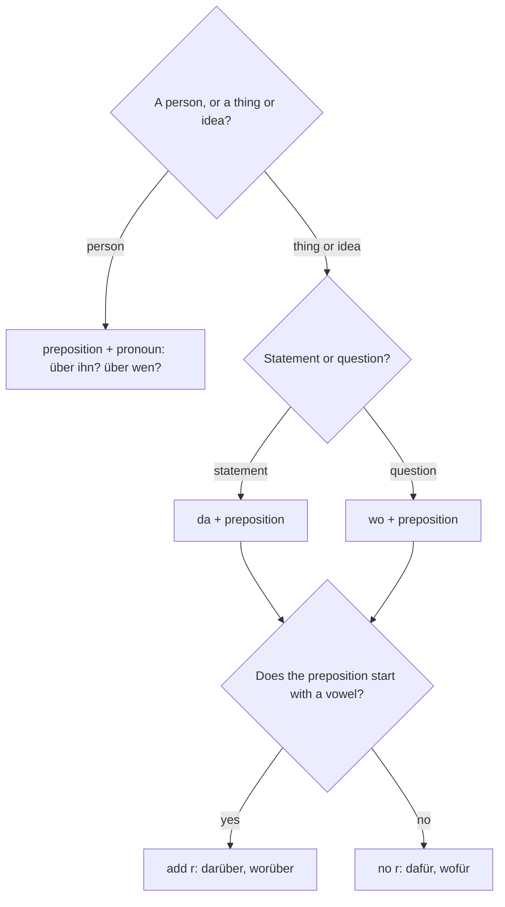

## What this lesson is for

At B1 you are expected to do more than say *Ich finde das gut*. You should be able to give your opinion with reasons, agree, disagree politely, weigh arguments and keep a discussion going. Several parts of the Goethe B1 exam, such as the forum post in Schreiben and the planning task in Sprechen, test exactly this.

Discussions are full of little words like *dafür, dagegen, darüber, davon, worum*. You met *darauf* and *worauf* in A2; this lesson completes the system: every preposition that can take *da-* and *wo-*, and the very German habit of using a *da-* word to point forward to a whole clause: *Ich bin dafür, dass …* (I'm in favour of …), *Es kommt darauf an, ob …* (It depends on whether …). Then you get a toolkit of phrases for giving opinions and discussing. The theme is media and social media: posts, sources, fake news and privacy, the topic of countless real discussions.

## da- and wo- compounds: the full set

A **da-compound** is *da* + a preposition, and it stands for a thing or an idea that was just mentioned: *Ich denke daran* (I'm thinking about it). A **wo-compound** is *wo* + a preposition, and it asks about a thing: *Woran denkst du?* (What are you thinking about?). Before a preposition that starts with a vowel, an *r* is added so the word is easier to say.

| preposition | da- | wo- | example |
|---|---|---|---|
| *an* | *daran* | *woran* | *Ich glaube nicht daran.* — I don't believe in it. |
| *auf* | *darauf* | *worauf* | *Worauf wartest du?* |
| *aus* | *daraus* | *woraus* | *Woraus besteht das?* — What's that made of? |
| *bei* | *dabei* | *wobei* | *Ich helfe dir dabei.* — I'll help you with it. |
| *durch* | *dadurch* | *wodurch* | *Dadurch wurde alles besser.* — That made everything better. |
| *für* | *dafür* | *wofür* | *Ich bin dafür.* — I'm for it. |
| *gegen* | *dagegen* | *wogegen* | *Hast du etwas dagegen?* — Do you mind? |
| *in* | *darin* | *worin* | *Worin liegt das Problem?* — What's the problem? |
| *mit* | *damit* | *womit* | *Damit bin ich einverstanden.* — I agree with that. |
| *nach* | *danach* | *wonach* | *Wonach suchst du?* — What are you looking for? |
| *über* | *darüber* | *worüber* | *Worüber diskutiert ihr?* |
| *um* | *darum* | *worum* | *Worum geht es?* — What's it about? |
| *unter* | *darunter* | *worunter* | *Viele Kinder, darunter auch meine Tochter …* — Many children, including my daughter … |
| *von* | *davon* | *wovon* | *Ich habe davon gehört.* — I've heard about it. |
| *vor* | *davor* | *wovor* | *Wovor hast du Angst?* |
| *zu* | *dazu* | *wozu* | *Was sagst du dazu?* — What do you say to that? |

*hinter, neben* and *zwischen* also have *da-* forms (*dahinter, daneben, dazwischen*), though their *wo-* forms are rare. Prepositions that take the genitive (*wegen, trotz, während*) and *ohne, seit, außer* have no *da-* or *wo-* form. Say *ohne das*, *trotzdem* (the fixed word for "nevertheless") or *deswegen*.

### Things vs people

The rule from A2 still holds, and it is the most common mistake at this level:

- For things and ideas: *da-* / *wo-*: *Sprichst du oft über Politik? — Ja, darüber spreche ich gern. Worüber sprichst du nicht gern?*
- For people: preposition + pronoun / *wen, wem*: *Sprichst du oft über deinen Chef? — Ja, über ihn spreche ich jeden Tag. Über wen sprichst du?*

In casual speech you'll hear *Über was redet ihr?* or *Mit was hast du bezahlt?* It's widespread, but in writing and in the exam use *worüber, womit*.

The whole decision as a chart:

## Pointing ahead: da- + dass or zu

Here is something English does differently. When a verb has a fixed preposition (*sich freuen auf, sich ärgern über, warten auf*), and what follows is not a noun but a whole clause, German puts a *da-* word in the main clause as a kind of signpost. It announces: "the content is coming in the next clause".

- *Ich freue mich darauf, dass du kommst.* — I'm looking forward to you coming.
- *Ich freue mich darauf, dich zu sehen.* — I'm looking forward to seeing you.
- *Er hat sich darüber geärgert, dass niemand ihm geantwortet hat.* — He was annoyed that nobody answered him.
- *Ich warte darauf, dass du dich entschuldigst.* — I'm waiting for you to apologise.
- *Wir sollten darauf achten, welche Informationen wir teilen.* — We should pay attention to what information we share.

This is a **forward-pointing da-compound**. The clause after it can start with *dass*, *ob*, a W-word or be an infinitive with *zu*. The *da-* word stays inside the main clause, before any participle or infinitive at its end (*Er hat sich darüber geärgert, dass …*), and the comma comes where the main clause ends.

Some fixed expressions always need it, and they are extremely common in discussions:

| expression | meaning | example |
|---|---|---|
| *Es geht darum, dass / … zu* | The point is that / It's about | *Es geht darum, die Kinder zu schützen.* |
| *Es kommt darauf an, ob / wie …* | It depends on whether / how … | *Es kommt darauf an, wie alt das Kind ist.* |
| *Es hängt davon ab, ob …* | It depends on whether … | *Es hängt davon ab, ob die Quelle glaubwürdig ist.* |
| *Ich bin dafür, dass / … zu* | I'm in favour of | *Ich bin dafür, das Handy in der Schule zu verbieten.* |
| *Ich bin dagegen, dass …* | I'm against | *Ich bin dagegen, dass alles gepostet wird.* |
| *Das liegt daran, dass …* | That's because … | *Das liegt daran, dass Falschmeldungen schnell geteilt werden.* |
| *Ich bin davon überzeugt, dass …* | I'm convinced that … | *Ich bin davon überzeugt, dass wir mehr Datenschutz brauchen.* |

*Es kommt darauf an* also works alone as an answer: *Findest du soziale Medien gut? — Es kommt darauf an.* (It depends.)

With everyday verbs like *sich freuen* or *sich ärgern*, the *da-* word is often left out (*Ich freue mich, dass du da bist.* — I'm glad you're here), but you're never wrong if you include it. Just pick the right one: *sich freuen über* (glad about something now) gives *darüber*, *sich freuen auf* (looking forward to something) gives *darauf*.

### wo-compounds in relative clauses *(receptive)*

In lesson 12 you learned *was* as a relative pronoun after *alles, etwas, nichts*. If the verb has a preposition, *was* becomes a *wo-* word: *Das ist etwas, worüber ich oft nachdenke.* — That's something I often think about. *Es gibt nichts, wofür ich mich schämen muss.* — There's nothing I need to be ashamed of.

## Words for media and debate

| German | English |
|---|---|
| *die sozialen Medien* | social media |
| *der Nutzer / die Nutzerin* | user |
| *der Beitrag* | post (online); contribution |
| *posten, teilen* | to post, to share |
| *die Quelle* | source |
| *glaubwürdig* | credible, trustworthy |
| *die Falschmeldung* | false report, fake news |
| *verbreiten* | to spread |
| *überprüfen* | to check, verify |
| *die Privatsphäre* | privacy |
| *der Datenschutz* | data protection |
| *der Einfluss, beeinflussen* | influence, to influence |
| *abhängig, die Abhängigkeit* | dependent, addicted; dependence, addiction |

And for arguing: *die Debatte* (debate), *das Argument* (argument as in "reason", not a quarrel: that's *der Streit*), *argumentieren*, *die Ansicht* and *der Standpunkt* (view, point of view), *behaupten* (to claim) and *die Behauptung*, *widersprechen* + dative (to contradict), *ablehnen* (to reject, turn down) and *die Ablehnung*, *der Zweifel* (doubt), *die Tatsache* (fact), *die Lüge* (lie).

The picture shows the parts of a typical post: the *Profil* of the person posting, the *Beitrag* itself, a link with its *Quelle*, the button to *teilen* (here *Teilen*) and a *Kommentar* below. Would you share this one? The source is unknown, the post is full of exclamation marks, it claims that "the politicians" are hiding something, and the comment asks exactly the right question: *Woher hast du das?* (Where did you get that from?)

![A social media post with labels. Profile (das Profil): Tina_Wahrheit, vor 2 Std. The post (der Beitrag): Unglaublich!!! Ab Montag werden alle Schulen in der Stadt geschlossen! Die Politiker sagen euch das nicht. Bitte sofort teilen!!! A link box (die Quelle): SCHULEN DICHT! Die ganze Wahrheit. Quelle: blitz-news24.example. Buttons: Gefällt mir, Kommentieren and Teilen; 1.204-mal geteilt. A comment (der Kommentar) from Max B.: Stimmt das? Auf der Webseite der Stadt steht nichts davon. Woher hast du das?](images/de3-m4-post.svg)

Two useful adverbs: *angeblich* (supposedly, allegedly) shows you doubt a claim: *Angeblich hat das Video zehn Millionen Klicks.* *tatsächlich* (actually, really, in fact) confirms it: *Ich habe es überprüft, und es stimmt tatsächlich.*

## Phrases for giving opinions and discussing

### Giving your opinion

- *Meiner Ansicht nach / Meiner Meinung nach ist das …* (verb straight after: it's position 1)
- *Ich bin der Meinung / der Ansicht, dass …*
- *Aus meiner Sicht …* — From my point of view …
- *Ich halte das für (eine gute Idee / übertrieben / gefährlich).* — I consider that (a good idea / exaggerated / dangerous). *halten für* + accusative.
- *Mein Standpunkt ist klar: …*

### Agreeing

- *Da stimme ich dir / Ihnen zu.* — I agree with you there.
- *Das sehe ich genauso.* — I see it the same way.
- *Da bin ich ganz deiner Meinung.* — I completely agree with you.
- *Damit bin ich einverstanden.* — I'm fine with that / I agree to that (a suggestion or plan).

### Partly agreeing

- *Da hast du zwar recht, aber …* — You're right there, but …
- *Im Prinzip ja, aber …* — In principle yes, but …
- *Das stimmt teilweise.* — That's partly true.

### Disagreeing

- *Das sehe ich anders.* — I see it differently.
- *Da bin ich anderer Meinung.* — I have a different opinion on that.
- *Da muss ich dir widersprechen.* — I have to disagree with you there.
- *Ich habe da meine Zweifel.* — I have my doubts about that.
- *Das halte ich für übertrieben.* — I think that's exaggerated.

### Keeping the discussion going

- *Was hältst du davon?* — What do you think of it?
- *Wie siehst du das?* — How do you see it?
- *Was meinst du damit?* — What do you mean by that?
- *Kannst du ein Beispiel dafür nennen?* — Can you give an example of that?
- *Darf ich kurz etwas dazu sagen?* — May I say something about that?
- *Lass mich bitte ausreden.* — Please let me finish.
- *Ein wichtiges Argument dafür / dagegen ist …* — An important argument for / against it is …

## Text: an online forum

> Ab wann sollen Kinder soziale Medien nutzen?
>
> Lena_K: Meine Tochter ist zwölf und möchte unbedingt ein eigenes Profil, weil angeblich alle in ihrer Klasse eins haben. Ich halte das für zu früh. Meiner Ansicht nach können Kinder in dem Alter noch nicht erkennen, welche Beiträge glaubwürdig sind. Außerdem mache ich mir Sorgen um ihre Privatsphäre: Was einmal gepostet ist, bleibt im Netz.
>
> Ömer1985: Ich verstehe deine Sorgen, aber ich sehe das ein bisschen anders. Verbote helfen meiner Erfahrung nach wenig. Wir haben mit unserem Sohn lange darüber gesprochen, was er teilen darf und was nicht. Es geht doch darum, dass Kinder lernen, kritisch mit Medien umzugehen. Und das lernen sie nicht, wenn sie gar keinen Zugang haben.
>
> Frau_Berger: Als Lehrerin muss ich Ömer teilweise widersprechen. Ich erlebe tatsächlich jeden Tag, wie stark soziale Medien meine Schüler beeinflussen. Falschmeldungen werden in der Klasse verbreitet, und niemand überprüft die Quelle. Manche Kinder sind richtig abhängig von ihrem Handy. Ich bin dafür, dass Eltern und Schulen mehr zusammenarbeiten.
>
> Lena_K: Danke euch! Wir haben jetzt einen Kompromiss gefunden: Meine Tochter darf ein Profil haben, aber es bleibt privat, und wir sprechen jede Woche darüber, was sie gesehen hat. Damit ist sie einverstanden – und ich auch.

In English:

> From what age should children use social media?
>
> Lena_K: My daughter is twelve and really wants her own profile, because supposedly everyone in her class has one. I think that's too early. In my view, children at that age can't yet recognise which posts are credible. And I'm worried about her privacy: what's been posted once stays on the net.
>
> Ömer1985: I understand your worries, but I see it a bit differently. In my experience bans don't help much. We talked to our son for a long time about what he may share and what not. The point is that children learn to deal critically with media. And they don't learn that if they have no access at all.
>
> Frau_Berger: As a teacher I have to partly disagree with Ömer. I actually see every day how strongly social media influence my pupils. Fake news gets spread in the class, and nobody checks the source. Some children are really addicted to their phones. I'm in favour of parents and schools working together more.
>
> Lena_K: Thanks, both of you! We've found a compromise now: my daughter can have a profile, but it stays private, and every week we talk about what she's seen. She's fine with that – and so am I.

Words to note: *das Profil* (profile), *erkennen* (to recognise), *sich Sorgen machen um* (to worry about), *der Zugang* (access), *erleben* (to experience). Notice *Was einmal gepostet ist*: a state passive from lesson 17. And notice how each post has the same shape as a good B1 forum answer: an opinion, a reason, an example.

## Pronunciation

- *das Argument*: stress on the last syllable, ar-gu-MENT; the same for *argumentieren* (ar-gu-men-TIE-ren, like all *-ieren* verbs).
- *widersprechen* is inseparable, and the stress is on the verb: wi-der-SPRE-chen: *Ich widerspreche dir. Sie hat mir widersprochen.*
- *die Privatsphäre*: pri-VAAT-sfä-re; *ph* is said as *f*.
- In *dafür, darauf, damit*, the stress is usually on the preposition (da-FÜR), but when you point at something, it moves to *da*: *DAfür bin ich nicht.* — I'm not in favour of *that*.

## Common mistakes

- *da-* words for people: ~~Ich habe gestern darüber gesprochen~~ (meaning "about my boss") → *über ihn*.
- Leaving the preposition hanging, English-style: ~~Das ist etwas, was ich mich freue auf.~~ → *Das ist etwas, worauf ich mich freue.*
- No *da-* word before a fixed expression: ~~Es kommt an, ob …~~ → *Es kommt darauf an, ob …*. ~~Ich bin für, dass …~~ → *Ich bin dafür, dass …*
- *halten als*: ~~Ich halte das als eine gute Idee.~~ → *Ich halte das für eine gute Idee.*
- Accusative with *widersprechen*: ~~Ich widerspreche dich.~~ → *Ich widerspreche dir* (dative), like *zustimmen*.
- Word order after *meiner Meinung nach*: ~~Meiner Meinung nach soziale Medien sind gefährlich.~~ → *Meiner Meinung nach sind soziale Medien gefährlich.*
- *das Argument* is a reason, not a quarrel: "We had an argument" is *Wir hatten Streit / Wir haben uns gestritten*.

## Key points

- *da(r)-* + preposition replaces a thing or idea; *wo(r)-* + preposition asks about one. For people use preposition + pronoun or *wen / wem*.
- *r* before a vowel: *darauf, worüber, daran*. No *da-/wo-* forms with *ohne, seit, außer* or genitive prepositions.
- A *da-* word can point ahead to a *dass*, *ob*, W- or *zu* clause: *Ich freue mich darauf, dich zu sehen. Es kommt darauf an, ob …*
- Learn the discussion phrases in groups: giving an opinion, agreeing, partly agreeing, disagreeing, keeping the discussion going.
- *halten für* + accusative, *widersprechen* + dative, *einverstanden mit* + dative.

The words from this lesson are listed below; they join your vocabulary reviews when you complete the lesson.
