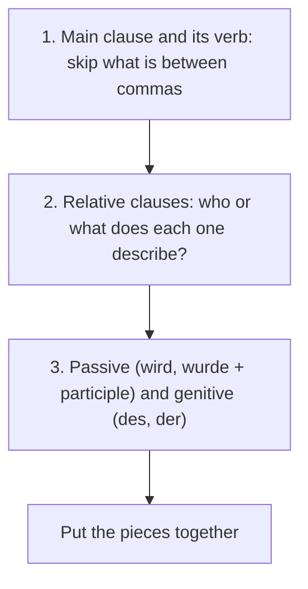

## What this lesson is for

This lesson closes the module by putting its grammar to work on the hardest everyday texts there are: news about politics. A single sentence from a news website can contain a relative clause, a passive and a genitive at once: *Das Gesetz, das gestern vom Bundestag beschlossen wurde, regelt die Rechte der Mieter.* You have learned each of these pieces separately (relative clauses in lesson 11, the genitive in lesson 13, the passive in lessons 16–18). Here you practise taking such sentences apart.

You also meet one new feature of formal German, **nominal style**: packing a whole action into a noun (*die Einführung des Gesetzes* instead of *das Gesetz wird eingeführt*). You only need to understand it, but it is everywhere in the news.

The theme is politics and society: how Germany is governed, elections, parties, rights, and how ordinary people take part. These words are on the Goethe B1 list, and you need them to follow the news and to talk about your own country.

## Text: Wie funktioniert die Demokratie in Deutschland?

> Deutschland ist ein demokratischer Staat mit 16 Bundesländern. Die Regeln, nach denen der Staat funktioniert, stehen im Grundgesetz, der deutschen Verfassung, die 1949 beschlossen wurde. Darin sind auch die Grundrechte der Bürgerinnen und Bürger festgelegt, zum Beispiel die Meinungsfreiheit und die Gleichberechtigung von Frauen und Männern.
>
> Das wichtigste Parlament ist der Bundestag in Berlin. Er wird alle vier Jahre gewählt. Wählen darf jede deutsche Staatsbürgerin und jeder deutsche Staatsbürger ab 18 Jahren. Jeder Wähler und jede Wählerin hat zwei Stimmen: Mit der Erststimme wählt man eine Person aus dem eigenen Wahlkreis, mit der Zweitstimme eine Partei. Die Zweitstimme ist wichtiger, denn sie entscheidet darüber, wie viele Sitze jede Partei im Parlament bekommt.
>
> Weil eine Partei allein selten die Mehrheit hat, müssen sich nach der Wahl meistens zwei oder drei Parteien auf eine Koalition einigen. Danach wählen die Abgeordneten den Bundeskanzler oder die Bundeskanzlerin. Er oder sie leitet die Regierung und schlägt die Ministerinnen und Minister vor, die dann vom Bundespräsidenten ernannt werden.
>
> Im Bundestag werden die Gesetze diskutiert und beschlossen. Bei vielen Gesetzen müssen aber auch die Bundesländer zustimmen, die im Bundesrat vertreten sind. Außerdem hat jedes Bundesland ein eigenes Parlament und eine eigene Regierung, die zum Beispiel für die Schulen und die Polizei zuständig sind.

In English:

> Germany is a democratic state with 16 federal states. The rules by which the state works are in the Basic Law, the German constitution, which was adopted in 1949. It also sets out the basic rights of citizens, for example freedom of expression and equal rights for women and men.
>
> The most important parliament is the Bundestag in Berlin. It is elected every four years. Every German citizen aged 18 or over may vote. Every voter has two votes: with the first vote you vote for a person from your own constituency, with the second vote for a party. The second vote is more important, because it decides how many seats each party gets in parliament.
>
> Because one party rarely has a majority on its own, two or three parties usually have to agree on a coalition after the election. Then the members of parliament elect the Federal Chancellor. He or she leads the government and proposes the ministers, who are then appointed by the Federal President.
>
> Laws are debated and passed in the Bundestag. For many laws, however, the federal states, which are represented in the Bundesrat, also have to agree. In addition, each federal state has its own parliament and its own government, which are responsible for schools and the police, for example.

Words to note: *das Grundrecht* (basic right), *festlegen* (to lay down, fix), *der Staatsbürger / die Staatsbürgerin* (citizen), *der Wahlkreis* (constituency), *der Sitz* (seat), *die Koalition* (coalition), *der / die Abgeordnete* (member of parliament; an adjectival noun from lesson 5: *ein Abgeordneter*), *vorschlagen* (to propose), *ernennen* (to appoint), *der Bundespräsident / die Bundespräsidentin* (Federal President, the head of state), *vertreten* (to represent).

A note on the facts: under the electoral reform of 2023, first used in the 2025 election, the Bundestag has a fixed 630 seats, and winning the most first votes in a constituency no longer guarantees a seat: the winner only gets in if their party's second votes cover it. In 2025, 23 constituencies were left without a directly elected member. Further changes are being discussed, so check the current rules before you rely on the details. Formally, the Bundestag elects the Chancellor on the proposal of the Federal President, who in practice proposes the coalition's candidate. And 18 is the voting age for the Bundestag; for European elections, and for state and local elections in several *Bundesländer*, it is 16.

The diagram shows who elects or appoints whom at the federal level. (The Federal President is elected by a special assembly, the *Bundesversammlung*, made up of all members of the Bundestag and the same number of delegates from the states.)

## Taking a news sentence apart

News sentences look long, but they are built from parts you know. Read them in three passes.

1. Find the main clause and its verb. Skip everything between commas for a moment.

*Der Bundeskanzler, der seit zwei Jahren regiert, hat gestern eine neue Ministerin vorgestellt.* → *Der Bundeskanzler hat gestern eine neue Ministerin vorgestellt.*

2. Look at the relative clauses. Who or what does each one describe?

- *Die Partei, die die meisten Stimmen bekommen hat, …* — the party that got the most votes
- *Die Politikerin, der viele junge Wähler vertrauen, …* — the politician (whom) many young voters trust (dative: *vertrauen* + Dat)
- *Das Thema, über das im Parlament gestritten wird, …* — the topic that is being argued about in parliament

3. Spot the passive and the genitive.

- Passive: *Das Gesetz wurde mit großer Mehrheit beschlossen.* (*wurde* + participle: past.) *Die Steuern sollen erhöht werden.* (modal passive.)
- Genitive: *die Wahl des Bundeskanzlers* (the election of the Chancellor), *die Rechte der Bürger* (the citizens' rights), *die Regierung des Landes* (the government of the state).

Put together: *Die Ministerin, die im Mai ernannt worden war, musste wegen eines Fehlers ihres Ministeriums zurücktreten.* — The minister, who had been appointed in May, had to resign because of a mistake by her ministry. Relative clause, past perfect passive, genitive preposition and genitive in one sentence; take it one piece at a time and it falls into place. (*zurücktreten*: to resign; *ist zurückgetreten*.)

The three passes as a diagram:

## Nominal style: actions packed into nouns *(receptive)*

Spoken German uses verbs: *Das Gesetz wird eingeführt.* Written German, especially news and official texts, often turns the verb into a noun and the rest of the sentence into a genitive: *die Einführung des Gesetzes*. This is **nominal style** (*Nominalstil*). It's compact, so headlines love it: *Einführung des Gesetzes verschoben* (Introduction of the law postponed).

| verb | noun |
|---|---|
| *wählen* | *die Wahl* |
| *einführen* | *die Einführung* |
| *abschaffen* | *die Abschaffung* |
| *erhöhen* | *die Erhöhung* |
| *entscheiden* | *die Entscheidung* |
| *beschließen* | *der Beschluss* |
| *regieren* | *die Regierung* |
| *demonstrieren* | *die Demonstration* |
| *integrieren* | *die Integration* |

Most nouns end in *-ung* (always feminine), some in *-ion* (also feminine), and some are short forms of the verb (*die Wahl, der Beschluss*).

To understand a nominal phrase, turn it back into a clause. The noun becomes the verb, and the genitive usually becomes the object (or the subject):

| nominal style (written) | verbal style (spoken) |
|---|---|
| *Nach der Wahl des neuen Bürgermeisters …* | *Nachdem der neue Bürgermeister gewählt worden war, …* |
| *Die Regierung plant die Erhöhung der Steuern.* | *Die Regierung plant, die Steuern zu erhöhen.* |
| *Wegen der Schließung des Schwimmbads protestieren viele Eltern.* | *Viele Eltern protestieren, weil das Schwimmbad geschlossen wird.* |
| *Bei der Abstimmung über das Gesetz …* | *Als über das Gesetz abgestimmt wurde, …* |

You don't need to write like this at B1; in your own texts, the verbal style is clearer. But when you meet a long noun with *-ung* followed by *des / der*, ask: "Who does what to whom?"

## Words for politics

| German | English |
|---|---|
| *die Politik, politisch* | politics, policy; political |
| *der Politiker / die Politikerin* | politician |
| *die Partei* | (political) party |
| *die Wahl, wählen* | election, choice; to vote, elect, choose |
| *der Wähler / die Wählerin* | voter |
| *die Stimme* | vote; voice |
| *abstimmen (über)* | to vote (on a question) |
| *die Regierung, regieren* | government; to govern |
| *das Parlament, der Bundestag* | parliament; the German federal parliament |
| *der Bundeskanzler / die Bundeskanzlerin* | Federal Chancellor |
| *der Minister / die Ministerin* | minister |
| *der Staat* | state, country (as a political unit) |
| *die Demokratie, demokratisch* | democracy, democratic |
| *die Verfassung, das Grundgesetz* | constitution; the German constitution |
| *das Recht* | right; law (the legal system) |
| *gerecht* | fair, just |

Some notes:

- *wählen* is "to vote" in an election and "to elect" someone: *Wen hast du gewählt?* For a yes/no decision on a question, use *abstimmen über*: *Im Parlament wird morgen über das Gesetz abgestimmt.* *wählen* also keeps its everyday meaning "to choose": *Sie können zwischen drei Terminen wählen.*
- *die Politik* covers both "politics" and "policy": *die Umweltpolitik der Regierung* (the government's environmental policy).
- *das Recht* is a right (*das Recht auf Bildung*, the right to education; plural *die Rechte*) and also the law as a system (*das deutsche Recht*). A single law passed by parliament is *das Gesetz* (lesson 18).
- *der Staat* is the political state; a German or Austrian federal state is *das Bundesland* (or *das Land*).

## Taking part: interview with a local campaigner

> Reporterin: Frau Weber, Sie engagieren sich in der Bürgerinitiative „Rettet unser Hallenbad“. Worum geht es Ihnen?
>
> Frau Weber: Die Stadt will das Hallenbad schließen, weil die Renovierung zu teuer ist. Wir finden das nicht gerecht. Das Bad wird von Schulen, Vereinen und vielen älteren Menschen genutzt.
>
> Reporterin: Was haben Sie bisher gemacht?
>
> Frau Weber: Wir haben über 4.000 Unterschriften gesammelt und letzten Samstag vor dem Rathaus demonstriert. Zu der Demonstration sind fast 800 Leute gekommen.
>
> Reporterin: Und wie geht es weiter?
>
> Frau Weber: Im März wird im Stadtrat darüber abgestimmt. Bis dahin sprechen wir mit Politikerinnen und Politikern aller Parteien.
>
> Reporterin: Machen Sie das alles ehrenamtlich?
>
> Frau Weber: Natürlich. Ich arbeite Vollzeit, das Ehrenamt mache ich abends. Aber es lohnt sich: Ich habe viele Nachbarn kennengelernt, auch Familien, die erst seit Kurzem hier wohnen. Für die Integration ist so ein Projekt übrigens auch gut.

In English:

> Reporter: Ms Weber, you're involved in the citizens' action group "Save our indoor pool". What is it about for you?
>
> Ms Weber: The town wants to close the indoor pool because the renovation is too expensive. We don't think that's fair. The pool is used by schools, clubs and lots of older people.
>
> Reporter: What have you done so far?
>
> Ms Weber: We've collected over 4,000 signatures and last Saturday we demonstrated in front of the town hall. Almost 800 people came to the demonstration.
>
> Reporter: And what happens next?
>
> Ms Weber: In March the town council will vote on it. Until then we're talking to politicians from all parties.
>
> Reporter: Do you do all this as a volunteer?
>
> Ms Weber: Of course. I work full-time; I do the voluntary work in the evenings. But it's worth it: I've got to know lots of neighbours, including families who have only lived here for a short time. A project like this is good for integration too, by the way.

*sich engagieren* (to get involved, be active; said with a French *g*: an-ga-ZHIE-ren) is reflexive: *Ich engagiere mich für den Umweltschutz.* *ehrenamtlich* means unpaid, voluntary; *das Ehrenamt* is a voluntary position or volunteering. According to the government's large volunteering survey (2024), more than a third of people in Germany aged 14 and over volunteer in some way: in sports clubs, the volunteer fire brigade, churches or helping refugees.

## Austria and Switzerland

The words are the same, but the systems differ. In Austria you can vote from the age of 16, and the government is led by the *Bundeskanzler*, as in Germany. In Switzerland, people vote directly on many questions several times a year in *Volksabstimmungen* (referendums), so *abstimmen* is a word every Swiss citizen uses regularly.

## Pronunciation

- Stress moves in this word family: *die Politik* (po-li-TIK), but *der Politiker* (po-LI-ti-ker) and *politisch* (po-LI-tisch).
- *die Demokratie*: stress on the last syllable, de-mo-kra-TIE; *demokratisch*: de-mo-KRA-tisch.
- *das Parlament*: par-la-MENT; *die Regierung*: re-GIE-rung, long *ie*.
- *die Demonstration*: -tion is said "-tsjohn", as in all *-ion* words.

## Common mistakes

- *die Partei* is only political. A party with music and drinks is *die Party* or *die Feier*: ~~Ich gehe heute Abend auf eine Partei.~~
- *wählen* vs *abstimmen*: you *wählen* people and parties, you *abstimmen über* a question.
- Forgetting the reflexive pronoun: ~~Ich engagiere für die Umwelt.~~ → *Ich engagiere mich für die Umwelt.*
- *recht haben* vs *das Recht*: *Du hast recht* (you're right) is usually written lower case (*Recht haben* is also allowed); *Du hast das Recht, deine Meinung zu sagen* (you have the right to say what you think) is the noun.
- Head of state and head of government: in Germany the *Bundeskanzler* leads the government; the *Bundespräsident* is the head of state, with mostly ceremonial tasks. Don't call the chancellor "Präsident".

## Key points

- News sentences combine relative clauses, passive and genitive. Read in three passes: main clause, relative clauses, then passive and genitive.
- Nominal style turns a clause into a noun + genitive: *die Einführung des Gesetzes* = *das Gesetz wird eingeführt*. Recognise it; in your own writing, prefer verbs.
- Nouns in *-ung* and *-ion* are feminine.
- *wählen* people and parties; *abstimmen über* a question. *die Partei* is political, *die Party* is fun.
- Germany: Bundestag elected every four years from age 18, two votes (the second vote decides the seats), coalition, the Bundestag elects the Chancellor; the Grundgesetz is the constitution.

The words from this lesson are listed below; they join your vocabulary reviews when you complete the lesson.
