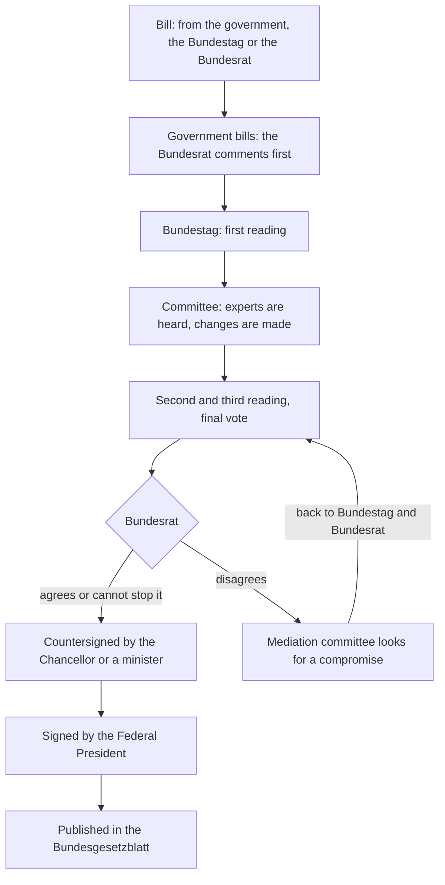

## From the town hall to the Bundestag

In lessons 16 to 18 you learned the passive step by step: *Der Müll wird abgeholt. Das Rathaus wurde 1890 gebaut. Der Antrag muss eingereicht werden.* In lesson 20 you met the Bundestag, the parties and the Chancellor. This honors lesson brings the two together in the place where the passive is most at home: the description of how a law is made. Nobody reads "the clerk sends the bill to the committee"; official German says *Der Entwurf wird an einen Ausschuss überwiesen.*

You will also take the passive a step further than the core lessons:

- the difference between an action and a state (*Das Gesetz wird verabschiedet* vs *Das Gesetz ist verabschiedet*), now for active use;
- passives with no subject at all, from verbs with a dative or a preposition (*Dem Antrag wurde zugestimmt. Darüber wird abgestimmt.*);
- four other ways to avoid naming the doer, including *sich lassen* (*Das lässt sich ändern*);
- and a critical eye: why politicians like sentences such as *Es wurden Fehler gemacht.*

## Text: Wie ein Gesetz entsteht

> Die meisten Gesetze werden von der Bundesregierung vorgeschlagen. Ein Gesetzentwurf kann aber auch aus der Mitte des Bundestages oder vom Bundesrat eingebracht werden. Entwürfe der Regierung werden zuerst dem Bundesrat zugeleitet, der innerhalb von sechs Wochen dazu Stellung nehmen kann.
>
> Im Bundestag wird jeder Entwurf in drei Lesungen beraten. Nach der ersten Lesung wird er an einen Ausschuss überwiesen. Dort werden Expertinnen und Experten angehört, und der Text wird oft noch geändert. In der zweiten und dritten Lesung wird im Plenum, also im ganzen Bundestag, noch einmal diskutiert, und am Ende wird abgestimmt. Wenn die Mehrheit zustimmt, ist das Gesetz verabschiedet.
>
> Danach ist der Bundesrat an der Reihe. Manche Gesetze brauchen seine Zustimmung. Bei den anderen kann er nur Einspruch einlegen, und dieser Einspruch kann vom Bundestag zurückgewiesen werden. Wenn sich Bundestag und Bundesrat nicht einig sind, kann der Vermittlungsausschuss angerufen werden. Dort wird von beiden Seiten nach einem Kompromiss gesucht.
>
> Zum Schluss wird das Gesetz von der Regierung gegengezeichnet, vom Bundespräsidenten oder von der Bundespräsidentin unterzeichnet und im Bundesgesetzblatt verkündet, das seit 2023 nur noch online erscheint. Dann tritt es in Kraft: an dem Tag, der im Gesetz festgelegt ist, oder, wenn kein Tag festgelegt ist, 14 Tage nach dem Erscheinen des Bundesgesetzblatts.

In English:

> Most laws are proposed by the federal government. But a bill can also be introduced from within the Bundestag or by the Bundesrat. Government bills are first sent to the Bundesrat, which can comment on them within six weeks.
>
> In the Bundestag every bill is debated in three readings. After the first reading it is referred to a committee. There experts are heard, and the text is often changed. In the second and third readings there is another debate in the plenary, that is, the whole Bundestag, and at the end there is a vote. If the majority agrees, the law is passed.
>
> Then it's the Bundesrat's turn. Some laws need its consent. For the others it can only lodge an objection, and this objection can be overruled by the Bundestag. If the Bundestag and the Bundesrat don't agree, the mediation committee can be called in. There both sides look for a compromise.
>
> Finally the law is countersigned by the government, signed by the Federal President and published in the Federal Law Gazette, which since 2023 only appears online. Then it comes into force: on the day set in the law or, if no day is set, 14 days after that issue of the Gazette appears.

Words to note: *der Gesetzentwurf* (bill, draft law; *der Entwurf* is any draft), *einbringen* (to introduce a bill), *zuleiten* (to forward officially), *Stellung nehmen* (to comment, give a view), *die Lesung* (reading), *der Ausschuss* (committee), *überweisen* (here: to refer), *anhören* (here: to hear, consult), *das Plenum* (plenary, the full house), *verabschieden* (to pass a law), *die Zustimmung* (consent, approval), *der Einspruch* (objection), *zurückweisen* (to reject, overrule), *der Vermittlungsausschuss* (mediation committee, 16 members from each chamber), *gegenzeichnen* (to countersign), *unterzeichnen* (to sign, formal), *verkünden* (to proclaim, publish officially), *in Kraft treten* (to come into force; *trat in Kraft, ist in Kraft getreten*).

The process as a chart. It is simplified: for example, a bill from the Bundestag itself goes straight to its first reading.

Two facts worth knowing. Before signing, the Federal President checks that the law was made in the right way; how far he or she may also check its content is debated among lawyers, and presidents have refused to sign only a few times since 1949. And the Basic Law itself can only be changed with a two-thirds majority in both the Bundestag and the Bundesrat.

## Action or state: werden or sein?

Lesson 17 showed you the **state passive** for recognition: *Die Straße ist gesperrt.* Now use it yourself. The rule is simple:

- *werden* + Partizip II describes the action, the process: *Das Gesetz wird verabschiedet.* (It is being passed: the vote is happening.)
- *sein* + Partizip II describes the state after the action: *Das Gesetz ist verabschiedet.* (It has been passed; that's done.)

| | action (werden) | state (sein) |
|---|---|---|
| present | *Die Grenze wird geöffnet.* | *Die Grenze ist geöffnet.* |
| Präteritum | *Die Grenze wurde geöffnet.* | *Die Grenze war geöffnet.* |
| Perfekt | *Die Grenze ist geöffnet worden.* | rare |

Watch the middle column's Perfekt and the right column's present: *ist geöffnet worden* (an event: it has been opened) and *ist geöffnet* (a state: it is open) differ only by *worden*.

The state passive only works when the action leaves a visible result that lasts: *geöffnet, geschlossen, verboten, geregelt, festgelegt, verletzt, beschlossen.* With verbs whose action leaves no such state, only the *werden*-passive makes sense: *Der Minister wird oft kritisiert* is fine, but ~~Der Minister ist kritisiert~~ doesn't work: being criticised leaves no lasting state. A quick test: can you put *schon* in front and describe a finished situation? *Die Sitzung ist schon eröffnet* works, so the state passive is possible.

### Example 1: choosing werden or sein

Complete: *Seit 2023 ___ das Rauchen in unserem Stadtpark ___.* (verbieten)

1. Is this an action happening at one moment, or a situation that lasts? *Seit 2023* describes a situation that has existed since then.
2. A lasting state needs *sein*: *Seit 2023 ist das Rauchen in unserem Stadtpark verboten.*
3. Compare the action: *2023 wurde das Rauchen im Stadtpark verboten* (in 2023 the ban was made). Same verb, different moment.

## Passives without a subject

In lesson 16 you saw *Den Kunden wird sofort geholfen*, and in lesson 17 *Hier wird nicht geraucht*. Official and political German uses this kind of passive constantly, so now you should be able to build it. There are three cases.

**Verbs with a dative object** (*helfen, zustimmen, widersprechen, danken, folgen*): the dative stays a dative, because only an accusative object can become a passive subject. With no subject, the verb is always in the *er/sie/es* form:

- *Der Bundestag stimmte dem Gesetz zu.* → *Dem Gesetz wurde (vom Bundestag) zugestimmt.*
- *Viele Abgeordnete widersprachen der Ministerin.* → *Der Ministerin wurde von vielen Abgeordneten widersprochen.*
- *Man hilft den Flutopfern schnell.* → *Den Flutopfern wird schnell geholfen.* (*die Flutopfer*: flood victims. It's *wird*, not ~~werden~~, even though *den Flutopfern* is plural.)

**Verbs with a fixed preposition** (*abstimmen über, sprechen über, sorgen für, suchen nach*): the prepositional phrase stays as it is, or becomes a *da-* word (lesson 19):

- *Im März wird über das Gesetz abgestimmt.* — The law will be voted on in March.
- *Darüber wird seit Jahren gestritten.* — People have been arguing about that for years.
- *Es wird nach einer Lösung gesucht.* — A solution is being looked for.

**A dass- or ob-clause as the content**: the main clause has only *es* + passive, and the clause says what was decided, expected or checked:

- *Es wurde beschlossen, dass die Bibliothek länger geöffnet bleibt.*
- *Es wird erwartet, dass das Gesetz im Herbst in Kraft tritt.* — It is expected that …
- *Es wird geprüft, ob der Entwurf mit dem Grundgesetz vereinbar ist.* — It is being checked whether … (*vereinbar mit*: compatible with)

Remember the *es* rule from lesson 17: *es* only fills an empty position 1. *Im März wird über das Gesetz abgestimmt* has no *es*, because *Im März* is already in position 1.

### Example 2: active to subjectless passive

Make passive, without the doer: *Der Ausschuss hat den Experten für ihre Hilfe gedankt.*

1. Find the object. *danken* takes the dative: *den Experten* is dative plural. There is no accusative object, so there will be no subject.
2. The dative stays: *den Experten*. The verb goes into the *er/sie/es* form.
3. The tense is Perfekt, so: *ist … gedankt worden* (or Präteritum *wurde … gedankt*).
4. Result: *Den Experten ist für ihre Hilfe gedankt worden.* Or in written style: *Den Experten wurde für ihre Hilfe gedankt.*

## Four more ways to leave out the doer

The *werden*-passive is the main tool, but official German has a whole family of constructions that all avoid naming who does something. You met three of them in lessons 16 and 18; the fourth is new.

| meaning | passive | alternatives |
|---|---|---|
| someone does it | *Das Formular wird ausgefüllt.* | *Man füllt das Formular aus.* |
| it must be done | *Der Antrag muss eingereicht werden.* | *Der Antrag ist einzureichen.* |
| it can be done | *Das Problem kann gelöst werden.* | *Das Problem lässt sich lösen.* / *Das Problem ist zu lösen.* / *Das Problem ist lösbar.* |

The new one is **sich lassen** + infinitive: *Das lässt sich ändern* means "that can be changed". The thing is the subject, *lassen* agrees with it, *sich* stands next to it, and the infinitive goes to the end:

- *Das Problem lässt sich leicht lösen.* — The problem can easily be solved.
- *Die Fenster lassen sich nicht öffnen.* — The windows can't be opened.
- *Der Streit ließ sich nur mit einem Kompromiss beenden.* — The dispute could only be ended with a compromise. (Präteritum *ließ*.)

Lesson 27 teaches *lassen* in its other meaning, "to have something done" (*Ich lasse mein Auto reparieren*). With *sich* and a thing as subject, it means "can be done".

### Example 3: one sentence, four forms

Start: *Man kann das Grundgesetz nur mit einer Zweidrittelmehrheit ändern.*

1. Modal passive: *Das Grundgesetz kann nur mit einer Zweidrittelmehrheit geändert werden.*
2. *sich lassen*: *Das Grundgesetz lässt sich nur mit einer Zweidrittelmehrheit ändern.*
3. *sein + zu*: *Das Grundgesetz ist nur mit einer Zweidrittelmehrheit zu ändern.*
4. *-bar*: *Das Grundgesetz ist nur mit einer Zweidrittelmehrheit änderbar.*

All four are correct; the first two are the most common. But be careful with *sein + zu* when there is no word like *leicht, schwer, nur, kaum*: *Der Antrag ist online zu stellen* means "must be made online", not "can be made online". If you mean "can", the modal passive is safest: *Der Antrag kann online gestellt werden.*

### An authentic sentence

German laws are public, and they use exactly this grammar. Article 76 of the Basic Law says: *Vorlagen der Bundesregierung sind zunächst dem Bundesrat zuzuleiten.* Take it apart: *sind … zuzuleiten* is *sein + zu* with the separable verb *zuleiten*, and it is a rule, so it means "must": Government bills must first be sent to the Bundesrat. As a modal passive: *Vorlagen der Bundesregierung müssen zunächst dem Bundesrat zugeleitet werden.*

## Reading critically: who did it?

The passive hides the doer, and sometimes that is the point. When a politician says *Es wurden Fehler gemacht* (mistakes were made), the listener doesn't learn who made them. Journalists notice this, and so should you. Compare:

- *Die Ministerin hat Fehler gemacht.* — clear responsibility.
- *Im Ministerium wurden Fehler gemacht.* — a place, but no person.
- *Es wurden Fehler gemacht.* — nobody at all.

Nominal style (lesson 20) can hide the doer just as well: *Nach der Erhöhung der Gebühren …* doesn't say who raised them. Neither form is dishonest in itself; processes, rules and news often have no single doer worth naming. But when responsibility matters, ask: *Von wem?*

## Common mistakes

- Plural verb in a subjectless passive: ~~Den Bürgern werden geholfen.~~ → *Den Bürgern wird geholfen.* There is no subject, so the verb stays singular.
- Making a dative into a nominative: ~~Die Ministerin wurde widersprochen.~~ → *Der Ministerin wurde widersprochen.* Only accusative objects become subjects.
- State passive for an action at a point in time: ~~Das Gesetz war am 5. März verabschiedet.~~ (if you mean the vote) → *Das Gesetz wurde am 5. März verabschiedet.*
- Forgetting *sich*: ~~Das lässt leicht ändern.~~ → *Das lässt sich leicht ändern.*
- Reading *sein + zu* as "can" in a rule: *Der Ausweis ist vorzulegen* means you must show it.
- *es* when another word is already in position 1: ~~Im Bundestag wurde es heftig gestritten.~~ → *Im Bundestag wurde heftig gestritten.*

## Key points

- Action: *werden* + Partizip II (*Das Gesetz wird verabschiedet*). State: *sein* + Partizip II (*Das Gesetz ist verabschiedet*), only for actions that leave a lasting result.
- Verbs with a dative or a preposition make subjectless passives: *Dem Antrag wurde zugestimmt. Darüber wird abgestimmt.* The verb is always singular; *es* only fills an empty position 1.
- *Es wurde beschlossen / erwartet / geprüft, dass / ob …* reports decisions without naming who.
- "Can be done": *kann … werden*, *lässt sich* + infinitive, *ist … zu* + infinitive (with *leicht, schwer, kaum, nur*), *-bar*.
- A German law: bill, three readings with a committee, Bundesrat, countersignature, signature by the Federal President, publication, entry into force.
- When the doer is missing, ask whether it matters who it was.

The words from this lesson are listed below; they join your vocabulary reviews when you complete the lesson.
