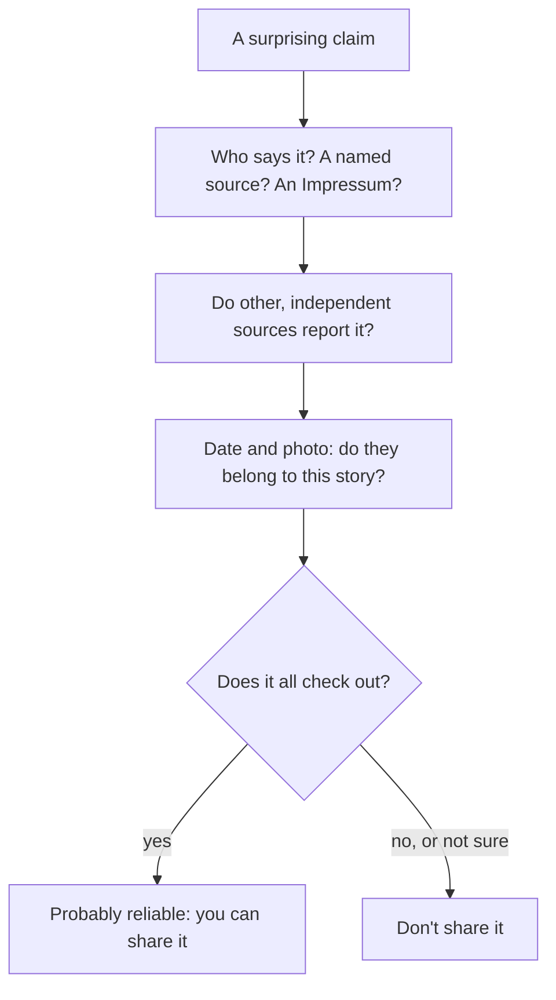

## Who says so?

In lesson 19 you met *die Quelle*, *glaubwürdig*, *die Falschmeldung* and the word *angeblich*, and you saw a post that claimed all the schools in town would close. This honors lesson goes one step further: it teaches the German that journalists use to show *who* claims something and *how sure* they are, and it gives you a method for checking a claim yourself.

The grammar is small but powerful: the prepositions *laut*, *nach Angaben* and *zufolge*; *sollen* and *wollen* in their "hearsay" meanings (*Er soll reich sein*, "he is said to be rich"); a first look at the special verb forms of reported speech; and a set of adverbs from *tatsächlich* to *angeblich*. These are B1+ and B2 structures, and you'll meet them in every German news report.

## Naming the source

A careful news report says where each piece of information comes from. German has several ways to do this:

| construction | example | English |
|---|---|---|
| *laut* + noun | *Laut Polizei wurde niemand verletzt.* | According to the police, nobody was hurt. |
| *laut* + dative or genitive | *laut einem Bericht / laut eines Berichts* | according to a report |
| *nach Angaben* + genitive | *Nach Angaben der Stadt …* | According to the town … |
| noun (dative) + *zufolge* | *Einer Studie zufolge …* | According to a study … |
| *wie* + subject + verb | *Wie die Feuerwehr mitteilte, …* | As the fire brigade announced, … |
| *es heißt, …* | *Es heißt, der Minister trete zurück.* | It is said that the minister is resigning. |

Three details matter. *zufolge* comes after its noun, which is in the dative: *dem Bericht zufolge*, *einer Umfrage zufolge*. *nach Angaben* (literally "according to the statements") is very common, also as *nach eigenen Angaben* (by his / her / their own account). And a *wie*-clause counts as position 1, so the main verb follows straight after the comma: *Wie die Polizei mitteilte, wurde der Fahrer leicht verletzt.*

The source is not the same as the truth. *Laut einer Studie* only tells you that a study says so. Whether the study is good is a different question.

## sollen and wollen: reported claims

You know *sollen* as "should, be supposed to" and *wollen* as "want". In news German, both have a second, **hearsay** meaning: they pass on a claim without confirming it.

*sollen* = "is said to, reportedly": the speaker passes on what others say, without confirming it.

- *Das neue Café soll sehr gut sein.* — The new café is supposed to be very good (people say).
- *Der Täter soll etwa 30 Jahre alt sein.* — The offender is said to be about 30.

*wollen* = "claims to": the subject says it about himself or herself, and the speaker has doubts.

- *Der Fahrer will das Rotlicht nicht gesehen haben.* — The driver claims not to have seen the red light.
- *Sie will die Frau noch nie getroffen haben.* — She claims never to have met the woman.

For something in the past, use the **perfect infinitive**: Partizip II + *haben* or *sein*, chosen exactly as in the Perfekt:

| Perfekt | perfect infinitive | with sollen / wollen |
|---|---|---|
| *Er hat das Geld genommen.* | *genommen haben* | *Er soll das Geld genommen haben.* |
| *Sie ist nach Spanien gefahren.* | *gefahren sein* | *Sie soll nach Spanien gefahren sein.* |
| *Der Brief wurde gefälscht.* | *gefälscht worden sein* | *Der Brief soll gefälscht worden sein.* |

The last row is a past passive inside a hearsay sentence: *gefälscht worden sein*, "to have been faked". You only need to recognise it.

Context decides which meaning you have. *Er soll morgen kommen* is usually "he is supposed to come tomorrow" (someone wants him to). *Er will reich sein* is usually "he wants to be rich". The hearsay meaning is clearest with the perfect infinitive: *Er will reich gewesen sein* can only be a claim.

### Example 1: from rumour to careful report

A neighbour tells you: *Der Bürgermeister hat Geld von einer Baufirma genommen!* You don't know if it's true. Report it carefully.

1. Keep the claim, but don't make it your own: use *sollen*.
2. The action is in the past, so you need the perfect infinitive. *nehmen* has *haben* in the Perfekt: *genommen haben*.
3. *Der Bürgermeister soll Geld von einer Baufirma genommen haben.*
4. If you know the source, name it: *Laut einem Bericht der Lokalzeitung soll der Bürgermeister Geld von einer Baufirma genommen haben.*
5. If the mayor denies it, *wollen* is wrong, because he is not claiming anything about himself; report his words: *Der Bürgermeister bestreitet das.* (*bestreiten*: to deny, dispute.)

## Reported speech in the news *(receptive)*

In written reports you will see verb forms like *sei*, *habe*, *gebe* and *werde* where you expect *ist*, *hat*, *gibt* and *wird*:

- *Ein Sprecher sagte, die Lage sei ruhig.* — A spokesman said the situation was calm.
- *Die Ministerin erklärte, es gebe keine Probleme.* — The minister stated there were no problems.

This is the Konjunktiv I, the verb form of **reported speech**. It tells you: this is what the person said, and the newspaper is only passing it on. Lesson 26 shows the forms; for now, read *sei* as "is (according to them)". In everyday speech, people report with *dass* and the normal verb: *Er hat gesagt, dass die Lage ruhig ist.*

## How sure is it?

Adverbs show how sure the speaker is. From most to least certain:

| adverb | meaning | what the speaker signals |
|---|---|---|
| *tatsächlich* | in fact, really | It has been confirmed. |
| *offenbar* | evidently, apparently | The evidence points clearly to it. |
| *anscheinend* | apparently, it seems | It looks that way. |
| *vermutlich* | presumably | It's a reasonable guess. |
| *angeblich* | allegedly, supposedly | Someone claims it; I doubt it. |
| *scheinbar* | seemingly (but not really) | It looks true, but it isn't. |

*scheinbar* and *anscheinend* are a famous pair. *Der Bus ist scheinbar pünktlich* means it only looks punctual (but isn't); *Der Bus ist anscheinend pünktlich* means it seems to be punctual, and probably is. In everyday speech many people use *scheinbar* in the sense of *anscheinend*, so you'll hear both; in careful writing and in exams, keep them apart.

## Text: a local news report

This continues the story of the post in lesson 19.

> Gerücht im Netz: Schulen bleiben geöffnet
>
> Seit dem Wochenende verbreitet sich in den sozialen Medien die Behauptung, dass ab Montag alle Schulen der Stadt geschlossen werden. Wie die Stadtverwaltung am Sonntag mitteilte, ist an dem Gerücht nichts dran. „Der Unterricht findet ganz normal statt“, sagte ein Sprecher. Ein solcher Beschluss sei nie geplant gewesen.
>
> Nach Angaben der Stadt wurde der Beitrag bis Sonntagabend über 1.200-mal geteilt. Er soll zuerst auf einer Webseite ohne Impressum erschienen sein. Der Betreiber der Seite will die Information von einer Lehrerin bekommen haben; einen Namen nannte er nicht. Das Foto in dem verlinkten Artikel ist offenbar alt: Es zeigt eine Schule in einer anderen Stadt.
>
> Einer Umfrage des Elternbeirats zufolge hat fast die Hälfte der befragten Eltern den Beitrag gesehen. Viele riefen anscheinend direkt in den Schulen an. Die Stadt bittet darum, Informationen vor dem Teilen zu überprüfen. Aktuelle Meldungen werden auf der offiziellen Webseite der Stadt veröffentlicht.

In English:

> Rumour online: schools stay open
>
> Since the weekend, the claim that all the town's schools will be closed from Monday has been spreading on social media. As the city administration announced on Sunday, there is nothing in the rumour. "Lessons are taking place quite normally," a spokesman said. Such a decision had never been planned, he said.
>
> According to the town, the post had been shared over 1,200 times by Sunday evening. It is said to have appeared first on a website without an Impressum. The operator of the site claims to have got the information from a teacher; he gave no name. The photo in the linked article is evidently old: it shows a school in a different town.
>
> According to a survey by the parents' council, almost half of the parents asked had seen the post. Many apparently phoned the schools directly. The town asks people to check information before sharing it. Current news is published on the town's official website.

Words to note: *das Gerücht* (rumour), *an etwas ist nichts dran* (colloquial: there's nothing in it, it's not true), *der Beschluss* (decision, resolution), *das Impressum* (the legal notice that names who is responsible for a website or publication), *der Betreiber* (operator), *der Elternbeirat* (parents' council), *befragt* (asked, surveyed), *veröffentlichen* (to publish). Find the source words (*Wie … mitteilte*, *Nach Angaben*, *zufolge*), the hearsay *soll … erschienen sein*, the claim *will … bekommen haben*, the reported *sei*, and the certainty adverbs *offenbar* and *anscheinend*.

### Example 2: who claims what?

Read: *Laut Polizei soll der Fahrer zu schnell gefahren sein. Er selbst will das Schild nicht gesehen haben.*

1. *Laut Polizei*: the police are the source of the first sentence.
2. *soll … gefahren sein*: the police say he drove too fast. *fahren* takes *sein*, so *gefahren sein*. The newspaper doesn't confirm it.
3. *will … nicht gesehen haben*: the driver claims about himself that he didn't see the sign, and the newspaper signals doubt.
4. So there are two claims and no confirmed fact. A careful reader waits for the court or more evidence.

## Checking a claim

German websites that are run as a business must by law have an *Impressum*, a page that names who is responsible. That makes it one of the first things to look for. A simple method for any surprising claim:

Several German newsrooms run their own fact-checking teams (*der Faktencheck*), for example at the news agency dpa, at the ARD (*ARD-faktenfinder*) and at the non-profit newsroom Correctiv. A reverse image search (*die umgekehrte Bildersuche*) shows whether a photo has appeared before, in another context.

### Example 3: checking the post from lesson 19

1. Who says it? *Tina_Wahrheit*, an unknown account; the link goes to *blitz-news24.example*, a site with no *Impressum*. Warning sign.
2. Other sources? The town's website and the local newspaper say nothing about closed schools. Second warning sign.
3. Date and photo? The linked article shows a photo of a closed school. A reverse image search shows that it was taken years ago, in another town.
4. Style: capital letters, three exclamation marks, *Die Politiker sagen euch das nicht*, *Bitte sofort teilen!* Pressure to share fast is a typical feature of a *Falschmeldung*.
5. Result: don't share it. A useful reply: *Woher hast du das? Ich habe nichts dazu gefunden.*

## Press freedom and public broadcasting

Article 5 of the Basic Law protects the freedom of the press (*die Pressefreiheit*) and says, in four words: *Eine Zensur findet nicht statt.* (There is no censorship.) Newspapers in Germany have also set themselves rules: the press code (*der Pressekodex*) of the German Press Council (*der Deutsche Presserat*), which, for example, asks journalists to check information carefully and to correct mistakes.

Besides private media, Germany has public broadcasters (*der öffentlich-rechtliche Rundfunk*): the ARD, the ZDF and Deutschlandradio. They are financed mainly by a fee that every household pays (*der Rundfunkbeitrag*), not by the state budget, and they are meant to be independent of the government. How much they should cost and how balanced they are is a regular subject of political debate.

## Common mistakes

- *zufolge* before the noun: ~~zufolge einer Studie~~ → *einer Studie zufolge*.
- The wrong helping verb in the perfect infinitive: ~~Er soll nach Berlin gefahren haben.~~ → *gefahren sein*. Use the one the verb takes in the Perfekt.
- *wollen* for what others say: if the police say the driver was drunk, it's *Laut Polizei soll der Fahrer betrunken gewesen sein*, not ~~will … gewesen sein~~. *wollen* is only for a claim about oneself.
- Reading hearsay as fact: *Der Minister soll gelogen haben* does not say that he lied, only that someone says so.
- *scheinbar* for *anscheinend* in careful writing: ~~Er ist scheinbar krank, er hat Fieber.~~ → *anscheinend krank*.
- Word order after a *wie*-clause: ~~Wie die Polizei mitteilte, niemand wurde verletzt.~~ → *…, wurde niemand verletzt.*

## Key points

- Name the source with *laut* + noun, *nach Angaben* + genitive, dative + *zufolge*, or *Wie X mitteilte, …* (verb next).
- *sollen* = is said to (others say); *wollen* = claims to (about oneself). For the past, add the perfect infinitive: *genommen haben, gefahren sein*.
- *sei, habe, gebe* in a report mark reported speech: the paper passes the words on without confirming them.
- Certainty: *tatsächlich* > *offenbar* > *anscheinend* > *vermutlich* > *angeblich*; *scheinbar* means "only seemingly".
- Before sharing: who says it, who else reports it, do the date and photo fit?
- Article 5 of the Basic Law guarantees press freedom: *Eine Zensur findet nicht statt.*

The words from this lesson are listed below; they join your vocabulary reviews when you complete the lesson.
