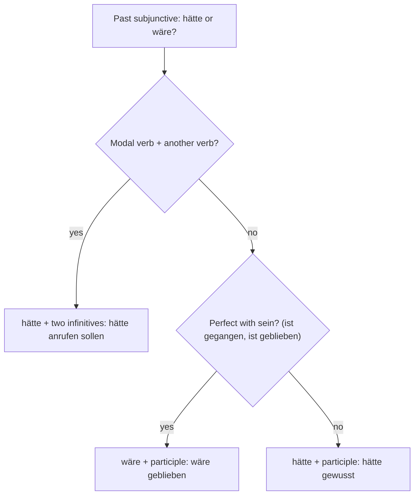

## What this lesson is for

In lesson 21 you imagined the present and the future: *Wenn ich Zeit hätte, würde ich mitkommen.* But many of the things we imagine are about the past: decisions we regret, chances we missed, lucky escapes. "If I had known, I would have stayed at home." "You should have called me." "I almost fell."

For all of this German has one past form of the Konjunktiv II, and it is easy to build: you already know every part of it. The theme is regrets, mistakes, coincidence and fate.

## The form: hätte or wäre + past participle

The **past subjunctive** (*Konjunktiv II der Vergangenheit*) is made like the perfect tense, but with *hätte* or *wäre* instead of *hat* or *ist*:

| Perfect (real) | Past subjunctive (unreal) |
|---|---|
| *Ich habe es gewusst.* — I knew it. | *Ich hätte es gewusst.* — I would have known it. |
| *Sie ist geblieben.* — She stayed. | *Sie wäre geblieben.* — She would have stayed. |
| *Wir haben den Zug genommen.* | *Wir hätten den Zug genommen.* — We would have taken the train. |
| *Er ist pünktlich gewesen.* | *Er wäre pünktlich gewesen.* — He would have been on time. |

The choice between *hätte* and *wäre* follows exactly the same rule as *haben* and *sein* in the perfect: verbs of movement and change (*gehen, fahren, kommen, aufstehen, passieren*) and *sein, bleiben, werden* take *wäre*; everything else takes *hätte*. If you know the perfect, you know the past subjunctive.

Here is the whole decision, including the modal verbs you'll meet later in this lesson:

| | with hätte | with wäre |
|---|---|---|
| ich | *hätte gearbeitet* | *wäre gefahren* |
| du | *hättest gearbeitet* | *wärst gefahren* |
| er / sie / es | *hätte gearbeitet* | *wäre gefahren* |
| wir | *hätten gearbeitet* | *wären gefahren* |
| ihr | *hättet gearbeitet* | *wärt gefahren* |
| sie / Sie | *hätten gearbeitet* | *wären gefahren* |

Unlike the present, there is only one past form. There's no strong-verb variant to learn and no *würde* version in normal German: "would have done" is always *hätte/wäre … getan*.

## Unreal conditions in the past

Use the past subjunctive in both clauses to imagine a different past:

- *Wenn ich das gewusst hätte, wäre ich zu Hause geblieben.* — If I had known that, I would have stayed at home.
- *Wenn du mich gefragt hättest, hätte ich dir geholfen.* — If you had asked me, I would have helped you.
- *Wenn der Bus pünktlich gekommen wäre, hätten wir den Anschluss nicht verpasst.* — If the bus had come on time, we wouldn't have missed the connection.

The word order is the same as in lesson 21. In the *wenn* clause the whole verb group goes to the end, with *hätte/wäre* last: *wenn ich das gewusst hätte*. In the main clause, *hätte/wäre* is the verb in position 2 (straight after the comma if the *wenn* clause comes first) and the participle goes to the end.

And again, *wenn* can be dropped if the verb comes first: *Hätte ich das gewusst, wäre ich zu Hause geblieben.* You'll meet this in writing and in speech, especially in the short exclamation *Hätte ich das bloß gewusst!* — If only I'd known!

### Mixing past and present

Sometimes a past condition has a present result. Then each clause takes its own time:

- *Wenn ich gestern nicht so lange gefeiert hätte, wäre ich jetzt nicht so müde.* — If I hadn't partied so long yesterday, I wouldn't be so tired now.
- *Wenn sie damals nicht ausgewandert wäre, würde sie heute in Graz leben.* — If she hadn't emigrated back then, she'd be living in Graz today.

The reverse also works: a present fact with a past result: *Wenn ich nicht so schüchtern wäre, hätte ich sie angesprochen.* — If I weren't so shy, I'd have spoken to her.

## Regrets and reproaches with modal verbs

To say what someone *should have* or *could have* done, German uses *hätte* + infinitive + modal infinitive. The modal stays in the infinitive, not the participle, so there are two infinitives at the end. This is called the **double infinitive**:

- *Ich hätte früher losfahren sollen.* — I should have left earlier.
- *Du hättest mich anrufen können!* — You could have called me!
- *Wir hätten nicht so viel essen müssen.* — We didn't need to eat so much. (literally: wouldn't have had to)

Learn the first two as patterns: *hätte … sollen* is for regrets and advice that comes too late; *hätte … können* is for missed chances and reproaches. Both always take *hätte*, even with *fahren* or *gehen*, because the auxiliary belongs to the modal verb.

In a subordinate clause, *hätte* doesn't go to the very end but comes before the two infinitives: *Ich weiß, dass ich früher hätte losfahren sollen.* This order is unusual, so you only need to recognize it at B1. In conversation, people often avoid it by using a main clause: *Ich weiß: Ich hätte früher losfahren sollen.*

### Talking about regret

- *Ich bereue, dass ich das Angebot abgelehnt habe.* — I regret turning down the offer. (*bereuen* + indicative: it really happened)
- *Ich mache mir Vorwürfe.* — I blame myself.
- *Sie hat mir vorgeworfen, dass ich nicht zugehört habe.* — She accused me of not listening.
- *Das war meine Schuld.* / *Ich bin schuld.* — That was my fault. / It's my fault.
- *Im Nachhinein / Rückblickend / Hinterher ist man immer klüger.* — In hindsight, you're always wiser.

## Almost: beinahe and fast

When something nearly happened but didn't, German uses the past subjunctive with *beinahe* or *fast*. The Konjunktiv makes clear that it didn't actually happen:

- *Ich wäre beinahe gefallen.* — I almost fell.
- *Fast hätten wir den Flug verpasst.* — We nearly missed the flight.
- *Das hätte ich fast vergessen!* — I almost forgot that!

Compare: *Ich bin fast hingefallen* (indicative) is also correct and common in speech, but the Konjunktiv makes it extra clear that it didn't happen, and it's the usual choice in writing. The feeling afterwards: *Ich war total erleichtert.* — I was so relieved. *Was für eine Erleichterung!* — What a relief!

## Alternative histories

Historians, journalists and friends in the pub like to ask *Was wäre gewesen, wenn …?* — What would have happened if …?

- *Was wäre passiert, wenn das Telefon nie erfunden worden wäre?* — What would have happened if the phone had never been invented? (passive; you only need to recognize it)
- *Ohne diesen Zufall hätten wir uns nie kennengelernt.* — Without this coincidence we would never have met.

Notice the last example: a phrase with *ohne* or *mit* can replace the whole *wenn* clause: *Ohne deine Hilfe hätte ich es nicht geschafft.* — Without your help I wouldn't have managed it.

## Text: Der Zug, den ich verpasst habe

Markus tells a story from his life for a podcast about coincidences.

> Vor zehn Jahren habe ich an einem Montagmorgen meinen Zug nach Hamburg verpasst. Ich war spät aufgestanden, weil ich am Abend vorher zu lange gefeiert hatte. Als ich zum Bahnsteig rannte, fuhr der Zug gerade ab. Ich habe mich furchtbar geärgert und mir Vorwürfe gemacht: Ich hätte früher losgehen sollen! Hätte ich bloß den Wecker gehört!
>
> Der nächste Zug kam erst eine Stunde später. Im Café am Bahnhof gab es nur noch einen freien Platz, neben einer jungen Frau, die ein Buch las, zufällig mein Lieblingsbuch. Wir kamen ins Gespräch, und als mein Zug kam, hatte ich ihre Telefonnummer.
>
> Heute ist diese Frau meine Ehefrau. Im Nachhinein sehe ich diesen Morgen ganz anders. Wenn ich pünktlich gewesen wäre, hätte ich Lena nie kennengelernt. Dann wäre ich wahrscheinlich in Hamburg geblieben, hätte dort eine Stelle angenommen und ein ganz anderes Leben geführt. Ich wäre beinahe nicht einmal ins Café gegangen, weil es so voll war.
>
> War das Zufall oder Schicksal? Ich weiß es nicht. Lena sagt, sie hätte mich auch ohne das Buch angesprochen. Das glaube ich ihr nicht ganz. Rückblickend bereue ich nur eins: dass ich mich an diesem Morgen so geärgert habe. Hinterher habe ich gelernt, dass ein kleiner Fehler manchmal eine große Wirkung haben kann, und nicht immer eine schlechte.

In English:

> Ten years ago, on a Monday morning, I missed my train to Hamburg. I had got up late because I had partied too long the evening before. When I ran to the platform, the train was just leaving. I was terribly annoyed and blamed myself: I should have left earlier! If only I'd heard the alarm clock!
>
> The next train didn't come until an hour later. In the café at the station there was only one free seat left, next to a young woman who was reading a book, my favourite book, as it happened. We got talking, and when my train came, I had her phone number.
>
> Today that woman is my wife. In hindsight I see that morning quite differently. If I had been on time, I would never have met Lena. I would probably have stayed in Hamburg, taken a job there and led a completely different life. I almost didn't even go into the café, because it was so full.
>
> Was it coincidence or fate? I don't know. Lena says she would have spoken to me even without the book. I don't quite believe her. Looking back, I regret only one thing: that I got so annoyed that morning. Afterwards I learned that a small mistake can sometimes have a big effect, and not always a bad one.

Notes: the story mixes tenses on purpose. The real events are told in the simple past and perfect (*fuhr ab, habe verpasst*) and the past perfect (*war aufgestanden, hatte gefeiert*, lesson 2). The imagined past is in the past subjunctive (*wäre geblieben, hätte kennengelernt*). *zufällig* means "by chance, as it happened"; *jemanden ansprechen* is to start talking to someone, approach someone; *ein Leben führen* is to lead a life. In *hätte … angenommen und … geführt*, one *hätte* serves two participles.

The picture shows the two paths of Markus's story side by side: what really happened, told in the indicative, and what would have happened, told in the past subjunctive.

## Cause and effect

The theme words include a few that help you talk about why things happened:

| Word | Meaning | Example |
|---|---|---|
| *die Ursache* | cause | *Die Ursache des Unfalls ist noch unklar.* |
| *die Wirkung* | effect | *Das Medikament hat sofort Wirkung gezeigt.* |
| *die Auswirkung (auf + Akk)* | impact, consequence | *Die Entscheidung hatte Auswirkungen auf die ganze Familie.* |
| *sich auswirken auf* | to affect, have an effect on | *Der Stress wirkt sich auf meinen Schlaf aus.* |
| *verursachen* | to cause | *Ein Fehler im Computer hat das Problem verursacht.* |
| *verhindern* | to prevent | *Das hätte man verhindern können.* |
| *vermeiden* | to avoid | *Diesen Fehler kann man leicht vermeiden.* |

More words for mistakes, luck and blame:

| Word | Meaning | Example |
|---|---|---|
| *der Irrtum*, *sich irren* | error, to be wrong | *Da habe ich mich wohl geirrt.* — I must have been wrong. |
| *versäumen* | to miss (fail to do) | *Ich habe die Frist versäumt.* |
| *die Konsequenz* | consequence | *Das hätte schlimme Konsequenzen haben können.* |
| *warnen (vor + D)*, *die Warnung* | to warn, warning | *Hättest du mich doch gewarnt!* |
| *der Einfluss*, *beeinflussen* | influence, to influence | *Ihr Rat hat meine Entscheidung beeinflusst.* |
| *absichtlich* | on purpose | *Ich habe die Tasse nicht absichtlich kaputt gemacht.* |
| *das Pech* | bad luck | *Da hast du Pech gehabt.* |
| *knapp* | narrowly, only just | *Wir haben das Spiel knapp verloren.* |
| *nachträglich* | belated(ly) | *Nachträglich alles Gute zum Geburtstag!* |

*vermeiden* is strong: *vermied, hat vermieden*. *verhindern* (prevent something happening) and *vermeiden* (avoid doing something, stay away from it) are close but not the same: you prevent an accident, you avoid a mistake.

## Pronunciation

- *hätte gewusst*: the stress is on the participle: hätte ge-WUSST. In a fast sentence *hätte* is often reduced to *hätt'*.
- *Schicksal*: SCHICK-sal; *Zufall*: ZU-fall; *zufällig*: ZU-fäl-lig.
- *bereuen*: be-REU-en, *eu* sounds like "oy". *Reue* is REU-e.
- *im Nachhinein*: im NACH-hi-nein; the *h* in *-hinein* is pronounced.

## Common mistakes

- würde + participle: ~~Ich würde das gemacht.~~ The past is *Ich hätte das gemacht.* (*Ich würde das gemacht haben* exists, but it's rare and sounds clumsy.)
- Wrong auxiliary: ~~Ich hätte nach Hause gegangen.~~ → *Ich wäre nach Hause gegangen.* If the perfect uses *sein*, the past subjunctive uses *wäre*.
- Indicative in the wenn clause: ~~Wenn ich das gewusst habe, wäre ich gekommen.~~ → *Wenn ich das gewusst hätte, …*
- Participle of the modal: ~~Ich hätte anrufen gesollt.~~ → *Ich hätte anrufen sollen.* With another verb, the modal stays an infinitive.
- wäre with a modal: ~~Ich wäre früher losfahren sollen.~~ → *Ich hätte früher losfahren sollen.* Modals always take *hätte*.
- Near misses: *Ich bin fast hingefallen* isn't wrong, but learners often don't know the typical German pattern *Ich wäre fast gefallen*. Use it, especially in writing.
- Mixing up schuld and Schuld: *Ich bin schuld* (small *s*, with *sein*) but *Das ist meine Schuld* (noun, capital *S*).

## Key points

- Past subjunctive = *hätte* / *wäre* + past participle: *ich hätte gewusst, ich wäre gegangen*. Choose *hätte* or *wäre* as in the perfect.
- Unreal past conditions: *Wenn ich das gewusst hätte, wäre ich gekommen.* Or verb first: *Hätte ich das gewusst, …*
- Past and present can mix: *Wenn ich nicht gefeiert hätte, wäre ich jetzt nicht müde.*
- Regrets and reproaches: *Ich hätte … sollen. Du hättest … können.* (double infinitive, always *hätte*)
- Near misses: *Ich wäre beinahe / fast gefallen.*
- *ohne* + noun can replace a *wenn* clause: *Ohne dich hätte ich es nicht geschafft.*

The words from this lesson are listed below; they join your vocabulary reviews when you complete the lesson.
