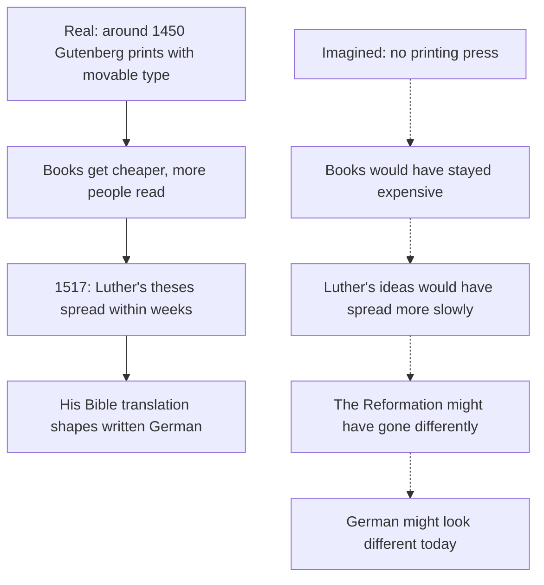

## What this lesson is for

In lessons 21 and 22 you learned to build the Konjunktiv II for everyday speech: *wäre, hätte*, the modals, *würde* + infinitive, and *hätte/wäre* + participle for the past. You also learned that writers use many more one-word forms (*läge, stünde, nähme*), and that you only need to recognize them.

This honors lesson is about recognizing them in real reading. You'll meet the written forms in a table, then read two texts where the Konjunktiv carries the meaning: a famous one-sentence piece by Franz Kafka, which is a single unreal wish, and an original essay that asks what would have happened without the printing press. Along the way you'll see how writers use the Konjunktiv to imagine, to dream and to speculate, and how to tell an imagined world from the real one in a text.

## The one-word forms of writing

The recipe from lesson 21 works for most strong verbs: take the simple past stem, add an umlaut to *a, o, u*, and add *-e*. A few verbs keep an older, irregular vowel instead: *stehen → stünde* (beside the regular *stände*), *werfen → würfe*, *helfen → hülfe* (beside *hälfe*). Here are the forms you're most likely to meet in novels, newspapers and essays:

| Infinitive | Simple past | Konjunktiv II | Example |
|---|---|---|---|
| *liegen* | *lag* | *läge* | *Wenn das Dorf am Meer läge, …* — If the village were by the sea … |
| *stehen* | *stand* | *stünde* (or *stände*) | *Es stünde schlecht um uns.* — Things would look bad for us. |
| *sehen* | *sah* | *sähe* | *Die Welt sähe anders aus.* — The world would look different. |
| *nehmen* | *nahm* | *nähme* | *Nähme sie den Job an, …* — If she took the job … |
| *halten* | *hielt* | *hielte* | *Ich hielte das für möglich.* — I'd consider that possible. |
| *fallen* | *fiel* | *fiele* | *Es fiele mir schwer.* — It would be hard for me. |
| *tun* | *tat* | *täte* | *Das täte dir gut.* — That would do you good. |
| *fahren* | *fuhr* | *führe* | *Wenn ich Zeit hätte, führe ich ans Meer.* — If I had time, I'd drive to the sea. |
| *bringen* | *brachte* | *brächte* | *Das brächte nichts.* — That wouldn't achieve anything. |
| *denken* | *dachte* | *dächte* | *Man dächte, …* — One would think … |

*bringen* and *denken* are mixed verbs, but they take the umlaut like *wissen → wüsste*. Some forms look like other words: *führe* (from *fahren*) is also a form of *führen* (to lead), and *läge* is close to *lag*. The umlaut and the final *-e* are your signal, and the context does the rest. *stünde* is the older form and still the more common one in writing; *stände* is also correct.

Weak verbs are different: their Konjunktiv II is identical to the simple past (*machte, sagte, erzitterte*). That's exactly why everyday German replaced them with *würde* + infinitive. In older or literary texts you'll still find the bare weak forms, and then only the context tells you whether a sentence is real or imagined.

### Example 1: Decoding a literary sentence

*Wenn sie nicht so weit weg wohnte, führen wir jedes Wochenende zu ihr.*

1. Find *wenn* and look for the verbs: *wohnte* at the end of the *wenn* clause, *führen* in position 1 of the main clause.
2. *wohnte*: a weak verb, so it could be simple past ("when she lived") or Konjunktiv II ("if she lived"). Keep both in mind.
3. *führen*: is it the infinitive "to lead"? That makes no sense with *wir … zu ihr*. Check the recipe backwards: *fuhren* (we drove) + umlaut = *führen*, the Konjunktiv II of *fahren*. So the main clause is imagined.
4. Now *wohnte* must be imagined too: an unreal condition.

Meaning: *If she didn't live so far away, we would drive to see her every weekend.* In speech: *Wenn sie nicht so weit weg wohnen würde, würden wir jedes Wochenende zu ihr fahren.*

## A wish in one sentence: Kafka

Franz Kafka (1883–1924) was a German-speaking writer from Prague, best known for *Die Verwandlung* (The Metamorphosis) and the novel *Der Process* (The Trial). His first book, *Betrachtung* (Meditation), was printed at the end of 1912 (its title page says 1913) and contains short prose pieces, some only a few lines long. One of them is a single sentence. Kafka died in 1924, so his work is in the public domain, and here is the full text:

> **Wunsch, Indianer zu werden**
>
> Wenn man doch ein Indianer wäre, gleich bereit, und auf dem rennenden Pferde, schief in der Luft, immer wieder kurz erzitterte über dem zitternden Boden, bis man die Sporen ließ, denn es gab keine Sporen, bis man die Zügel wegwarf, denn es gab keine Zügel, und kaum das Land vor sich als glatt gemähte Heide sah, schon ohne Pferdehals und Pferdekopf.

A translation (ours, close to the German):

> **The Wish to Be an Indian**
>
> If only one were an Indian, instantly ready, and on the racing horse, leaning into the air, trembling again and again for a moment over the trembling ground, until one let go of the spurs, for there were no spurs, until one threw away the reins, for there were no reins, and hardly saw the land ahead as smoothly mown heath, already without horse's neck and horse's head.

A note on the title word: *Indianer* was the normal German word for the Indigenous peoples of the Americas in Kafka's time, and it carries the romantic images of adventure stories that German children grew up with. Today many people find it outdated or hurtful and prefer *indigene Völker Nordamerikas* or the name of the particular nation; others still use it. That debate is about modern usage; in a text from 1912 the word is part of the historical record, and the translation keeps "Indian" for the same reason.

Some words you need:

- *gleich bereit* — ready at once; *rennend* — running, racing (a present participle as an adjective, lesson 15); the old dative *-e* in *dem Pferde* is a literary form of *dem Pferd*.
- *schief* — slanting, at an angle; *erzittern* — to (begin to) tremble; *der zitternde Boden* — the trembling ground.
- *die Sporen* (singular *der Sporn*) — spurs; *etwas lassen* — here: to let go of something.
- *die Zügel* (usually plural) — the reins; *wegwerfen* — to throw away (*warf weg*).
- *glatt gemäht* — smoothly mown; *die Heide* — heath, open flat land.

### How the grammar carries the meaning

The sentence opens like an **unreal wish** from lesson 23: *Wenn man doch … wäre* — If only one were … *doch* is the modal particle that turns a condition into a longing, and there is no main clause: the wish stands alone, as wishes do. *man* (one) makes it general: anyone could be dreaming this.

### Example 2: Real or imagined? Reading Kafka's verbs

Go through the verbs in order and ask what form each one is.

1. *wäre* — Konjunktiv II of *sein*, after *wenn … doch*: clearly imagined.
2. *erzitterte* — *erzittern* is weak, so this form is both the simple past and the Konjunktiv II. After *wäre* and *und*, we read it as part of the wish: "and (if only one) trembled".
3. *ließ* — the simple past of *lassen*. The Konjunktiv II would be *ließe*. So this is, strictly, an indicative form.
4. *gab* (*es gab keine Sporen*) — simple past; the Konjunktiv would be *gäbe*.
5. *wegwarf* — simple past of *wegwerfen* (Konjunktiv: *wegwürfe*).
6. *sah* — simple past (Konjunktiv: *sähe*).

So the sentence begins in the Konjunktiv and, after *bis*, continues in plain past forms. One common reading is that the wish slowly turns into a vision that feels real: the rider drops the spurs, then the reins, and in the end even the horse disappears, until only speed and open land are left. Other readers see the whole sentence as one continuous daydream and give the change of form less weight. This is interpretation, not grammar fact, and literature scholars read the piece in many ways. The grammar question, though, has a clear answer: you can tell exactly where the Konjunktiv forms stop, and noticing that is what careful reading means.

## Was wäre gewesen, wenn …? Alternative history

Historians sometimes ask **counterfactual** questions: what would have happened if one event had gone differently? This kind of history (*kontrafaktische Geschichte*) is a thought experiment, not a fact, and serious writers mark it clearly as speculation. The Konjunktiv II is how German marks it. Here is an original short essay.

> **Eine Welt ohne Buchdruck?**
>
> Um 1450 entwickelte Johannes Gutenberg in Mainz ein neues Verfahren: Er druckte Texte mit beweglichen Buchstaben aus Metall. Bewegliche Lettern gab es in China und Korea schon früher, aber in Europa veränderte Gutenbergs Erfindung alles. Vorher mussten Bücher mit der Hand abgeschrieben werden, oft von Mönchen. Eine Bibel herzustellen, dauerte Monate oder Jahre, und nur reiche Leute konnten sich Bücher leisten.
>
> Was wäre passiert, wenn der Buchdruck nicht erfunden worden wäre? Bücher wären teuer geblieben, und viel weniger Menschen hätten lesen gelernt. Als Martin Luther 1517 seine Thesen veröffentlichte, verbreiteten sie sich dank der Druckereien in wenigen Wochen. Ohne den Buchdruck hätten sich seine Ideen wahrscheinlich viel langsamer verbreitet. Vielleicht wäre die Reformation ganz anders verlaufen, oder sie wäre gar nicht erst passiert.
>
> Auch die deutsche Sprache sähe heute vielleicht anders aus. Luthers Übersetzung der Bibel wurde tausendfach gedruckt und gelesen, und sie hat die gemeinsame deutsche Schriftsprache stark beeinflusst. Wie groß ihr Einfluss genau war, darüber diskutieren Sprachwissenschaftler noch heute.
>
> Natürlich ist das alles Spekulation. Niemand weiß, ob nicht jemand anders den Buchdruck ein paar Jahre später erfunden hätte. Aber solche Gedankenexperimente zeigen, wie viel manchmal an einer einzigen Erfindung hängt.

In English:

> **A world without printing?**
>
> Around 1450, in Mainz, Johannes Gutenberg developed a new process: he printed texts with movable letters made of metal. Movable type already existed earlier in China and Korea, but in Europe Gutenberg's invention changed everything. Before that, books had to be copied by hand, often by monks. Producing a Bible took months or years, and only rich people could afford books.
>
> What would have happened if printing had not been invented? Books would have stayed expensive, and far fewer people would have learned to read. When Martin Luther published his theses in 1517, they spread within a few weeks thanks to the print shops. Without printing, his ideas would probably have spread much more slowly. Perhaps the Reformation would have taken a completely different course, or it would never have happened at all.
>
> The German language might look different today too. Luther's translation of the Bible was printed and read thousands of times over, and it strongly influenced the common written German language. Exactly how great its influence was is still debated by linguists today.
>
> Of course, all this is speculation. Nobody knows whether someone else wouldn't have invented printing a few years later. But thought experiments like this show how much can sometimes depend on a single invention.

Notes: *bewegliche Buchstaben / Lettern* — movable type; *das Verfahren* — process, method; *dank* + genitive or dative — thanks to; *verlaufen* — to go, take a course; *gar nicht erst* — not even in the first place; *hängen an* + dative — to depend on. The facts in the first paragraph and the first half of the second are in the indicative (*entwickelte, druckte, veröffentlichte, verbreiteten sich*). Everything imagined is in the Konjunktiv II: past (*wäre passiert, wären geblieben, hätten gelernt, hätten sich verbreitet, wäre verlaufen*) and present (*sähe … aus*). *wenn der Buchdruck nicht erfunden worden wäre* is the past subjunctive of the passive (lesson 17): *worden wäre* at the end. You only need to recognize it.

The essay's argument as a chain:

### Example 3: Building your own counterfactual

Start from a fact and change one thing: *1876 meldete Alexander Graham Bell ein Patent für das Telefon an.* (In 1876 Bell filed a patent for the telephone.)

1. Flip the fact into an unreal past condition: *Wenn das Telefon nicht erfunden worden wäre, …* (passive, as in the essay) or more simply: *Wenn es kein Telefon gegeben hätte, …* (*es gibt* → perfect *es hat gegeben* → *hätte gegeben*).
2. Add a past consequence with *hätte/wäre* + participle: *… hätten die Menschen noch lange Briefe und Telegramme geschickt.*
3. Add a present consequence with the present Konjunktiv: *Vielleicht gäbe es heute auch keine Smartphones.*
4. Mark it as speculation: *vielleicht, wahrscheinlich, möglicherweise*, or a guessing modal from the honors lesson on diplomatic German: *Es könnte sein, dass …*

Result: *Wenn es kein Telefon gegeben hätte, hätten die Menschen noch lange Briefe und Telegramme geschickt. Vielleicht gäbe es heute auch keine Smartphones.*

## Common mistakes

- Reading every *-te* form as the past: *Wenn ich mehr Zeit hätte, lernte ich Japanisch* is a (bookish) Konjunktiv; the *wenn … hätte* tells you so.
- Missing the umlaut signal: *führe, läge, nähme* are Konjunktiv II; *fuhr, lag, nahm* are simple past.
- Taking *führen* as "to lead" when it follows *wenn … hätte* or *wäre*: check whether *fahren* makes more sense.
- Presenting speculation as fact: *Ohne Gutenberg gab es keine Reformation* states a fact that nobody can know. Use the Konjunktiv and a hedge: *Ohne Gutenberg hätte es die Reformation vielleicht nicht gegeben.*
- Mixing up *Lettern* and *Briefe*: the letters of the alphabet in print are *Buchstaben* or *Lettern*; letters you post are *Briefe*.
- Forgetting *worden* in the passive past subjunctive: ~~wenn das Telefon nicht erfunden wäre~~ (that is a state: "if the telephone weren't invented") → *wenn das Telefon nicht erfunden worden wäre*.

## Key points

- Written one-word forms: simple past stem + umlaut + *-e* (a few irregular, like *stünde*): *läge, stünde, sähe, nähme, hielte, fiele, täte, führe, brächte, dächte*. Recognize them; in speech use *würde* + infinitive.
- Weak verbs have no separate form (*machte, erzitterte*): context decides between past and Konjunktiv.
- Kafka's *Wunsch, Indianer zu werden* is one unreal wish: *Wenn man doch … wäre*, with no main clause; after *bis* it continues in plain past forms.
- Counterfactual history: facts in the indicative, the imagined past in *hätte/wäre* + participle, present effects in the present Konjunktiv II, and a hedge (*vielleicht, wahrscheinlich*) to mark speculation.
- Passive in the past subjunctive *(recognize)*: *wenn … erfunden worden wäre*.

The words from this lesson are listed below; they join your vocabulary reviews when you complete the lesson.
