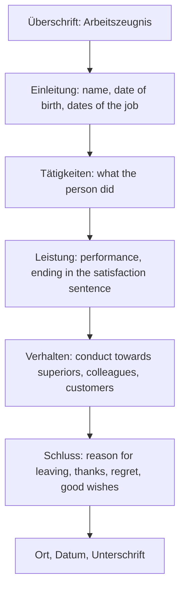

## What this lesson is for

In lesson 25 you read about the job market and wrote a short formal e-mail; in lesson 24 you learned verbs, adjectives and nouns with fixed prepositions. This honors lesson brings the two together in a document that surprises many people who move to Germany: the **Arbeitszeugnis**, the written job reference that employees receive when they leave a job.

Arbeitszeugnisse are a normal part of a German job application, together with the *Anschreiben* (cover letter) and the *Lebenslauf* (CV). They are written in a very particular style, sometimes called **Zeugnissprache**: every sentence sounds friendly, but small differences in wording are read as a grade. You'll learn how the document is built, how the famous "satisfaction sentence" works, what the law says about hidden messages, and which verb–preposition chunks appear again and again in references and cover letters.

## What an Arbeitszeugnis is

In Germany, every employee has a legal right to a written reference when the job ends (§ 109 of the *Gewerbeordnung*, the Trade Regulation Act). There are two kinds:

- *ein einfaches Zeugnis* (a simple reference): only the type and length of the job;
- *ein qualifiziertes Zeugnis* (a qualified reference): also an assessment of *Leistung* (performance) and *Verhalten* (conduct). The employee can ask for this one, and almost everyone does.

Courts have set two principles that pull in different directions. The reference must be true, and it must be *wohlwollend* (benevolent): it must not make the employee's career unnecessarily difficult. The result is a document in which nearly every sentence is positive, and the reader has to notice *how* positive. Austria and Switzerland have similar references (in Austria often called *Dienstzeugnis*), though the details of the law differ.

A qualified reference usually has these parts:

## The satisfaction sentence

The most famous sentence in a reference sums up the performance. Its wording follows a scale that almost everyone in German HR knows:

The grades are the German school grades (*die Noten*) from 1 (*sehr gut*) downwards; school goes down to 6 (*ungenügend*), but the reference scale usually stops at 5 (*mangelhaft*). Three words do the work:

- *stets* (always, consistently; also *immer* or *jederzeit*): good performance all the time, not just sometimes. Leaving it out lowers the grade by one step.
- *voll* (full): *zu unserer vollen Zufriedenheit* is better than *zu unserer Zufriedenheit*.
- *vollst-* (fullest): the top grade.

A language note: strictly speaking, *voll* is an adjective that can't be compared. Something is full or it isn't, so *am vollsten* is illogical, like English "most full". Grammar books use this as an example of a superlative that shouldn't exist, but in references *vollsten* is the fixed formula, and *zu unserer vollen Zufriedenheit* alone is no longer read as top praise.

Which grade counts as normal? The Federal Labour Court (*Bundesarbeitsgericht*) ruled in 2014 that *zur vollen Zufriedenheit* (grade 3) is the average: an employee who wants a better grade must show why they deserve it, and an employer who gives a worse one must show why. The court said this applies even though, in practice, most references now give grades 1 or 2.

### Is it a secret code?

You'll find long online lists of "secret codes" in references. Be careful with them. The law itself (§ 109, paragraph 2) says a reference must be clear and must not contain wording meant to say something other than what it says on the surface. So a deliberate hidden code is not allowed.

The satisfaction scale is different: it's an open convention that courts themselves use, so it isn't secret. Other claims are less certain: for example, that naming colleagues before superiors (*gegenüber Kollegen und Vorgesetzten*) hints at trouble with the boss, or that a missing thank-you at the end is a warning. Some readers do interpret references this way, but whether a particular writer meant it is often unclear, and many references are written by people who don't know the "codes" at all. Read the satisfaction sentence as a grade; treat the rest as hints, not proof. Courts have also ruled that employers don't have to include thanks and good wishes at the end, so their absence alone proves little.

### Example 1: Decoding a performance paragraph

*Herr Lang arbeitete sich schnell in seine Aufgaben ein. Er erledigte sie zu unserer vollen Zufriedenheit.*

1. Find the satisfaction sentence: *Er erledigte sie zu unserer vollen Zufriedenheit.*
2. Look for *stets / immer / jederzeit*: none.
3. Look for *voll* or *vollst-*: *vollen*.
4. Compare with the scale: *zu unserer vollen Zufriedenheit* without *stets* is grade 3, the average.

So: a solid, average reference. Now compare *Er erledigte sie stets zu unserer vollsten Zufriedenheit*: *stets* + *vollsten* = grade 1. Just two words make the difference between average and excellent.

## Verbs with prepositions in references and applications

References and cover letters reuse a small set of chunks. Many are verbs with prepositions, so the rules from lesson 24 apply: learn each one with its preposition and case.

| Chunk | Case | English | Example |
|---|---|---|---|
| *sich einarbeiten in* | A | to get to know (a job), familiarize yourself with | *Sie arbeitete sich schnell in das neue System ein.* |
| *verfügen über* | A | to have, possess (skills, knowledge) | *Er verfügt über sehr gute Englischkenntnisse.* |
| *sich auszeichnen durch* | A | to stand out for, be distinguished by | *Sie zeichnete sich durch große Sorgfalt aus.* |
| *beitragen zu* | D | to contribute to | *Er hat wesentlich zum Erfolg des Projekts beigetragen.* |
| *sich bewerben um* / *als* | A / N | to apply for / as | *Ich bewerbe mich um die Stelle als Koch.* |
| *zuständig sein für* | A | to be responsible for | *Sie war für die Buchhaltung zuständig.* |
| *geschätzt werden von* | D | to be valued by | *Er wurde von Kollegen und Kunden geschätzt.* |
| *ausscheiden aus* | D | to leave (a company) | *Sie scheidet auf eigenen Wunsch aus unserem Unternehmen aus.* |

Notes: *sich einarbeiten*, *sich auszeichnen*, *beitragen* and *ausscheiden* are separable (*arbeitete sich ein, zeichnete sich aus, hat beigetragen, schied aus*). *beitragen* is strong like *tragen* (*trug bei, hat beigetragen*), and so is *ausscheiden* (*schied aus, ist ausgeschieden*, with *sein*). *geschätzt werden* is a passive (lesson 16). *auf eigenen Wunsch* (at their own request) is the phrase that tells a reader the employee chose to leave.

Adjectives you'll meet everywhere in references: *zuverlässig* (reliable, lesson 11), *sorgfältig* (careful, thorough), *engagiert* (committed), *belastbar* (able to work under pressure), *selbstständig* (independently; in lesson 25 you met it as "self-employed"), *vorbildlich* (exemplary) and *einwandfrei* (faultless).

### Example 2: Writing the first lines of a cover letter

You want to apply for a job as a bookkeeper. Build the opening of the *Anschreiben* with chunks from this lesson and lesson 25.

1. Subject line, a noun phrase without a verb: *Betreff: Bewerbung als Buchhalterin*
2. Greeting with the person's name if you know it: *Sehr geehrte Frau Krause,*
3. Say what you're applying for, with *sich bewerben um*. The first word after the comma starts with a small letter: *hiermit bewerbe ich mich um die Stelle als Buchhalterin, die Sie auf Ihrer Website ausgeschrieben haben.*
4. Say what you have, with *verfügen über* + accusative: *Ich verfüge über fünf Jahre Berufserfahrung in der Buchhaltung.*
5. Add a strength with *sich auszeichnen durch* or a reference to your *Zeugnis*: *Wie Sie meinem Arbeitszeugnis entnehmen können, arbeite ich sorgfältig und selbstständig.* (*einer Sache etwas entnehmen* = to gather something from something)

Note the accusative after *über*: *über fünf Jahre Berufserfahrung*, *über gute Kenntnisse*. A common mistake is a dative here (~~über guten Kenntnissen~~).

## Text: Aus einem Arbeitszeugnis

This is an invented reference for an invented person and company. Read it and decide which grade it gives.

> Frau Selin Arslan, geboren am 4. März 1994, war vom 1. April 2021 bis zum 30. September 2025 in unserem Hotel als Rezeptionistin tätig.
>
> Zu ihren Aufgaben gehörten die Betreuung der Gäste, die Bearbeitung von Reservierungen und die Abrechnung.
>
> Frau Arslan arbeitete sich in kürzester Zeit in alle Aufgaben ein. Sie verfügt über sehr gute Englisch- und Türkischkenntnisse und zeichnete sich durch große Sorgfalt und Freundlichkeit aus. Auch in Zeiten mit hoher Arbeitsbelastung war sie jederzeit belastbar. Sie erledigte ihre Aufgaben stets zu unserer vollsten Zufriedenheit.
>
> Ihr Verhalten gegenüber Vorgesetzten, Kollegen und Gästen war stets vorbildlich.
>
> Frau Arslan scheidet auf eigenen Wunsch aus unserem Unternehmen aus. Wir bedauern ihr Ausscheiden sehr, danken ihr für die stets hervorragende Zusammenarbeit und wünschen ihr für ihre berufliche und private Zukunft alles Gute und weiterhin viel Erfolg.

In English:

> Ms Selin Arslan, born on 4 March 1994, worked in our hotel as a receptionist from 1 April 2021 to 30 September 2025.
>
> Her tasks included looking after guests, handling reservations and billing.
>
> Ms Arslan got to know all her tasks in a very short time. She has very good English and Turkish and stood out for her great care and friendliness. Even at times of heavy workload she was always able to cope with the pressure. She always carried out her tasks to our complete satisfaction.
>
> Her conduct towards superiors, colleagues and guests was always exemplary.
>
> Ms Arslan is leaving our company at her own request. We very much regret her departure, thank her for the consistently excellent cooperation and wish her all the best for her professional and private future and continued success.

Notes: *tätig sein als* — to work as; *die Betreuung* — looking after, care; *die Abrechnung* — billing, accounts; *in kürzester Zeit* — in a very short time (a superlative used for emphasis); *die Arbeitsbelastung* — workload. Everything points to grade 1: *stets … vollsten* in the satisfaction sentence, *stets vorbildlich* for conduct with superiors named first, *auf eigenen Wunsch*, and a full closing with regret (*bedauern*), thanks and good wishes. The English translation sounds much less enthusiastic than the German really is: the scale doesn't translate.

## Common mistakes

- Reading every positive sentence as praise: *Sie erledigte ihre Aufgaben zu unserer Zufriedenheit* sounds nice but is grade 4.
- Taking online "code lists" as fact: the satisfaction scale is a known convention; many other "codes" are guesses.
- Wrong case after *verfügen über*: it takes the accusative: *über gute Kenntnisse*, not ~~über guten Kenntnissen~~.
- Forgetting the reflexive pronoun: ~~Er arbeitete schnell in das System ein~~ → *Er arbeitete sich schnell in das System ein*; ~~Sie zeichnete durch Sorgfalt aus~~ → *Sie zeichnete sich durch Sorgfalt aus*.
- *um* vs *als* with *sich bewerben*: *um die Stelle* (for the job), *als Koch* (as a cook, nominative): *Ich bewerbe mich um die Stelle als Koch.*
- Translating the scale literally: "to our full satisfaction" sounds like top praise in English, but in a German reference it's only average.

## Key points

- An **Arbeitszeugnis** is a written job reference; employees in Germany have a legal right to one (§ 109 GewO). The qualified version assesses *Leistung* and *Verhalten*.
- It must be true and benevolent, and by law clear, without hidden messages.
- The satisfaction sentence is graded: *stets … vollsten* = 1, *stets … vollen* = 2, *vollen* = 3 (average), *zu unserer Zufriedenheit* = 4, *im Großen und Ganzen* = 5.
- Other "codes" are uncertain: read them as hints, not facts.
- Chunks: *sich einarbeiten in* + A, *verfügen über* + A, *sich auszeichnen durch* + A, *beitragen zu* + D, *sich bewerben um* + A, *ausscheiden aus* + D.

The words from this lesson are listed below; they join your vocabulary reviews when you complete the lesson.
