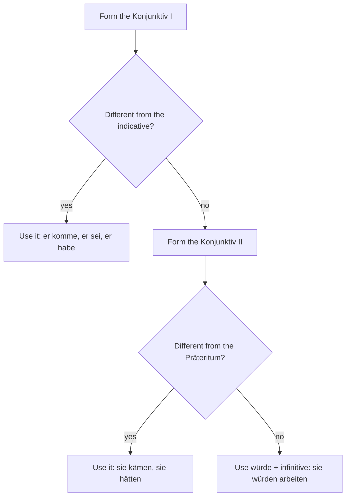

## What this lesson is for

In lesson 26 you learned to report what someone said in everyday German (*Sie hat gesagt, dass sie morgen kommt*) and to recognize a few news forms: *er sei, er habe, es gebe*. This honors lesson completes the picture. You'll see the whole Konjunktiv I, the rule journalists use to decide between Konjunktiv I, Konjunktiv II and *würde*, how past, future, questions and requests are reported, and what the choice of verb (*behaupten*, *einräumen*, *bestätigen* …) tells you about a statement. At the end you'll turn a news report back into the German you'd use with a friend.

Using the Konjunktiv I actively is a B2 skill, so most of this lesson is about reading. If you did the honors lesson on sources and claims in module 4, you already know *laut*, *zufolge* and the hearsay *sollen*; here the focus is on the verb forms.

## Why the news needs its own form

Compare two sentences from a newspaper:

- *Die Brücke ist sicher, sagte der Bürgermeister.*
- *Die Brücke sei sicher, sagte der Bürgermeister.*

Both report the mayor's words. In the first, the main clause *Die Brücke ist sicher* looks like a plain fact; only the added *sagte der Bürgermeister* shows whose view it is. In the second, the verb itself says "this is someone's statement": *sei* marks it as reported, and the newspaper doesn't vouch for it.

The big advantage shows up in longer texts. Once a reporter has named the speaker, every following sentence in the Konjunktiv I still belongs to that speaker, with no need to repeat "he said":

> *Der Bürgermeister verteidigte die Entscheidung. Die Brücke sei sicher. Man habe sie erst im Frühjahr geprüft. Es gebe keinen Grund zur Sorge.*

In English you'd have to keep adding "he said" or "according to him". In German the verb form carries it. As soon as the text switches back to the indicative, the newspaper is speaking again.

Two things to keep in mind. First, the quote itself, in quotation marks, is **direct speech**: *„Die Brücke ist sicher", sagte er.* It keeps the speaker's exact words and the indicative. Second, the indicative is also correct in reported speech, and many papers use it after a clear verb of saying (*Er sagte, dass die Brücke sicher ist*). The Konjunktiv I is the more careful, more formal choice, typical of news agencies, quality papers and the radio news.

## The forms in full

The Konjunktiv I is built from the infinitive stem plus the endings *-e, -est, -e, -en, -et, -en*. Only *sein* is irregular. The forms marked * are the same as the normal present tense:

| | sein | haben | werden | können | kommen |
|---|---|---|---|---|---|
| ich | *sei* | *habe** | *werde** | *könne* | *komme** |
| du | *sei(e)st* | *habest* | *werdest* | *könnest* | *kommest* |
| er / sie / es | *sei* | *habe* | *werde* | *könne* | *komme* |
| wir | *seien* | *haben** | *werden** | *können** | *kommen** |
| ihr | *seiet* | *habet* | *werdet* | *könnet* | *kommet* |
| sie / Sie | *seien* | *haben** | *werden** | *können** | *kommen** |

In practice you'll meet two groups: the third person singular of every verb (*er habe, sie komme, man könne, es gebe*) and all the forms of *sein* (*sie seien*). The *du* and *ihr* forms sound old-fashioned and are rare; you only need to recognize them. Stem-changing verbs keep the infinitive vowel: *er gebe* (not *gibt*), *sie fahre* (not *fährt*), *er wisse* (not *weiß*). That's a handy way to spot them.

## The replacement rule

What if the Konjunktiv I looks exactly like the indicative, as in *sie haben* or *wir kommen*? Then the reader can't see that the sentence is reported, so writers follow a **replacement rule** (*Ersatzregel*):

1. Use the Konjunktiv I if it is different from the indicative: *er komme, er habe, sie seien*.
2. If it isn't, use the Konjunktiv II: *sie hätten, sie kämen, wir müssten*.
3. If the Konjunktiv II looks like the Präteritum too (as with all regular verbs: *sie arbeiteten*), use *würde* + infinitive: *sie würden arbeiten*.

So in a news article a Konjunktiv II doesn't always mean "unreal" or "would". *Die Ärzte sagen, sie hätten zu wenig Zeit* simply reports *„Wir haben zu wenig Zeit."* The context tells you which job it's doing. In speech and informal writing, many people go straight to the Konjunktiv II or *würde* for all reported speech; that's normal too.

## Time: only three choices

Reported speech has fewer tenses than direct speech:

| original | reported (Konjunktiv I) |
|---|---|
| present: *„Ich komme."* | *er komme* |
| any past: *„Ich kam." / „Ich bin gekommen." / „Ich war gekommen."* | *er sei gekommen* |
| future: *„Ich werde kommen."* | *er werde kommen* |

Every past tense becomes *habe* or *sei* + participle: *„Wir hatten keine Wahl"* → *sie hätten keine Wahl gehabt* (*sie haben gehabt* would look like the indicative, so the rule switches to *hätten*). A Konjunktiv II in the original stays as it is: *„Wir hätten früher informieren müssen"* → *man hätte früher informieren müssen*.

## Questions and requests

Reported questions work as in lesson 26, with the verb in the Konjunktiv I at the end:

- *„Wann wird die Brücke geöffnet?"* → *Sie fragte, wann die Brücke geöffnet werde.*
- *„Gibt es einen Ersatzbus?"* → *Er wollte wissen, ob es einen Ersatzbus gebe.*

Requests and instructions use *sollen* (or, for a polite request, *mögen*):

- *„Nehmen Sie die Nordbrücke!"* → *Die Polizei sagte, man solle die Nordbrücke nehmen.*
- *„Bitte haben Sie Geduld."* → *Der Sprecher bat, man möge Geduld haben.*

With a plural subject the replacement rule applies again: *sie sollen* looks like the indicative, so you read *sie sollten*: *Er forderte die Anwohner auf, sie sollten den Umweg nehmen.*

## The reporting verb tells you more

The verb that introduces a statement is chosen with care, and it often reveals how the reporter sees it. These **reporting verbs** are worth knowing:

| verb | meaning | what it suggests |
|---|---|---|
| *sagen, erklären, mitteilen* | say, state, announce | neutral |
| *betonen* | stress | the speaker finds it important |
| *behaupten* | claim | the reporter keeps a distance; maybe it isn't true |
| *bestätigen* | confirm | it was said before; now it's official |
| *einräumen* | admit | something unpleasant for the speaker |
| *bestreiten, dementieren* | deny | *dementieren*: officially deny a report |
| *warnen (vor)* | warn | a danger |
| *fordern* | demand, call for | a demand on someone else |

*Der Minister behauptete, er habe von nichts gewusst* sounds much more doubtful than *Der Minister erklärte, er habe von nichts gewusst*. And *Die Firma räumte ein, dass Fehler gemacht worden seien* tells you the firm didn't want to say it. A short official statement is a *Pressemitteilung* (press release); exact words in quotation marks are a *Zitat* (quotation). If someone gives a view, they *äußern sich* (comment): *Die Stadt wollte sich nicht äußern.* — The city declined to comment.

The picture shows these signals in a short article:

### Example 1: From direct to reported speech

A city spokesman speaks at a press conference. Report his words in news style.

1. *„Die Brücke ist nicht sicher."* — *ist* → Konjunktiv I *sei* (different from *ist*): *Er sagte, die Brücke sei nicht sicher.*
2. *„Wir haben die Schäden erst im März entdeckt."* — the speaker is the city, so *wir* becomes *die Stadt* (third person singular). Past → *habe* + participle: *Er räumte ein, die Stadt habe die Schäden erst im März entdeckt.* *einräumen* fits: it's an admission.
3. *„Die Arbeiten dauern mindestens acht Wochen."* — Konjunktiv I *sie dauern* = indicative; Konjunktiv II *sie dauerten* = Präteritum; so *würde*: *Die Arbeiten würden mindestens acht Wochen dauern.*
4. *„Wann wird die Brücke wieder geöffnet?"* (a resident's question) — *ob*/question word + Konjunktiv I: *Eine Anwohnerin wollte wissen, wann die Brücke wieder geöffnet werde.*
5. *„Nutzen Sie die Fähre!"* (to the residents) — a request, plural: *Er forderte die Anwohner auf, sie sollten die Fähre nutzen.*

### Example 2: Whose view is it?

Read the short report and decide which sentences belong to the speaker and which to the newspaper.

> *(1) Der Vermieterverband kritisierte die neuen Regeln für Nebenkosten. (2) Sie seien viel zu kompliziert. (3) Kleine Vermieter hätten dafür keine Zeit. (4) Viele Eigentümer dächten deshalb an einen Verkauf. (5) Die Regeln treten am 1. Juli in Kraft.*

1. Sentence 1 is in the indicative: the newspaper reports a fact, namely that the association criticized the rules.
2. *seien* (Konjunktiv I): the association's view, not the paper's.
3. *hätten* (replacing *haben*, which would look like the indicative): still the association.
4. *dächten* (Konjunktiv II of *denken*, replacing *denken*): still the association. Nobody has checked whether owners really want to sell.
5. *treten … in Kraft* (indicative): the newspaper's own information. The date is a fact.

### Example 3: Back to everyday German

You read the news and tell a friend about it. Konjunktiv I would sound stiff in conversation, so turn it into *dass* + indicative, or into Konjunktiv II if you doubt it.

- News: *Der Minister erklärte, die Renten seien sicher. Er habe nie etwas anderes behauptet.*
- To a friend: *Der Minister hat gesagt, dass die Renten sicher sind und dass er nie etwas anderes behauptet hat.*
- With doubt: *Er hat behauptet, die Renten wären sicher.* (You don't quite believe him.)

The perfect (*hat gesagt*) replaces the Präteritum of the news (*erklärte*), as usual in speech.

## Reading: a residents' meeting

> *Lindenbrücke: Anwohner verlieren die Geduld*
>
> Seit drei Wochen ist die Lindenbrücke gesperrt, und viele Anwohnerinnen und Anwohner sind verärgert. Bei einer Bürgerversammlung am Dienstag kritisierten sie vor allem die Informationspolitik der Stadt. Man habe erst aus der Zeitung von der Sperrung erfahren, sagte eine Ladenbesitzerin aus der Altstadt. Seitdem kämen kaum noch Kunden in ihr Geschäft.
>
> Baubürgermeister Klaus Wendt räumte Fehler ein. Die Stadt hätte die Bürger früher informieren müssen. Die Sperrung sei aber notwendig gewesen: Ein Gutachten habe gezeigt, dass der Beton an mehreren Stellen beschädigt sei. Er betonte, die Sicherheit gehe vor.
>
> Ein Anwohner wollte wissen, ob die Stadt eine Fähre oder einen Ersatzbus einsetzen werde. Wendt antwortete, man prüfe beide Möglichkeiten. Eine Entscheidung werde es bis Ende des Monats geben. Die Anwohner forderte er auf, sie sollten bis dahin den Umweg über die Nordbrücke nehmen.
>
> Die Bauarbeiten beginnen nach Angaben der Stadt im Juni.

Translation:

> *Lindenbrücke: residents are losing patience*
>
> The Lindenbrücke has been closed for three weeks, and many residents are angry. At a public meeting on Tuesday they criticized above all the way the city handled information. People only found out about the closure from the newspaper, said a shop owner from the old town. Since then, she said, hardly any customers had come into her shop.
>
> Klaus Wendt, the deputy mayor for building, admitted mistakes. The city should have informed people earlier, he said. But the closure had been necessary: an expert report had shown that the concrete was damaged in several places. He stressed that safety came first.
>
> One resident wanted to know whether the city would provide a ferry or a replacement bus. Wendt answered that both options were being examined. There would be a decision by the end of the month. Until then, he asked the residents to take the detour over the Nordbrücke.
>
> According to the city, the construction work will begin in June.

Notes: *kämen* replaces *kommen* (which would look like the indicative). *hätte … informieren müssen* was already Konjunktiv II in the original (*„Wir hätten früher informieren müssen"*), a real regret, so it stays. *vorgehen* means to take priority; *einsetzen* to put into service; *der Umweg* is a detour; *die Bürgerversammlung* is a public meeting for residents. The last sentence is indicative with a source: the city's plan, reported as information.

## Common mistakes

- Reading *er sei* or *sie habe* as a mistake or as a command. It's reported speech: "he is, (he says)".
- Reading every Konjunktiv II in the news as "would" or "unreal". In reported speech, *sie hätten* often just stands for *sie haben*.
- Translating the Konjunktiv I with a present tense in English after "said". English normally shifts back: *Er sagte, er sei krank* = "He said he *was* ill."
- Forgetting that every past becomes *habe/sei* + participle: ~~er war gekommen~~ → *er sei gekommen*.
- Using the Konjunktiv I in your own conversation. In speech, *dass* + indicative or the Konjunktiv II is natural; save the Konjunktiv I for formal writing at B2.
- Taking *behaupten* as neutral. It signals distance; *sagen* or *erklären* is the neutral choice.

## Key points

- The Konjunktiv I (*er sei, er habe, es gebe, man könne*) marks a statement as reported; a whole paragraph in it still belongs to the named speaker.
- Endings *-e, -est, -e, -en, -et, -en*; stem-changing verbs keep the infinitive vowel (*er gebe, sie fahre*).
- Replacement rule: Konjunktiv I → if identical, Konjunktiv II → if identical to the Präteritum, *würde* + infinitive.
- Three times only: *er komme*, *er sei gekommen*, *er werde kommen*.
- Questions: *ob*/question word + Konjunktiv I; requests: *solle(n)*, polite *möge*.
- Reporting verbs carry a view: *behaupten* (doubt), *einräumen* (admission), *bestätigen*, *dementieren*.
- In conversation, turn news German back into *dass* + indicative.

The words from this lesson are listed below; they join your vocabulary reviews when you complete the lesson.
