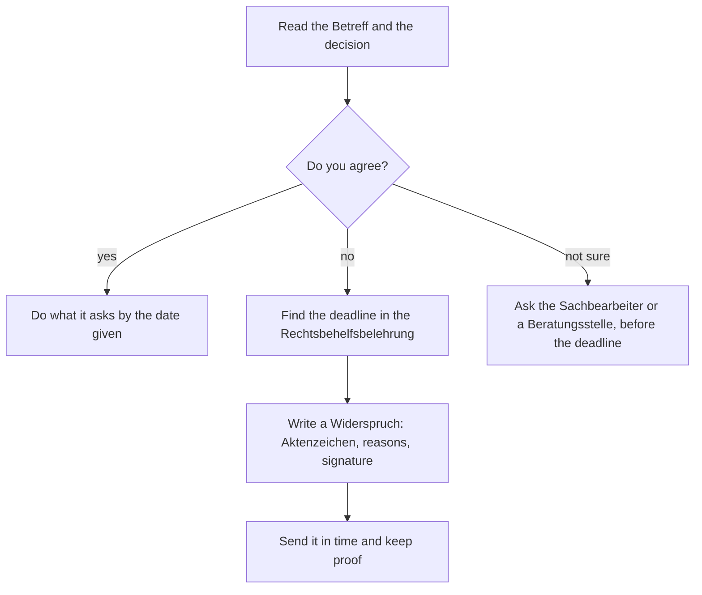

## What this lesson is for

Living on your own in a German-speaking country means post: from the town hall, the health insurance fund, the landlord. In lesson 29 you learned to *write* formal letters; this honors lesson is about *reading* the ones that come to you, and acting on them in time. Their style has a nickname, *Amtsdeutsch* ("office German"), in English **officialese**: long nouns, fixed phrases, abbreviations and passive forms. It looks hard, but it uses a small toolkit you already know from lesson 18 (*sein* + *zu*) and lesson 20 (nominal style), plus one new pattern, the light verb construction.

You'll learn the parts of an official decision, how deadlines and objections work, how to turn officialese into plain German, and how to check the yearly service-charge bill from your landlord. The legal details here are simplified and describe Germany; they are not legal advice. When in doubt, a *Beratungsstelle* or the *Mieterverein* (lesson 27) can help.

## The parts of an official decision

When an office decides on something you applied for, or something you have to pay, it sends a *Bescheid* (an official decision). A *Bescheid* is binding: if you don't object in time, it stands. Most have the same parts:

- *das Aktenzeichen* (Az.): the file number. Quote it in every reply and phone call; it's how the office finds your case.
- *der Sachbearbeiter / die Sachbearbeiterin*: the official dealing with your case, often with a phone number.
- *der Betreff*: what the letter is about, as in lesson 29.
- the decision itself: your application *wird bewilligt* (is approved) or *wird abgelehnt* (is rejected), or an amount *wird festgesetzt* (is fixed).
- *die Begründung*: the reasons.
- *die Rechtsbehelfsbelehrung*: information on how you can challenge the decision, and by when. Always read this part.
- *Im Auftrag* (i. A.): the person signs on behalf of the office.

## Deadlines and objections

The Rechtsbehelfsbelehrung in the picture says: *Gegen diesen Bescheid kann innerhalb eines Monats nach Bekanntgabe Widerspruch erhoben werden.* That means you can lodge an objection (*Widerspruch einlegen* or *erheben*) within one month of being notified.

*Bekanntgabe* (notification) isn't the date on the letter. A letter sent by ordinary post counts as delivered a few days later: under the federal rules, since 2025, on the fourth day after posting (before that it was the third), and state offices follow similar rules. Because the details vary, the safe habit is simple: treat the date on the letter as the start, and act well within a month.

A *Widerspruch* must be in writing (a signed letter; some offices also accept other forms) or *zur Niederschrift*, which means you go to the office and an official writes it down for you. In some states and for some kinds of decisions there is no *Widerspruch*, and you have to go straight to the administrative court (*Klage* at the *Verwaltungsgericht*). You don't need to know which cases those are: the Rechtsbehelfsbelehrung of your letter tells you.

### Example 1: Answering the Bescheid

Elif Kaya applied for a residents' parking permit (*Bewohnerparkausweis*). The car belongs to her sister, so it isn't registered in her name, and the office rejected the application because a confirmation from the registered keeper (*die Halterin*) was missing. The letter is dated Monday, 3 May 2027.

1. Deadline: a month after notification. Posted on 3 May, the letter counts as delivered on Friday, 7 May, so the month ends on Monday, 7 June. To be safe, Elif plans to send her objection by the end of May.
2. What she can do: the missing document is the whole problem, so she could simply apply again with it. She can also lodge a *Widerspruch* and attach the document, which asks the office to look at the same case again. She chooses that.
3. Her letter, formal, with the file number in the subject line:

> Betreff: Widerspruch gegen Ihren Bescheid vom 03.05.2027, Az. BP-2027-0418
>
> Sehr geehrter Herr Brandt,
>
> hiermit lege ich Widerspruch gegen den oben genannten Bescheid ein. Das Fahrzeug gehört meiner Schwester, aber ich nutze es dauerhaft. Die Bestätigung der Halterin habe ich diesem Schreiben beigefügt. Ich bitte Sie, meinen Antrag erneut zu prüfen.
>
> Mit freundlichen Grüßen
>
> Elif Kaya

(*hiermit* = hereby; *oben genannt* = above-mentioned; *das Schreiben* = the letter, a formal word.) She sends it by registered post (*Einschreiben*) or hands it in and asks for a stamp with the date of receipt, so she has proof.

## Officialese decoded

### Nominal style

Lesson 20 showed how written German packs actions into nouns. Official letters do it constantly, often with a preposition at the front. Turn the noun back into a verb and the sentence becomes plain German:

| officialese | plain German | English |
|---|---|---|
| *Nach Eingang Ihrer Unterlagen …* | *Wenn Ihre Unterlagen bei uns angekommen sind, …* | once your documents have arrived |
| *Bei Nichtzahlung …* | *Wenn Sie nicht zahlen, …* | if you don't pay |
| *Zur Vermeidung weiterer Kosten …* | *Damit keine weiteren Kosten entstehen, …* | to avoid further costs |
| *Nach Prüfung Ihres Antrags …* | *Nachdem wir Ihren Antrag geprüft haben, …* | after examining your application |
| *Bei Rückfragen …* | *Wenn Sie Fragen haben, …* | if you have any questions |

### Light verb constructions

A **light verb construction** (*Funktionsverbgefüge*) is a noun plus a verb that has lost most of its own meaning: the noun carries the meaning. *einen Antrag stellen* doesn't "put" anything; it simply means *beantragen*, to apply. They sound formal and are everywhere in official German:

| light verb construction | simple verb | English |
|---|---|---|
| *einen Antrag stellen* | *beantragen* | to apply |
| *Widerspruch einlegen* | *widersprechen* | to object |
| *eine Entscheidung treffen* | *entscheiden* | to decide |
| *in Anspruch nehmen* | *nutzen* | to make use of |
| *zur Verfügung stellen* | *geben, bereitstellen* | to provide |
| *zur Kenntnis nehmen* | *bemerken, wissen* | to note |
| *in Kraft treten* | *gültig werden* | to come into force |

You don't need to use them yourself; *Ich möchte widersprechen* is perfectly correct. But *Ich lege Widerspruch ein* is what offices expect, and it's worth learning as a phrase.

### Passive and sein + zu

Offices rarely say who acts. Lesson 18's *sein* + *zu* is their favourite way to give an order: *Der Betrag ist bis zum 15.07. zu überweisen* = *Sie müssen den Betrag bis zum 15.07. überweisen.* *Die Unterlagen sind beizufügen* = you must enclose the documents. The passive does the same job without the "must": *Ihr Antrag wird abgelehnt.*

### Abbreviations

| abbreviation | full form | English |
|---|---|---|
| *Az.* | *Aktenzeichen* | file number |
| *z. Hd.* | *zu Händen* | for the attention of |
| *i. A.* | *im Auftrag* | on behalf of |
| *ggf.* | *gegebenenfalls* | if necessary, where applicable |
| *bzgl.* | *bezüglich* | regarding |
| *gem.* | *gemäß* | in accordance with |
| *Abs.* | *Absatz* | paragraph, subsection (of a law) |
| *Anl.* | *Anlage(n)* | enclosure(s), attachment(s) |

*§ 556 Abs. 3 BGB* reads "Paragraf 556, Absatz 3 des Bürgerlichen Gesetzbuchs" (the German Civil Code).

### Example 2: Translating a sentence into plain German

*„Bei nicht fristgerechter Vorlage der Nachweise wird Ihr Antrag gem. § 66 SGB I ggf. abgelehnt."*

1. *Bei … Vorlage der Nachweise*: *bei* + noun = *wenn*; *die Vorlage* comes from *vorlegen* (to present). → *Wenn Sie die Nachweise … vorlegen*.
2. *nicht fristgerecht* = not in time (*die Frist* + *gerecht*, "fitting"). → *Wenn Sie die Nachweise nicht rechtzeitig vorlegen*.
3. *gem. § 66 SGB I*: the legal basis, a section of the social security code. You can skip it to understand the sentence.
4. *ggf.* = *gegebenenfalls*, "possibly, where applicable".
5. Plain German: *Wenn Sie die Nachweise nicht rechtzeitig schicken, kann es sein, dass wir Ihren Antrag ablehnen.* — If you don't send the documents in time, we may reject your application.

## The service-charge bill: die Nebenkostenabrechnung

Your rent in Germany usually has two parts: the basic rent and the *Nebenkosten* (service charges: heating, water, rubbish collection, cleaning the stairwell, the caretaker and so on). For the *Nebenkosten* you pay a fixed *Vorauszahlung* (advance payment) every month. Once a year the landlord or the *Hausverwaltung* adds up the real costs and sends the *Nebenkostenabrechnung*. If the real costs were higher than your advance payments, you owe a *Nachzahlung* (additional payment); if they were lower, you have a *Guthaben* (credit), which is paid back or set against the next rent.

Some rules worth knowing (simplified; Austria and Switzerland differ):

- The landlord has to send the bill within twelve months of the end of the billing period. For a bill for 2026, that means by 31 December 2027. A bill that comes later usually can't demand a *Nachzahlung*.
- You have twelve months from receiving it to raise objections, and you may ask to see the *Belege* (receipts) behind it.
- After a bill, the landlord can adjust the monthly advance payment to a fitting amount.

## Reading: a letter from the property management

> Betreff: Nebenkostenabrechnung 2026, Mieteinheit Lindenweg 7, 2. OG links
>
> Sehr geehrte Frau Kaya,
>
> anbei erhalten Sie die Nebenkostenabrechnung für den Abrechnungszeitraum 01.01.2026 bis 31.12.2026. Ihre Vorauszahlungen betrugen 12 × 210,00 € = 2.520,00 €. Ihr Anteil an den Kosten beträgt 2.687,40 €. Daraus ergibt sich eine Nachzahlung in Höhe von 167,40 €.
>
> Der Betrag ist innerhalb von 30 Tagen nach Erhalt dieser Abrechnung auf das unten genannte Konto zu überweisen. Aufgrund der gestiegenen Heizkosten wird Ihre monatliche Vorauszahlung ab dem 01.03.2027 auf 225,00 € angepasst.
>
> Die Belege können nach vorheriger Terminvereinbarung in unserem Büro eingesehen werden. Bei Rückfragen steht Ihnen Ihre Sachbearbeiterin, Frau Lenz, gern zur Verfügung.
>
> Mit freundlichen Grüßen
>
> i. A. M. Lenz
> Hausverwaltung Muster GmbH
>
> Anl.: Abrechnung (3 Seiten)

Translation:

> Subject: Service-charge bill 2026, flat Lindenweg 7, 2nd floor left
>
> Dear Ms Kaya,
>
> Please find enclosed the service-charge bill for the billing period 1 January 2026 to 31 December 2026. Your advance payments came to 12 × €210.00 = €2,520.00. Your share of the costs is €2,687.40. This results in an additional payment of €167.40.
>
> The amount must be transferred to the account given below within 30 days of receiving this bill. Because heating costs have risen, your monthly advance payment will be adjusted to €225.00 from 1 March 2027.
>
> The receipts can be inspected in our office by prior appointment. If you have any questions, your contact, Ms Lenz, will be glad to help.
>
> Yours sincerely,
>
> pp. M. Lenz, Muster property management
>
> Encl.: bill (3 pages)

Notes: *anbei* = enclosed; *OG* = *Obergeschoss* (upper floor); *betragen* = to amount to; *sich ergeben* = to result; *in Höhe von* = to the amount of; *einsehen* = to inspect; *die Terminvereinbarung* = making an appointment. Find the nominal style (*nach Erhalt, nach vorheriger Terminvereinbarung, bei Rückfragen*), the *sein* + *zu* order (*ist … zu überweisen*), the passives (*wird … angepasst*, *können … eingesehen werden*) and the light verb construction (*steht … zur Verfügung*).

### Example 3: Checking the numbers

1. Advance payments: 12 × 210,00 € = 2.520,00 €. Costs: 2.687,40 €. Costs are higher, so it's a *Nachzahlung*: 2.687,40 € − 2.520,00 € = 167,40 €. The letter is right.
2. Is the new advance payment fair? 2.687,40 € ÷ 12 ≈ 223,95 € a month, so 225,00 € roughly matches last year's real costs.
3. Another tenant paid 12 × 160,00 € = 1.920,00 € and her share was 1.812,60 €. Costs are lower, so she has a *Guthaben* of 1.920,00 € − 1.812,60 € = 107,40 €.

Remember the German number format: a comma for decimals and a point for thousands (*2.687,40 €*).

## Common mistakes

- Waiting for the deadline to "start" when the letter arrives late, or calculating it to the last day. Act well within a month of the date on the letter.
- Phoning instead of writing. A call can help you understand, but a *Widerspruch* has to be in writing or *zur Niederschrift*.
- Forgetting the *Aktenzeichen* in a reply. Without it, your letter may take weeks to reach the right desk.
- Reading *ist … zu überweisen* as "is to be transferred (some day)". It's an instruction: you must transfer it.
- Mixing up *Nachzahlung* (you pay) and *Guthaben* (you get money back).
- Reading *i. A.* as a name. It means the person signs on behalf of the office or company.

## Key points

- A *Bescheid* has an *Aktenzeichen*, a decision, a *Begründung* and a *Rechtsbehelfsbelehrung*; read the last one first if you disagree.
- *Widerspruch einlegen*: usually within a month of notification, in writing; quote the *Aktenzeichen*; keep proof.
- Officialese = nominal style (*nach Eingang*, *bei Nichtzahlung*), light verb constructions (*einen Antrag stellen*, *zur Verfügung stellen*), *sein* + *zu* and the passive.
- Learn the abbreviations: *Az., z. Hd., i. A., ggf., bzgl., gem., Abs., Anl.*
- *Nebenkostenabrechnung*: real costs minus advance payments = *Nachzahlung* (positive) or *Guthaben* (negative).

The words from this lesson are listed below; they join your vocabulary reviews when you complete the lesson.
