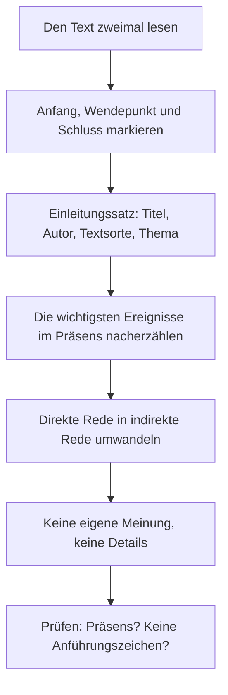

## What this lesson is for

In lesson 1 you learned to write stories in the simple past and met the words for books: *der Roman, der Autor, die Figur, die Handlung, das Kapitel*. In lesson 2 the past perfect let you step back in time inside a story. This honors module puts that grammar to work on real reading: literature, history and society. It starts with the most typical German school text of all, the **short story** (*die Kurzgeschichte*).

Almost every pupil in Germany, Austria and Switzerland reads short stories in class. You'll learn what makes a Kurzgeschichte, read one written for this course, find its turning point and its gaps, and write the standard German school summary, the *Inhaltsangabe*, a skill you can use for any film, report or meeting.

## Where the Kurzgeschichte comes from

The word is a translation of the English "short story". After 1945, young German writers came home to bombed cities and wanted a new, plain way of writing. The language of the Nazi years had been full of big words; they wanted short sentences, everyday language and ordinary people. Many of them admired American writers such as Ernest Hemingway, whose stories were now translated into German.

Their stories about hunger, ruins and soldiers coming home are called **rubble literature** (*die Trümmerliteratur*; *die Trümmer* = ruins, rubble). Two names you'll meet in every German school book:

- Wolfgang Borchert (1921–1947) wrote his stories in the two years between the end of the war and his early death. In *Das Brot* (written in 1946), an old couple meet in the kitchen at night in a time of hunger; one of them has secretly eaten a slice of bread, and neither says so.
- Heinrich Böll (1917–1985) started with short stories about the war and its aftermath and later wrote novels. He won the Nobel Prize in Literature in 1972.

Today's Kurzgeschichten are about anything, but the form those writers shaped is still what schools teach. (*die Literatur* is literature; *die Erzählung* is a general word for a narrative text, usually longer than a Kurzgeschichte.)

## What makes a Kurzgeschichte

German teachers use a checklist of typical features (*Merkmale*). It's a simplification: many famous stories break one or two of the rules. But it tells you what to look for.

| feature | German term | what it means |
|---|---|---|
| sudden start | *unvermittelter Anfang* | no introduction; we're dropped into the action (*Als Jana aus dem Bus stieg, …* Who is Jana?) |
| open ending | *offener Schluss* | the story stops without telling us how things end |
| turning point | *der Wendepunkt* | one moment changes the situation or what a character understands |
| short time | *kurze erzählte Zeit* | minutes or hours, rarely more than a day |
| few characters | *wenige Figuren* | often two or three ordinary people, sometimes without names |
| everyday language | *Alltagssprache* | short sentences, simple words, a lot of dialogue |
| gaps | *Leerstellen* | important things are not said; the reader has to fill them in |

The **open ending** and the gaps are why readers argue about short stories. A fairy tale closes every door (*Und wenn sie nicht gestorben sind, dann leben sie noch heute*); a Kurzgeschichte leaves them open on purpose. The **turning point** is usually small: a sentence, a look, an object. Nothing explodes, but afterwards a character sees the world differently.

The difference shows clearly if you draw how the tension (*die Spannung*) rises and falls:

## Text: Der Zettel

Read the story first without the translation. It was written for this course.

> Als Jana aus dem Bus stieg, regnete es schon wieder. Sie zog die Kapuze über den Kopf und lief los. Seit drei Wochen ging sie jeden Dienstag nach der Arbeit zu ihrem Vater. Er wohnte immer noch in der Wohnung, in der sie aufgewachsen war, im vierten Stock, ohne Aufzug.
>
> Er öffnete die Tür, bevor sie klingeln konnte. „Du kommst zu spät“, sagte er. Sie kam nicht zu spät. Sie kam wie immer um sechs. Sie trug die Einkaufstasche in die Küche und wollte die Milch in den Kühlschrank stellen. Dort standen schon drei Flaschen Milch, alle ungeöffnet.
>
> „Hast du heute schon gegessen?“, fragte sie.
>
> „Natürlich“, sagte er und setzte sich vor den Fernseher. Der Fernseher war aus.
>
> Auf dem Küchentisch lag ein Zettel. Oben stand in seiner ordentlichen Schrift: *Dienstag kommt Jana. Milch kaufen.* Darunter, etwas schiefer: *Dienstag kommt Jana.* Und ganz unten, kaum noch zu lesen, nur: *Jana.*
>
> Sie las den Zettel zweimal. Dann faltete sie ihn klein zusammen und steckte ihn in ihre Jackentasche. Im Wohnzimmer erzählte ihr Vater von einem Fußballspiel, das sie vor zwanzig Jahren zusammen im Stadion gesehen hatten. Er wusste noch jedes Tor, jeden Namen, sogar das Wetter.
>
> „Papa“, sagte sie, „nächste Woche komme ich schon am Montag. Und am Donnerstag auch.“
>
> Er sah sie an, als hätte sie etwas Seltsames gesagt. Dann lächelte er. „Montag ist gut“, sagte er.
>
> Draußen regnete es weiter. Jana blieb sitzen, bis es dunkel wurde.

In English:

> When Jana got off the bus, it was raining again. She pulled her hood over her head and set off. For three weeks she had been going to her father's every Tuesday after work. He still lived in the flat she had grown up in, on the fourth floor, with no lift.
>
> He opened the door before she could ring. "You're late," he said. She wasn't late. She came at six as always. She carried the shopping bag into the kitchen and was going to put the milk in the fridge. There were already three bottles of milk there, all unopened.
>
> "Have you eaten yet today?" she asked.
>
> "Of course," he said, and sat down in front of the television. The television was off.
>
> On the kitchen table there was a note. At the top, in his neat handwriting: *Tuesday Jana is coming. Buy milk.* Below it, a little more crooked: *Tuesday Jana is coming.* And right at the bottom, hardly readable, just: *Jana.*
>
> She read the note twice. Then she folded it up small and put it in her jacket pocket. In the living room her father talked about a football match they had watched together at the stadium twenty years ago. He still remembered every goal, every name, even the weather.
>
> "Dad," she said, "next week I'll come on Monday. And on Thursday too."
>
> He looked at her as if she had said something strange. Then he smiled. "Monday is good," he said.
>
> Outside it went on raining. Jana stayed sitting there until it got dark.

Words to note: *die Kapuze* (hood), *ungeöffnet* (unopened), *ordentlich* (neat, tidy), *schief* (crooked), *zusammenfalten* (to fold up), *lächeln* (to smile). *als hätte sie etwas Seltsames gesagt* is *als ob* with the verb moved forward (lesson 23): "as if she had said something strange". *etwas Seltsames* is an adjectival noun after *etwas* (lesson 5).

The grammar is the grammar of every written story: the simple past for the events (*stieg, zog, lief, öffnete, las, faltete*), the past perfect for what happened before (*aufgewachsen war, gesehen hatten*), and the perfect only inside the dialogue (*Hast du gegessen?*), because people speak in the perfect.

### Example 1: Finding the features

Go through the checklist with *Der Zettel*.

1. Sudden start: the first sentence names Jana as if we knew her. We learn who she is only bit by bit.
2. Short time and few characters: one evening, two people.
3. Everyday language: short sentences, ordinary words, short dialogue.
4. The turning point: the note. Before it, Jana notices small strange things (the milk, the TV that's off). The note shows her, and us, what they mean. Her reaction comes right after it: she hides the note and decides to come more often.
5. Gaps: the story only hints at the illness (*andeuten*: *Die Geschichte deutet die Krankheit nur an*); the word never appears. Nobody says "Dad is getting forgetful". The reader works it out from three bottles of milk and a name written three times. Why does she put the note in her pocket? To keep it? So that he doesn't see it again? The text doesn't say.
6. Open ending: the last scene (*die Szene*) shows Jana sitting in the dark. Will he remember Monday? What happens next? We don't find out.

Notice that the gaps don't make the story vague: a good Kurzgeschichte is exact about things and silent about feelings.

## Who tells the story?

The **narrator** (*der Erzähler, die Erzählerin*) is the voice that tells the story. It isn't the same as the author (*der Autor, die Autorin*), the real person who wrote it. Two main types:

- A **first-person narrator** (*der Ich-Erzähler*) is a character in the story and says *ich*: *Als ich aus dem Bus stieg, regnete es.* We only know what this person knows and thinks.
- A **third-person narrator** (*der Er-Erzähler / Sie-Erzähler*) talks about the characters as *er* and *sie*: *Als Jana aus dem Bus stieg …*. This narrator can stay close to one character, as in *Der Zettel*, where we see everything through Jana's eyes, or can know everything about everyone.

The perspective (*die Perspektive*) decides what the reader may know: in *Der Zettel* we never learn what the father thinks.

## Writing an Inhaltsangabe

The **Inhaltsangabe** (summary of the content) is the standard German school summary. It follows strict rules, and teachers mark them:

- Present tense (*Präsens*), even though the story is in the past. The past perfect becomes the perfect: *Sie war hier aufgewachsen* → *Sie ist hier aufgewachsen*.
- No direct speech. Turn quotations into reported speech with *dass* or a verb such as *behaupten, fragen, versprechen* (lesson 26).
- Your own words, short and in order. Leave out details that don't matter.
- No opinion. No *spannend*, no *traurig*, no "I think". Interpretation comes afterwards, in a separate part.
- An introduction sentence with title, author, text type and theme: *In der Kurzgeschichte „…“ von … geht es um …*

### Example 2: An Inhaltsangabe of Der Zettel

Step 1, the introduction sentence. The theme is not "milk" or "rain"; it's what the story is about underneath:

*In der Kurzgeschichte „Der Zettel“ geht es um eine junge Frau, die merkt, dass ihr Vater immer vergesslicher wird.*

Step 2, the main events in the present tense. Compare the story's sentences with the summary:

| story (past, direct speech) | Inhaltsangabe (present, reported) |
|---|---|
| *Seit drei Wochen ging sie jeden Dienstag zu ihrem Vater.* | *Jana besucht ihren Vater seit einigen Wochen jeden Dienstag.* |
| *„Du kommst zu spät“, sagte er.* | *Er behauptet, dass sie zu spät kommt, obwohl das nicht stimmt.* |
| *Dort standen schon drei Flaschen Milch.* | *Im Kühlschrank findet sie mehrere ungeöffnete Flaschen Milch.* |
| *Auf dem Küchentisch lag ein Zettel …* | *Auf einem Zettel hat ihr Vater immer wieder ihren Namen geschrieben, immer unordentlicher.* |
| *„Nächste Woche komme ich schon am Montag.“* | *Jana steckt den Zettel ein und verspricht, nun öfter zu kommen.* |

Step 3, the ending, without opinion: *Der Vater freut sich darüber. Die Geschichte endet offen.*

Put together, that's a complete Inhaltsangabe of about 70 words, without the rain, the hood, the football match or any word like *traurig*. Note *hat … geschrieben*: what happened earlier is in the perfect.

## Common mistakes

- Writing the Inhaltsangabe in the past: ~~Jana besuchte ihren Vater~~ → *Jana besucht ihren Vater.* Summaries of stories, films and books are in the present.
- Quoting: ~~Er sagt: „Du kommst zu spät.“~~ → *Er behauptet, dass sie zu spät kommt.*
- Giving your opinion in the summary: ~~Die Geschichte ist sehr traurig.~~ That belongs in the interpretation, not the Inhaltsangabe.
- Mixing up narrator and author: in a first-person story, *ich* is the narrator, not necessarily the author.
- Naming the topic instead of the theme: ~~Es geht um Milch und einen Zettel.~~ Say what the story is really about: *Es geht um eine Tochter, die merkt, dass ihr Vater vergesslich wird.*

## Key points

- The Kurzgeschichte grew out of the rubble literature after 1945 (Borchert, Böll), with plain language and ordinary people.
- Typical features: sudden start, open ending, a turning point, a short time, few characters, everyday language and gaps the reader must fill. It's a checklist, not a law.
- The narrator is the voice in the text, not the author: first-person (*ich*) or third-person (*er/sie*).
- An Inhaltsangabe is in the present tense, without quotations or opinions, and starts with title, author, text type and theme.
- Stories use the simple past and past perfect; their dialogue uses the perfect; their summaries use the present and perfect.

The words from this lesson are listed below; they join your vocabulary reviews when you complete the lesson.
