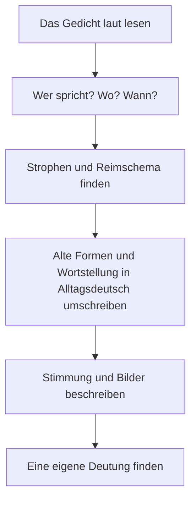

## What this lesson is for

In lesson 13 one of the genitive examples was *Goethes Gedichte*, Goethe's poems. This lesson opens the world of German poetry. (If you did the honors lesson on stories in German A2, you already met Goethe's *Wandrers Nachtlied*; here you go further.) Poems are short, so they're perfect for a learner: you can read one in five minutes and learn it by heart in a week. Both poems in this lesson are among the best known in German.

Poems are also hard in a special way. They use old forms (*hätt'*, *die Lande*), unusual word order and words chosen for their sound. This lesson gives you the tools: the words for talking about a poem, the three common rhyme patterns, and a method for turning poetic German into everyday German. Then you read Joseph von Eichendorff's *Mondnacht* and part of Heinrich Heine's *Die Lore-Ley*. Both are long out of copyright, so you read the original texts.

## Talking about a poem

| German | English | note |
|---|---|---|
| *das Gedicht* | poem | plural *die Gedichte* |
| *der Dichter, die Dichterin* | poet | |
| *die Strophe* | stanza, verse (a group of lines) | |
| *die Zeile, der Vers* | line | |
| *der Reim, sich reimen* | rhyme; to rhyme | *Herz reimt sich auf Schmerz.* |
| *das Reimschema* | rhyme scheme | |
| *die Stimmung* | mood, atmosphere | |
| *auswendig lernen* | to learn by heart | |
| *vortragen* | to recite, perform | *trägt vor, trug vor, hat vorgetragen* |

A **stanza** (*die Strophe*) is a group of lines, separated from the next group by an empty line. A **line** of verse is *eine Zeile* or *ein Vers*. Watch out: German *Vers* means one line, while English "verse" often means a whole stanza (as in "the second verse of a song"). For a song's stanza, German says *die Strophe*.

## Three rhyme schemes

To describe how a poem rhymes, give each new rhyme sound a letter: the first is *a*, the next new sound *b*, and so on. Lines that rhyme get the same letter. That pattern is the **rhyme scheme** (*das Reimschema*). Three schemes are so common that they have names:

- **Couplet rhyme** (*der Paarreim*), *aabb*: lines rhyme in pairs.
- **Alternate rhyme** (*der Kreuzreim*), *abab*: every other line rhymes; the rhymes "cross" (*kreuzen*).
- **Enclosed rhyme** (*der umarmende Reim*), *abba*: one pair of rhymes "embraces" (*umarmt*) another.

A small example of couplet rhyme, written for this course:

> Im Garten blüht der erste Baum,\
> der Winter war ein langer Traum.\
> Die Kinder rennen aus dem Haus,\
> der Frühling ruft: „Kommt alle raus!“

*Baum / Traum* is *a*, *Haus / raus* is *b*: *aabb*. (In the garden the first tree is blooming, the winter was a long dream. The children run out of the house, spring calls: "Everybody come out!")

A rhyme starts at the last stressed vowel: *Nacht* and *sacht* rhyme from the *a* onwards, *Felder* and *Wälder* from the *e* / *ä*.

## Text 1: Eichendorff, Mondnacht

Joseph von Eichendorff (1788–1857) was one of the great poets of German Romanticism, the movement that loved nature, night, longing and the feeling of being far from home. He published *Mondnacht* (Moonlit Night) in 1837, and Robert Schumann set it to music in 1840. The text here is in modern spelling; Eichendorff wrote *geküßt*, *Daß* and *müßt'*.

> Es war, als hätt' der Himmel\
> Die Erde still geküsst,\
> Dass sie im Blütenschimmer\
> Von ihm nun träumen müsst'.
>
> Die Luft ging durch die Felder,\
> Die Ähren wogten sacht,\
> Es rauschten leis die Wälder,\
> So sternklar war die Nacht.
>
> Und meine Seele spannte\
> Weit ihre Flügel aus,\
> Flog durch die stillen Lande,\
> Als flöge sie nach Haus.

A plain translation: *It was as if the sky had quietly kissed the earth, so that, in the shimmer of blossom, she now had to dream of him. The air moved through the fields, the ears of grain swayed gently, the forests rustled softly, so starry-clear was the night. And my soul spread its wings wide, flew through the silent lands, as if it were flying home.*

Words: *der Schimmer* (shimmer, glow), *die Blüte* (blossom), *die Ähre* (ear of grain), *wogen* (to sway, surge like waves), *sacht* (gently), *rauschen* (to rustle, murmur), *die Seele* (soul), *der Flügel* (wing).

Two things to notice first. The grammar you know from lessons 21–23 is everywhere: *als hätt' der Himmel … geküsst* and *als flöge sie* are *als ob* sentences with the verb moved forward, in Konjunktiv II: "as if the sky had kissed", "as if it were flying". The poem opens and closes with a comparison to something unreal. And the poem uses grammatical gender: *der Himmel* is masculine and *die Erde* feminine, so *sie* (she, the earth) dreams *von ihm* (of him, the sky). In English the love story disappears; in German it's built into the articles.

The old and poetic forms are all still understandable (honors lesson 25h2 has more one-word Konjunktiv forms like *flöge*):

| in the poem | everyday German | what happened |
|---|---|---|
| *hätt'* | *hätte* | final *-e* dropped for the rhythm |
| *müsst'* | *müsste* | final *-e* dropped (Konjunktiv II of *müssen*) |
| *leis* | *leise* | final *-e* dropped |
| *flöge* | *würde fliegen* | Konjunktiv II of *fliegen*, today rare in speech |
| *die Lande* | *die Länder, das Land* | old poetic plural of *Land* |
| *nach Haus* | *nach Hause* | final *-e* dropped |

Dropping a sound like this is called **elision** (*die Elision*); in old texts it's often marked with an apostrophe: *hätt', müsst'*. The *-e* at the end of *nach Hause* and *zu Hause* is an old dative ending that survives in everyday German (also *im Grunde*, *auf dem Lande*); older poems use it much more: *im Walde, dem Manne*. Don't copy these forms into your own e-mails: *flöge* and *die Lande* sound 200 years old.

### Example 1: The rhyme scheme of Mondnacht

Write down the last word of each line and give letters. Stanza 1:

1. *Himmel*: new sound, *a*
2. *geküsst*: new sound, *b*
3. *Blütenschimmer*: *a*? *Himmel* and *Schimmer* share the stressed vowel and the *mm*, but end differently (*-el*, *-er*). This is an **impure rhyme** (*der unreine Reim*): close enough for the ear, not identical. Count it as *a*.
4. *müsst'*: rhymes with *geküsst*, *b*

Stanza 2: *Felder* / *Wälder* (*e* and *ä* sound the same here, *c*), *sacht* / *Nacht* (*d*). Stanza 3: *spannte* / *Lande* (impure again, *e*), *aus* / *Haus* (*f*).

The scheme is *abab cdcd efef*: three stanzas of alternate rhyme (*Kreuzreim*), four lines each. Rhyme is about sound, not spelling: *Felder* and *Wälder* rhyme perfectly even though one has *e* and the other *ä*.

Now look at lines 9 and 10: *Und meine Seele spannte / Weit ihre Flügel aus*. The sentence doesn't stop at the end of line 9; it runs on into line 10. This is called **enjambment** (*der Zeilensprung*). Here it even splits a separable verb: *spannte … aus* (from *ausspannen*, to spread out). When you read aloud, don't stop after *spannte*; let the voice carry on, and the wings open with the sentence. What the last line means, a soul longing for a home on earth or in heaven, the poem doesn't say. Many readers hear both; that's interpretation, and you're free to disagree.

## Text 2: Heine, Die Lore-Ley

Heinrich Heine (1797–1856) was born in Düsseldorf into a Jewish family and lived in Paris from 1831 until his death. He wrote *Die Lore-Ley* in 1824, and it became famous through his collection *Buch der Lieder* (Book of Songs, 1827). The Loreley is a steep rock on the Rhine, and its story is a *Sage* (legend) near St. Goarshausen, where the river is narrow and was dangerous for boats. Heine's poem tells of a beautiful woman who sits on the rock, combs her golden hair and sings, and the boatman below looks up at her instead of at the rocks. With a melody by Friedrich Silcher (1837) it became one of the best-known German songs.

The first stanza:

> Ich weiß nicht, was soll es bedeuten,\
> Dass ich so traurig bin;\
> Ein Märchen aus alten Zeiten,\
> Das kommt mir nicht aus dem Sinn.

And the last:

> Ich glaube, die Wellen verschlingen\
> Am Ende Schiffer und Kahn;\
> Und das hat mit ihrem Singen\
> Die Lore-Ley getan.

Translation: *I don't know what it should mean that I am so sad; a tale from olden times won't leave my mind. … I believe the waves in the end swallow up the boatman and his boat; and that is what the Lorelei did with her singing.*

(The spelling is modernised here: Heine wrote *Daß* and *gethan*, as everyone did before the spelling reforms. In 1901 *th* became *t* in words like *tun*; in 1996 *daß* became *dass*.)

Words: *die Welle* (wave), *verschlingen* (to swallow up, devour), *der Schiffer* (boatman), *der Kahn* (small boat), *aus dem Sinn kommen* (to leave one's mind; compare the proverb *Aus den Augen, aus dem Sinn*: out of sight, out of mind).

A small joke hides in the first stanza: the speaker calls the story *ein Märchen aus alten Zeiten*, but the Loreley legend wasn't old at all. The writer Clemens Brentano invented it in a ballad in 1801, only about 20 years before Heine's poem. A story told about the poem is also uncertain: it's often said that during the Nazi era, when Heine's books were banned, songbooks printed *Die Lore-Ley* as by "an unknown poet". Researchers who have searched the school books and anthologies of the time have found little or no evidence for it, so treat it as a legend about a legend.

### Example 2: From poetic word order to everyday German

Poems bend word order for rhythm and rhyme. To understand a line, rewrite it in normal German.

1. *Ich weiß nicht, was soll es bedeuten, dass ich so traurig bin.* An indirect question like *was …* normally sends the verb to the end (lesson 26): *Ich weiß nicht, was es bedeuten soll, dass ich so traurig bin.* Heine keeps main-clause order, which sounds spoken and gives the line its rhythm.
2. *Ein Märchen aus alten Zeiten, das kommt mir nicht aus dem Sinn.* The *das* repeats the subject, as in speech. Everyday: *Ein altes Märchen geht mir nicht aus dem Kopf.*
3. *Und das hat mit ihrem Singen die Lore-Ley getan.* The object *das* stands first, and the subject *die Lore-Ley* comes last, right before the participle, so that the name falls at the end of the poem. Everyday order: *Und die Lore-Ley hat das mit ihrem Singen getan.* Same meaning, but the surprise is gone.

The method for any line: find the verb (or the two parts of the verb), find the subject (who or what?), then put them in the order you'd use in a letter.

## How to read a poem

Read aloud first, because rhyme and rhythm are sounds, and learn a poem by heart the same way: stanza by stanza, out loud.

## Common mistakes

- *der Vers* is one line, not a stanza. "The second verse of the song" is *die zweite Strophe*.
- Copying old forms into your own writing: ~~Ich hätt' gern Zeit~~ → *Ich hätte gern Zeit.* ~~durch die Lande reisen~~ → *durch das Land reisen.*
- Writing *daß* because you saw it in an old poem. Since 1996 the standard spelling is *dass*.
- Stopping at the end of every line when you read aloud. With enjambment, the sentence goes on.
- *der Dichter* is a poet (or a great writer, in a solemn way); a writer in general is *der Schriftsteller* (lesson 1).
- Rhymes are for the ear: don't look only at the spelling. *Felder* rhymes with *Wälder*.

## Key points

- *das Gedicht, die Strophe* (stanza), *die Zeile / der Vers* (line), *der Reim, das Reimschema*.
- Rhyme schemes: *Paarreim aabb, Kreuzreim abab, umarmender Reim abba*. Give each new sound a new letter.
- Old poetic forms: dropped *-e* (*hätt', leis*), old plurals (*die Lande*), Konjunktiv II forms like *flöge*, dative *-e* (*im Walde*). Understand them; don't use them.
- Poems change word order for rhythm and rhyme. Find verb and subject, then rewrite the line in normal order.
- Eichendorff's *Mondnacht* (1837): *abab cdcd efef*, a comparison in Konjunktiv II, with impure rhymes and enjambment. Heine's *Die Lore-Ley* (1824): a "tale from olden times" that was invented in 1801.

The words from this lesson are listed below; they join your vocabulary reviews when you complete the lesson.
