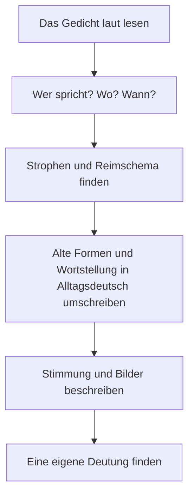

## What this lesson is for

In lesson 13 one of the genitive examples was *Goethes Gedichte*, Goethe's poems. This lesson opens them. Poems are short, so they're perfect for a learner: you can read one in five minutes, learn it by heart in a week and keep it for life. Many Germans can still recite a poem they learned at school, and the two in this lesson are among the best known.

Poems are also hard in a special way. They use old forms (*spürest du*, *im Walde*), unusual word order and words chosen for their sound. This lesson gives you the tools: the words for talking about a poem, the three common rhyme patterns, and a method for turning poetic German into everyday German. Then you read Johann Wolfgang von Goethe's *Wandrers Nachtlied* and part of Heinrich Heine's *Die Lore-Ley*. Both are long out of copyright, so you read the original texts. (Lesson 90, on the Kurzgeschichte, looked at prose; you can do the two lessons in either order.)

## Talking about a poem

| German | English | note |
|---|---|---|
| *das Gedicht* | poem | plural *die Gedichte* |
| *der Dichter, die Dichterin* | poet | |
| *die Strophe* | stanza, verse (a group of lines) | |
| *die Zeile, der Vers* | line | |
| *der Reim, sich reimen* | rhyme; to rhyme | *Herz reimt sich auf Schmerz.* |
| *das Reimschema* | rhyme scheme | |
| *die Stimmung* | mood, atmosphere | |
| *auswendig lernen* | to learn by heart | |
| *vortragen* | to recite, perform | *trägt vor, trug vor, hat vorgetragen* |

A **stanza** (*die Strophe*) is a group of lines, separated from the next group by an empty line. A **line** of verse is *eine Zeile* or *ein Vers*. Watch out: German *Vers* means one line, while English "verse" often means a whole stanza (as in "the second verse of a song"). For a song's stanza, German says *die Strophe*.

## Three rhyme schemes

To describe how a poem rhymes, give each new rhyme sound a letter: the first is *a*, the next new sound *b*, and so on. Lines that rhyme get the same letter. That pattern is the **rhyme scheme** (*das Reimschema*). Three schemes are so common that they have names:

- **Couplet rhyme** (*der Paarreim*), *aabb*: lines rhyme in pairs.
- **Alternate rhyme** (*der Kreuzreim*), *abab*: every other line rhymes; the rhymes "cross" (*kreuzen*).
- **Enclosed rhyme** (*der umarmende Reim*), *abba*: one pair of rhymes "embraces" (*umarmt*) another.

A small example of couplet rhyme, written for this course:

> Im Garten blüht der erste Baum,
>
> der Winter war ein langer Traum.
>
> Die Kinder rennen aus dem Haus,
>
> der Frühling ruft: „Kommt alle raus!“

*Baum / Traum* is *a*, *Haus / raus* is *b*: *aabb*. (In the garden the first tree is blooming, the winter was a long dream. The children run out of the house, spring calls: "Everybody come out!")

Rhyme in German is about sound, not spelling: *Ruh* and *du* rhyme, and so do *Hauch* and *auch*. A rhyme starts at the last stressed vowel: *Gipfeln* and *Wipfeln* rhyme from the *i* onwards.

## Text 1: Goethe, Wandrers Nachtlied

Goethe (1749–1832) wrote this poem in pencil on the wooden wall of a hut on the Kickelhahn, a hill near Ilmenau in Thuringia, in September 1780. He was 31. He printed it in 1815 under the title *Ein Gleiches* ("Another of the same"), because it followed an earlier poem called *Wandrers Nachtlied*; most people know it by that title. Franz Schubert and many other composers set it to music. A witness later reported that Goethe visited the hut again in 1831, a few months before his death, read the lines on the wall and wept; the story may be partly polished, but it's part of the poem's fame.

> Über allen Gipfeln
>
> Ist Ruh,
>
> In allen Wipfeln
>
> Spürest du
>
> Kaum einen Hauch;
>
> Die Vögelein schweigen im Walde.
>
> Warte nur, balde
>
> Ruhest du auch.

A plain translation: *Over all the mountain tops is peace. In all the treetops you feel hardly a breath of wind. The little birds are silent in the forest. Just wait, soon you will rest too.*

Words: *der Gipfel* is a mountain top, *der Wipfel* a treetop; they rhyme, and the eye moves from the mountains down to the trees and then to the birds. *der Hauch* is a breath, the lightest movement of air. *schweigen* means to be silent (*schwieg, hat geschwiegen*).

Notice the old and poetic forms. Each one is still understandable today:

| in the poem | everyday German | what happened |
|---|---|---|
| *Ruh* | *Ruhe* | final *-e* dropped for the rhythm and the rhyme with *du* |
| *spürest, ruhest* | *spürst, ruhst* | old full ending *-est* for *du* |
| *Vögelein* | *Vöglein, kleine Vögel* | diminutive *-lein* (like *-chen*) |
| *im Walde* | *im Wald* | old dative ending *-e* |
| *balde* | *bald* | old form with *-e* |

Dropping a sound like this is called **elision** (in German *die Elision*). The dative *-e* survives today in a few fixed phrases: *zu Hause, nach Hause, im Grunde, auf dem Lande*. In poems, songs and very formal writing you'll meet it more often. Don't copy these forms into your own e-mails: *spürest* and *balde* sound 200 years old.

### Example 1: The rhyme scheme of Wandrers Nachtlied

Write down the last word of each line and give letters:

1. *Gipfeln*: new sound, **a**
2. *Ruh*: new sound, **b**
3. *Wipfeln*: rhymes with *Gipfeln*, **a**
4. *du*: rhymes with *Ruh*, **b**
5. *Hauch*: new sound, **c**
6. *Walde*: new sound, **d**
7. *balde*: rhymes with *Walde*, **d**
8. *auch*: rhymes with *Hauch*, **c**

The scheme is *abab cddc*: four lines of alternate rhyme, then four of enclosed rhyme. The poem calms down as it rhymes: the last rhyme, *auch*, closes the circle that *Hauch* opened.

Notice also lines 7 and 8. The sentence *Warte nur, balde ruhest du auch* doesn't stop at the end of line 7; it runs on into line 8. This is called **enjambment** (*der Zeilensprung*). When you read aloud, don't stop at *balde*; let the voice carry on. The short last line then lands like a final breath. What *ruhen* means here, sleep at the end of the day or the rest of death, the poem doesn't say. Most readers hear both; that's interpretation, and you're free to disagree.

## Text 2: Heine, Die Lore-Ley

Heinrich Heine (1797–1856) was born in Düsseldorf into a Jewish family and lived in Paris from 1831 until his death. He wrote *Die Lore-Ley* in 1824, and it became famous through his collection *Buch der Lieder* (Book of Songs, 1827). The Loreley is a steep rock on the Rhine near St. Goarshausen, where the river is narrow and was dangerous for boats. Heine's poem tells of a beautiful woman who sits on the rock, combs her golden hair and sings, and the boatman below looks up at her instead of at the rocks. With a melody by Friedrich Silcher (1837) it became one of the best-known German songs.

The first stanza:

> Ich weiß nicht, was soll es bedeuten,
>
> Dass ich so traurig bin;
>
> Ein Märchen aus alten Zeiten,
>
> Das kommt mir nicht aus dem Sinn.

And the last:

> Ich glaube, die Wellen verschlingen
>
> Am Ende Schiffer und Kahn;
>
> Und das hat mit ihrem Singen
>
> Die Lore-Ley getan.

Translation: *I don't know what it should mean that I am so sad; a tale from olden times won't leave my mind. … I believe the waves in the end swallow up the boatman and his boat; and that is what the Lorelei did with her singing.*

(The spelling is modernised here: Heine wrote *Daß* and *gethan*, as everyone did before the spelling reforms. In 1901 *th* became *t* in words like *tun*; in 1996 *daß* became *dass*.)

Words: *die Welle* (wave), *verschlingen* (to swallow up, devour), *der Schiffer* (boatman), *der Kahn* (small boat), *aus dem Sinn kommen* (to leave one's mind; compare the proverb *Aus den Augen, aus dem Sinn*: out of sight, out of mind).

A small joke hides in the first stanza: the speaker calls the story *ein Märchen aus alten Zeiten*, but the Loreley legend wasn't old at all. The writer Clemens Brentano invented it in a ballad in 1801, only about 20 years before Heine's poem. A story told about the poem is also uncertain: it's often said that during the Nazi era, when Heine's books were banned, songbooks printed *Die Lore-Ley* as by "an unknown poet". Researchers who have searched the school books and anthologies of the time have found little or no evidence for it, so treat it as a legend about a legend.

### Example 2: From poetic word order to everyday German

Poems bend word order for rhythm and rhyme. To understand a line, rewrite it in normal German.

1. *Ich weiß nicht, was soll es bedeuten, dass ich so traurig bin.* An indirect question like *was …* normally sends the verb to the end (lesson 26): *Ich weiß nicht, was es bedeuten soll, dass ich so traurig bin.* Heine keeps main-clause order, which sounds spoken and gives the line its rhythm.
2. *Ein Märchen aus alten Zeiten, das kommt mir nicht aus dem Sinn.* The *das* repeats the subject, as in speech. Everyday: *Ein altes Märchen geht mir nicht aus dem Kopf.*
3. *Und das hat mit ihrem Singen die Lore-Ley getan.* The object *das* stands first, and the subject *die Lore-Ley* comes last, right before the participle, so that the name falls at the end of the poem. Everyday order: *Und die Lore-Ley hat das mit ihrem Singen getan.* Same meaning, but the surprise is gone.

The method for any line: find the verb (or the two parts of the verb), find the subject (who or what?), then put them in the order you'd use in a letter.

## How to read a poem

Read aloud first, because rhyme and rhythm are sounds. And when you learn a poem by heart, learn it in the same order: stanza by stanza, saying it out loud.

## Common mistakes

- *der Vers* is one line, not a stanza. "The second verse of the song" is *die zweite Strophe*.
- Copying old forms into your own writing: ~~Ich gehe balde nach Hause~~ → *Ich gehe bald nach Hause.* ~~Du spürest~~ → *du spürst.*
- Writing *daß* because you saw it in an old poem. Since 1996 the standard spelling is *dass*.
- Stopping at the end of every line when you read aloud. With enjambment, the sentence goes on.
- *der Dichter* is a poet (or a great writer, in a solemn way); a writer in general is *der Schriftsteller* (lesson 1).
- Rhymes are for the ear: don't look only at the spelling. *Ruh* rhymes with *du*.

## Key points

- *das Gedicht, die Strophe* (stanza), *die Zeile / der Vers* (line), *der Reim, das Reimschema*.
- Rhyme schemes: *Paarreim aabb, Kreuzreim abab, umarmender Reim abba*. Give each new sound a new letter.
- Old poetic forms: dropped *-e* (*Ruh*), *-est* for *du* (*spürest*), dative *-e* (*im Walde*), *-lein* (*Vögelein*). Understand them; don't use them.
- Poems change word order for rhythm and rhyme. Find verb and subject, then rewrite the line in normal order.
- Goethe's *Wandrers Nachtlied* (1780): *abab cddc*, with enjambment at the end. Heine's *Die Lore-Ley* (1824): a "tale from olden times" that was invented in 1801.

The words from this lesson are listed below; they join your vocabulary reviews when you complete the lesson.
