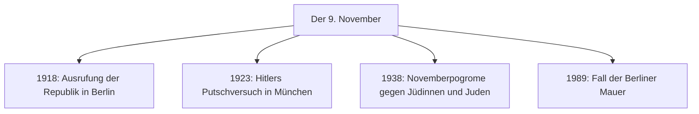

## What this lesson is for

In lesson 2 you met Herr Brandt, who crossed into West Berlin on the night of 9 November 1989, and the words for history: *der Krieg, die Diktatur, die Flucht, der Zeitzeuge*. In lesson 17 you learned the passive in the past (*Die Mauer wurde 1961 gebaut*), and in lesson 13 the genitive. This lesson puts all three together in the texts you'll see in every German town: memorial plaques, memorial days and the small brass stones in the pavement called *Stolpersteine*.

The theme is serious. Germany's way of remembering the crimes of the Nazi era (1933–1945) is a large part of its public life, and a visitor or a new resident meets it everywhere. The language is also special: short, formal and full of passives, because it is about people to whom things were done.

## Erinnerungskultur: remembering in public

*Die Erinnerungskultur*, the **culture of remembrance**, means all the ways a society remembers its past in public: memorials, memorial days, museums, school lessons, speeches. In Germany the word mostly refers to remembering the Nazi era and the Holocaust (*der Holocaust*, also *die Shoah*), the murder of about six million European Jews, and the persecution of Sinti and Roma, political opponents, gay men, people with disabilities and many others.

A longer word you'll see in newspapers is **Vergangenheitsbewältigung**: *die Vergangenheit* (the past) + *die Bewältigung* (coping with, mastering, from *bewältigen*). It means coming to terms with the past. Many people now prefer *die Aufarbeitung* (working through), because a past like this can't really be "mastered".

It didn't start at once. A simplified overview:

- In the 1950s West Germany rebuilt, and many people preferred not to talk about the past.
- The Frankfurt Auschwitz trials (1963–1965) put former camp staff in court and in the newspapers.
- Around 1968 a young generation asked their parents what they had done.
- On 8 May 1985 Federal President Richard von Weizsäcker called the end of the war a *Tag der Befreiung*, a day of liberation, for the Germans too. The speech became a turning point in public memory.
- In 2005 the *Denkmal für die ermordeten Juden Europas* (Memorial to the Murdered Jews of Europe), with its 2,711 concrete blocks, opened in the centre of Berlin.

## Memorial days

A **Gedenktag** is a day of remembrance (*gedenken* = to commemorate). The most important:

| date | what is remembered |
|---|---|
| 27 January | 1945: the Auschwitz camp is liberated by the Soviet army. A German day of remembrance for the victims of National Socialism since 1996, and International Holocaust Remembrance Day since 2005. |
| 8 May | 1945: the war in Europe ends. |
| 3 October | 1990: German reunification, the national holiday (lesson 2). |
| 9 November | the "day of fate" in German history (see below). |

9 November is called *der Schicksalstag* because four turning points fell on it:

In the night of 9 to 10 November 1938, synagogues were set on fire across Germany and Austria, Jewish shops and homes were destroyed, and many people were killed or sent to concentration camps. One reason often given for choosing 3 October rather than 9 November as the national holiday is that a day of celebration couldn't fall on the anniversary of the pogroms.

## Stolpersteine: names in the pavement

Walk through almost any German city and look down. In front of some houses there's a small brass plate set into the pavement, 10 by 10 centimetres, on top of a concrete cube. This is a **Stolperstein**, a "stumbling stone". Each one carries the name of one person who lived there and was persecuted by the Nazis: most of them murdered, some driven out, a few who survived.

The artist Gunter Demnig laid his first stone in Cologne in 1992. In May 2023 the 100,000th Stolperstein was laid in Nuremberg, and there are now stones in many European countries. They're placed in front of the last address the person chose freely, and they're paid for by neighbours, school classes, relatives and local groups, who often research the person's life first. Nobody really stumbles: the idea is that you stop, bend down to read, and so bow to the person.

The stones aren't uncontroversial. Munich, for example, doesn't allow them on public ground: Charlotte Knobloch, president of the Jewish community there, and others objected that people would again tread on the victims' names. Since 2018 Munich has used its own *Erinnerungszeichen*, plaques on walls and small steles at eye level. Both sides want the same thing, to remember each person by name; they disagree about how.

### Example 1: Reading a Stolperstein

The stone in the picture is invented for this course, but its text follows the real pattern exactly. Inscriptions use **telegraphic style**: no articles, no auxiliary verbs, only the words that carry the facts. To understand one, rebuild the full sentences.

1. *HIER WOHNTE / ROSA ADLER* → *Hier wohnte Rosa Adler.* A complete sentence in the simple past; *hier* is in position 1, so the verb comes second and the subject third.
2. *JG. 1903* → *JG.* is short for *Jahrgang*, year of birth: *Sie wurde 1903 geboren.*
3. *DEPORTIERT 1942* → a past participle alone. Rosa Adler didn't deport anyone; she was deported. So the full sentence is a passive: *Sie wurde 1942 deportiert.*
4. *ERMORDET IN AUSCHWITZ* → *Sie wurde in Auschwitz ermordet.*

Full text: *Hier wohnte Rosa Adler. Sie wurde 1903 geboren. 1942 wurde sie deportiert und in Auschwitz ermordet.*

Compare a stone for someone who escaped: *HIER WOHNTE / PAUL ADLER / JG. 1928 / FLUCHT 1939 / ENGLAND / ÜBERLEBT*. Here *Flucht* (escape) is a noun, and *überlebt* is a participle of an active verb: *1939 floh er nach England. Er hat überlebt.* The grammar shows who acted: passive for what was done to people, active for what they did themselves.

## Text: Eine Gedenktafel

Plaques on walls tell a longer story. This one, written for this course, hangs on a fictional house in a fictional town:

> In diesem Haus befand sich von 1919 bis 1938 die Druckerei der Familie Adler.
>
> In der Nacht vom 9. auf den 10. November 1938 wurde die Druckerei von SA-Männern zerstört.
>
> Rosa Adler und ihr Bruder Max wurden 1942 deportiert und ermordet.
>
> Ihr Neffe Paul, der 1939 mit einem Kindertransport nach England gekommen war, überlebte als Einziger der Familie.
>
> Wir gedenken ihrer.
>
> Die Bürgerinnen und Bürger der Stadt Neustadt, 2008

In English:

> From 1919 to 1938 this house was the site of the Adler family's printing works.
>
> In the night of 9 to 10 November 1938 the printing works was destroyed by SA men.
>
> Rosa Adler and her brother Max were deported and murdered in 1942.
>
> Their nephew Paul, who had come to England with a Kindertransport in 1939, was the only one of the family to survive.
>
> We remember them.
>
> The citizens of the town of Neustadt, 2008

Background: the SA (*Sturmabteilung*) was the Nazi party's paramilitary force. The *Kindertransporte* of 1938 and 1939 brought about 10,000 mostly Jewish children from Germany, Austria and Czechoslovakia to Britain; most never saw their parents again.

### Example 2: The grammar of a memorial text

Go through the plaque line by line.

1. *befand sich*: *sich befinden* (to be located) is the formal word for *sein* with places. Simple past, because it's a written history text.
2. *wurde … von SA-Männern zerstört*: passive past with the agent in *von* + dative (lesson 17). The building is the subject; the people who destroyed it are added with *von*.
3. *wurden … deportiert und ermordet*: one *wurden* serves both participles.
4. *der … gekommen war*: a relative clause (lesson 11) in the past perfect (lesson 2), because Paul's arrival in England happened before the rest of the story's point, his survival. *als Einziger* = as the only one (an adjectival noun, lesson 5).
5. *Wir gedenken ihrer.*: *gedenken* takes the **genitive**, which makes it sound solemn. *ihrer* is the genitive of *sie* (them). In everyday German you'd say *Wir erinnern an sie* (we commemorate them) or *Wir denken an sie* (we think of them).

| solemn, written | everyday |
|---|---|
| *Wir gedenken der Opfer.* | *Wir erinnern an die Opfer.* |
| *zum Gedenken an Rosa Adler* | *zur Erinnerung an Rosa Adler* |
| *in stillem Gedenken* | *wir denken an dich* |

Notice the difference between *sich erinnern an* (to remember, privately: *Ich erinnere mich an meine Kindheit*) and *erinnern an* without *sich* (to remind of, or to commemorate in public: *Die Tafel erinnert an die Familie Adler*).

## Remembering the GDR

Germany also remembers its second dictatorship. At the *Gedenkstätte Berliner Mauer* on Bernauer Straße you can see a piece of the Wall with its "death strip" and read about people who died trying to cross. Since 1992 people can apply to read the files that the GDR's secret police, the Stasi, kept on them; many found out that friends or relatives had reported on them. The words of lesson 2 come back here: *die Grenze, die Flucht, der Zeitzeuge, die Wende*.

Austria's story is different again. For decades after 1945, Austria's official view was that it had been Hitler's "first victim" because of the *Anschluss* of 1938. That view was widely questioned from the 1980s, and in 1991 Chancellor Franz Vranitzky acknowledged in parliament that Austrians shared responsibility for the crimes. (A simplified summary of a long debate.)

## Common mistakes

- *gedenken* with the accusative: ~~Wir gedenken die Opfer~~ → *Wir gedenken der Opfer* (genitive). Or use *erinnern an* + accusative.
- Active instead of passive: ~~Rosa Adler deportierte 1942~~ means she deported someone. → *Rosa Adler wurde 1942 deportiert.*
- *das Denkmal* vs *das Mahnmal*: both are monuments, but a *Mahnmal* (from *mahnen*, to warn) warns: it remembers a crime so that it never happens again. A *Denkmal* can also honour a person or a victory.
- *die Gedenkstätte* is a memorial site, often a former camp or prison: *die KZ-Gedenkstätte Dachau*. It isn't a cemetery (*der Friedhof*).
- *jüdisch* (Jewish) is an adjective: *eine jüdische Familie*. For people, *die Juden / die Jüdinnen und Juden* is the normal, respectful word.

## Key points

- *Erinnerungskultur*: how a society remembers in public. In Germany above all the Nazi era and the Holocaust, and also the GDR.
- Memorial days: 27 January, 8 May, 9 November (1918, 1923, 1938, 1989); the national holiday is 3 October.
- *Stolpersteine* carry one name each, in front of the person's last freely chosen home. Their telegraphic style hides passives: *deportiert 1942* = *wurde 1942 deportiert*.
- Memorial texts use the passive past, the past perfect, relative clauses and the genitive: *Wir gedenken der Opfer.*
- *sich erinnern an* = to remember; *erinnern an* = to remind of, commemorate.

The words from this lesson are listed below; they join your vocabulary reviews when you complete the lesson.
