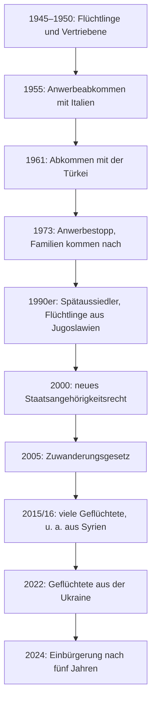

## What this lesson is for

In lesson 5 you learned the words for people in society: *der Ausländer, die Herkunft, die Bevölkerung, die Mehrheit, die Minderheit*. Lesson 20 added *die Integration* and the nominal style of the news, and lesson 19 the phrases for giving opinions. This last honors lesson uses all of them on one of the big topics of German society: migration. About one person in four in Germany today immigrated or has two parents who did.

You'll learn the main stages of that history, from the "guest workers" of the 1950s to today's citizenship law, and a skill that every B1 and B2 exam and every newspaper reader needs: describing a chart (*eine Grafik beschreiben*) with the right verbs, prepositions and numbers, including the difference between per cent and percentage points.

## From emigration to immigration

For a long time Germans were emigrants (lesson 21's *auswandern*), not immigrants (*einwandern, der Einwanderer, die Einwanderin*); *die Migration* covers both directions. In the 19th century millions left for America. After the Second World War about 12 million refugees and expellees (*Flüchtlinge und Vertriebene*), Germans from the former eastern territories and from Eastern Europe, had to find a new home in the two German states. Then West Germany's economic boom (*das Wirtschaftswunder*) ran short of workers.

### The "guest workers"

In 1955 West Germany signed its first **recruitment agreement** (*das Anwerbeabkommen*) with Italy. Agreements with Spain and Greece (1960), Turkey (1961), Morocco (1963), Portugal (1964), Tunisia (1965) and Yugoslavia (1968) followed. The workers were called *Gastarbeiter*, **guest workers**, and the word says what everyone expected: guests go home. Many did. Of roughly 14 million people who came to work in West Germany until 1973, about 11 million returned. In 1964 the Portuguese worker Armando Rodrigues de Sá was welcomed at Cologne-Deutz station as the millionth guest worker and given a moped.

In November 1973, during the oil crisis, the government stopped recruitment (*der Anwerbestopp*). But many workers who had stayed now brought their families, because leaving meant they could never come back. Temporary workers had become immigrants. The Swiss writer Max Frisch summed up the same thing in Switzerland in 1965: *„Man hat Arbeitskräfte gerufen, und es kommen Menschen.“* — "We called for workers, and people are coming."

East Germany had its own *Vertragsarbeiter* (contract workers), mostly from Vietnam, Mozambique and other socialist countries, who often lived apart from Germans in hostels and were expected to leave after a few years.

### After 1990

Since reunification, people have come for very different reasons: ethnic Germans from the former Soviet Union (*Spätaussiedler*), refugees from the wars in Yugoslavia in the 1990s, EU citizens who can live and work anywhere in the EU, refugees from Syria, Afghanistan and Iraq above all in 2015 and 2016, and over a million people from Ukraine after 2022.

The law changed slowly. Only in 2000 did children born in Germany to foreign parents get the right to German citizenship (if one parent had lived there legally for eight years). The first law that openly called itself an immigration law came into force in 2005. The reform of 2024 allowed **naturalisation** (*die Einbürgerung*) after five years instead of eight and generally allowed dual citizenship; a faster route after three years, added in the same reform, was abolished again in 2025. Laws like these change often, so always check the current rules.

## Counting: Ausländer or Einwanderungsgeschichte?

Statistics use several groups, and newspapers mix them up:

- *Ausländer* (lesson 5): people without German citizenship. Many were born in Germany; many immigrants aren't in this group, because they have become German.
- *Menschen mit Migrationshintergrund*: the older statistical term: people who weren't born German citizens or have at least one parent who wasn't.
- *Menschen mit Einwanderungsgeschichte*: the measure the Federal Statistical Office now puts first: people who immigrated since 1950 themselves, or whose two parents did. In 2024 that was about 21.2 million people, 25.6 % of the population, according to its first results.

The same country can therefore have "about 15 % foreigners" and "about a quarter with an immigration history" at the same time. Before you compare two numbers, check that they count the same group.

## Describing a chart

At B1 and B2, exams and courses ask you to describe a chart. The structure is always the same: what the chart shows and where it comes from, the main trend, details, and a short conclusion. The chart below was invented for this lesson.

Phrases for each part:

| part | phrases |
|---|---|
| introduction | *Die Grafik zeigt …* · *Das Säulendiagramm stellt dar, wie …* · *Die Zahlen stammen von …* · *laut* + dative / genitive: *laut der Stadt Neustadt* |
| going up | *steigen (ist gestiegen)* · *zunehmen* · *der Anstieg* · *sich verdoppeln* |
| going down | *sinken (ist gesunken)* · *zurückgehen* · *abnehmen* · *der Rückgang* |
| no change | *gleich bleiben* · *stabil bleiben* |
| how much | *von 12 auf 24 Prozent* (from … to …) · *um 12 Prozentpunkte* (by …) |
| size | *knapp* (just under) · *rund, etwa* (about) · *über, mehr als* · *fast* · *jeder Vierte* (one in four) · *ein Drittel, die Hälfte* |
| conclusion | *Insgesamt kann man sagen, dass …* · *Zusammenfassend …* |

The two prepositions matter: *auf* gives the new value, *um* gives the difference. *Der Anteil stieg von 20 auf 24 Prozent* = it ended at 24. *Der Anteil stieg um 4 Prozentpunkte* = it grew by 4.

### Example 1: Describing the Neustadt chart

1. Introduction: *Das Säulendiagramm zeigt, wie sich der Anteil der Einwohner mit Einwanderungsgeschichte in Neustadt zwischen 2000 und 2024 entwickelt hat. Die Zahlen stammen von der Stadt Neustadt.*
2. Main trend: *Der Anteil ist in diesem Zeitraum stark gestiegen: von 12 auf 24 Prozent. Er hat sich also verdoppelt.*
3. Details: *Den stärksten Anstieg gab es zwischen 2008 und 2016, nämlich um 5 Prozentpunkte. Heute hat etwa jeder vierte Einwohner eine Einwanderungsgeschichte.*
4. Conclusion: *Insgesamt zeigt die Grafik, dass Neustadt immer vielfältiger wird.* (*vielfältig* = diverse; *die Vielfalt* = diversity; a set of numbers like this is *eine Statistik*.)

Check the numbers before you write: 12 → 15 is +3 points, 15 → 20 is +5, 20 → 24 is +4. So the biggest jump really is 2008–2016. 24 % is just under 25 %, so "about one in four" (*etwa jeder Vierte*) is right, and *knapp ein Viertel* (just under a quarter) would be even more exact.

## Per cent and percentage points

When a share changes, there are two ways to measure the change, and German, like English, has two words.

- A **percentage point** (*der Prozentpunkt*) is the plain difference between two percentages: from 20 % to 24 % is 4 percentage points.
- A change in *per cent* (*Prozent*) compares the difference with the old value: 4 is one fifth of 20, so the share grew by 20 per cent.

### Example 2: Points or per cent?

A newspaper writes: *Die Partei steigt in der Umfrage von 10 auf 12 Prozent.*

1. Difference: 12 − 10 = 2. The party gained *2 Prozentpunkte*.
2. Compared with the old value: 2 ÷ 10 = 0.2, so its support grew *um 20 Prozent*.
3. Both sentences are true. *Die Partei legt um 2 Prozent zu* would be wrong: it confuses the two.

Now the chart: from 2000 to 2024 the share rose by 12 percentage points (24 − 12). Compared with 12 %, that's an increase of 100 per cent (12 ÷ 12 = 1), which is just another way of saying it doubled. Between 2016 and 2024 it rose by 4 points, that is by 20 per cent (4 ÷ 20). Headlines that want a big number choose per cent; careful writers say which one they mean.

## Common mistakes

- *Prozent* has no plural after a number: ~~25 Prozente~~ → *25 Prozent*. With a plural noun after it, the verb is usually plural: *25 Prozent der Einwohner haben …*
- *auf* and *um* mixed up: ~~Der Anteil stieg um 24 Prozent~~ when you mean it ended at 24 → *stieg auf 24 Prozent*.
- *steigen* and *sinken* take *sein* in the perfect: *Der Anteil ist gestiegen*, not ~~hat gestiegen~~.
- *Die Grafik sagt …* sounds odd. Charts *zeigen* or *stellen dar*.
- Treating *Ausländer* and *Einwanderer* as the same: many foreigners were born in Germany, and many immigrants are German citizens.
- *Gastarbeiter* is a historical term. Use it for the 1955–1973 period, often in quotation marks; today people say *ausländische Arbeitskräfte* or *Fachkräfte aus dem Ausland*.

## Key points

- Germany became a country of immigration in stages: refugees after 1945, guest workers from 1955, the recruitment stop of 1973 and family reunification, migration after 1990, and new citizenship laws in 2000, 2005 and 2024.
- Check what a statistic counts: *Ausländer*, *Migrationshintergrund* and *Einwanderungsgeschichte* are different groups.
- To describe a chart: introduction with source, main trend, details, conclusion.
- *von … auf* = from … to; *um* = by. *steigen, sinken* take *sein*.
- Percentage points are the plain difference between two percentages; per cent compares the change with the old value.

The words from this lesson are listed below; they join your vocabulary reviews when you complete the lesson.
