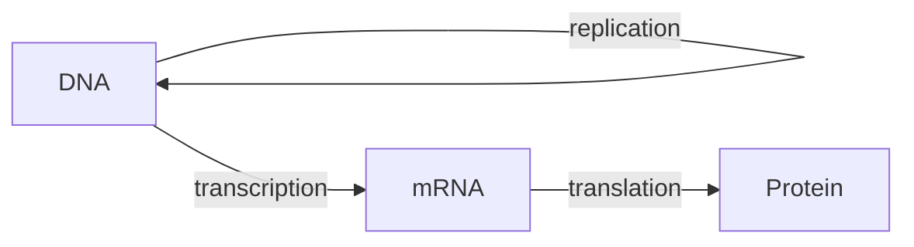

# Writing a bundled math or science course

These courses ship inside Erudior. Each one takes a learner from the high school level
through the intro college level of its subject, in that order: early modules are high
school (Algebra 1 / Geometry / AP-level), later modules are college (Calc II, upper-level
topics). Learners study alone with no teacher, so every lesson has to teach, not summarize.

Everything is original writing. Don't copy or closely paraphrase any textbook, website or
exam; standard formulas, definitions and theorems are fine, but explanations, examples
and questions are yours.

## Catalog

Bundled courses aren't installed up front: the Library shows them in a course catalog (`samples/catalog.json`, written by build.py from each released course's course.yaml plus `content/catalog-extra.json` for non-math courses), with search and Subject / Level / Type filters. Choosing Start course loads that one course and adds it to In progress.

## Files

One folder per course, `content/math/<folder>/`:

```
course.yaml          id, title, description, revision: 1, modules: [{id, title}]
lessons/NN-slug.md   one lesson per file (NN = 01, 02, … keeps them in order)
questions/*.yaml     multiple-choice questions (one file per module is tidy)
drills/*.yaml        math drills (generated practice problems)
cards.yaml           notecards
glossary.yaml        glossary terms
references/*.md      quick-reference sheets (formula sheets, tables)
PROGRESS.md          your running notes: outline, what's done, what's left
```

Build and check:

```
python3 content/math/build.py <folder>
npx tsx tests/check-course.mts samples/math/<course-id>.json
```

The builder catches broken structure (missing lessons, bad answer indices, unknown
drill ids…); the checker generates every drill 40 times, types its correct answer and a
wrong one, renders every figure, and runs every piece of math through KaTeX. Both must
pass with zero problems.

Only touch your own folder (and its output in `samples/math/`). Don't edit `src/`, `tests/`,
other courses, or run git.

### course.yaml

```yaml
id: math-algebra
title: Algebra
description: >-
  Algebra from the first equation through college algebra: …
revision: 1
order: 2              # position in the course catalog
subject: Math        # catalog filter: Math, Science, Real estate, …
level: [High school] # catalog filter: High school, College, Professional (one or more)
type: [Course]       # catalog filter: Course and/or Exam prep
modules:
  - id: alg-m1
    title: Foundations of algebra
  - id: alg-m2
    title: Linear equations and inequalities
```

### Lessons (`lessons/03-solving-linear-equations.md`)

```markdown
---
id: alg-solving-linear
module: alg-m2
title: Solving linear equations
minutes: 25
topics: [Linear equations]
drills: [alg-linear-1, alg-linear-2]
refs: [alg-ref-equations]
---
## Why it works

…Markdown body…
```

- `topics`: 1–3 topic names; reuse the same names in the lesson's questions' `topic`.
- `drills`: 1–3 drill ids that practice this lesson (shown as "Practice the math").
- `refs`: reference sheet ids that help with this lesson.
- `honors: true`: an optional honors lesson (see Honors below).
- Body: 900–1,800 words. Structure that works well:
  - a short intro saying what the lesson is for and how it connects to the previous one;
  - the ideas in `##` sections, each with the rule or definition and *why* it's true or
    where it comes from (a short derivation or intuition);
  - **at least two fully worked examples** per lesson, step by step, with the
    reasoning at each step (use a `### Example 1` heading);
  - a "Common mistakes" section;
  - a short "Key points" list at the end.
- **Bold** each key term the first time it appears; give each bolded term an entry in
  `glossary.yaml` (the app turns bolded glossary terms into pop-up definitions).
- Use figures generously where a picture helps (graphs, triangles, number lines,
  vectors, slope fields, histograms). See Figures below.
- Tables are fine (GitHub Markdown tables).

### Questions (`questions/m2.yaml`)

```yaml
- id: alg-q-0201
  lesson: alg-solving-linear
  module_quiz: true
  topic: Linear equations
  stem: 'Solve $3x - 7 = 11$.'
  choices: ['$x = 6$', '$x = \tfrac{4}{3}$', '$x = 18$', '$x = -6$']
  answer: 0
  explanation: |-
    Add 7 to both sides: $3x = 18$. Divide by 3: $x = 6$.
    ($\tfrac43$ comes from subtracting 7 instead of adding it.)
```

- `lesson`: the lesson whose end-of-lesson quiz includes it. Each lesson's quiz is every
  question tagged with that lesson, so it should cover *that lesson's* content only.
- `module_quiz: true` also puts it in the module's end-of-module quiz. Mark roughly a
  third of each lesson's questions, at least 2 per lesson, chosen so the module quiz
  covers every topic in the module.
- **Aim for 10–14 questions per lesson** (more for dense lessons) so the course totals
  roughly 400. Mix: concept checks, computations, "which step is wrong", reading a
  graph or table, word problems, and a few harder multi-step ones.
- 4 choices, one correct (`answer` is the 0-based index). Spread the correct index
  evenly across 0–3; don't favor any position. For "select all that apply", use a list
  (`answer: [0, 2]`) and say so in the stem; use sparingly.
- Wrong choices should be the answers people actually get from common mistakes (sign
  error, forgot to square, wrong formula, degrees vs radians), and the explanation
  should show the work and, where useful, name the mistake behind a distractor.
- No "all of the above" / "none of the above". Choices should be similar in length and
  form.
- Ids: unique within the course, prefixed with the course short code.

#### Other question types

Besides multiple choice (and select-all-that-apply), a question can set `type:`. Use a mix:
roughly a quarter of a lesson's questions can be other types where they fit the content
naturally (a term to recall, a process to order, parts to label, pairs to match). All of them
go in lesson and module quizzes the same way and are scored right or wrong as a whole (the
review shows which parts were right). Text in every field is plain text with `$math$`.

```yaml
# Select all that apply: answer is a list; say "Select all that apply." in the stem.
- id: bio-q-0150
  lesson: bio-organelles
  stem: 'Which structures are found in plant cells but not animal cells? Select all that apply.'
  choices: [Cell wall, Chloroplast, Mitochondrion, Ribosome]
  answer: [0, 1]
  explanation: …

# Fill in the blank (type the answer). Each ___ is a blank. List every reasonable correct
# answer (singular/plural, abbreviation, common alternate spelling); spacing, capital
# letters, curly quotes and a final period are ignored. Plain numbers compare by value.
- id: bio-q-0151
  lesson: bio-organelles
  type: text
  stem: 'Proteins are built on ___, using instructions copied from DNA in the ___.'
  accept:
    - [ribosomes, ribosome]
    - [nucleus]
  explanation: …
# One blank: accept can be a flat list.  accept: [mitochondrion, mitochondria]
# caseSensitive: true makes capital letters count (gene symbols like "Tt").

# Match: each left item to one answer. Answers may repeat (sorting into categories);
# distractors are extra answers that match nothing.
- id: bio-q-0152
  lesson: bio-organelles
  type: match
  stem: 'Match each organelle to its main job.'
  pairs:
    - [Ribosome, Builds proteins]
    - [Mitochondrion, Releases energy from food as ATP]
    - [Golgi apparatus, Modifies and packages proteins]
  distractors: [Stores the cell's DNA]
  explanation: …

# Put in order: list items in the CORRECT order; the app shuffles them.
- id: bio-q-0153
  lesson: bio-cell-cycle
  type: order
  stem: 'Put the phases of mitosis in order.'
  items: [Prophase, Metaphase, Anaphase, Telophase]
  explanation: …

# Label the picture: numbered markers at x, y (percent of the image's width and height,
# measured from the top-left); the learner picks a label for each.
- id: bio-q-0154
  lesson: bio-organelles
  type: label
  stem: 'Name the numbered parts of this animal cell.'
  image: {src: images/animal-cell.svg, alt: 'An animal cell with four numbered parts'}
  labels:
    - {x: 50, y: 48, text: Nucleus}
    - {x: 78, y: 30, text: Mitochondrion}
  distractors: [Chloroplast, Cell wall]
  explanation: …
```

Any question (choice ones too) can show a picture: `image: {src: images/…, alt: '…',
caption: '…'}` (alt required; caption optional). Write match, order and label questions with
3–6 parts; an order question with 3–7 items. Match and label answers appear in drop-down lists,
so they are plain text (no `$math$`); left items and order items may use math.

#### Images

Put pictures in the course's `images/` folder (SVG preferred; PNG/JPG/WebP allowed, under
400 KB each) and use them in lessons as `` or in questions with
`image:`. The build embeds them in the course file (web addresses don't load in the app).
Alt text says what the picture shows in a sentence or two. Draw SVGs yourself (original work
only) with a white background rectangle, dark (#1c2833) lines and text at least 14px, and
colors with enough contrast; no scripts, `<foreignObject>` or outside links. For label
questions, leave the parts unlabeled in the image (the app adds numbered markers). Check how
an image looks: `node scripts/preview-figure.mjs content/math/<course>/images/x.svg` writes
a PNG next to it (add `--markers '[{"x":50,"y":48}]'` to see label markers); open the PNG
with your file viewer to look at it, then delete it.

#### Diagrams (Mermaid)

Lessons and reference sheets can draw flowcharts, cycles, timelines, sequence and pie
diagrams with a ```mermaid block. Every diagram needs `accTitle:` and `accDescr:` lines (the
description is what screen-reader users get, so describe the whole diagram). Labels are plain
text (no `$math$` or Markdown). Keep them small enough to read on a phone: about 12 boxes, and `flowchart TD` (top-down) for
chains of more than four boxes (left-to-right chains get too wide on a phone).
Check one with `node scripts/preview-figure.mjs file.mmd` (mermaid source in a .mmd file).

````markdown

````

#### Honors

School courses have honors material: optional lessons that go deeper (honors or AP level)
for students who are ready for more or need more hours. Two forms, both welcome:
- an honors lesson inside a core module: `honors: true` in its front matter. It's not needed
  to finish the module, and its questions stay out of the module quiz (give it a lesson quiz
  as usual; `module_quiz` is ignored).
- an honors module: `honors: true` on the module in course.yaml. All its lessons are honors;
  it has its own module quiz like any module.
Honors lessons meet the same quality bar as core lessons, and must be accurate first.

### Drills (`drills/m2.yaml`)

A drill is a template: random inputs, computed answers, text with placeholders. The
full reference is `docs/COURSE_FORMAT.md` (Math drills, Expressions, Answers,
Placeholders, Math notation, Figures); read it first. Example:

```yaml
- id: alg-linear-1
  title: Solve a two-step equation
  topic: Linear equations
  vars:
    a: {min: 2, max: 9}
    x: {min: -12, max: 12}
    b: {min: -20, max: 20}
  where: ["b != 0"]
  calc:
    c: a*x + b
  prompt: 'Solve for $x$: $\;{a}x {b:signed} = {c}$'
  answers:
    - {name: x, label: '$x =$'}
  solution: |-
    Undo the {b} first: ${a}x = {c} - ({b})$. Then divide by {a}: $x =$ **{x}**.
```

- **At least 60 drills per course** (2 per lesson on average, more where computation
  is the point), covering every computational skill in the course. Each lesson's
  front matter links its drills.
- Use `where` to keep numbers clean (whole-number roots, nonzero coefficients, valid
  triangles, nice probabilities). Avoid answers that are huge or need 8 digits.
- Pick the answer type that matches the skill: `fraction` (exact, `lowestTerms`) for
  exact rational answers, `expression` for "find the derivative / simplify / write the
  equation", `units` and `sigfigs` for physics, `relTolerance` for computed decimals,
  multiple boxes for coordinates, vectors, matrix entries, (mean, sd) pairs, etc.
- Say in the prompt how to answer when it matters ("exact fraction", "2 decimals",
  "in degrees", "to 3 significant figures").
- The solution shows the method with this problem's numbers, ending in the bolded answer.
- Placeholder trap: any `{name}` that matches a value is filled, even inside TeX
  braces. With a value named `g`, `\dfrac{v^2}{g}` prints the number. Name values
  so they don't collide with single letters you put alone in braces (`grav`, not `g`;
  or write `\dfrac{v^2}{\,g}`).
- Expression answers are written with explicit `*` and use the drill's values
  (`3*a*x^2 + 2*b*x`); `variables` lists the letters the learner may type.
- Available functions include trig/inverse trig (radians and `…d` degree versions),
  logs, `fact`, `nCr`, `nPr`, `gcd`, `lcm`, `isprime`, statistics of a list (`mean`,
  `median`, `stdev`, `pstdev`, `quartile`), distributions (`normcdf`, `invnorm`, `tcdf`,
  `invt`, `chi2cdf`, `binompdf`, `binomcdf`, `poissonpdf`, …) and numerical calculus on
  drill functions (`deriv`, `integ`, `solve`, `limit`, `extremum`, `sum`).
- YAML: values like `a*x + b` are fine bare, but quote anything starting with `{`, `[`,
  `*`, `-`, `!`, `|`, `'`, `"`, `%`, `@`, or containing `: ` or ` #`.

### Notecards (`cards.yaml`) and glossary (`glossary.yaml`)

```yaml
# cards.yaml — 120–250 cards: formulas, definitions, theorems, "when to use which"
- {front: Quadratic formula, back: '$x = \dfrac{-b \pm \sqrt{b^2 - 4ac}}{2a}$', topic: Quadratics}

# glossary.yaml — every bolded term, plus standard notation and abbreviations
- term: discriminant
  aliases: [discriminants]
  definition: 'The quantity $b^2 - 4ac$ in the quadratic formula; its sign tells how many real roots there are.'
  topic: Quadratics
```

Glossary: 120–250 terms. Include abbreviations (e.g. `SOH-CAH-TOA`, `FTC`, `RREF`,
`CLT`) with what they stand for.

### Reference sheets (`references/*.md`)

```markdown
---
id: alg-ref-equations
title: Equations and formulas
---
| Form | Equation |
|---|---|
| Slope-intercept | $y = mx + b$ |
```

2–5 sheets per course: the formula sheet a student would want open while practicing.

## Math notation

- Inline math `$…$`, display math `$$…$$` on its own line. No space just inside an
  inline `$`: write `$x = 2$`, not `$ x = 2 $`. Don't end inline math right before a
  digit (`$x$5` breaks).
- Money in word problems: a bare `$12` is fine (`$` followed by a digit is text), but
  write `\$` whenever a `$` could be mistaken for the start of math.
- In YAML, single-quote or block-scalar (`|-`) any string with TeX so backslashes stay
  literal. Inside single quotes, a literal `'` is written `''`.
- Every TeX command must be inside math; the checker flags `\frac` etc. outside `$…$`.
- KaTeX supports `\dfrac`, `\tfrac`, `\sqrt[n]{}`, `\vec{}`, `\mathbf{}`, `\hat{}`,
  `\int`, `\iint`, `\oint`, `\sum`, `\lim`, `\begin{cases}`, `\begin{bmatrix}`,
  `\begin{pmatrix}`, `\begin{vmatrix}`, `\begin{aligned}`, `\text{}`, `\,`, `\circ`,
  `\overline{}`, `\angle`, `\triangle`, `\cong`, `\sim`, `\parallel`, `\perp`,
  `\overset{}{}`, `\xrightarrow{}`, `\mathbb{R}`, units with `\text{ m/s}`.

## Figures

In lessons, a fenced block whose language is `plot`, `shape` or `numberline` holds the
figure's JSON (strict JSON: double quotes, no trailing commas). In drills, `figure:`
holds the same spec as YAML. See docs/COURSE_FORMAT.md › Figures for every option:
`functions`, `curves` (parametric/polar), `points`, `segments` (with `arrow` for
vectors), `polygons`, `circles`, `rightAngles`, `labels`, `shade`, `tangents`,
`slopeField`, `vectorField`, `bars` (histograms), `xLabel`/`yLabel`, `equal: true`
(same scale on both axes), `caption`.

````markdown
```plot
{"x": [-4, 4], "y": [-2, 10], "functions": [{"f": "x^2", "label": "y = x^2"}], "points": [{"at": [2, 4], "label": "(2, 4)"}], "caption": "The parabola y = x²"}
```

```shape
{"polygons": [{"points": [[0, 0], [4, 0], [4, 3]]}], "rightAngles": [[[4, 0], [0, 0], [4, 3]]], "segments": [{"from": [0, 0], "to": [4, 0], "label": "4"}, {"from": [4, 0], "to": [4, 3], "label": "3"}, {"from": [4, 3], "to": [0, 0], "label": "5"}]}
```

```numberline
{"x": [-5, 5], "points": [{"at": [2, 0], "open": true}], "segments": [{"from": [2, 0], "to": [5, 0], "arrow": true}], "caption": "x > 2"}
```
````

Figure text (labels, captions) is plain text, not TeX: write `x²`, `θ`, `π`, `√2`.

## Getting it right

Accuracy matters more than volume: a learner trusts every answer key.

- Work every question's answer yourself and check numeric ones in Python (`sympy` is
  installed: `python3 -c "import sympy as s; …"`). Check that each distractor is
  actually wrong.
- Check physical constants and units, sign conventions, and that degrees vs radians are
  stated.
- Re-read each lesson's worked examples for arithmetic slips.
- Run the builder and checker after each module, and fix everything they report.

## Working method

1. Write the full outline into PROGRESS.md: modules (6–10), lessons (30–40 total, in
   teaching order, high school first, college later), and for each lesson its topics
   and planned drills.
2. Write `course.yaml`.
3. Module by module: lessons, then that module's questions and drills; build and check;
   tick it off in PROGRESS.md. Keep files written as you go so nothing is lost.
4. Then cards, glossary, reference sheets; final build and check with zero problems.
5. Update PROGRESS.md with final counts and anything a reviewer should look at.
