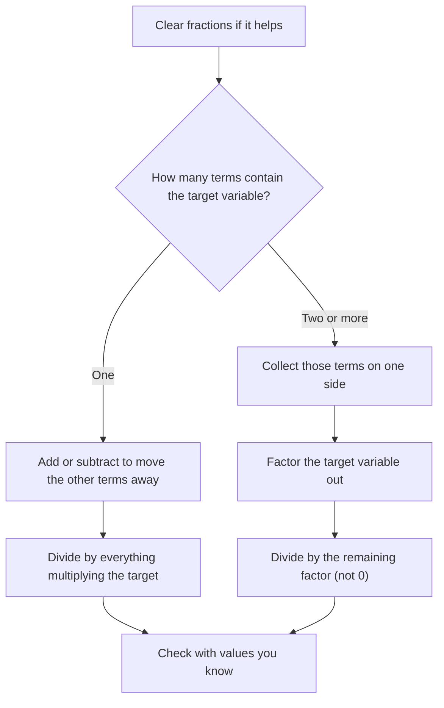

Formulas are equations with several letters: $d = rt$, $A = \tfrac12 bh$, $F = \tfrac95 C + 32$. Often a formula is written for one variable but you need another. Rearranging it is the same skill as the last lesson, solving a linear equation, except the "numbers" you move around are letters. This lesson shows how to do that cleanly, and when you're allowed to divide by a letter.

## Literal equations

A **literal equation** is an equation with two or more variables. A **formula** is a literal equation that expresses a known relationship, such as the perimeter of a rectangle $P = 2l + 2w$.

To **solve for** a variable means to isolate it, so that it appears alone on one side and nowhere on the other. The other letters are treated exactly as if they were numbers. A good habit: imagine the other letters are specific numbers, decide what you would do, then do the same thing with the letters.

### Example 1

Solve $P = 2l + 2w$ for $w$.

Pretend it said $20 = 2(3) + 2w$. You would subtract the $2l$ term, then divide by 2. Do the same with letters.

1. Subtract $2l$ from both sides: $P - 2l = 2w$.
2. Divide both sides by 2: $w = \dfrac{P - 2l}{2}$.

You may also write the result as $w = \tfrac{P}{2} - l$; both are correct. What you must not write is $w = P - 2l \div 2$, which by order of operations means $P - l$. Use a fraction bar or parentheses to keep $P - 2l$ together.

## Dividing by a variable

When you divide both sides by a letter, you are assuming it isn't zero. In formulas this is usually automatic: a rate, a length or a time can't be zero in a meaningful problem. Still, it's good practice to note it. Solving $d = rt$ for $t$ gives $t = \tfrac{d}{r}$, valid for $r \ne 0$.

### Example 2

Convert the temperature formula $F = \tfrac95 C + 32$ into a formula for $C$.

1. Subtract 32: $F - 32 = \tfrac95 C$.
2. Multiply both sides by the reciprocal $\tfrac59$: $C = \tfrac59(F - 32)$.
3. Check with a known pair: water boils at $F = 212$. $\tfrac59(212 - 32) = \tfrac59(180) = 100$. Correct.

Multiplying by the reciprocal is cleaner than dividing by a fraction, and it's the same operation.

## When the variable appears twice

If the variable you want shows up in more than one term, gather those terms on one side and **factor** the variable out. That's the distributive property in reverse, and it's the key step people miss.

### Example 3

Solve $ax + b = cx + d$ for $x$.

1. Collect the $x$-terms on the left: $ax - cx = d - b$.
2. Factor out $x$: $x(a - c) = d - b$.
3. Divide by $a - c$ (assuming $a \ne c$): $x = \dfrac{d - b}{a - c}$.

### Example 4

The amount in an account with simple interest is $A = P + Prt$. Solve for $P$.

1. $P$ appears in two terms on the right. Factor it out: $A = P(1 + rt)$.
2. Divide by $1 + rt$: $P = \dfrac{A}{1 + rt}$.

Trying to "subtract $Prt$" first leaves $A - Prt = P$, which still has $P$ on both sides. Not solved.

So the first question to ask is how many terms contain the variable you want. This chart sums up both cases:



## Using a formula once it's rearranged

Rearranging first pays off when you'll use a formula many times, or when it makes the arithmetic cleaner.

### Example 5

A trapezoid has area $A = \tfrac12 h(b_1 + b_2)$. If its area is 60 square cm, its height is 8 cm and one base is 6 cm, how long is the other base?

1. Solve for $b_2$. Multiply by 2: $2A = h(b_1 + b_2)$.
2. Divide by $h$: $\tfrac{2A}{h} = b_1 + b_2$.
3. Subtract $b_1$: $b_2 = \dfrac{2A}{h} - b_1$.
4. Substitute: $b_2 = \tfrac{2(60)}{8} - 6 = 15 - 6 = 9$ cm.

```shape
{"polygons": [{"points": [[0, 0], [9, 0], [7, 4], [1, 4]]}], "segments": [{"from": [0, 0], "to": [9, 0], "label": "b₂ = ?"}, {"from": [1, 4], "to": [7, 4], "label": "b₁ = 6"}, {"from": [6, 0], "to": [6, 4], "dashed": true, "label": "h = 8"}], "caption": "Trapezoid with area 60 (not to scale)"}
```

### Example 6

The surface area of a closed cylinder is $S = 2\pi r h + 2\pi r^2$. Solve for $h$, then find the height of a can with $S = 100\pi$ square cm and $r = 5$ cm.

Where does the formula come from? Unroll the can. The two ends are circles of area $\pi r^2$ each, and the curved side opens into a rectangle whose height is $h$ and whose width is the distance around the circle, $2\pi r$. Adding the three areas gives $2\pi r h + 2\pi r^2$.


1. The term without $h$ is $2\pi r^2$. Subtract it: $S - 2\pi r^2 = 2\pi r h$.
2. Divide both sides by $2\pi r$: $h = \dfrac{S - 2\pi r^2}{2\pi r}$.
3. Substitute: $h = \dfrac{100\pi - 2\pi(25)}{2\pi(5)} = \dfrac{50\pi}{10\pi} = 5$ cm.

Notice that $\pi$ cancels. Keeping $\pi$ as a symbol until the end, instead of using 3.14 early, gives an exact answer and less rounding.

## Checking a rearranged formula

Two quick checks catch most errors.

- *Units.* In $t = \tfrac{d}{r}$, miles divided by miles per hour gives hours, which is right for a time. If you had written $t = dr$, the units would be miles squared per hour, which can't be a time.
- *Known values.* Pick numbers that satisfy the original formula, such as $d = 120$, $r = 40$, $t = 3$, and confirm the new formula reproduces the one you solved for.

## A useful table of formulas

| Formula | Meaning | Solved for another variable |
|---|---|---|
| $d = rt$ | distance = rate × time | $r = \tfrac{d}{t}$, $t = \tfrac{d}{r}$ |
| $I = Prt$ | simple interest | $r = \tfrac{I}{Pt}$ |
| $A = lw$ | rectangle area | $w = \tfrac{A}{l}$ |
| $P = 2l + 2w$ | rectangle perimeter | $l = \tfrac{P - 2w}{2}$ |
| $C = 2\pi r$ | circle circumference | $r = \tfrac{C}{2\pi}$ |
| $y = mx + b$ | line | $x = \tfrac{y - b}{m}$, $m = \tfrac{y - b}{x}$ |

## Common mistakes

- Dividing only one term by the coefficient: from $2w = P - 2l$, writing $w = P - l$ instead of $w = \tfrac{P - 2l}{2}$.
- Leaving the target variable on both sides. If it appears twice, collect and factor.
- "Cancelling" across a sum: $\tfrac{P - 2l}{2}$ is not $P - l$, because the 2 must divide both terms.
- Forgetting that dividing by an expression assumes it's not zero.

## Key points

- A literal equation has several variables; solving for one means isolating it on one side.
- Treat the other letters like numbers and use the same moves as for linear equations.
- If the target variable appears in several terms, gather those terms and factor the variable out.
- Use a fraction bar or parentheses so a whole side gets divided.
- Check a rearranged formula with a pair of values you know.
