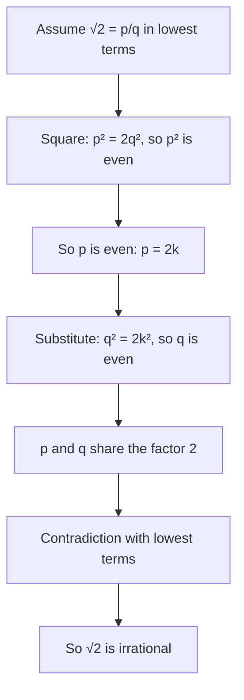

Lesson 1 made two claims without proving them. First, a number is rational exactly when its decimal either stops or repeats. Second, $\sqrt2$ is irrational. This honors lesson proves both. Along the way you will use the linear equations of Lesson 3 to turn any repeating decimal into a fraction, meet the strange but true fact that $0.999\ldots = 1$, and write your first real proof, the same argument Greek mathematicians used more than two thousand years ago.

## From fractions to decimals: why the digits must repeat

To write $\tfrac{p}{q}$ as a decimal, you divide $p$ by $q$ by long division. At every step you bring down a 0, divide, and keep a **remainder**. The key observation is that a remainder after dividing by $q$ is always one of $0, 1, 2, \dots, q - 1$. There are only $q$ possibilities.

- If the remainder 0 ever appears, the division is finished and the decimal terminates (stops), as in $\tfrac38 = 0.375$.
- If 0 never appears, then the remainders come from just $q - 1$ values, so within $q$ steps some remainder must come back. From that moment, the division repeats the same steps, producing the same digits, forever.

A decimal that ends is a **terminating decimal**; one in which a block of digits repeats forever is a **repeating decimal**. We mark the repeating block with a bar: $\tfrac{5}{11} = 0.454545\ldots = 0.\overline{45}$.

Here is the cycle for $\tfrac17$. Start with remainder 1. Bring down a 0: $10 \div 7 = 1$ remainder 3. Then $30 \div 7 = 4$ remainder 2, $20 \div 7 = 2$ remainder 6, $60 \div 7 = 8$ remainder 4, $40 \div 7 = 5$ remainder 5, and $50 \div 7 = 7$ remainder 1. Remainder 1 is back, so the digits $142857$ repeat: $\tfrac17 = 0.\overline{142857}$.

The argument also tells you how long the repeating block can be: at most $q - 1$ digits, since that is how many nonzero remainders there are. For $\tfrac17$ the block has the maximum length, 6.

### Which fractions terminate?

A terminating decimal such as $0.075$ is a fraction with a power of 10 underneath: $\tfrac{75}{1000}$. Since $10 = 2 \cdot 5$, the only primes that divide a power of 10 are 2 and 5. That gives a test you can apply without dividing:

> A fraction in **lowest terms** (numerator and denominator share no common factor except 1) has a terminating decimal exactly when its denominator has no prime factors other than 2 and 5.

Why it works the other way too: if the denominator is made of 2s and 5s, you can multiply top and bottom by enough 2s or 5s to make it a power of 10. For example, $\tfrac{3}{40} = \tfrac{3}{2^3 \cdot 5} = \tfrac{3 \cdot 25}{2^3 \cdot 5 \cdot 25} = \tfrac{75}{1000} = 0.075$.

### Example 1

Decide, without a calculator, which of $\tfrac{7}{20}$, $\tfrac{5}{12}$, $\tfrac{9}{75}$ and $\tfrac{11}{30}$ have terminating decimals.

1. $\tfrac{7}{20}$ is in lowest terms and $20 = 2^2 \cdot 5$. Terminates: $\tfrac{7}{20} = \tfrac{35}{100} = 0.35$.
2. $\tfrac{5}{12}$ is in lowest terms and $12 = 2^2 \cdot 3$. The factor 3 means it repeats: $0.41666\ldots = 0.41\overline{6}$.
3. $\tfrac{9}{75}$ is *not* in lowest terms. Reduce first: $\tfrac{9}{75} = \tfrac{3}{25}$, and $25 = 5^2$. Terminates: $0.12$. (Testing 75 directly would have spotted the 3 and given the wrong answer.)
4. $\tfrac{11}{30}$ is in lowest terms and $30 = 2 \cdot 3 \cdot 5$. Repeats: $0.3\overline{6}$.

Notice that $\tfrac{5}{12}$ and $\tfrac{11}{30}$ have a few digits before the repetition starts. That happens when the denominator has factors of 2 or 5 *and* other primes.

## From decimals to fractions: a linear equation does the work

Now go the other way. Given a repeating decimal, is it always a fraction? Yes, and the proof is a linear equation. Call the decimal $x$, multiply by a power of 10 that shifts one full block to the left of the decimal point, and subtract. The endless tails line up and cancel.

### Example 2

Write $0.\overline{135}$ as a fraction in lowest terms.

1. Let $x = 0.135135135\ldots$. The block has 3 digits, so multiply by $10^3 = 1000$: $1000x = 135.135135\ldots$
2. Subtract the first equation from the second. Everything after the decimal point matches, so it cancels: $1000x - x = 135$, that is, $999x = 135$.
3. Solve: $x = \tfrac{135}{999}$. Both are divisible by 27: $x = \tfrac{5}{37}$.
4. Check by dividing: $5 \div 37 = 0.135135\ldots$ Correct.

The pattern is worth remembering: a block of $k$ digits repeating right after the decimal point equals that block over $k$ nines. So $0.\overline{7} = \tfrac79$, $0.\overline{45} = \tfrac{45}{99} = \tfrac{5}{11}$ and $0.\overline{135} = \tfrac{135}{999}$.

### Example 3

Write $0.4\overline{6} = 0.4666\ldots$ as a fraction in lowest terms.

Here one digit, the 4, comes before the repeating part. Use two multipliers: one that moves the decimal point to the start of the repetition, and one that moves it one block further.

1. Let $x = 0.4666\ldots$ Then $10x = 4.666\ldots$ and $100x = 46.666\ldots$
2. Subtract: $100x - 10x = 46 - 4$, so $90x = 42$.
3. Solve: $x = \tfrac{42}{90} = \tfrac{7}{15}$.
4. Check: $15 = 3 \cdot 5$ has a factor 3, so the decimal should repeat, and $7 \div 15 = 0.4666\ldots$ Correct.

Put the two directions together and you have proved Lesson 1's first claim: *a real number is rational exactly when its decimal terminates or repeats.* Every fraction gives a terminating or repeating decimal (the remainder argument), and every such decimal is a fraction (the subtraction argument; a terminating decimal is just a whole number over a power of 10).

One honest caution. Multiplying an endless decimal by 10 and subtracting treats it like an ordinary number. That is correct, but the full justification needs the idea of a limit, which calculus supplies. At this level, take it as a fact that this arithmetic works.

## The surprise: $0.999\ldots = 1$

Apply the method to $x = 0.999\ldots$ Then $10x = 9.999\ldots$, and subtracting gives $9x = 9$, so $x = 1$.

Many people feel this must be wrong: surely $0.999\ldots$ is "just below" 1. But two different real numbers always have other numbers between them (their average, for example). There is no number between $0.999\ldots$ and 1, because the 9s never stop, so they are not two different numbers. Another way to see it: $\tfrac13 = 0.333\ldots$, and multiplying by 3 gives $1 = 0.999\ldots$ The lesson is that some numbers have two decimal names. Every terminating decimal has a twin ending in repeating 9s: $0.5 = 0.4999\ldots$ and $2.37 = 2.36999\ldots$

## Proving that $\sqrt{2}$ is irrational

We now know that $\sqrt2$ is irrational if and only if no fraction equals it. Checking fractions one at a time can never prove that, since there are infinitely many. Instead we use a **proof by contradiction**: assume the opposite of what you want to prove, reason correctly from it, and arrive at something impossible. Then the assumption must have been false.

We need one fact about **even** numbers (multiples of 2, written $2k$) and **odd** numbers (written $2k + 1$, for an integer $k$): the square of an odd number is odd, because

$$(2k + 1)^2 = 4k^2 + 4k + 1 = 2(2k^2 + 2k) + 1.$$

So if a whole number's square is even, the number itself cannot be odd; it must be even.

*Claim.* $\sqrt2$ is irrational.

*Proof.* Suppose, to the contrary, that $\sqrt2 = \tfrac{p}{q}$ for positive integers $p$ and $q$. We may reduce the fraction, so assume it is in lowest terms: $p$ and $q$ have no common factor except 1.

1. Square both sides: $2 = \tfrac{p^2}{q^2}$, so $p^2 = 2q^2$. That makes $p^2$ even.
2. By the fact above, $p$ is even. Write $p = 2k$.
3. Substitute: $(2k)^2 = 2q^2$, so $4k^2 = 2q^2$, and $q^2 = 2k^2$. So $q^2$ is even, and $q$ is even.
4. Now $p$ and $q$ are both even, so they share the factor 2. That contradicts lowest terms.

The assumption led to a contradiction, so no such fraction exists, and $\sqrt2$ is irrational. ∎

Because $\sqrt2$ is irrational, its decimal $1.41421356\ldots$ can never settle into a repeating block, no matter how far you compute it.

A note on history: the discovery that the diagonal of a square cannot be measured exactly by any fraction of its side goes back to Greek mathematicians of the fifth century BCE and is usually credited to the Pythagoreans. Stories that one of them, Hippasus, was drowned for revealing it are legends, not history. About a century later Aristotle referred to an argument of exactly this odd-and-even kind.

### Example 4

Prove that $\sqrt3$ is irrational.

The same plan works, with multiples of 3 in place of even numbers. First the needed fact: every integer is $3k$, $3k + 1$ or $3k + 2$. Squaring the last two gives $9k^2 + 6k + 1 = 3(3k^2 + 2k) + 1$ and $9k^2 + 12k + 4 = 3(3k^2 + 4k + 1) + 1$, neither a multiple of 3. So if $p^2$ is a multiple of 3, then $p$ is too.

1. Suppose $\sqrt3 = \tfrac{p}{q}$ in lowest terms. Then $p^2 = 3q^2$, a multiple of 3, so $p = 3k$.
2. Substitute: $9k^2 = 3q^2$, so $q^2 = 3k^2$, a multiple of 3, so $q$ is a multiple of 3.
3. Both $p$ and $q$ are multiples of 3, contradicting lowest terms. So $\sqrt3$ is irrational. ∎

Why doesn't the same argument "prove" that $\sqrt4$ is irrational? Try it: $p^2 = 4q^2$ makes $p$ even, $p = 2k$, and then $4k^2 = 4q^2$ gives $k^2 = q^2$. Nothing forces $q$ to be even, so there is no contradiction, and indeed $\sqrt4 = \tfrac21$. A proof is only as good as each of its steps; checking where an argument breaks is a good way to understand why it works.

## Common mistakes

- Testing the denominator before reducing. $\tfrac{9}{75}$ terminates even though $75$ has a factor 3, because the fraction reduces to $\tfrac{3}{25}$.
- Multiplying by the wrong power of 10. For $0.\overline{27}$, $10x = 2.727\ldots$ does not line up with $x = 0.2727\ldots$; you need $100x$, one shift per digit in the block.
- Forgetting the non-repeating digits. For $0.4\overline{6}$, subtracting $x$ from $10x$ leaves $9x = 4.2$, which works but is messy; using $100x - 10x$ keeps everything whole.
- Believing a calculator display. A screen showing $1.414213562$ has rounded; $\sqrt2$ is not that fraction. And $\tfrac{22}{7}$ is a rational approximation of $\pi$, not $\pi$.
- Thinking examples prove a claim. Checking that $\tfrac75$, $\tfrac{17}{12}$ and $\tfrac{41}{29}$ are not exactly $\sqrt2$ proves nothing about the infinitely many other fractions; the proof by contradiction covers them all at once.
- Saying "$p^2$ is even, so $p$ is even" without a reason. The reason is that odd numbers have odd squares.

## Key points

- In long division by $q$ there are only $q$ possible remainders, so the decimal of $\tfrac{p}{q}$ must terminate or repeat, with a block at most $q - 1$ digits long.
- A fraction in lowest terms terminates exactly when its denominator's only prime factors are 2 and 5.
- To turn a repeating decimal into a fraction, let $x$ be the decimal, multiply by powers of 10 so the repeating tails line up, subtract and solve.
- $0.999\ldots = 1$: some numbers have two decimal names.
- Proof by contradiction: assume the opposite and reason to something impossible. Assuming $\sqrt2 = \tfrac{p}{q}$ in lowest terms forces $p$ and $q$ both to be even.
