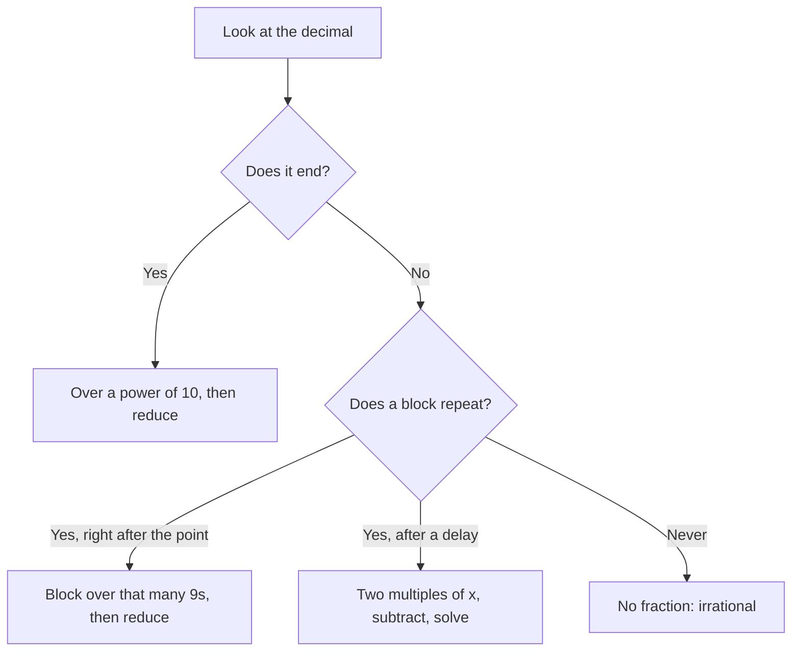

Lesson 1 made a claim without proving it: a number is rational exactly when its decimal either stops or repeats. This honors lesson proves it, in both directions. Along the way you will use the linear equations of Lesson 3 to turn any repeating decimal into a fraction, meet the strange but true fact that $0.999\ldots = 1$, see that between any two numbers there are infinitely many others, and write your first proof by contradiction.

## From fractions to decimals: why the digits must repeat

To write $\tfrac{p}{q}$ as a decimal, you divide $p$ by $q$ by long division. At every step you bring down a 0, divide, and keep a **remainder**. The key observation is that a remainder after dividing by $q$ is always one of $0, 1, 2, \dots, q - 1$. There are only $q$ possibilities.

- If the remainder 0 ever appears, the division is finished and the decimal terminates (stops), as in $\tfrac38 = 0.375$.
- If 0 never appears, then the remainders come from just $q - 1$ values, so within $q$ steps some remainder must come back. From that moment, the division repeats the same steps, producing the same digits, forever.

A decimal that ends is a **terminating decimal**; one in which a block of digits repeats forever is a **repeating decimal**. We mark the repeating block with a bar: $\tfrac{5}{11} = 0.454545\ldots = 0.\overline{45}$.

Here is the cycle for $\tfrac17$. Start with remainder 1. Bring down a 0: $10 \div 7 = 1$ remainder 3. Then $30 \div 7 = 4$ remainder 2, $20 \div 7 = 2$ remainder 6, $60 \div 7 = 8$ remainder 4, $40 \div 7 = 5$ remainder 5, and $50 \div 7 = 7$ remainder 1. Remainder 1 is back, so the digits $142857$ repeat: $\tfrac17 = 0.\overline{142857}$.

The argument also tells you how long the repeating block can be: at most $q - 1$ digits, since that is how many nonzero remainders there are. For $\tfrac17$ the block has the maximum length, 6.

### Which fractions terminate?

A terminating decimal such as $0.075$ is a fraction with a power of 10 underneath: $\tfrac{75}{1000}$. Since $10 = 2 \cdot 5$, the only primes that divide a power of 10 are 2 and 5. That gives a test you can apply without dividing:

> A fraction in **lowest terms** (numerator and denominator share no common factor except 1) has a terminating decimal exactly when its denominator has no prime factors other than 2 and 5.

Why it works the other way too: if the denominator is made of 2s and 5s, you can multiply top and bottom by enough 2s or 5s to make it a power of 10. For example, $\tfrac{3}{40} = \tfrac{3}{2^3 \cdot 5} = \tfrac{3 \cdot 25}{2^3 \cdot 5 \cdot 25} = \tfrac{75}{1000} = 0.075$.

### Example 1

Decide, without a calculator, which of $\tfrac{7}{20}$, $\tfrac{5}{12}$, $\tfrac{9}{75}$ and $\tfrac{11}{30}$ have terminating decimals.

1. $\tfrac{7}{20}$ is in lowest terms and $20 = 2^2 \cdot 5$. Terminates: $\tfrac{7}{20} = \tfrac{35}{100} = 0.35$.
2. $\tfrac{5}{12}$ is in lowest terms and $12 = 2^2 \cdot 3$. The factor 3 means it repeats: $0.41666\ldots = 0.41\overline{6}$.
3. $\tfrac{9}{75}$ is *not* in lowest terms. Reduce first: $\tfrac{9}{75} = \tfrac{3}{25}$, and $25 = 5^2$. Terminates: $0.12$. (Testing 75 directly would have spotted the 3 and given the wrong answer.)
4. $\tfrac{11}{30}$ is in lowest terms and $30 = 2 \cdot 3 \cdot 5$. Repeats: $0.3\overline{6}$.

Notice that $\tfrac{5}{12}$ and $\tfrac{11}{30}$ have a few digits before the repetition starts. That happens when the denominator has factors of 2 or 5 *and* other primes.

## From decimals to fractions: a linear equation does the work

Now go the other way. Given a repeating decimal, is it always a fraction? Yes, and the proof is a linear equation. Call the decimal $x$, multiply by a power of 10 that shifts one full block to the left of the decimal point, and subtract. The endless tails line up and cancel.

### Example 2

Write $0.\overline{135}$ as a fraction in lowest terms.

1. Let $x = 0.135135135\ldots$. The block has 3 digits, so multiply by $10^3 = 1000$: $1000x = 135.135135\ldots$
2. Subtract the first equation from the second. Everything after the decimal point matches, so it cancels: $1000x - x = 135$, that is, $999x = 135$.
3. Solve: $x = \tfrac{135}{999}$. Both are divisible by 27: $x = \tfrac{5}{37}$.
4. Check by dividing: $5 \div 37 = 0.135135\ldots$ Correct.

The pattern is worth remembering: a block of $k$ digits repeating right after the decimal point equals that block over $k$ nines. So $0.\overline{7} = \tfrac79$, $0.\overline{45} = \tfrac{45}{99} = \tfrac{5}{11}$ and $0.\overline{135} = \tfrac{135}{999}$.

### Example 3

Write $0.4\overline{6} = 0.4666\ldots$ as a fraction in lowest terms.

Here one digit, the 4, comes before the repeating part. Use two multipliers: one that moves the decimal point to the start of the repetition, and one that moves it one block further.

1. Let $x = 0.4666\ldots$ Then $10x = 4.666\ldots$ and $100x = 46.666\ldots$
2. Subtract: $100x - 10x = 46 - 4$, so $90x = 42$.
3. Solve: $x = \tfrac{42}{90} = \tfrac{7}{15}$.
4. Check: $15 = 3 \cdot 5$ has a factor 3, so the decimal should repeat, and $7 \div 15 = 0.4666\ldots$ Correct.

Put the two directions together and you have proved Lesson 1's first claim: *a real number is rational exactly when its decimal terminates or repeats.* Every fraction gives a terminating or repeating decimal (the remainder argument), and every such decimal is a fraction (the subtraction argument; a terminating decimal is just a whole number over a power of 10).

One honest caution. Multiplying an endless decimal by 10 and subtracting treats it like an ordinary number. That is correct, but the full justification needs the idea of a limit, which calculus supplies. At this level, take it as a fact that this arithmetic works.

## The surprise: $0.999\ldots = 1$

Apply the method to $x = 0.999\ldots$ Then $10x = 9.999\ldots$, and subtracting gives $9x = 9$, so $x = 1$.

Many people feel this must be wrong: surely $0.999\ldots$ is "just below" 1. But two different real numbers always have other numbers between them (their average, for example). There is no number between $0.999\ldots$ and 1, because the 9s never stop, so they are not two different numbers. Another way to see it: $\tfrac13 = 0.333\ldots$, and multiplying by 3 gives $1 = 0.999\ldots$ The lesson is that some numbers have two decimal names. Every terminating decimal has a twin ending in repeating 9s: $0.5 = 0.4999\ldots$ and $2.37 = 2.36999\ldots$

## Which method when

Every decimal falls into one of four cases, and each case has its own route to a fraction, or a reason there isn't one.

The last branch is how you can recognize, and even build, irrational numbers. The decimal $0.101001000100001\ldots$, with one more 0 between the 1s each time, follows a clear pattern, but no block of digits ever repeats forever, so by the result above it is not a fraction: it is irrational. Likewise, Lesson 1 told you that $\sqrt2$ is irrational, so its decimal $1.41421356\ldots$ can never settle into a repeating block, however far you compute it. (Why $\sqrt2$ is irrational takes a separate argument; an honors lesson in Module 7 proves it.)

## Numbers in between: density

Between two different rational numbers $a$ and $b$ there is always another one: their average $\tfrac{a + b}{2}$, which is a fraction of integers when $a$ and $b$ are. Then there is another between $a$ and that average, and so on, without end. So between any two different rationals there are infinitely many more. Mathematicians say the rational numbers are **dense** on the number line: no gap between two of them is too small to hold another.

Irrational numbers are just as crowded. Between any two different decimals you can write one that never repeats, by copying the digits they share and then continuing with a non-repeating pattern.

### Example 4

Find a rational number and an irrational number between $\tfrac27$ and $\tfrac{3}{10}$.

1. As decimals, $\tfrac27 = 0.285714\ldots$ and $\tfrac{3}{10} = 0.3$.
2. A rational number between them: the average, $\tfrac12\left(\tfrac{20}{70} + \tfrac{21}{70}\right) = \tfrac{41}{140} \approx 0.2929$. A simpler choice is $0.29 = \tfrac{29}{100}$, since $0.2857\ldots < 0.29 < 0.3$.
3. An irrational number between them: $0.29010010001\ldots$ (start with $0.29$, then 1s separated by more and more 0s). It is bigger than $0.29$ and smaller than $0.3$, and it never repeats.

## A first proof by contradiction

How do you show that something is impossible, such as finding a *smallest* positive fraction? Checking fractions one at a time can never finish, since there are infinitely many. Instead, use a **proof by contradiction**: assume the opposite of what you want to prove, reason correctly from it, and arrive at something impossible. Then the assumption must have been false.

*Claim.* There is no smallest positive rational number.

*Proof.* Suppose, to the contrary, that $r$ is the smallest positive rational number.

1. Then $\tfrac{r}{2}$ is also rational (if $r = \tfrac{p}{q}$, then $\tfrac{r}{2} = \tfrac{p}{2q}$) and also positive.
2. But $\tfrac{r}{2} < r$, so $r$ is not the smallest after all.
3. That contradicts the assumption. So no smallest positive rational number exists. ∎

The argument for $0.999\ldots = 1$ in the previous section had the same shape: if the two were different numbers, their average would lie strictly between them, and no decimal fits there. Proof by contradiction will come back many times in this course, most famously in the proof that $\sqrt2$ is irrational.

## Common mistakes

- Testing the denominator before reducing. $\tfrac{9}{75}$ terminates even though $75$ has a factor 3, because the fraction reduces to $\tfrac{3}{25}$.
- Multiplying by the wrong power of 10. For $0.\overline{27}$, $10x = 2.727\ldots$ does not line up with $x = 0.2727\ldots$; you need $100x$, one shift per digit in the block.
- Forgetting the non-repeating digits. For $0.4\overline{6}$, subtracting $x$ from $10x$ leaves $9x = 4.2$, which works but is messy; using $100x - 10x$ keeps everything whole.
- Believing a calculator display. A screen showing $1.414213562$ has rounded; $\sqrt2$ is not that fraction. And $\tfrac{22}{7}$ is a rational approximation of $\pi$, not $\pi$.
- Thinking a decimal with a pattern must repeat. $0.101001000100001\ldots$ has a pattern, but no block repeats, so it is irrational.
- Thinking examples prove a claim. Showing that $\tfrac{1}{1000}$ and $\tfrac{1}{1000000}$ each have a smaller positive fraction below them says nothing about the infinitely many others; the proof by contradiction covers them all at once.

## Key points

- In long division by $q$ there are only $q$ possible remainders, so the decimal of $\tfrac{p}{q}$ must terminate or repeat, with a block at most $q - 1$ digits long.
- A fraction in lowest terms terminates exactly when its denominator's only prime factors are 2 and 5.
- To turn a repeating decimal into a fraction, let $x$ be the decimal, multiply by powers of 10 so the repeating tails line up, subtract and solve.
- A number is rational exactly when its decimal terminates or repeats; a decimal that does neither is irrational.
- $0.999\ldots = 1$: some numbers have two decimal names.
- The rationals are dense: between any two different numbers there are infinitely many rationals, and infinitely many irrationals too.
- Proof by contradiction: assume the opposite and reason to something impossible.
