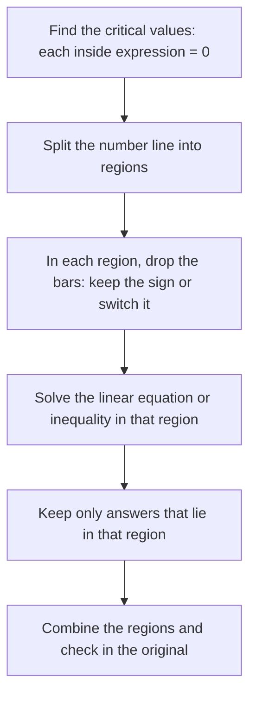

Lesson 7 solved problems like $|2x - 3| \le 5$, where the absolute value is compared with a plain number. The distance picture made those quick. This lesson handles the harder kinds: a variable on *both* sides, as in $|x - 3| = 2x$, and two absolute values in one problem, as in $|x - 1| + |x + 2| = 5$. The tool that works every time is to split the problem into cases, one for each sign the expression inside the bars can have. Along the way you will meet answers that look right but aren't, and learn why they appear.

## The definition behind the bars

Lesson 1 described $|a|$ as the distance from $a$ to 0. In algebra form, that says

$$|u| = \begin{cases} u & \text{if } u \ge 0 \\ -u & \text{if } u < 0. \end{cases}$$

A nonnegative number is its own distance from 0. A negative number has its sign switched: $|-7| = -(-7) = 7$. The minus sign in "$-u$" doesn't make anything negative; it undoes a negative.

This is the key to every problem in this lesson. On any stretch of the number line where you know the sign of $u$, the bars can be removed: $|u|$ is just $u$ or just $-u$, and the problem becomes an ordinary linear one. The places where the sign of $u$ can change are where $u = 0$. Such a value of $x$ is called a **critical value**. For $|x - 3|$, the critical value is $x = 3$: to the right of 3, $|x - 3| = x - 3$, and to the left, $|x - 3| = -(x - 3) = 3 - x$.

Working through each sign separately is called **case analysis**. The chart shows the full method; the first examples need only two cases.



## A variable on the other side of an equation

In Lesson 7, $|u| = k$ split into $u = k$ or $u = -k$, and the only thing to watch was a negative $k$. When the right side contains $x$, you can't tell in advance whether it is negative, because that depends on $x$. Splitting still finds every possible answer, but it can also produce an **extraneous solution**: a value that comes out of correct-looking algebra but does not satisfy the original equation. So every candidate must be checked.

### Example 1

Solve $|x - 3| = 2x$.

*Method 1: split, then check.*

1. Split: $x - 3 = 2x$ or $x - 3 = -2x$.
2. First equation: subtract $2x$ and add 3 to get $-x = 3$, so $x = -3$.
3. Second equation: add $2x$ and add 3 to get $3x = 3$, so $x = 1$.
4. Check $x = -3$: the left side is $|-6| = 6$, but the right side is $2(-3) = -6$. Since $6 \ne -6$, $x = -3$ is extraneous.
5. Check $x = 1$: $|1 - 3| = |-2| = 2$ and $2(1) = 2$. It works.

The only solution is $x = 1$.

*Method 2: cases on the sign of $x - 3$.* The critical value is 3.

- Case $x \ge 3$: here $|x - 3| = x - 3$, so $x - 3 = 2x$ and $x = -3$. But this case only allows $x \ge 3$, and $-3$ is not in it. Reject.
- Case $x < 3$: here $|x - 3| = 3 - x$, so $3 - x = 2x$, $3 = 3x$, $x = 1$. This is less than 3, so it belongs to the case. Keep.

Both methods agree. Method 2 explains *why* $-3$ appeared: it is the answer to an equation that is only the right one for $x \ge 3$, and it lies outside that region.

The graph tells the same story. The V of $y = |x - 3|$ and the line $y = 2x$ cross only once, at $(1, 2)$. The line $y = 2x$ is negative for $x < 0$, so it can't meet the V there, and on the right the V climbs at slope 1 while the line climbs at slope 2, so the line pulls away above it.

```plot
{"x": [-4, 6], "y": [-3, 9], "functions": [{"f": "abs(x - 3)", "label": "y = |x - 3|"}, {"f": "2x", "label": "y = 2x", "dashed": true}], "points": [{"at": [1, 2], "label": "(1, 2)"}], "caption": "The V and the line meet only at x = 1"}
```

A quick way to spot extraneous candidates: in $|u| = v$, the right side $v$ must be at least 0, because it equals a distance. In Example 1, $2x \ge 0$ requires $x \ge 0$, which rules out $-3$ at a glance.

### Example 2

Solve $|2x + 1| = x - 4$.

1. The right side must be nonnegative: $x - 4 \ge 0$, so any solution must have $x \ge 4$.
2. Split: $2x + 1 = x - 4$ gives $x = -5$; $2x + 1 = -(x - 4) = -x + 4$ gives $3x = 3$, so $x = 1$.
3. Neither $-5$ nor 1 is at least 4. Checking confirms it: $x = -5$ gives $|-9| = 9$ on the left but $-9$ on the right, and $x = 1$ gives $3$ on the left but $-3$ on the right.

There is no solution, even though the algebra produced two numbers. Graphically, the line $y = x - 4$ stays below the V $y = |2x + 1|$ everywhere.

## Inequalities with a variable on the other side

Inequalities are friendlier. The rules from Lesson 7,

$$|u| < v \iff -v < u < v \qquad\text{and}\qquad |u| > v \iff u < -v \text{ or } u > v,$$

hold for *every* value of $v$, negative ones included (the same goes for $\le$ and $\ge$). Here is why. The number $|u|$ is the larger of $u$ and $-u$. A larger-of-two is below $v$ exactly when *both* numbers are below $v$: that is, $u < v$ and $-u < v$, which is $-v < u < v$. A larger-of-two is above $v$ exactly when *at least one* of them is above $v$: $u > v$ or $-u > v$, which is $u > v$ or $u < -v$. Nothing in that argument needed $v \ge 0$. If $v$ happens to be negative, the "between" condition $-v < u < v$ simply has no solutions, which is correct, because a distance can't be below a negative number.

So inequalities need no special extraneous check. There is one practical catch: when $x$ appears in all three parts of $-v < u < v$, you can't solve it all at once. Split it into its two halves, solve each, and intersect.

### Example 3

Solve $|2x - 1| \le x + 4$.

1. Rewrite as "between": $-(x + 4) \le 2x - 1 \le x + 4$.
2. Left half: $-x - 4 \le 2x - 1$. Add $x$ and add 1: $-3 \le 3x$, so $x \ge -1$.
3. Right half: $2x - 1 \le x + 4$. Subtract $x$ and add 1: $x \le 5$.
4. Both must hold ("and"): $-1 \le x \le 5$, the interval $[-1, 5]$.
5. Check an inside value, $x = 0$: $|-1| = 1 \le 4$. True. Check an outside value, $x = 6$: $|11| = 11 \le 10$ is false, as it should be.

```plot
{"x": [-3, 7], "y": [-1, 12], "functions": [{"f": "abs(2x - 1)", "label": "y = |2x - 1|"}, {"f": "x + 4", "label": "y = x + 4", "dashed": true}], "points": [{"at": [-1, 3], "label": "(-1, 3)"}, {"at": [5, 9], "label": "(5, 9)"}], "caption": "The V is on or below the line for -1 ≤ x ≤ 5"}
```

### Example 4

Solve $|x + 2| > 2x - 1$.

1. Rewrite as "or": $x + 2 < -(2x - 1)$ or $x + 2 > 2x - 1$.
2. First part: $x + 2 < -2x + 1$, so $3x < -1$ and $x < -\tfrac13$.
3. Second part: $x + 2 > 2x - 1$, so $3 > x$, that is $x < 3$.
4. Union: every number below $-\tfrac13$ is already below 3, so the union is just $x < 3$, the interval $(-\infty, 3)$.
5. Check: $x = 0$ gives $2 > -1$, true; $x = 3$ gives $5 > 5$, false; $x = 4$ gives $6 > 7$, false.

An "or" answer doesn't always come out as two rays: when one piece contains the other, the union is the bigger piece.

## Two absolute values: split the line into regions

For $|x - 1| + |x + 2| = 5$, there are two critical values: $x = 1$ (where $x - 1 = 0$) and $x = -2$ (where $x + 2 = 0$). They cut the number line into three regions, and in each region both signs are fixed. The picture shows what each absolute value becomes.


To decide a sign in a region, test any number in it. At $x = -3$, $x + 2 = -1$ is negative and $x - 1 = -4$ is negative, so both bars switch the sign. At $x = 0$, $x + 2 = 2$ is positive and $x - 1 = -1$ is negative. At $x = 2$, both are positive.

### Example 5

Solve $|x - 1| + |x + 2| = 5$.

1. Region $x < -2$: the sum is $-2x - 1$. Solve $-2x - 1 = 5$: $x = -3$. It is less than $-2$, so keep it.
2. Region $-2 \le x < 1$: the sum is the constant 3, and $3 = 5$ is never true. No solutions here.
3. Region $x \ge 1$: the sum is $2x + 1$. Solve $2x + 1 = 5$: $x = 2$. It is at least 1, so keep it.
4. Check: $|-4| + |-1| = 5$ and $|1| + |4| = 5$. The solutions are $x = -3$ and $x = 2$.

The distance picture explains the shape of the answer. $|x - 1| + |x + 2|$ is the distance from $x$ to 1 plus the distance from $x$ to $-2$. Those two points are 3 apart. For any $x$ between them, the two distances fill the gap exactly, so the sum is always 3. Outside, you travel past one end and back, so the sum is 3 plus twice the overshoot. A sum of 5 means an overshoot of 1 at either end: $x = -3$ or $x = 2$. The graph of the sum is flat-bottomed.

```plot
{"x": [-6, 5], "y": [0, 10], "functions": [{"f": "abs(x - 1) + abs(x + 2)", "label": "y = |x - 1| + |x + 2|"}, {"f": "5", "label": "y = 5", "dashed": true}], "points": [{"at": [-3, 5], "label": "(-3, 5)"}, {"at": [2, 5], "label": "(2, 5)"}, {"at": [-2, 3]}, {"at": [1, 3]}], "caption": "The sum of the two distances is 3 between -2 and 1 and rises outside"}
```

The same reasoning predicts unusual answers. $|x - 1| + |x + 2| = 3$ is true for *every* $x$ in $[-2, 1]$, infinitely many solutions. $|x - 1| + |x + 2| = 2$ has no solution at all, because the sum is never below 3. Inequalities work region by region too: $|x - 1| + |x + 2| < 7$ gives $-4 < x < -2$ from the left region, all of $[-2, 1)$ from the middle, and $1 \le x < 3$ from the right, so the solution is $(-4, 3)$.

## Common mistakes

- Not checking candidates from $|u| = v$ when $v$ contains $x$. Splitting can create extraneous solutions; the right side must be nonnegative.
- Solving a three-part inequality with $x$ in all three parts as if it were Lesson 6's $-5 \le 2x + 3 < 9$. Split it into two inequalities.
- Sign slips when removing bars. In a region where $x - 1$ is negative, $|x - 1| = -(x - 1) = -x + 1$, not $-x - 1$.
- Keeping an answer from the wrong region. An answer counts only if it lies in the region whose equation produced it.
- Expecting exactly two answers. A sum of two absolute values can equal a number at two points, along a whole interval, or nowhere.

## Key points

- $|u| = u$ where $u \ge 0$ and $|u| = -u$ where $u < 0$. Critical values (where $u = 0$) are where the formula can change.
- For $|u| = v$ with $x$ in $v$: split, then check every candidate; $v$ must be at least 0.
- $|u| < v \iff -v < u < v$ and $|u| > v \iff u < -v$ or $u > v$ hold for any $v$; when $x$ is in all parts, solve the two halves separately.
- With several absolute values, split the line at all critical values, solve in each region, keep answers inside their region, and combine.
- $|x - a| + |x - b|$ is a sum of distances: constant between $a$ and $b$, growing outside.
