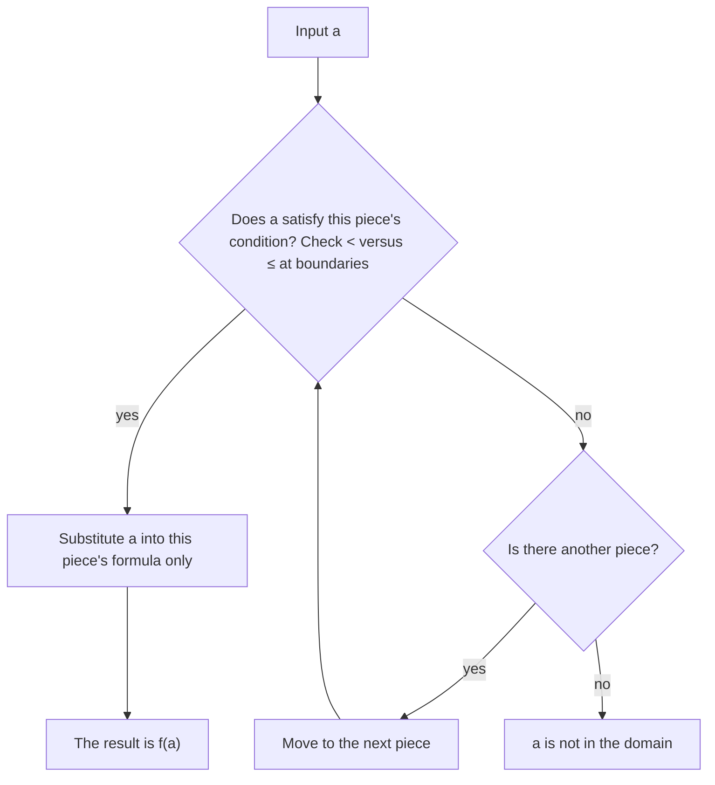

Every function so far has used one formula for all of its inputs. Many real rules don't work that way. A phone plan charges a flat fee up to a data limit and then a price per gigabyte; a tax rate jumps when income crosses a bracket; a parking garage charges by the hour, and 61 minutes counts as two hours. This lesson shows how to write, evaluate and graph functions whose rule changes from one part of the domain to another. It uses the lines from Lessons 10–12 as building blocks and gives a new look at absolute value (Lessons 1 and 7).

## Functions defined in pieces

A **piecewise function** uses different formulas on different parts of its domain. Each formula comes with a condition that says which inputs it applies to:

$$f(x) = \begin{cases} -x + 2, & x < 1 \\ 2x - 1, & 1 \le x < 4 \\ 5, & x \ge 4 \end{cases}$$

Read it as three instructions: if the input is less than 1, use $-x + 2$; if it is from 1 up to (but not including) 4, use $2x - 1$; if it is 4 or more, the output is 5.

The conditions must not overlap. If $x = 4$ were allowed in both the second and third pieces, $f(4)$ could be 7 or 5, and $f$ would not be a function. Here every real number falls under exactly one condition, so each input has exactly one output and the domain is all real numbers. The pieces don't have to cover everything, though: if a function is only defined for $0 \le x \le 10$, its domain is just $[0, 10]$.

## Evaluating

To find $f(a)$, first decide which condition $a$ satisfies, then use that piece's formula and no other. The boundary values, where one condition ends and the next begins, need the most care: look at whether each inequality is strict ($<$) or includes the endpoint ($\le$).

The procedure is a loop through the conditions, shown in this chart. If an input satisfies none of them, it isn't in the domain.



### Example 1

For the function $f$ above, find $f(-3)$, $f(1)$, $f(2.5)$ and $f(4)$.

1. $-3 < 1$, so use the first piece: $f(-3) = -(-3) + 2 = 5$.
2. $x = 1$ fails $x < 1$ but satisfies $1 \le x < 4$, so use the second piece: $f(1) = 2(1) - 1 = 1$.
3. $1 \le 2.5 < 4$: second piece again, $f(2.5) = 2(2.5) - 1 = 4$.
4. $x = 4$ fails $x < 4$ but satisfies $x \ge 4$: $f(4) = 5$. The second formula would have given $2(4) - 1 = 7$, but it doesn't apply at 4.

## Graphing

Graph each piece only over its own interval, as if you were looking at the full graph of that formula through a window. At each boundary, mark the endpoint of a piece with a closed dot if the condition includes it ($\le$ or $\ge$) and an open dot if it doesn't ($<$ or $>$).

### Example 2

Graph $f$ and find its range.

1. For $x < 1$, draw the line $y = -x + 2$ (slope $-1$). It heads toward the point $(1, 1)$ but doesn't include it, so that end gets an open dot for now.
2. For $1 \le x < 4$, draw $y = 2x - 1$ from $(1, 1)$, closed, to $(4, 7)$, open.
3. For $x \ge 4$, draw the horizontal ray $y = 5$ starting with a closed dot at $(4, 5)$.
4. The second piece fills in $(1, 1)$, so the open dot from step 1 becomes solid and the graph is connected there. At $x = 4$ it jumps from just under 7 down to 5.

```plot
{"x": [-3, 7], "y": [-1, 8], "functions": [{"f": "-x + 2", "from": -3, "to": 1}, {"f": "2*x - 1", "from": 1, "to": 4}, {"f": "5", "from": 4, "to": 7}], "points": [{"at": [1, 1], "label": "(1, 1)"}, {"at": [4, 7], "open": true, "label": "(4, 7)"}, {"at": [4, 5], "label": "(4, 5)"}, {"at": [-3, 5], "label": "(-3, 5)"}], "caption": "The three pieces of f: connected at x = 1, a jump at x = 4"}
```

For the range, take each piece in turn. The first piece's outputs, $-x + 2$ for $x < 1$, are every number greater than 1. The second gives $[1, 7)$, and the third gives only 5. Together the outputs are every number from 1 up: the range is $[1, \infty)$.

A vertical line meets this graph only once. That is the vertical line test from Lesson 8, and it is exactly what the non-overlapping conditions guarantee.

## Absolute value is piecewise

Lesson 1 defined $|x|$ as the distance from $x$ to 0. For $x \ge 0$ that distance is $x$ itself. For $x < 0$ it is $-x$, the opposite of a negative number, which is positive: $|-4| = -(-4) = 4$. So

$$|x| = \begin{cases} x, & x \ge 0 \\ -x, & x < 0 \end{cases}$$

The two pieces are the lines $y = x$ and $y = -x$, which is why the graph of $y = |x|$ is a V with its corner at the origin.

Any absolute value of a linear expression splits the same way, at the input where the expression inside equals 0: on one side the inside is nonnegative and the bars can be dropped, and on the other side the bars change its sign.

### Example 3

Write $g(x) = |2x - 6| + 1$ without absolute value bars.

1. The inside is 0 when $2x - 6 = 0$, at $x = 3$.
2. For $x \ge 3$, $2x - 6 \ge 0$, so $|2x - 6| = 2x - 6$ and $g(x) = 2x - 6 + 1 = 2x - 5$.
3. For $x < 3$, $2x - 6 < 0$, so $|2x - 6| = -(2x - 6) = -2x + 6$ and $g(x) = -2x + 7$.
4. So $g(x) = -2x + 7$ for $x < 3$ and $2x - 5$ for $x \ge 3$. Check with $x = 0$: $|{-6}| + 1 = 7$ and $-2(0) + 7 = 7$. ✓ The corner is at $(3, 1)$, where both pieces give 1.

```plot
{"x": [-1, 7], "y": [-1, 9], "functions": [{"f": "-2*x + 7", "from": -1, "to": 3, "label": "y = -2x + 7"}, {"f": "2*x - 5", "from": 3, "to": 7, "label": "y = 2x - 5", "dashed": true}], "points": [{"at": [3, 1], "label": "corner (3, 1)"}, {"at": [0, 7], "label": "(0, 7)"}], "caption": "g(x) = |2x - 6| + 1 is two rays that meet at the corner"}
```

## Step functions

A **step function** is a piecewise function that is constant on each piece, so its graph looks like a staircase of horizontal segments. The standard example is the **greatest integer function**, written $\lfloor x \rfloor$ (also called the floor function): $\lfloor x \rfloor$ is the greatest integer that is less than or equal to $x$. On a number line, it is the integer at or immediately to the left of $x$.

- $\lfloor 3.7 \rfloor = 3$ and $\lfloor 5 \rfloor = 5$.
- $\lfloor -1.2 \rfloor = -2$, not $-1$: the integers $\le -1.2$ are $-2, -3, \dots$, and the greatest of them is $-2$. For negative numbers, the floor is not "drop the decimal part."

As a piecewise function, $\lfloor x \rfloor = 0$ for $0 \le x < 1$, $= 1$ for $1 \le x < 2$, and so on. Each step has a closed dot on its left end (the integer itself is included) and an open dot on its right end.

```plot
{"x": [-3, 3], "y": [-4, 3], "segments": [{"from": [-3, -3], "to": [-2, -3]}, {"from": [-2, -2], "to": [-1, -2]}, {"from": [-1, -1], "to": [0, -1]}, {"from": [0, 0], "to": [1, 0]}, {"from": [1, 1], "to": [2, 1]}, {"from": [2, 2], "to": [3, 2]}], "points": [{"at": [-3, -3]}, {"at": [-2, -3], "open": true}, {"at": [-2, -2]}, {"at": [-1, -2], "open": true}, {"at": [-1, -1]}, {"at": [0, -1], "open": true}, {"at": [0, 0]}, {"at": [1, 0], "open": true}, {"at": [1, 1]}, {"at": [2, 1], "open": true}, {"at": [2, 2]}, {"at": [3, 2], "open": true}], "caption": "y = ⌊x⌋: closed dot on the left of each step, open dot on the right"}
```

Many prices work the other way: they round *up*. "Each hour or part of an hour" charges 3 hours for 2 hours and 10 minutes. Those steps have an open dot on the left and a closed dot on the right. (Rounding up has its own symbol, $\lceil x \rceil$, but you can always write such a rule as a list of pieces.)

### Example 4

A garage charges \$3 for the first hour or any part of it, and \$2 for each additional hour or part of an hour, for stays of up to 5 hours. Write the cost $C(t)$ for a stay of $t$ hours, find the cost of 2 hours 10 minutes and of exactly 2 hours, and graph $C$.

1. Any stay up to and including 1 hour costs 3 dollars: $C(t) = 3$ for $0 < t \le 1$.
2. Just past 1 hour, a second hour starts: $C(t) = 5$ for $1 < t \le 2$. Likewise $C = 7$ on $2 < t \le 3$, $C = 9$ on $3 < t \le 4$ and $C = 11$ on $4 < t \le 5$.
3. 2 hours 10 minutes is $t \approx 2.17$, in $2 < t \le 3$: \$7. Exactly 2 hours is in $1 < t \le 2$: \$5.
4. Each step includes its right end, so the closed dots go on the right.

```plot
{"x": [0, 5.5], "y": [0, 12], "segments": [{"from": [0, 3], "to": [1, 3]}, {"from": [1, 5], "to": [2, 5]}, {"from": [2, 7], "to": [3, 7]}, {"from": [3, 9], "to": [4, 9]}, {"from": [4, 11], "to": [5, 11]}], "points": [{"at": [0, 3], "open": true}, {"at": [1, 3]}, {"at": [1, 5], "open": true}, {"at": [2, 5]}, {"at": [2, 7], "open": true}, {"at": [3, 7]}, {"at": [3, 9], "open": true}, {"at": [4, 9]}, {"at": [4, 11], "open": true}, {"at": [5, 11]}], "xLabel": "hours parked", "yLabel": "cost ($)", "caption": "Parking cost: each step includes its right end"}
```

The domain is $(0, 5]$ and the range is the set $\{3, 5, 7, 9, 11\}$: a step function's range is a list of values, not an interval.

## Common mistakes

- Using every piece, or the wrong piece. Each input uses only the formula whose condition it satisfies.
- Sloppy boundaries: $x < 4$ excludes 4. Check strict versus non-strict inequalities at every boundary.
- Drawing each piece as a full line instead of only over its interval.
- Putting closed dots on both ends of a jump, which gives one input two outputs.
- Treating $\lfloor -1.2 \rfloor$ as $-1$. The floor of a negative non-integer moves further from 0.
- Forgetting to flip the sign: for $x < 3$, $|2x - 6|$ is $-(2x - 6) = -2x + 6$, not $2x + 6$.

## Key points

- A piecewise function pairs each formula with a condition; the conditions must not overlap.
- Evaluate by finding the condition the input satisfies, then using only that formula.
- Graph each piece over its interval; closed dots for $\le$, $\ge$, open dots for $<$, $>$.
- $|x| = x$ for $x \ge 0$ and $-x$ for $x < 0$; $|ax + b|$ splits where $ax + b = 0$.
- A step function is constant on each piece. $\lfloor x \rfloor$ is the greatest integer $\le x$; "per hour or part of an hour" rounds up.
