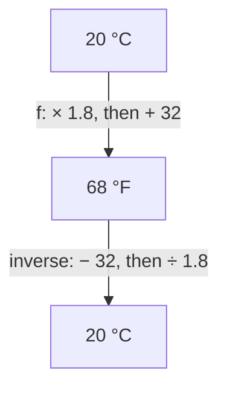
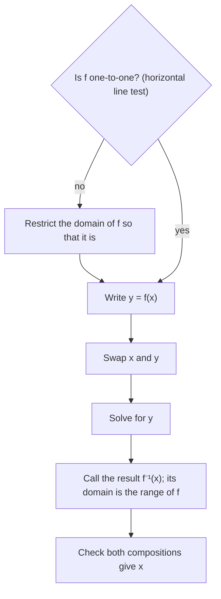

Lesson 8 drew a sharp line between two questions about a function $f$: "what is $f(3)$?" asks for an output, while "solve $f(x) = 3$" asks for the input that produced a given output. Every time you solve $f(x) = c$, you are running the function backward for one value of $c$. This honors lesson asks what happens if you run it backward for *every* output at once. The answer is a new function, the inverse of $f$. You'll learn when an inverse exists, how to find its formula, how its graph is related to the graph of $f$, and how to read it in context. It uses the composition notation $f(g(x))$ from Lesson 8 and the slopes from Lessons 10–12.

## Undoing a function

A thermometer reads in degrees Celsius, and you want Fahrenheit. The rule is

$$F = 1.8C + 32,$$

so the function $f(C) = 1.8C + 32$ does two things in order: multiply by 1.8, then add 32. For example, $f(20) = 36 + 32 = 68$, so 20 °C is 68 °F.

Now go the other way: a recipe says 350 °F and your oven is in Celsius. To undo $f$, undo its steps *in reverse order*: first subtract 32, then divide by 1.8. That gives

$$g(F) = \frac{F - 32}{1.8}, \qquad g(350) = \frac{318}{1.8} \approx 176.7.$$

So 350 °F is about 177 °C. The reverse order matters, just as you take off your shoes before your socks even though you put the socks on first. Dividing by 1.8 *before* subtracting 32 would give $\tfrac{350}{1.8} - 32 \approx 162.4$, which is wrong.



## Definition and notation

Let $f$ be a function. A function $g$ is the **inverse function** of $f$ when $g$ sends each output of $f$ back to the input it came from:

$$g(b) = a \quad \text{exactly when} \quad f(a) = b.$$

The inverse of $f$ is written $f^{-1}$, read "$f$ inverse." Two facts follow straight from the definition:

- *Pairs swap.* If $(a, b)$ is on the graph of $f$, then $(b, a)$ is on the graph of $f^{-1}$.
- *Domain and range swap.* The inputs of $f^{-1}$ are the outputs of $f$, and the outputs of $f^{-1}$ are the inputs of $f$.

> Warning: the $-1$ in $f^{-1}$ is not an exponent. $f^{-1}(x)$ means "the inverse function at $x$," not $\dfrac{1}{f(x)}$. For $f(x) = 2x$, $f^{-1}(x) = \tfrac{x}{2}$, but $\dfrac{1}{f(x)} = \dfrac{1}{2x}$, a different function.

Because each undoes the other, composing them in either order gives back the input:

$$f^{-1}(f(x)) = x \text{ for every } x \text{ in the domain of } f, \qquad f(f^{-1}(x)) = x \text{ for every } x \text{ in the domain of } f^{-1}.$$

These two equations are the standard way to check that you have found the right inverse.

## Which functions have inverses?

Look at $f(x) = x^2$. Both $f(3) = 9$ and $f(-3) = 9$. If you are told the output is 9, you can't say whether the input was 3 or $-3$, so "$f^{-1}(9)$" would need two values. A function can't do that, so $x^2$ (on all real numbers) has no inverse.

A function is **one-to-one** if different inputs always give different outputs: $f(a) = f(b)$ only when $a = b$. Exactly the one-to-one functions have inverses, because only then does each output come from a single input.

On a graph, the input values that give the output $c$ are where the horizontal line $y = c$ meets the graph. So there is a twin of the vertical line test:

> **Horizontal line test**: a function is one-to-one exactly when no horizontal line crosses its graph more than once.

Every non-horizontal line passes: $f(x) = mx + b$ with $m \ne 0$ is one-to-one. A horizontal line $y = b$ fails badly (every input gives $b$), and so does every parabola.

## Finding an inverse from a formula

To find the formula for $f^{-1}$, write $y = f(x)$, swap the roles of $x$ and $y$ (because the inverse swaps inputs and outputs), and solve for $y$.



### Example 1

Find the inverse of $f(x) = 3x - 7$ and check it.

1. $f$ is linear with slope $3 \ne 0$, so it is one-to-one.
2. Write $y = 3x - 7$ and swap: $x = 3y - 7$.
3. Solve for $y$: $x + 7 = 3y$, so $y = \dfrac{x + 7}{3}$. Thus $f^{-1}(x) = \dfrac{x + 7}{3}$.
4. Check one way: $f^{-1}(f(x)) = \dfrac{(3x - 7) + 7}{3} = \dfrac{3x}{3} = x$.
5. Check the other way: $f(f^{-1}(x)) = 3 \cdot \dfrac{x + 7}{3} - 7 = (x + 7) - 7 = x$.

Notice the reverse order again: $f$ multiplies by 3 and then subtracts 7, while $f^{-1}$ adds 7 and then divides by 3.

### Example 2

A streaming service charges $C(r) = 12 + 4r$ dollars for a month with $r$ rentals (Lesson 8, Example 3). Find $C^{-1}$, compute $C^{-1}(32)$, and say what it means.

1. Solve $y = 12 + 4r$ for $r$: $r = \dfrac{y - 12}{4}$. In context it's clearer *not* to swap letters, because $r$ and $C$ have meanings. So $C^{-1}(y) = \dfrac{y - 12}{4}$, where $y$ is a monthly bill in dollars.
2. $C^{-1}(32) = \dfrac{32 - 12}{4} = 5$.
3. Meaning: a bill of \$32 comes from 5 rentals. The input of $C^{-1}$ is in dollars and its output is a number of rentals: the units swap along with the inputs and outputs.
4. The domain of $C^{-1}$ is the range of $C$: the bills \$12, \$16, \$20, …. A bill of \$30 isn't possible, and indeed $C^{-1}(30) = 4.5$ is not a whole number of rentals.

## The inverse of a linear function

The same steps work for any linear function $f(x) = mx + b$ with $m \ne 0$: from $x = my + b$ we get

$$f^{-1}(x) = \frac{x - b}{m} = \frac{1}{m}x - \frac{b}{m}.$$

So the inverse of a line is a line, and its slope is $\tfrac{1}{m}$, the *reciprocal* of the original slope. That makes sense: a slope of $m$ means "rise $m$ for each run of 1"; swapping $x$ and $y$ turns it into "rise 1 for each run of $m$." Don't confuse this with Lesson 12: perpendicular lines have slopes that are *negative* reciprocals. A line and its inverse have reciprocal slopes of the same sign.

## Graphs: a reflection across $y = x$

Since the inverse swaps every pair $(a, b)$ to $(b, a)$, its graph comes from the graph of $f$ by swapping coordinates. Geometrically, $(a, b)$ and $(b, a)$ are mirror images across the line $y = x$. Here's why, using Lesson 12:

- The segment joining them has slope $\dfrac{a - b}{b - a} = -1$ (when $a \ne b$). The line $y = x$ has slope 1, and $1 \cdot (-1) = -1$, so the segment is perpendicular to $y = x$.
- The midpoint of the segment is $\left(\tfrac{a + b}{2}, \tfrac{a + b}{2}\right)$, which lies on $y = x$.

A point and its mirror image are exactly a pair whose connecting segment is perpendicular to the mirror and is cut in half by it. So:

> The graph of $f^{-1}$ is the reflection of the graph of $f$ across the line $y = x$.

```plot
{"x": [-4, 6], "y": [-4, 6], "equal": true, "functions": [{"f": "2*x + 1", "label": "y = f(x)"}, {"f": "(x - 1)/2", "label": "y = f⁻¹(x)"}, {"f": "x", "dashed": true, "label": "y = x"}], "points": [{"at": [1, 3]}, {"at": [3, 1]}, {"at": [2, 2]}, {"at": [-1, -1]}], "segments": [{"from": [1, 3], "to": [3, 1], "dashed": true}], "caption": "f(x) = 2x + 1 and f⁻¹(x) = (x − 1)/2 are mirror images across y = x", "labels": [{"at": [-2.0, -0.8], "text": "(-1, -1)"}, {"at": [3.6, 0.35], "text": "(3, 1)"}, {"at": [1.85, 2.95], "text": "(1, 3)"}]}
```

In the picture, $f(1) = 3$ and $f^{-1}(3) = 1$; the dashed segment from $(1, 3)$ to $(3, 1)$ crosses $y = x$ at a right angle at its midpoint $(2, 2)$. The two graphs meet at $(-1, -1)$, a point on the mirror line, where $f(-1) = -1$.

### Example 3

A one-to-one function $f$ is given by the table below. Find $f^{-1}(5)$, $f^{-1}(f(2))$ and $f(f^{-1}(-1))$.

| $x$ | $-2$ | $0$ | $2$ | $4$ |
|---|---|---|---|---|
| $f(x)$ | $-1$ | $3$ | $5$ | $11$ |

1. $f^{-1}(5)$ asks which input gives 5. Find 5 in the *bottom* row: it sits under $x = 2$, so $f^{-1}(5) = 2$.
2. $f^{-1}(f(2)) = f^{-1}(5) = 2$. No lookup was really needed: an inverse undoes $f$, so the answer is the original input.
3. $f(f^{-1}(-1)) = f(-2) = -1$, again the starting value.
4. The table of $f^{-1}$ is the same table with the rows swapped: inputs $-1, 3, 5, 11$ and outputs $-2, 0, 2, 4$.

## Restricting the domain

A function that fails the horizontal line test can still be given an inverse if we agree to use only part of its domain, a piece on which it is one-to-one. The standard example: on $x \ge 0$ only, $f(x) = x^2$ is one-to-one, and its inverse is $f^{-1}(x) = \sqrt{x}$. The square root symbol means the *nonnegative* root precisely so that it can be this inverse.

```plot
{"x": [-1, 6], "y": [-1, 6], "equal": true, "functions": [{"f": "x^2", "from": 0, "to": 2.45, "label": "y = x², x ≥ 0"}, {"f": "sqrt(x)", "from": 0, "to": 6, "label": "y = √x"}, {"f": "x", "dashed": true, "label": "y = x"}], "points": [{"at": [2, 4], "label": "(2, 4)"}, {"at": [4, 2]}, {"at": [0, 0]}], "caption": "Half of a parabola and its inverse, the square root function", "labels": [{"at": [4.4, 1.45], "text": "(4, 2)"}]}
```

### Example 4

Let $g(x) = (x - 2)^2 + 1$ with domain $x \ge 2$. Find $g^{-1}$ and its domain.

1. On $x \ge 2$ the graph is the right half of a parabola with vertex $(2, 1)$, which rises steadily, so $g$ is one-to-one. Its range is $[1, \infty)$.
2. Write $y = (x - 2)^2 + 1$, swap: $x = (y - 2)^2 + 1$.
3. Solve: $(y - 2)^2 = x - 1$. Here $y$ plays the role of an input of $g$, so $y \ge 2$ and $y - 2 \ge 0$. That means $y - 2$ is the *nonnegative* square root: $y - 2 = \sqrt{x - 1}$.
4. So $g^{-1}(x) = \sqrt{x - 1} + 2$, with domain $[1, \infty)$ (the range of $g$) and range $[2, \infty)$ (the domain of $g$).
5. Check with a number: $g(5) = 9 + 1 = 10$, and $g^{-1}(10) = \sqrt{9} + 2 = 5$.

If the domain had been $x \le 2$ instead, step 3 would need the negative root, and the inverse would be $2 - \sqrt{x - 1}$. The restriction decides the formula.

## Common mistakes

- Reading $f^{-1}(x)$ as $\dfrac{1}{f(x)}$. The inverse undoes $f$; the reciprocal divides 1 by it.
- Undoing the steps in the original order instead of the reverse order.
- Giving the inverse of a line the negative reciprocal slope. That's the perpendicular slope; the inverse has slope $\tfrac{1}{m}$.
- Looking for an inverse of a function that isn't one-to-one, such as $x^2$ on all real numbers, without restricting its domain first.
- Forgetting that the domain of $f^{-1}$ is the range of $f$, or writing $\pm\sqrt{\phantom{x}}$ in a formula that must give one output.
- Checking only one composition. In general both $f(f^{-1}(x)) = x$ and $f^{-1}(f(x)) = x$ should hold on the right domains.

## Key points

- $f^{-1}(b) = a$ exactly when $f(a) = b$: the inverse swaps inputs and outputs, so it swaps domain and range.
- A function has an inverse exactly when it is one-to-one; on a graph, use the horizontal line test.
- To find $f^{-1}$: write $y = f(x)$, swap $x$ and $y$, solve for $y$; then check both compositions.
- The inverse of $f(x) = mx + b$ ($m \ne 0$) is $f^{-1}(x) = \dfrac{x - b}{m}$, a line with slope $\tfrac{1}{m}$.
- The graph of $f^{-1}$ is the reflection of the graph of $f$ across $y = x$.
- Restricting the domain can make a function one-to-one; $\sqrt{x}$ is the inverse of $x^2$ on $x \ge 0$.
