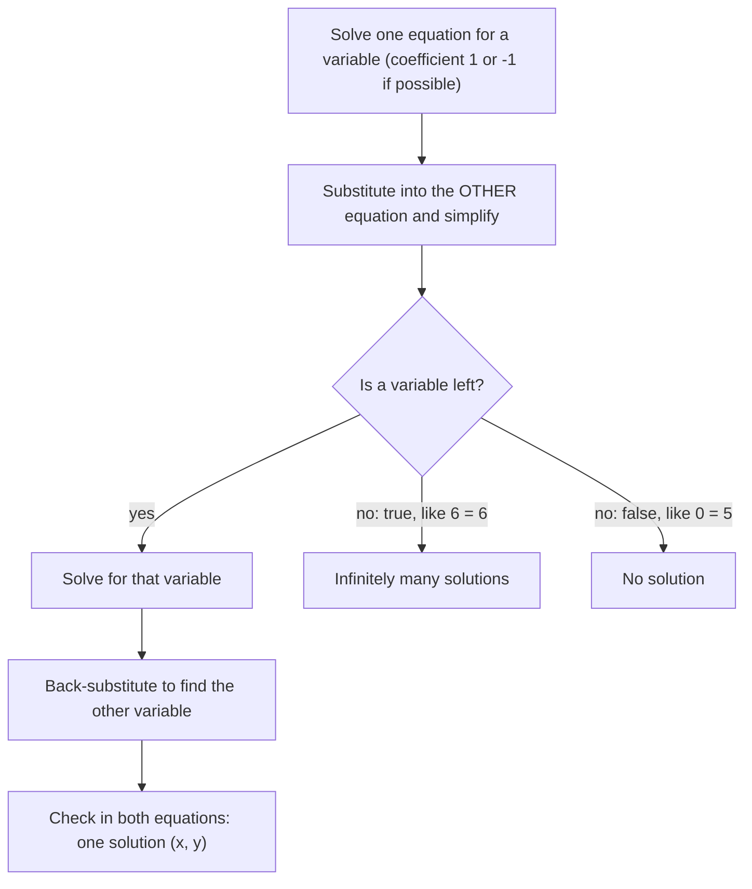

Many problems involve two unknowns tied together by two conditions: two prices and two purchases, two speeds and two trips. Each condition is a linear equation, and the pair forms a system. This lesson explains what a solution of a system means, how to see it on a graph, and how to find it exactly with the substitution method.

## What a system is

A **system of linear equations** is a set of linear equations in the same variables, considered together. For example,

$$\begin{cases} x + y = 7 \\ 2x - y = 2 \end{cases}$$

A **solution of a system** is an ordered pair $(x, y)$ that makes every equation true at the same time. $(3, 4)$ satisfies the first equation ($3 + 4 = 7$) and the second ($2(3) - 4 = 2$), so it is a solution. $(5, 2)$ satisfies the first ($5 + 2 = 7$) but not the second ($10 - 2 = 8$), so it is not.

## Solving by graphing

Each equation's solutions form a line. A point that lies on both lines satisfies both equations. So the solutions of the system are the intersection points of the lines.

```plot
{"x": [-2, 8], "y": [-3, 9], "functions": [{"f": "7 - x", "label": "x + y = 7"}, {"f": "2*x - 2", "label": "2x - y = 2"}], "points": [{"at": [3, 4], "label": "(3, 4)"}], "caption": "The lines cross at (3, 4), the solution of the system"}
```

Two lines in a plane can relate in only three ways, so a linear system has exactly one solution, none, or infinitely many.

| Lines | Number of solutions | Name |
|---|---|---|
| intersect once (different slopes) | one | **consistent system**, **independent** equations |
| parallel (same slope, different intercepts) | none | **inconsistent system** |
| the same line (same slope and intercept) | infinitely many | consistent, **dependent** equations |

The three possibilities side by side. In the third panel the dashed line lies exactly on top of the solid one, so every point of it is shared.


```plot
{"x": [-4, 4], "y": [-4, 6], "functions": [{"f": "x + 1", "label": "y = x + 1"}, {"f": "x - 2", "label": "y = x - 2", "dashed": true}], "caption": "Parallel lines never meet: an inconsistent system with no solution"}
```

Graphing gives a good picture and a quick estimate, but it's only exact when the intersection lands on clear grid points. For an answer like $\left(\tfrac{13}{7}, -\tfrac{2}{7}\right)$, a graph can only get you close. That's why we need algebraic methods.

### Example 1

Without solving, decide how many solutions $y = 3x - 4$ and $6x - 2y = 8$ have.

1. Put the second equation in slope-intercept form: $-2y = -6x + 8$, so $y = 3x - 4$.
2. It's the same line as the first. Every point on the line is a solution: infinitely many.

## The substitution method

The idea: use one equation to express one variable in terms of the other, then substitute that expression into the other equation. That leaves a single equation in one variable, which you already know how to solve.

1. Solve one equation for one variable. Pick a variable with coefficient 1 or $-1$ if you can, to avoid fractions.
2. Substitute the expression into the other equation.
3. Solve the resulting one-variable equation.
4. Back-substitute to find the other variable.
5. Check the pair in both original equations.

### Example 2

Solve $\begin{cases} 3x + 2y = 16 \\ x - 4y = -4 \end{cases}$ by substitution.

1. The second equation has $x$ with coefficient 1. Solve for $x$: $x = 4y - 4$.
2. Substitute into the first: $3(4y - 4) + 2y = 16$.
3. Solve: $12y - 12 + 2y = 16$, so $14y = 28$ and $y = 2$.
4. Back-substitute: $x = 4(2) - 4 = 4$.
5. Check: $3(4) + 2(2) = 16$ and $4 - 4(2) = -4$. The solution is $(4, 2)$.

### Example 3

Solve $\begin{cases} y = 2x - 3 \\ 4x - 2y = 6 \end{cases}$.

1. The first equation is already solved for $y$. Substitute: $4x - 2(2x - 3) = 6$.
2. Simplify: $4x - 4x + 6 = 6$, so $6 = 6$.
3. The variable vanished and left a true statement. The equations describe the same line, so there are infinitely many solutions: every point with $y = 2x - 3$.

If substituting leaves a false statement such as $0 = 5$, the lines are parallel and the system has no solution. These are the same signals you met with single equations in Lesson 3.

The whole method, including how to read each possible ending, fits in one chart:



### Example 4

Solve $\begin{cases} 2x + 3y = 5 \\ 5x - y = 4 \end{cases}$.

1. Solve the second for $y$: $y = 5x - 4$.
2. Substitute: $2x + 3(5x - 4) = 5$, so $17x - 12 = 5$ and $x = 1$.
3. Then $y = 5(1) - 4 = 1$. Solution $(1, 1)$.
4. Check: $2 + 3 = 5$ and $5 - 1 = 4$.

## Writing the answer

A solution of a two-variable system is an ordered pair, so write it as $(x, y)$, not just "$x = 4$." For infinitely many solutions, describe the set, for example $\{(x, y) \mid y = 2x - 3\}$. For no solution, say so, or write $\varnothing$.

## Common mistakes

- Substituting the expression back into the same equation it came from. That always produces a true statement like $16 = 16$ and tells you nothing.
- Dropping parentheses when substituting: $3(4y - 4)$, not $3 \cdot 4y - 4$.
- Stopping after finding one variable.
- Checking in only one equation. A solution must satisfy both.
- Reading "$6 = 6$" as "the solution is 6." A true statement with no variable means infinitely many solutions.

## Key points

- A solution of a system satisfies every equation at once; graphically it is an intersection point.
- Two lines give one solution (intersecting), none (parallel) or infinitely many (the same line).
- Substitution: isolate a variable, substitute into the other equation, solve, back-substitute, check.
- A false statement means no solution; a true statement with no variable means infinitely many.
