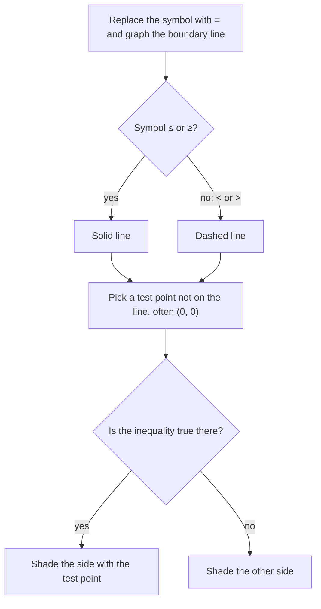

A linear equation in two variables describes a line. Change the equals sign to an inequality and you describe a whole region of the plane: a half-plane. Several inequalities together carve out a region where all of them hold, and finding the best point in such a region is the basic problem of linear programming. This lesson brings together the inequality skills of Module 2 and the graphing skills of Module 3.

## Graphing one inequality

A **linear inequality in two variables** looks like $2x - 3y < 6$ or $y \ge -x + 4$. Its solutions are all the points $(x, y)$ that make it true, and they fill a **half-plane**: everything on one side of the **boundary line**.

To graph one:

1. Graph the boundary line, the equation you get by replacing the inequality symbol with $=$.
2. Draw it solid if the symbol is $\le$ or $\ge$ (boundary points are solutions), and dashed if it is $<$ or $>$ (they aren't).
3. Choose a **test point** not on the line, often $(0, 0)$. If it satisfies the inequality, shade its side; if not, shade the other side.



Why does one test point decide everything? The two sides of the inequality are equal only on the boundary line, so as a point moves around without crossing the line, the inequality can't switch from true to false. Every point on the same side gives the same answer.

### Example 1

Graph $2x - 3y < 6$.

1. Boundary: $2x - 3y = 6$, or $y = \tfrac23 x - 2$. Since the symbol is $<$, draw it dashed.
2. Test $(0, 0)$: $0 - 0 < 6$ is true, so shade the side containing the origin, which is above the line.

```plot
{"x": [-4, 5], "y": [-6, 4], "functions": [{"f": "2/3*x - 2", "dashed": true, "label": "2x - 3y = 6"}], "shade": [{"f": "2/3*x - 2", "g": "4", "from": -4, "to": 5}], "points": [{"at": [0, 0], "label": "test (0, 0)"}], "caption": "2x - 3y < 6: the half-plane above the dashed line"}
```

Solving for $y$ also tells you which side to shade: $2x - 3y < 6$ becomes $-3y < -2x + 6$, and dividing by $-3$ flips the symbol, giving $y > \tfrac23 x - 2$. "$y >$" means above the line. The test point method avoids having to remember the flip.

A vertical boundary such as $x \ge 3$ shades to the right of the solid line $x = 3$; a horizontal one such as $y < -1$ shades below the dashed line $y = -1$.

## Systems of inequalities

A **system of linear inequalities** is a set of inequalities to satisfy at the same time. Its solution set is the overlap of the half-planes, often a polygon called the **feasible region**. The corners of the region, where boundary lines meet, are called its **vertices** (or corner points).

The picture below names every part for the system $y \le -x + 5$ and $y > x - 3$. The region is open on the left, because only two conditions limit it. Its vertex $(4, 1)$ is drawn as an open circle: it lies on the dashed line, so it is a corner of the region but not itself a solution.


### Example 2

Graph the system $y \le -x + 5$, $y \ge 2x - 1$, $x \ge 0$, and find its vertices.

1. $y \le -x + 5$: below or on the solid line with slope $-1$ and intercept 5.
2. $y \ge 2x - 1$: above or on the solid line with slope 2 and intercept $-1$.
3. $x \ge 0$: on or to the right of the $y$-axis.
4. The overlap is a triangle. Its vertices:
   - $y = -x + 5$ and $y = 2x - 1$: $-x + 5 = 2x - 1$, so $x = 2$ and $y = 3$. Vertex $(2, 3)$.
   - $y = -x + 5$ and $x = 0$: $(0, 5)$.
   - $y = 2x - 1$ and $x = 0$: $(0, -1)$.

```plot
{"x": [-2, 6], "y": [-3, 7], "functions": [{"f": "-x + 5", "label": "y = -x + 5"}, {"f": "2*x - 1", "label": "y = 2x - 1"}], "polygons": [{"points": [[0, 5], [2, 3], [0, -1]], "fill": true}], "points": [{"at": [0, 5], "label": "(0, 5)"}, {"at": [2, 3], "label": "(2, 3)"}, {"at": [0, -1], "label": "(0, -1)"}], "caption": "The feasible region is the triangle where all three conditions hold"}
```

To check a point, test it in every inequality. $(1, 2)$: $2 \le 4$, $2 \ge 1$, $1 \ge 0$, all true, so it's in the region. $(3, 1)$: $1 \le 2$ is true, but $1 \ge 5$ is false, so it isn't.

A system of inequalities can also have no solution, for example $y > x + 2$ and $y < x - 1$: the two half-planes lie on opposite sides of a pair of parallel lines and don't overlap.

## Linear programming

In **linear programming**, you want the largest or smallest value of a linear **objective function**, such as profit $P = 3x + 2y$, over a feasible region defined by linear **constraints**. The key fact:

> If a linear objective function has a maximum or minimum on a polygonal feasible region, it occurs at a vertex.

Why? The points where $P = 3x + 2y$ takes a given value form a line. As you increase the value, that line slides parallel to itself across the region. The last point of the region it touches before leaving is a corner (or, in a tie, a whole edge, which still includes corners).

### Example 3

A workshop makes chairs ($x$) and tables ($y$). Each chair earns \$30 profit and each table \$20. Constraints: at most 8 items a week ($x + y \le 8$), and wood limits require $2x + y \le 12$, with $x \ge 0$ and $y \ge 0$. How many of each maximize profit $P = 30x + 20y$?

1. Vertices of the feasible region: $(0, 0)$; $(6, 0)$ where $2x + y = 12$ meets the $x$-axis; $(0, 8)$ where $x + y = 8$ meets the $y$-axis; and the intersection of $x + y = 8$ and $2x + y = 12$. Subtracting gives $x = 4$, so $y = 4$: vertex $(4, 4)$.
2. Evaluate $P$ at each vertex:

| Vertex | $P = 30x + 20y$ |
|---|---|
| $(0, 0)$ | 0 |
| $(6, 0)$ | 180 |
| $(4, 4)$ | 200 |
| $(0, 8)$ | 160 |

3. The maximum profit is $200 a week, making 4 chairs and 4 tables.

```plot
{"x": [-1, 9], "y": [-1, 10], "functions": [{"f": "8 - x", "label": "x + y = 8"}, {"f": "12 - 2*x", "label": "2x + y = 12"}], "polygons": [{"points": [[0, 0], [6, 0], [4, 4], [0, 8]], "fill": true}], "points": [{"at": [4, 4], "label": "(4, 4) max"}, {"at": [6, 0], "label": "(6, 0)"}, {"at": [0, 8], "label": "(0, 8)"}], "caption": "The profit is largest at the corner (4, 4)"}
```

## Common mistakes

- Using a solid line for a strict inequality (or dashed for $\le$, $\ge$).
- Choosing a test point that lies on the boundary line; it can't tell you which side to shade.
- Forgetting to flip the inequality when dividing by a negative while solving for $y$, then shading the wrong side.
- Evaluating the objective at points that aren't vertices, or missing a vertex where a boundary meets an axis.
- Reporting the vertex when the question asked for the maximum value (or vice versa).

## Key points

- A linear inequality in two variables is a half-plane; graph the boundary (solid for $\le$, $\ge$; dashed for $<$, $>$) and shade using a test point.
- A system of inequalities is solved by the overlap of the half-planes, the feasible region.
- Vertices are found by solving pairs of boundary equations.
- A linear objective function reaches its maximum or minimum over a polygonal region at a vertex.
