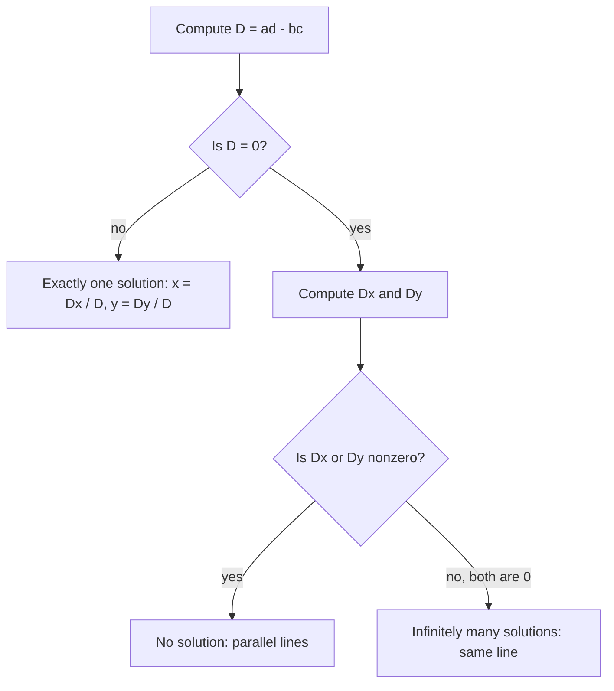

## Solving every system at once

In Lessons 14 and 15 you solved systems one at a time, and you may have noticed that elimination makes the same moves every time: multiply, add, divide, back-substitute. Whenever a process is the same every time, algebra lets you do it once with letters in place of numbers. That single calculation gives a formula for the solution of *every* system of two linear equations in two unknowns, and, better still, one number that tells you in advance whether the system has one solution, none, or infinitely many. This lesson builds that number, proves what it tells you, and shows what goes wrong in practice when it is close to zero.

Write the general system with letters for all six numbers:

$$\begin{cases} ax + by = e \\ cx + dy = f \end{cases}$$

To eliminate $y$, multiply the first equation by $d$ and the second by $b$:

$$\begin{aligned} adx + bdy &= ed \\ bcx + bdy &= bf \end{aligned}$$

Subtract the second from the first. The $y$ terms cancel and

$$(ad - bc)\,x = ed - bf.$$

To eliminate $x$, multiply the first equation by $c$ and the second by $a$, then subtract the first from the second:

$$(ad - bc)\,y = af - ce.$$

The same number, $ad - bc$, multiplies both unknowns. If it isn't zero, divide by it and you are done:

$$x = \frac{ed - bf}{ad - bc}, \qquad y = \frac{af - ce}{ad - bc}.$$

## The determinant

A rectangular array of numbers is called a **matrix**. The four coefficients of the system form a square matrix with two rows and two columns. The number $ad - bc$ is called the **determinant** of that matrix, and it is written with straight bars:

$$\begin{vmatrix} a & b \\ c & d \end{vmatrix} = ad - bc.$$

To remember it: multiply down the main diagonal (top left to bottom right), then subtract the product of the other diagonal. For example, $\begin{vmatrix} 3 & -2 \\ 5 & 4 \end{vmatrix} = 3 \cdot 4 - (-2)(5) = 12 + 10 = 22$.

Look again at the numerators in the formulas for $x$ and $y$. Each is a determinant too:

$$ed - bf = \begin{vmatrix} e & b \\ f & d \end{vmatrix}, \qquad af - ce = \begin{vmatrix} a & e \\ c & f \end{vmatrix}.$$

The first is the coefficient determinant with its $x$-column replaced by the constants $e, f$; the second has its $y$-column replaced. Name the three determinants $D$, $D_x$ and $D_y$. Then the solution is

$$x = \frac{D_x}{D}, \qquad y = \frac{D_y}{D} \qquad (D \ne 0).$$

This is **Cramer's rule**. It needs only three determinants, and the pattern is easy to remember: to find a variable, replace that variable's column with the constants.


### Example 1

Solve $\begin{cases} 4x + 3y = 10 \\ 6x - 5y = -4 \end{cases}$ by Cramer's rule. (This is Example 2 of Lesson 15, solved there by elimination.)

1. Coefficient determinant: $D = \begin{vmatrix} 4 & 3 \\ 6 & -5 \end{vmatrix} = (4)(-5) - (3)(6) = -20 - 18 = -38$. It isn't zero, so there is exactly one solution.
2. Replace the $x$-column with the constants: $D_x = \begin{vmatrix} 10 & 3 \\ -4 & -5 \end{vmatrix} = -50 - (-12) = -38$.
3. Replace the $y$-column: $D_y = \begin{vmatrix} 4 & 10 \\ 6 & -4 \end{vmatrix} = -16 - 60 = -76$.
4. Divide: $x = \dfrac{-38}{-38} = 1$ and $y = \dfrac{-76}{-38} = 2$. The solution is $(1, 2)$, as before.

### Example 2

Solve $\begin{cases} 3x + 2y = 24 \\ 2x - 5y = -16 \end{cases}$.

1. $D = (3)(-5) - (2)(2) = -15 - 4 = -19$.
2. $D_x = \begin{vmatrix} 24 & 2 \\ -16 & -5 \end{vmatrix} = -120 - (-32) = -88$, so $x = \dfrac{-88}{-19} = \dfrac{88}{19}$.
3. $D_y = \begin{vmatrix} 3 & 24 \\ 2 & -16 \end{vmatrix} = -48 - 48 = -96$, so $y = \dfrac{-96}{-19} = \dfrac{96}{19}$.
4. Check in the first equation: $3 \cdot \tfrac{88}{19} + 2 \cdot \tfrac{96}{19} = \tfrac{264 + 192}{19} = \tfrac{456}{19} = 24$. Correct.

This is the system from Example 3 of Lesson 15, where elimination had to be done twice to avoid back-substituting a fraction. Cramer's rule handles fractional answers without any extra trouble: you never substitute anything.

## What the determinant tells you, and why

Here is the main fact, for a system in which each equation really is a line (in each equation, $x$ and $y$ don't both have coefficient 0):

> The system has exactly one solution if and only if $D \ne 0$.

**If $D \ne 0$.** Every solution must satisfy $Dx = D_x$ and $Dy = D_y$, since those equations came from the system by legal moves. So $x = D_x/D$ and $y = D_y/D$ is the only *possible* solution. To be sure it really is one, substitute it back. In the first equation:

$$a D_x + b D_y = a(ed - bf) + b(af - ce) = aed - abf + abf - bce = e(ad - bc) = eD.$$

Dividing by $D$ gives $a \cdot \tfrac{D_x}{D} + b \cdot \tfrac{D_y}{D} = e$, so the first equation holds, and the second works the same way. Exactly one solution.

**If $D = 0$,** then $ad = bc$. When $b$ and $d$ are both nonzero, divide by $bd$: $\tfrac{a}{b} = \tfrac{c}{d}$, so the slopes $-\tfrac{a}{b}$ and $-\tfrac{c}{d}$ are equal. The lines are parallel or the same line. (If $b = 0$, then $ad = 0$; $a$ can't also be 0, so $d = 0$, and both lines are vertical. The case $d = 0$ is the same.) Either way, there isn't exactly one solution.

**Telling "none" from "infinitely many" when $D = 0$.** The equations $Dx = D_x$ and $Dy = D_y$ now read $0 = D_x$ and $0 = D_y$. If either $D_x$ or $D_y$ is not zero, that is a false statement, so there is no solution: parallel lines. If $D = D_x = D_y = 0$, the two equations are multiples of each other, and there are infinitely many solutions: one line. (This last step relies on each equation being a real line; a "system" such as $0x + 0y = 1$, $0x + 0y = 2$ has all three determinants 0 and no solution.)



### Example 3

For which values of $k$ does $\begin{cases} kx + 2y = 5 \\ 3x + 6y = 1 \end{cases}$ have exactly one solution? What happens for the other values?

1. $D = (k)(6) - (2)(3) = 6k - 6$. Exactly one solution whenever $6k - 6 \ne 0$, that is, $k \ne 1$.
2. At $k = 1$: $D_x = \begin{vmatrix} 5 & 2 \\ 1 & 6 \end{vmatrix} = 30 - 2 = 28 \ne 0$, so there is no solution.
3. Check by looking: with $k = 1$ the equations are $x + 2y = 5$ and $x + 2y = \tfrac13$ (dividing the second by 3). Same left side, different right sides: parallel lines.

### Example 4

Find $k$ and $m$ so that $\begin{cases} 2x - 3y = 4 \\ 6x + ky = m \end{cases}$ has infinitely many solutions.

1. Need $D = 2k - (-3)(6) = 2k + 18 = 0$, so $k = -9$.
2. Need $D_x = \begin{vmatrix} 4 & -3 \\ m & -9 \end{vmatrix} = -36 + 3m = 0$, so $m = 12$. Then $D_y = \begin{vmatrix} 2 & 4 \\ 6 & 12 \end{vmatrix} = 24 - 24 = 0$ as well.
3. With $k = -9$ and $m = 12$, the second equation is $6x - 9y = 12$, exactly 3 times the first. With $k = -9$ and any other $m$, there is no solution.

## Nearly parallel lines: when D is small

In theory, any $D \ne 0$ gives exactly one solution. In practice, when $D$ is close to 0, that solution can be very sensitive to small changes in the numbers. Since $x = D_x/D$, dividing by a tiny $D$ magnifies any small error in $D_x$, such as a constant that was measured or rounded.

### Example 5

Compare $\begin{cases} x + y = 2 \\ x + 1.1y = 2.1 \end{cases}$ with the same system after changing $2.1$ to $2.2$.

1. Both have $D = (1)(1.1) - (1)(1) = 0.1$, small but not zero.
2. First system: subtract the equations: $0.1y = 0.1$, so $y = 1$ and $x = 1$.
3. Second system: $0.1y = 0.2$, so $y = 2$ and $x = 0$.
4. A change of $0.1$ in one constant moved the solution from $(1, 1)$ to $(0, 2)$, a whole unit in each coordinate.

```plot
{"x": [-2, 4], "y": [-1, 4], "functions": [{"f": "2 - x", "label": "x + y = 2"}, {"f": "(2.1 - x)/1.1", "label": "x + 1.1y = 2.1"}, {"f": "(2.2 - x)/1.1", "label": "x + 1.1y = 2.2", "dashed": true}], "points": [{"at": [1, 1], "label": "(1, 1)"}, {"at": [0, 2], "label": "(0, 2)"}], "caption": "Nearly parallel lines: nudging one line a little slides the crossing point a long way"}
```

The graph shows why. The lines are almost parallel, so they cross at a shallow angle, and sliding one of them a tiny bit moves the crossing point a long way along the other. With $1.01$ in place of $1.1$ it is worse: $D = 0.01$, and changing a constant by just $0.01$ moves the solution by a whole unit. A system like this is called **ill-conditioned**. If its numbers come from measurements, its exact solution can't be trusted. (This is a simplified picture. Later courses measure the problem with a "condition number" rather than with $D$ alone, because multiplying an equation by 1,000 changes $D$ without changing the lines.)

## A little history

Methods equivalent to elimination are very old. *The Nine Chapters on the Mathematical Art*, a Chinese collection compiled by about the first century CE, solves systems of several equations by arranging the coefficients in columns of counting rods and combining columns to clear entries, which is elimination in all but notation. Determinants appeared much later and independently in two places: Seki Takakazu in Japan wrote about them in 1683, and Gottfried Leibniz described the idea in a letter in 1693. Gabriel Cramer, a Swiss mathematician, published his rule in 1750 in a book on curves, where he needed it to find the curve through a given set of points.

Cramer's rule is elegant and ideal for $2 \times 2$ systems and for proofs. It is not how computers solve large systems: for many unknowns it needs far more arithmetic than elimination, which remains the standard method.

## Common mistakes

- Subtracting the products in the wrong order: the determinant is (main diagonal) minus (other diagonal), $ad - bc$, not $bc - ad$. Swapping them flips the sign of the answer.
- Replacing the wrong column: $D_x$ has the constants in the $x$-column (the first), $D_y$ in the $y$-column (the second).
- Forgetting to put both equations in the form $ax + by = e$ first. In $y = 2x + 1$, the coefficients are $-2$ and $1$ and the constant is $1$.
- Dividing by $D$ when $D = 0$. Then Cramer's rule doesn't apply; check $D_x$ and $D_y$ to tell no solution from infinitely many.
- Sign slips with negative entries: $(3)(-5) - (2)(-4) = -15 + 8 = -7$. Use parentheses.

## Key points

- For $ax + by = e$, $cx + dy = f$: $D = ad - bc$, $D_x = ed - bf$, $D_y = af - ce$.
- Cramer's rule: if $D \ne 0$, the unique solution is $x = D_x/D$, $y = D_y/D$.
- $D \ne 0$ exactly when the lines have different slopes. If $D = 0$: no solution when $D_x$ or $D_y$ is nonzero, infinitely many when all three are 0 (for genuine lines).
- A small $D$ means nearly parallel lines: an ill-conditioned system whose solution swings with small changes in the data.
- Elimination is centuries older than determinants; Cramer published his rule in 1750.
