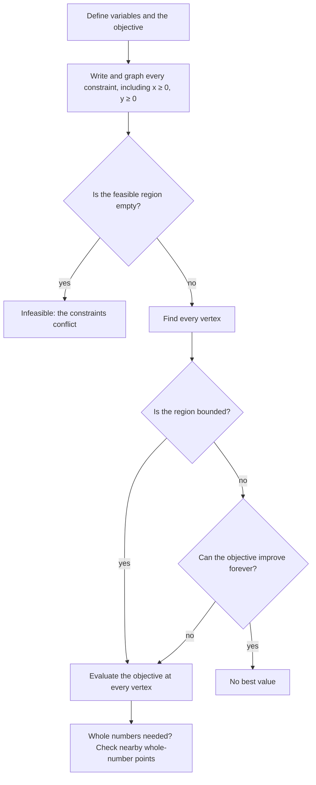

## Beyond "check the corners"

Lesson 17 ended with the corner principle: a linear objective function that has a maximum or minimum over a polygonal feasible region reaches it at a vertex. That one fact solves the workshop problem, but real planning problems raise more questions. *Which* corner wins, and how much can a price change before a different corner wins? What if two corners tie? What if the region is open on one side, or empty? What if the answer has to be a whole number of chairs? This lesson answers each question with the same picture: a line sliding across a region. It ends with the history of the method, which grew into one of the most used tools in business and engineering.

Throughout, the workshop from Lesson 17 is the running example: $x$ chairs and $y$ tables, with constraints $x + y \le 8$, $2x + y \le 12$, $x \ge 0$, $y \ge 0$. Its vertices are $(0, 0)$, $(6, 0)$, $(4, 4)$ and $(0, 8)$.

## Level lines

For the profit $P = 30x + 20y$, every plan with a profit of exactly \$120 lies on the line $30x + 20y = 120$; every plan with a profit of \$200 lies on $30x + 20y = 200$. Each of these is a **level line** of the objective (in profit problems, also called an isoprofit line). Solving $30x + 20y = c$ for $y$ gives $y = \tfrac{c}{20} - \tfrac32 x$: whatever the value of $c$, the slope is $-\tfrac32$. So the level lines are all parallel, and raising $c$ slides the line up and to the right without turning it.

```plot
{"x": [-1, 10], "y": [-1, 13], "polygons": [{"points": [[0, 0], [6, 0], [4, 4], [0, 8]], "fill": true}], "functions": [{"f": "6 - 1.5*x", "dashed": true}, {"f": "10 - 1.5*x", "dashed": true}, {"f": "12 - 1.5*x", "dashed": true, "to": 4.6}], "points": [{"at": [4, 4], "label": "(4, 4)"}, {"at": [6, 0]}, {"at": [0, 8]}], "labels": [{"at": [1.2, 1.6], "text": "P = 120"}, {"at": [6.3, 2.6], "text": "P = 200"}, {"at": [5.5, 5.6], "text": "P = 240"}], "caption": "Level lines of P = 30x + 20y. P = 200 touches the region only at (4, 4); P = 240 misses it"}
```

To maximize, push the level line as far as it will go while it still touches the region. The line $P = 120$ cuts right through the region, so better plans exist. The line $P = 200$ touches the region at the single point $(4, 4)$. The line $P = 240$ misses the region entirely: no plan earns that much. So the maximum is 200, at $(4, 4)$. This is the reason behind the corner principle: the last point a sliding straight line touches on a polygon is a corner (or a whole edge, which contains corners).

## Which corner wins: comparing slopes

The level line picture tells you more than the answer. At the vertex $(4, 4)$, two edges of the region meet: the edge along $x + y = 8$ (slope $-1$) and the edge along $2x + y = 12$ (slope $-2$). The level line through $(4, 4)$ keeps the whole region on one side, and so marks $(4, 4)$ as the best corner, exactly when its slope lies between those two edge slopes. If the level line is steeper than $-2$, sliding it outward, it last touches $(6, 0)$ instead; if it is flatter than $-1$, it last touches $(0, 8)$.

Studying how far the numbers in a problem can change before the answer changes is called **sensitivity analysis**. It matters because profits and prices are estimates.

### Example 1

Table profit stays \$20, but the chair profit $p$ is uncertain. For which values of $p$ is $(4, 4)$ still a best plan for $P = px + 20y$?

1. The level lines $px + 20y = c$ have slope $-\tfrac{p}{20}$.
2. $(4, 4)$ is optimal when $-2 \le -\tfrac{p}{20} \le -1$. Multiply by $-20$ and flip the symbols: $40 \ge p \ge 20$.
3. So $(4, 4)$ stays optimal for chair profits from \$20 to \$40.
4. Check outside the range. If $p = 45$: $P(6, 0) = 270$ beats $P(4, 4) = 180 + 80 = 260$. If $p = 15$: $P(0, 8) = 160$ beats $P(4, 4) = 60 + 80 = 140$. The best corner changed, as predicted.

## Ties: many best plans

At the ends of that range the level line is parallel to an edge.

### Example 2

Maximize $P = 25x + 25y$ over the workshop region.

1. Corners: $P(0, 0) = 0$, $P(6, 0) = 150$, $P(4, 4) = 200$, $P(0, 8) = 200$.
2. Two corners tie at 200. The level lines have slope $-1$, parallel to the edge $x + y = 8$, so the line $P = 200$ lies along that whole edge.
3. Every point on the edge from $(4, 4)$ to $(0, 8)$ is a best plan, for example $(2, 6)$: $50 + 150 = 200$. The corner principle still holds, because the corners $(4, 4)$ and $(0, 8)$ reach the maximum too; they just aren't the only points that do.

## Unbounded regions

The regions in Lesson 17 were closed polygons, or **bounded**: they fit inside some rectangle. Constraints that say "at least" often give an **unbounded region** that goes on forever in some direction. Then a maximum or a minimum may not exist at all.

### Example 3

A rancher mixes two feeds. A bag of feed A has 3 units of protein and 1 unit of fiber and costs \$4; a bag of feed B has 1 unit of protein and 2 units of fiber and costs \$3. The herd needs at least 12 units of protein and 9 units of fiber per day. How many bags of each minimize the cost?

1. Let $x$ and $y$ be the bags of A and B. Constraints: $3x + y \ge 12$ (protein), $x + 2y \ge 9$ (fiber), $x \ge 0$, $y \ge 0$. Minimize $C = 4x + 3y$.
2. Vertices. $3x + y = 12$ meets the $y$-axis at $(0, 12)$. $x + 2y = 9$ meets the $x$-axis at $(9, 0)$. The two lines meet where $x = 9 - 2y$ and $3(9 - 2y) + y = 12$, so $27 - 5y = 12$, $y = 3$, $x = 3$: the vertex $(3, 3)$.
3. Costs: $C(0, 12) = 36$, $C(3, 3) = 21$, $C(9, 0) = 36$. The minimum is \$21: 3 bags of each.
4. Is there a maximum? No: buying more of either feed keeps the herd fed and raises the cost without limit.


Why can we still trust the corners for the minimum? The cost has positive coefficients and $x, y \ge 0$, so $C$ can never go below 0; the sliding level line, moved down toward smaller costs, must stop somewhere, and it stops at a corner. In general, a theorem of linear programming (proved in later courses) says: if the region has at least one corner and the objective can't improve forever in the direction you want, the best value is reached at a corner. But when the objective *can* improve forever, as when maximizing cost here, there is no best value, and checking the corners would give a wrong answer.

A system can also have no feasible region at all. Constraints such as $x + y \le 4$ and $x + y \ge 6$ contradict each other, and the problem is called **infeasible**: no plan meets every requirement, so the requirements themselves must change.

## Whole-number answers

You can't build 1.8 batches of anything. When the variables count whole objects, the best corner may not be allowed, and rounding it can go wrong.

### Example 4

A bakery makes $x$ batches of muffins (profit \$50 each) and $y$ batches of scones (profit \$40 each). Oven time gives $2x + 3y \le 12$ and mixer time gives $4x + y \le 10$, with $x, y \ge 0$. Batches must be whole. Maximize $P = 50x + 40y$.

1. Corners: $(0, 0)$, $(2.5, 0)$, $(0, 4)$, and where the slanted lines meet. From $y = 10 - 4x$: $2x + 3(10 - 4x) = 12$, so $-10x = -18$, $x = 1.8$ and $y = 2.8$.
2. Profits: $0$, $125$, $160$, and $P(1.8, 2.8) = 90 + 112 = 202$. If fractions were allowed, the best plan would be $(1.8, 2.8)$.
3. Round to the nearest whole numbers, $(2, 3)$: oven time $4 + 9 = 13 > 12$. Not allowed.
4. Check the whole-number points near the best corner instead: $P(2, 2) = 180$, $P(1, 3) = 170$, $P(2, 1) = 140$, $P(0, 4) = 160$. Both $(2, 2)$ and $(1, 3)$ fit the constraints. The best whole-number plan is 2 batches of each, for \$180.

```plot
{"x": [-0.5, 4], "y": [-0.5, 5], "polygons": [{"points": [[0, 0], [2.5, 0], [1.8, 2.8], [0, 4]], "fill": true}], "functions": [{"f": "(12 - 2*x)/3"}, {"f": "10 - 4*x"}], "points": [{"at": [1.8, 2.8]}, {"at": [2, 3], "open": true}, {"at": [2, 2]}, {"at": [1, 3]}], "labels": [{"at": [1.25, 2.45], "text": "(1.8, 2.8)"}, {"at": [2.0, 3.25], "text": "(2, 3)"}, {"at": [1.45, 1.92], "text": "(2, 2) best"}, {"at": [0.55, 2.9], "text": "(1, 3)"}, {"at": [3.4, 2.4], "text": "2x + 3y = 12"}, {"at": [3.0, 0.5], "text": "4x + y = 10"}], "caption": "Rounding the best corner lands outside the region; the best whole-number plan is (2, 2)"}
```

Rounding can fail the other way too: it can give an allowed plan that isn't the best one. Requiring whole numbers turns the problem into **integer programming**, which is much harder in general; for problems with two variables, checking the whole-number points near the best corner works well, but this is a practical shortcut, not a guarantee for every problem.

## The whole procedure

Putting the pieces together, here is a checklist for any two-variable problem:



## How it all started

Linear programming is young as mathematics goes. In 1939 the Soviet mathematician Leonid Kantorovich wrote about planning production with limited resources, starting from a problem of assigning work to machines at a plywood factory. The subject took off after 1947, when George Dantzig, working on planning for the U.S. Air Force, invented the **simplex method**. Instead of listing every corner (a large problem can have astronomically many), the simplex method starts at one corner and moves along an edge to a neighboring corner with a better objective value, again and again, until no neighbor is better. It is the corner principle turned into a procedure. In 1975 Kantorovich and Tjalling Koopmans shared the Nobel Memorial Prize in Economic Sciences for their work on the best allocation of resources. Today linear programming schedules airline crews, plans shipping routes, blends fuels and feeds, and much more, often with thousands of variables solved by computer.

## Common mistakes

- Comparing objective values at points that aren't corners, or skipping a corner where a boundary meets an axis.
- Assuming a maximum exists on an unbounded region. Ask which way the region is open and whether the objective keeps improving that way.
- Rounding a fractional best corner and stopping. Check that the rounded point is feasible, and compare it with the other nearby whole-number points.
- Forgetting to flip the inequality when multiplying by a negative in a slope comparison (Example 1).
- Reporting one best plan when two corners tie: every point on the edge between them is also best.

## Key points

- Level lines of $P = px + qy$ are parallel, with slope $-\tfrac{p}{q}$. Sliding them across the region shows which corner is best.
- A corner is optimal when the level-line slope lies between the slopes of the two edges that meet there; this gives the range in sensitivity analysis.
- If the level lines are parallel to an edge, two corners tie and the whole edge is optimal.
- On an unbounded region, a best value exists only if the objective can't improve forever; when it exists, it is at a corner. An empty region means the problem is infeasible.
- Rounding the best corner can give a plan that is not allowed or not best; check nearby whole-number points.
- Kantorovich (1939) and Dantzig's simplex method (1947) started the field; simplex walks from corner to better corner.
