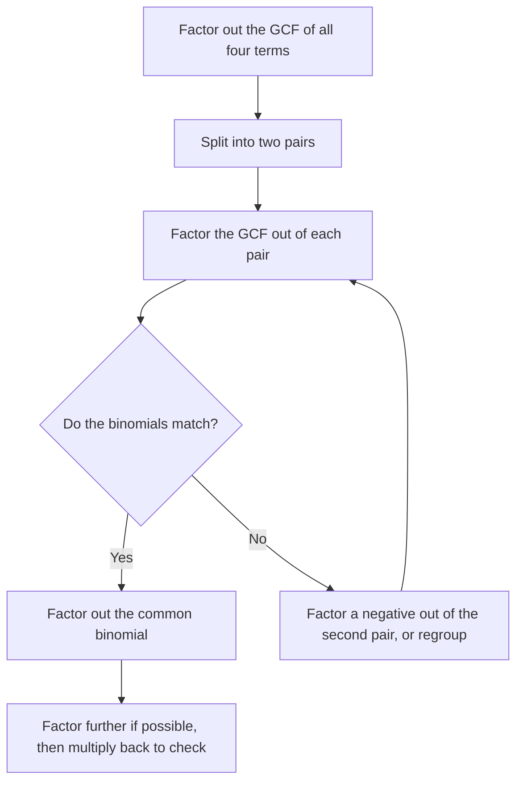

Multiplying polynomials turns a product into a sum. **Factoring** runs the other way: it rewrites a sum as a product. That matters because products are much more useful than sums for solving equations (a product is zero only when a factor is zero, as you'll see in Module 6) and, in later courses, for simplifying algebraic fractions. This lesson covers the first two factoring tools, pulling out the greatest common factor and factoring by grouping; the next lesson handles trinomials.

## What it means to factor

A polynomial is **factored completely** when it is written as a product of polynomials that can't be factored further using integer coefficients. For example $6x^2 + 9x = 3x(2x + 3)$: the right side is a product, and neither $3x$ nor $2x + 3$ breaks down further.

Factoring can always be checked by multiplying back. If $3x(2x + 3)$ doesn't expand to $6x^2 + 9x$, something went wrong.

## The greatest common factor

The **greatest common factor** (GCF) of a set of terms is the largest expression that divides every one of them. To find it:

- take the greatest common factor of the coefficients;
- for each variable that appears in every term, take the lowest power that appears.

For $12x^4y^2$, $18x^3y$ and $30x^2y^3$: the GCF of 12, 18, 30 is 6; the lowest power of $x$ is $x^2$; the lowest power of $y$ is $y$. So the GCF is $6x^2y$.

Factoring out the GCF is the distributive property in reverse: $ab + ac = a(b + c)$. Divide each term by the GCF to find what goes in the parentheses.

As areas: a rectangle of area $6x^2 + 9x$ whose height is the GCF $3x$ must have width $2x + 3$, because $3x \cdot 2x = 6x^2$ and $3x \cdot 3 = 9x$. So $6x^2 + 9x = 3x(2x + 3)$.


### Example 1

Factor $12x^4y^2 - 18x^3y + 30x^2y^3$.

1. GCF: $6x^2y$, as found above.
2. Divide each term: $\tfrac{12x^4y^2}{6x^2y} = 2x^2y$, $\tfrac{-18x^3y}{6x^2y} = -3x$, $\tfrac{30x^2y^3}{6x^2y} = 5y^2$.
3. Result: $6x^2y(2x^2y - 3x + 5y^2)$.
4. Check by distributing: each product gives back the original term.

*Always look for a GCF first.* It makes everything that follows easier, and forgetting it is the most common reason a factorization isn't complete.

### Factoring out a negative

When the leading coefficient is negative, it's usually tidier to factor out a negative GCF so the leading coefficient inside is positive: $-4x^2 + 8x - 12 = -4(x^2 - 2x + 3)$. Every sign inside flips.

### A binomial as the common factor

The common factor can be a whole expression. In $5x(x - 3) + 2(x - 3)$, both terms contain the factor $(x - 3)$:

$$5x(x - 3) + 2(x - 3) = (x - 3)(5x + 2).$$

Treat $(x - 3)$ as a single block, like a variable.

## Factoring by grouping

Four-term polynomials can often be factored by **grouping**: split them into two pairs, factor the GCF from each pair, and look for a common binomial.

### Example 2

Factor $x^3 + 4x^2 + 3x + 12$.

1. Group: $(x^3 + 4x^2) + (3x + 12)$.
2. Factor each group: $x^2(x + 4) + 3(x + 4)$.
3. The common binomial is $(x + 4)$: $(x + 4)(x^2 + 3)$.
4. Check: $(x + 4)(x^2 + 3) = x^3 + 3x + 4x^2 + 12$. Correct.

### Example 3

Factor $6ab - 9a - 4b + 6$.

1. Group: $(6ab - 9a) + (-4b + 6)$.
2. Factor: $3a(2b - 3)$ from the first. From the second, factor out $-2$ (not 2) so the binomial matches: $-2(2b - 3)$.
3. Result: $(2b - 3)(3a - 2)$.

If the binomials don't match after factoring each pair, try factoring a negative out of one pair, or regroup the terms in a different order. If no arrangement works, the polynomial may not factor by grouping.



### Example 4

Factor $2x^3 - 6x^2 - 8x + 24$ completely.

1. GCF first: all terms are divisible by 2. $2(x^3 - 3x^2 - 4x + 12)$.
2. Group inside: $x^2(x - 3) - 4(x - 3) = (x - 3)(x^2 - 4)$.
3. $x^2 - 4$ is a difference of squares (Lesson 19): $(x - 2)(x + 2)$.
4. Completely factored: $2(x - 3)(x - 2)(x + 2)$.

This example shows why "completely" matters: stopping at $2(x - 3)(x^2 - 4)$ leaves a factor that still breaks down.

## Prime polynomials

A polynomial that can't be factored (other than trivially, as 1 times itself) using integer coefficients is called **prime**. For example, $x^2 + 4$ and $x + 7$ are prime. Saying "prime" is a complete answer when no factorization exists.

## A preview of why factoring matters

Consider $x^2 + 4x = 0$. Factoring gives $x(x + 4) = 0$. A product is zero only when one of its factors is zero, so $x = 0$ or $x = -4$. You couldn't see that from the sum $x^2 + 4x$. Module 6 is built on this idea.

```plot
{"x": [-6, 2], "y": [-5, 6], "functions": [{"f": "x^2 + 4*x", "label": "y = x² + 4x = x(x + 4)", "from": -6, "to": 2}], "points": [{"at": [0, 0], "label": "x = 0"}, {"at": [-4, 0], "label": "x = -4"}], "caption": "The factors x and x + 4 show where the graph meets the x-axis"}
```

## Common mistakes

- Missing part of the GCF, such as factoring $6x^3 + 9x^2$ as $3(2x^3 + 3x^2)$ instead of $3x^2(2x + 3)$.
- Forgetting the 1: $4x^2 + 4x = 4x(x + 1)$, not $4x(x)$. When a term equals the GCF, it leaves 1.
- Sign errors when factoring out a negative from the second group in grouping.
- Stopping before the factorization is complete.
- Factoring a GCF out of only some terms.

## Key points

- Factoring writes a sum as a product; check by multiplying back.
- Always factor out the GCF first: largest common coefficient factor, lowest power of each shared variable.
- Grouping: pair the terms, factor each pair, then factor out the common binomial.
- Factor completely: keep going until every factor is prime.
