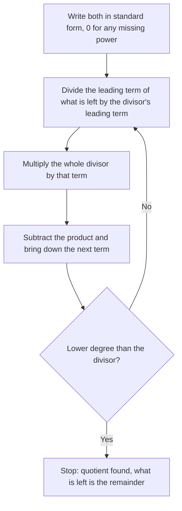

Lessons 20 and 21 gave you a toolbox for factoring: the GCF, grouping, the sum-product and ac methods, and the special patterns. A cubic such as $x^3 - 7x + 6$ fits none of them. It has no common factor, no four terms to group and no pattern. Yet it factors neatly as $(x - 1)(x - 2)(x + 3)$. The way to find that is to *divide*. This honors lesson shows how to divide one polynomial by another, using the same long division you learned for whole numbers. It then proves two short theorems, the remainder theorem and the factor theorem, that link division to evaluating a polynomial and to its zeros. Algebra 2 uses these ideas constantly, so this is a head start.

## Dividing by a monomial

Dividing by a single term is the distributive property in reverse, the same move as factoring out a GCF. Divide each term separately, using the quotient rule for exponents:

$$\frac{15x^4 - 10x^3 + 5x^2}{5x^2} = \frac{15x^4}{5x^2} - \frac{10x^3}{5x^2} + \frac{5x^2}{5x^2} = 3x^2 - 2x + 1 \qquad (x \ne 0).$$

The answer isn't always a polynomial. $\dfrac{4x^2 + 3}{x} = 4x + \dfrac{3}{x}$, and $\tfrac3x$ is not a polynomial term. Something is "left over", just as $17 \div 5$ leaves 2. Dividing by longer polynomials makes that leftover precise.

## Long division, from numbers to polynomials

Think about $853 \div 6$. You divide, multiply, subtract, bring down the next digit and repeat, and you end with quotient 142 and remainder 1. The result can be written as a multiplication with something added:

$$853 = 6 \cdot 142 + 1.$$

The remainder, 1, is smaller than the divisor, 6. That is how you know you're finished.

Polynomials work the same way, with "smaller" meaning *lower degree*. In any division, the polynomial being divided is the **dividend**, the one you divide by is the **divisor**, the result is the **quotient** and what is left over is the **remainder**. The **division algorithm** for polynomials says that for a dividend $P(x)$ and a nonzero divisor $D(x)$ there is exactly one pair of polynomials $Q(x)$ and $R(x)$ with

$$P(x) = D(x)\,Q(x) + R(x), \quad \text{where } R(x) = 0 \text{ or } R \text{ has lower degree than } D.$$

Each step of **polynomial long division** removes the dividend's current leading term:



### Example 1

Divide $2x^3 + 3x^2 - 8x + 5$ by $x + 3$.

1. Leading terms: $2x^3 \div x = 2x^2$. Write $2x^2$ in the quotient.
2. Multiply: $2x^2(x + 3) = 2x^3 + 6x^2$. Subtract from the first two terms: $(2x^3 + 3x^2) - (2x^3 + 6x^2) = -3x^2$. Bring down $-8x$: now you have $-3x^2 - 8x$.
3. $-3x^2 \div x = -3x$. Multiply: $-3x(x + 3) = -3x^2 - 9x$. Subtract: $(-3x^2 - 8x) - (-3x^2 - 9x) = x$. Bring down $+5$: $x + 5$.
4. $x \div x = 1$. Multiply: $1(x + 3) = x + 3$. Subtract: $(x + 5) - (x + 3) = 2$.
5. The 2 has degree 0, lower than the divisor's degree 1, so stop. Quotient $2x^2 - 3x + 1$, remainder 2.

Check with the division algorithm: $(x + 3)(2x^2 - 3x + 1) + 2 = 2x^3 + 3x^2 - 8x + 3 + 2$, which is the dividend. The result is often written $\dfrac{2x^3 + 3x^2 - 8x + 5}{x + 3} = 2x^2 - 3x + 1 + \dfrac{2}{x + 3}$.

Here is the same work in the familiar long-division layout. Each subtraction removes one leading term:


### Example 2: a missing power

Divide $x^3 - 7x + 9$ by $x - 2$.

The dividend has no $x^2$ term, so write it as $x^3 + 0x^2 - 7x + 9$. The placeholder keeps the columns lined up; leaving it out is the most common way long division goes wrong.

1. $x^3 \div x = x^2$. Subtract $x^2(x - 2) = x^3 - 2x^2$: $(x^3 + 0x^2) - (x^3 - 2x^2) = 2x^2$. Bring down: $2x^2 - 7x$.
2. $2x^2 \div x = 2x$. Subtract $2x(x - 2) = 2x^2 - 4x$: left with $-3x$. Bring down: $-3x + 9$.
3. $-3x \div x = -3$. Subtract $-3(x - 2) = -3x + 6$: left with $3$.

Quotient $x^2 + 2x - 3$, remainder 3. Check: $(x - 2)(x^2 + 2x - 3) + 3 = x^3 - 7x + 6 + 3 = x^3 - 7x + 9$.

## Synthetic division: a shortcut for x − c

When the divisor has the form $x - c$, every $x$ in long division just keeps the columns lined up, so you can leave the variables out. **Synthetic division** works with the coefficients alone:

1. Write $c$ in a box on the left (for $x - 3$, $c = 3$; for $x + 3$, $c = -3$, because $x + 3 = x - (-3)$).
2. Write the dividend's coefficients in a row, with 0 for any missing power.
3. Bring the first coefficient straight down.
4. Multiply it by $c$, write the product under the next coefficient and add. Repeat to the end of the row.
5. The last number is the remainder. The others are the quotient's coefficients, starting one degree lower than the dividend.

Why add instead of subtract? Long division subtracts multiples of $x - c$. Synthetic division multiplies by $+c$ instead of $-c$, which flips the sign of every product, so subtracting becomes adding. The arithmetic is the same.

### Example 3

Divide $2x^3 - 3x^2 - 11x + 6$ by $x - 3$.


1. Box $c = 3$. Row: $2, -3, -11, 6$.
2. Bring down 2. $2 \cdot 3 = 6$; $-3 + 6 = 3$.
3. $3 \cdot 3 = 9$; $-11 + 9 = -2$.
4. $-2 \cdot 3 = -6$; $6 + (-6) = 0$.
5. Quotient $2x^2 + 3x - 2$, remainder 0.

A remainder of 0 means $x - 3$ divides the dividend exactly: $2x^3 - 3x^2 - 11x + 6 = (x - 3)(2x^2 + 3x - 2)$. The quadratic factors by the ac method (product $-4$, sum 3: the numbers 4 and $-1$), so the complete factorization is $(x - 3)(2x - 1)(x + 2)$.

Synthetic division as taught here needs a divisor of exactly $x - c$. For $2x - 1$ or $x^2 + 1$, use long division.

## The remainder theorem

Divide any polynomial $P(x)$ by $x - c$. The remainder has lower degree than $x - c$, so it is a constant $r$:

$$P(x) = (x - c)\,Q(x) + r.$$

Now substitute $x = c$. The first term becomes $(c - c)Q(c) = 0$, which leaves $P(c) = r$. That is the **remainder theorem**: *the remainder when $P(x)$ is divided by $x - c$ equals $P(c)$.*

Check it on Example 2: with $P(x) = x^3 - 7x + 9$ and $c = 2$, $P(2) = 8 - 14 + 9 = 3$, which is the remainder that long division gave.

The theorem works in both directions. You can find a remainder by evaluating, and you can evaluate a polynomial by synthetic division. The second is handy for large inputs, because synthetic division never computes a large power.

### Example 4

Find the remainder when $P(x) = x^4 - 3x^3 + 2x - 5$ is divided by $x + 2$.

The divisor is $x - (-2)$, so $c = -2$. By the remainder theorem the remainder is

$$P(-2) = (-2)^4 - 3(-2)^3 + 2(-2) - 5 = 16 + 24 - 4 - 5 = 31.$$

Synthetic division with $1, -3, 0, 2, -5$ (note the 0 for the missing $x^2$) gives the same 31, along with the quotient $x^3 - 5x^2 + 10x - 18$.

## The factor theorem

Put the remainder theorem together with "remainder 0 means it divides exactly" and you get the **factor theorem**: *$x - c$ is a factor of $P(x)$ exactly when $P(c) = 0$.*

- If $P(c) = 0$, the remainder is 0, so $P(x) = (x - c)Q(x)$ and $x - c$ is a factor.
- If $x - c$ is a factor, then $P(x) = (x - c)Q(x)$, and substituting $c$ gives $P(c) = 0$.

So three statements say the same thing: $c$ is a zero of $P$; $x - c$ is a factor of $P(x)$; the graph of $y = P(x)$ crosses or touches the $x$-axis at $x = c$.

```plot
{"x": [-4.5, 3.5], "y": [-6, 16], "functions": [{"f": "x^3 - 7*x + 6", "label": "y = x³ - 7x + 6"}], "points": [{"at": [-3, 0], "label": "x = -3"}, {"at": [1, 0], "label": "x = 1"}, {"at": [2, 0]}], "labels": [{"at": [2.55, -2.6], "text": "x = 2"}], "caption": "y = x³ - 7x + 6 = (x - 1)(x - 2)(x + 3) meets the x-axis at the zeros 1, 2 and -3"}
```

How do you find a first zero to try? A useful fact: *if a polynomial has integer coefficients, every integer zero divides the constant term.* The reason: if $c$ is an integer and $P(c) = 0$, move the constant term to one side. Every other term of $P(c)$ has a factor of $c$, so the constant term equals $c$ times an integer. (This is the whole-number case of the *rational root theorem*, which you'll meet in Algebra 2. Non-integer zeros such as $\tfrac12$ need that fuller version.)

### Example 5

Factor $x^3 - 7x + 6$ completely.

1. Possible integer zeros divide 6: $\pm 1, \pm 2, \pm 3, \pm 6$.
2. Try $c = 1$: $P(1) = 1 - 7 + 6 = 0$. By the factor theorem, $x - 1$ is a factor.
3. Synthetic division by $x - 1$ with $1, 0, -7, 6$: bring down 1; $1 + 0 = 1$; $1 - 7 = -6$; $-6 + 6 = 0$. Quotient $x^2 + x - 6$.
4. Factor the quadratic: product $-6$, sum 1, so $(x + 3)(x - 2)$.
5. Result: $x^3 - 7x + 6 = (x - 1)(x - 2)(x + 3)$. The zeros are $1$, $2$ and $-3$, matching the graph above.

## Common mistakes

- Leaving out a missing power. $x^3 - 7x + 9$ must be written $1, 0, -7, 9$ in synthetic division (or $x^3 + 0x^2 - 7x + 9$ in long division).
- Using the wrong sign for $c$. Dividing by $x + 4$ means $c = -4$.
- Subtracting only the first term of the product in long division. The whole product is subtracted, so $-(x^3 - 2x^2)$ becomes $-x^3 + 2x^2$.
- Stopping too soon or too late. Stop exactly when what is left has lower degree than the divisor.
- Using synthetic division for a divisor like $2x - 1$ or $x^2 + 1$. It only works as written for $x - c$.
- Reading the bottom row wrong. The last number is the remainder, and the quotient's degree is one less than the dividend's.
- Thinking the factor theorem says a zero gives the factor $x + c$. A zero at $c = 4$ gives the factor $x - 4$.

## Key points

- Division algorithm: $P(x) = D(x)Q(x) + R(x)$, with $R = 0$ or of lower degree than $D$. Check every division by multiplying back.
- Long division repeats divide the leading terms, multiply, subtract. Write 0 for missing powers.
- Synthetic division divides by $x - c$ using coefficients only: bring down, multiply by $c$, add.
- Remainder theorem: dividing $P(x)$ by $x - c$ leaves remainder $P(c)$.
- Factor theorem: $x - c$ is a factor of $P(x)$ exactly when $P(c) = 0$. Zeros, factors and $x$-intercepts are the same information.
- With integer coefficients, integer zeros divide the constant term. Find one, divide it out, and factor what is left.
