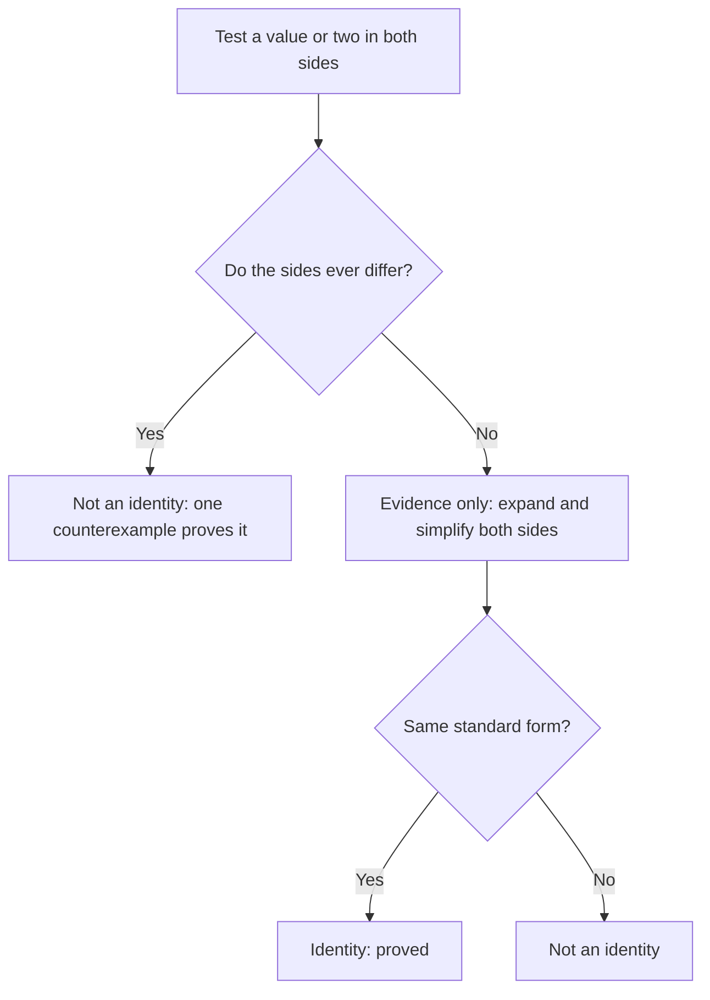

Lesson 19 gave you $(a + b)^2 = a^2 + 2ab + b^2$ and, in passing, $(a + b)^3 = a^3 + 3a^2b + 3ab^2 + b^3$. What about $(a + b)^5$, or $(2x - 1)^8$? Multiplying out eight copies of a binomial by hand is slow and easy to get wrong. This honors lesson finds the pattern behind all these powers. The coefficients come from a famous number triangle, and they also count something, which gives a formula for any one of them. The second half asks what it means for two polynomial expressions to be *equal for every value*, and how to prove it. You'll use that to generate as many Pythagorean triples as you like.

## The pattern in the powers

Here are the first few powers of $a + b$, each obtained by multiplying the one before by $a + b$:

| $n$ | $(a + b)^n$ |
|---|---|
| 0 | $1$ |
| 1 | $a + b$ |
| 2 | $a^2 + 2ab + b^2$ |
| 3 | $a^3 + 3a^2b + 3ab^2 + b^3$ |
| 4 | $a^4 + 4a^3b + 6a^2b^2 + 4ab^3 + b^4$ |

Four things hold in every row:

- $(a + b)^n$ has $n + 1$ terms.
- The powers of $a$ count down from $n$ to 0 while the powers of $b$ count up from 0 to $n$, so the exponents in each term add to $n$.
- The coefficients read the same forward and backward.
- The coefficients start and end with 1.

Only the coefficients need work. Write them in rows and you get **Pascal's triangle**.

## Pascal's triangle

Row 0 is a single 1. Each row starts and ends with 1, and every other entry is the sum of the two entries just above it:

Rows are numbered from 0, and so are the positions in a row. Row $n$ holds the coefficients of $(a + b)^n$. Row 5 is $1, 5, 10, 10, 5, 1$, so

$$(a + b)^5 = a^5 + 5a^4b + 10a^3b^2 + 10a^2b^3 + 5ab^4 + b^5.$$

*Why the addition rule works.* To get $(a + b)^5$, multiply $(a + b)^4$ by $a + b$. A term $a^3b^2$ in the answer can arise in two ways: as $a^2b^2$ (coefficient 6) times $a$, or as $a^3b$ (coefficient 4) times $b$. Its coefficient is therefore $6 + 4 = 10$. Every entry in the triangle is built the same way.

The triangle is much older than Blaise Pascal, who wrote about it in 1654 (published in 1665, after his death). The Persian mathematician al-Karaji worked with it around the year 1000, and the Chinese mathematicians Jia Xian (11th century) and Yang Hui (13th century) described it. In China it is often called Yang Hui's triangle.

## The coefficients count choices

Write $(a + b)^4$ as $(a + b)(a + b)(a + b)(a + b)$. Expanding means choosing an $a$ or a $b$ from each of the four factors, in every possible way, and multiplying the choices. The term $a^2b^2$ appears once for each way of choosing *which 2 of the 4 factors* supply a $b$: factors 1 and 2, 1 and 3, 1 and 4, 2 and 3, 2 and 4, or 3 and 4. That gives 6 ways, which is the coefficient 6.

In general, the coefficient of $a^{n-k}b^k$ is the number of ways to choose $k$ things from $n$. It is called a **binomial coefficient**, written $\dbinom{n}{k}$ (read "$n$ choose $k$") or $_nC_k$, and it can be computed directly:

$$\binom{n}{k} = \frac{n!}{k!\,(n - k)!}, \qquad n! = n(n - 1)(n - 2)\cdots 2 \cdot 1, \quad 0! = 1.$$

For example, $\dbinom{5}{2} = \dfrac{5!}{2!\,3!} = \dfrac{120}{2 \cdot 6} = 10$, which matches row 5. A quicker way to compute it is to cancel first: $\dbinom{6}{3} = \dfrac{6 \cdot 5 \cdot 4}{3 \cdot 2 \cdot 1} = 20$. Many calculators have an nCr key.

Putting it together gives the **binomial theorem**:

$$(a + b)^n = \binom{n}{0}a^n + \binom{n}{1}a^{n-1}b + \binom{n}{2}a^{n-2}b^2 + \cdots + \binom{n}{n}b^n.$$

The term with $b^k$ is $\dbinom{n}{k}a^{n-k}b^k$.

### Example 1

Expand $(x + 2)^4$.

1. Row 4: $1, 4, 6, 4, 1$. Here $a = x$, $b = 2$.
2. Terms: $1 \cdot x^4$, $4 \cdot x^3 \cdot 2$, $6 \cdot x^2 \cdot 2^2$, $4 \cdot x \cdot 2^3$, $1 \cdot 2^4$.
3. Result: $x^4 + 8x^3 + 24x^2 + 32x + 16$.

Check with $x = 1$: $(1 + 2)^4 = 81$, and $1 + 8 + 24 + 32 + 16 = 81$. A one-value check like this catches most slips.

### Example 2

Expand $(3x - 2)^4$.

1. Treat it as $(a + b)^4$ with $a = 3x$ and $b = -2$. The negative $b$ makes the signs alternate.
2. Terms: $(3x)^4 = 81x^4$; $4(3x)^3(-2) = 4 \cdot 27 \cdot (-2)x^3 = -216x^3$; $6(3x)^2(-2)^2 = 6 \cdot 9 \cdot 4x^2 = 216x^2$; $4(3x)(-2)^3 = -96x$; $(-2)^4 = 16$.
3. Result: $81x^4 - 216x^3 + 216x^2 - 96x + 16$.

The usual errors are writing $3x^4$ for $(3x)^4$ and losing a sign. Keep each $b$ in parentheses, $(-2)^k$, until the end.

### Example 3

Find the coefficient of $x^3$ in $(2x + 5)^6$, without expanding everything.

1. With $a = 2x$ and $b = 5$, the term containing $x^3$ has $a^3$, so $k = 3$ ($b$ appears 3 times).
2. The term is $\dbinom{6}{3}(2x)^3(5)^3 = 20 \cdot 8x^3 \cdot 125$.
3. The coefficient is $20 \cdot 8 \cdot 125 = 20{,}000$.

## Identities: equal for every value

An equation such as $x^2 = 9$ is true for some values of $x$ (3 and $-3$) and false for others. An **identity** is an equation that is true for *every* value of its variables, such as $(a + b)^2 = a^2 + 2ab + b^2$. Every special product and factoring pattern in this module is an identity.

How do you tell an identity from an equation that is only sometimes true?

A single value where the sides differ (a *counterexample*) settles the question: $(a + b)^3 = a^3 + b^3$ fails at $a = b = 1$, since $8 \ne 2$. Agreement at a few values proves nothing by itself. For instance, $x^3 = x$ holds at $x = -1$, $0$ and $1$, but fails at $x = 2$. To prove a polynomial identity, rewrite both sides in standard form and compare them term by term. (The honors lesson "Proving it with algebra" at the end of the course has much more on proofs and counterexamples.)

(A deeper fact, stated here without proof: two polynomials in $x$ of degree at most $n$ that agree at $n + 1$ different values must be identical. The proof uses the factor theorem from the previous honors lesson. So "testing values" can be made into a proof, but only with enough values.)

### Example 4: Pythagorean triples on demand

A **Pythagorean triple** is three positive integers with $a^2 + b^2 = c^2$, like $3, 4, 5$. Prove that for any numbers $m$ and $n$,

$$(m^2 - n^2)^2 + (2mn)^2 = (m^2 + n^2)^2.$$

1. Left side: $(m^2 - n^2)^2 = m^4 - 2m^2n^2 + n^4$ and $(2mn)^2 = 4m^2n^2$. Their sum is $m^4 + 2m^2n^2 + n^4$.
2. Right side: $(m^2 + n^2)^2 = m^4 + 2m^2n^2 + n^4$.
3. The standard forms match, so the equation is an identity.

Now choose whole numbers $m > n > 0$. Then $m^2 - n^2$, $2mn$ and $m^2 + n^2$ are positive integers forming a Pythagorean triple:

| $m$, $n$ | $m^2 - n^2$ | $2mn$ | $m^2 + n^2$ |
|---|---|---|---|
| 2, 1 | 3 | 4 | 5 |
| 3, 2 | 5 | 12 | 13 |
| 4, 1 | 15 | 8 | 17 |
| 4, 3 | 7 | 24 | 25 |

This recipe appears in Euclid's *Elements* (about 300 BC) and is often called Euclid's formula. Every triple with no common factor can be made this way (sometimes with the two legs swapped). That last fact needs more number theory than we have, so take it on trust for now.

### Example 5: estimating with the first few terms

Estimate $1.01^5$.

1. Write $1.01^5 = (1 + 0.01)^5$ and use row 5: $1 + 5(0.01) + 10(0.01)^2 + 10(0.01)^3 + \cdots$
2. The terms shrink quickly: $1 + 0.05 + 0.001 + 0.00001 + \cdots$
3. The first three terms give $1.051$. The exact value is $1.0510100501$.

So money growing 1% a year for five years grows by about 5.1%, a little more than $5 \times 1\%$ because of the $\dbinom52$ term, which is the "interest on interest".

## Common mistakes

- Writing $(a + b)^n = a^n + b^n$. The middle terms never disappear (when $a$ and $b$ are both nonzero and $n \ge 2$).
- Raising only part of a term: $(3x)^4 = 81x^4$, not $3x^4$.
- Losing the alternating signs in $(a - b)^n$. Write $b$ as a negative number in parentheses.
- Counting rows from 1. The coefficients of $(a + b)^4$ are in row 4, which has 5 entries.
- Using $k$ for the wrong letter. In $\dbinom{n}{k}a^{n-k}b^k$, $k$ is the power of the *second* term.
- Treating a few matching values as a proof of an identity. Only algebra, or enough values, proves it. One mismatch disproves it.

## Key points

- $(a + b)^n$ has $n + 1$ terms; the powers of $a$ fall from $n$ while those of $b$ rise, adding to $n$ in every term.
- The coefficients are row $n$ of Pascal's triangle. Each entry is the sum of the two above it.
- The coefficient of $a^{n-k}b^k$ is $\dbinom{n}{k} = \dfrac{n!}{k!(n - k)!}$, the number of ways to choose which $k$ factors give $b$.
- For $(px + q)^n$, put $a = px$ and $b = q$ (with its sign), and keep them in parentheses.
- An identity is true for every value. Prove one by bringing both sides to standard form; disprove one with a single counterexample.
- $(m^2 - n^2)^2 + (2mn)^2 = (m^2 + n^2)^2$ turns any whole numbers $m > n > 0$ into a Pythagorean triple.
