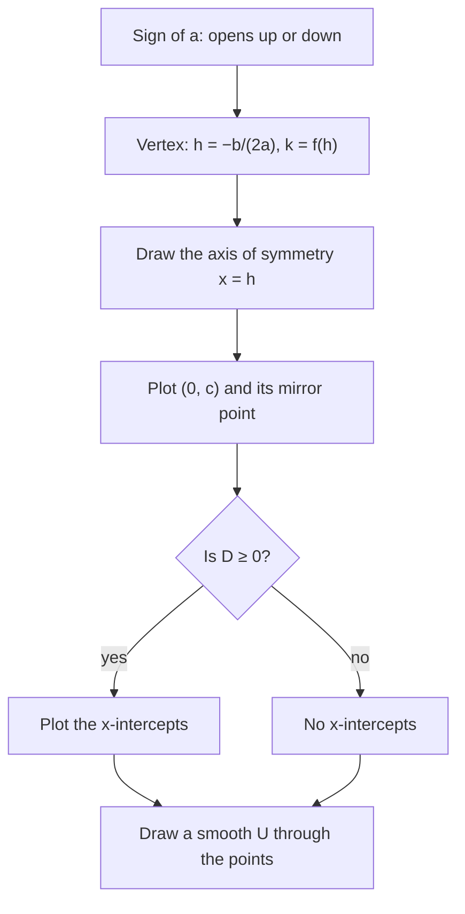

The last three lessons solved $ax^2 + bx + c = 0$. Now we look at the function $f(x) = ax^2 + bx + c$ as a whole. Its graph, the parabola, has a lowest or highest point, a line of symmetry, and intercepts, and all of them can be read from the right form of the equation. This lesson shows how to find each feature and sketch the graph quickly.

## The parabola

A **quadratic function** is $f(x) = ax^2 + bx + c$ with $a \ne 0$. Its graph is a **parabola**. The simplest is $y = x^2$: a U shape with its lowest point at the origin, symmetric about the $y$-axis.

Every parabola has:

- a **vertex**, the turning point, which is either the lowest point (a minimum) or the highest point (a maximum);
- an **axis of symmetry**, the vertical line through the vertex; the two halves of the parabola are mirror images across it.

The picture names these parts on the parabola $y = x^2 - 6x + 5$, which Example 2 below works out in full. Every point has a mirror image across the axis: the $y$-intercept $(0, 5)$ is matched by $(6, 5)$, and the two $x$-intercepts are matched with each other.


## The effect of $a$

The sign of $a$ decides the direction: if $a > 0$ the parabola **opens upward** and the vertex is a minimum; if $a < 0$ it **opens downward** and the vertex is a maximum. The size of $|a|$ controls the width: $|a| > 1$ makes it narrower (steeper) than $y = x^2$, and $|a| < 1$ makes it wider.

```plot
{"x": [-4, 4], "y": [-6, 8], "functions": [{"f": "x^2", "label": "a = 1", "from": -2.9, "to": 2.9}, {"f": "3*x^2", "label": "a = 3", "from": -1.7, "to": 1.7}, {"f": "0.4*x^2", "label": "a = 0.4", "dashed": true, "from": -4, "to": 4}, {"f": "-x^2", "label": "a = -1", "from": -2.5, "to": 2.5}], "caption": "y = ax²: the sign of a sets the direction, |a| the width"}
```

## Vertex form

Writing the function as

$$f(x) = a(x - h)^2 + k$$

is called **vertex form**, because the vertex is $(h, k)$ and the axis of symmetry is $x = h$. Here's why: $(x - h)^2$ is never negative and equals 0 only at $x = h$. If $a > 0$, $f(x) = a(\text{something} \ge 0) + k$ is smallest, equal to $k$, at $x = h$. If $a < 0$, it's largest there.

In terms of shifting, the graph of $a(x - h)^2 + k$ is the graph of $ax^2$ moved $h$ units right and $k$ units up. Watch the sign: $(x - 3)^2$ shifts right 3, and $(x + 3)^2 = (x - (-3))^2$ shifts left 3.

These moves work for any function, not just $x^2$. Starting from the graph of $y = f(x)$: $y = f(x) + k$ moves it up $k$ units (down if $k < 0$); $y = f(x - h)$ moves it right $h$ units (left if $h < 0$); and $y = a\,f(x)$ stretches it vertically by the factor $|a|$, flipping it over the $x$-axis when $a < 0$. For example, $y = |x - 2| + 1$ is the V of $y = |x|$ moved right 2 and up 1, with its corner at $(2, 1)$, and $y = \sqrt{x + 4}$ is the graph of $y = \sqrt x$ moved left 4. Lesson 29 uses these moves to graph square root and cube root functions.

### Example 1

Graph $f(x) = -2(x + 1)^2 + 8$.

1. $a = -2 < 0$: opens downward, narrower than $y = x^2$.
2. Vertex $(h, k) = (-1, 8)$: a maximum. Axis $x = -1$.
3. $y$-intercept: $f(0) = -2(1) + 8 = 6$, so $(0, 6)$. By symmetry, $(-2, 6)$ is also on the graph.
4. $x$-intercepts: $-2(x + 1)^2 + 8 = 0$, so $(x + 1)^2 = 4$, $x + 1 = \pm 2$, and $x = 1$ or $x = -3$.

```plot
{"x": [-5, 3], "y": [-4, 10], "functions": [{"f": "-2*(x + 1)^2 + 8", "label": "f(x) = -2(x + 1)² + 8", "from": -3.7, "to": 1.7}], "points": [{"at": [-1, 8], "label": "vertex (-1, 8)"}, {"at": [0, 6], "label": "(0, 6)"}, {"at": [-2, 6], "label": "(-2, 6)"}, {"at": [1, 0], "label": "(1, 0)"}, {"at": [-3, 0], "label": "(-3, 0)"}], "segments": [{"from": [-1, -4], "to": [-1, 10], "dashed": true}], "caption": "Vertex, axis of symmetry, and the intercepts"}
```

## The vertex from standard form

For $f(x) = ax^2 + bx + c$, completing the square (as in Lesson 23) gives the vertex's $x$-coordinate

$$h = -\frac{b}{2a},$$

and $k = f(h)$. There's a second way to see it: the two $x$-intercepts, when they exist, are $\tfrac{-b \pm \sqrt{D}}{2a}$, and their midpoint is exactly $-\tfrac{b}{2a}$. The axis of symmetry runs halfway between the roots.

### Example 2

Find the vertex, axis, intercepts and range of $f(x) = x^2 - 6x + 5$.

1. $h = -\tfrac{-6}{2(1)} = 3$. $k = f(3) = 9 - 18 + 5 = -4$. Vertex $(3, -4)$, a minimum since $a > 0$.
2. Axis of symmetry: $x = 3$.
3. $y$-intercept: $f(0) = 5$, so $(0, 5)$. Its mirror image is $(6, 5)$.
4. $x$-intercepts: $(x - 1)(x - 5) = 0$, so $x = 1$ and $x = 5$, symmetric about $x = 3$.
5. Range: $[-4, \infty)$. Vertex form: $f(x) = (x - 3)^2 - 4$.

The steps of Example 2 work for any quadratic in standard form. As a checklist:



```plot
{"x": [-1, 7], "y": [-5, 7], "functions": [{"f": "x^2 - 6*x + 5", "label": "y = x² - 6x + 5", "from": -0.4, "to": 6.4}], "points": [{"at": [3, -4], "label": "(3, -4)"}, {"at": [0, 5], "label": "(0, 5)"}, {"at": [6, 5], "label": "(6, 5)"}, {"at": [1, 0], "label": "(1, 0)"}, {"at": [5, 0], "label": "(5, 0)"}], "segments": [{"from": [3, -5], "to": [3, 7], "dashed": true}], "caption": "Symmetric about the axis x = 3"}
```

## Intercept form

If a quadratic has real roots $r$ and $s$, it can be written in **intercept form** (factored form) $f(x) = a(x - r)(x - s)$. The $x$-intercepts are $r$ and $s$, and the vertex is at $x = \tfrac{r + s}{2}$.

| Form | Equation | Shows directly |
|---|---|---|
| Standard | $ax^2 + bx + c$ | $y$-intercept $c$; vertex at $x = -\tfrac{b}{2a}$ |
| Vertex | $a(x - h)^2 + k$ | vertex $(h, k)$ |
| Intercept | $a(x - r)(x - s)$ | $x$-intercepts $r$, $s$ |

## Writing the equation from a graph

### Example 3

A parabola has vertex $(2, -3)$ and passes through $(4, 5)$. Find its equation.

1. Vertex form: $y = a(x - 2)^2 - 3$.
2. Use the other point to find $a$: $5 = a(4 - 2)^2 - 3$, so $8 = 4a$ and $a = 2$.
3. $y = 2(x - 2)^2 - 3$, or in standard form $y = 2x^2 - 8x + 5$.

### Example 4

A parabola crosses the $x$-axis at $-1$ and 3 and passes through $(1, -8)$. Find its equation.

1. Intercept form: $y = a(x + 1)(x - 3)$.
2. $-8 = a(2)(-2) = -4a$, so $a = 2$.
3. $y = 2(x + 1)(x - 3) = 2x^2 - 4x - 6$. Its vertex is at $x = 1$: the point $(1, -8)$ itself.

## Domain and range

Every quadratic function has domain $(-\infty, \infty)$. The range depends on the vertex: if the parabola opens up with vertex $(h, k)$, the range is $[k, \infty)$; if it opens down, $(-\infty, k]$.

## Common mistakes

- Reading the vertex of $a(x + 3)^2 + 1$ as $(3, 1)$. It's $(-3, 1)$.
- Forgetting the negative in $h = -\tfrac{b}{2a}$.
- Finding $h$ but not $k$; the vertex is a point $(h, f(h))$.
- Thinking the sign of $c$ decides the opening direction. Only the sign of $a$ does.
- Giving the range as $x$-values or including the wrong endpoint.

## Key points

- $a > 0$ opens up (minimum at the vertex); $a < 0$ opens down (maximum). Larger $|a|$ means narrower.
- Vertex form $a(x - h)^2 + k$: vertex $(h, k)$, axis $x = h$.
- Standard form: vertex at $x = -\tfrac{b}{2a}$, $y$-intercept $c$.
- Intercept form $a(x - r)(x - s)$: $x$-intercepts $r$, $s$; the axis is halfway between them.
- Find $a$ from one extra point after writing the vertex or intercept form.
