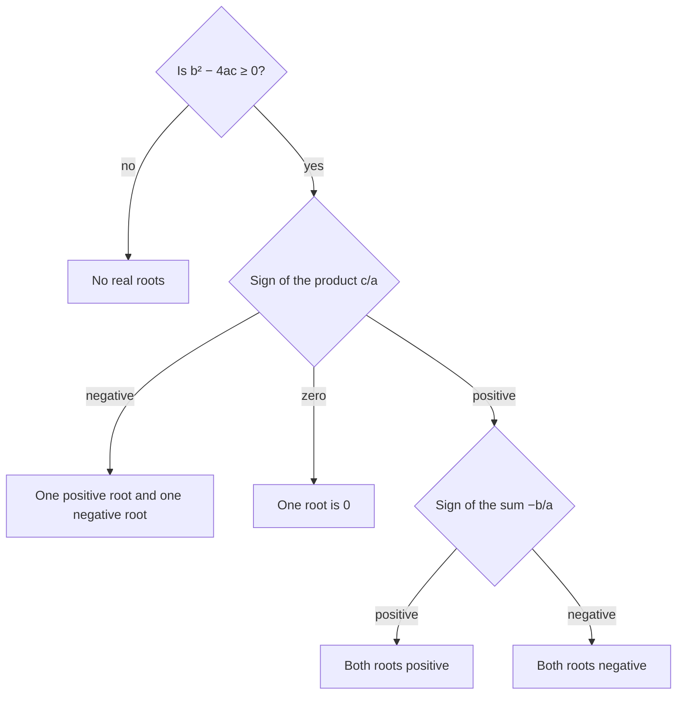

Lesson 22 ended by running the factoring method backward: the roots $r$ and $s$ come from the equation $(x - r)(x - s) = 0$. Multiply that product out and something useful appears. The coefficients of a quadratic are built from its roots in a simple way, so you can learn a lot about the roots (their sum, their product, their signs, how far apart they are) without solving the equation at all. This honors lesson develops that idea and uses it to check answers, build equations and find unknown coefficients.

## From factors to coefficients

Expand the factored form:

$$(x - r)(x - s) = x^2 - sx - rx + rs = x^2 - (r + s)x + rs.$$

Compare with $x^2 + bx + c$. The coefficient of $x$ is $b = -(r + s)$ and the constant is $c = rs$. In words: for a quadratic with leading coefficient 1, the sum of the roots is $-b$ and the product of the roots is $c$.

Test it on Example 1 of Lesson 22. The equation $x^2 + 2x - 15 = 0$ has roots $-5$ and 3. Their sum is $-2$, which is $-b$, and their product is $-15$, which is $c$.

## Vieta's formulas

If the leading coefficient is $a \ne 1$, divide the equation $ax^2 + bx + c = 0$ by $a$. The new equation $x^2 + \tfrac{b}{a}x + \tfrac{c}{a} = 0$ has the same roots, and it has leading coefficient 1. So for roots $r$ and $s$:

$$r + s = -\frac{b}{a}, \qquad rs = \frac{c}{a}.$$

These are **Vieta's formulas**, named after François Viète (1540–1603), a French lawyer and royal adviser who studied how the roots of an equation are tied to its coefficients.

The quadratic formula gives a second proof. The roots are $\tfrac{-b + \sqrt D}{2a}$ and $\tfrac{-b - \sqrt D}{2a}$, where $D = b^2 - 4ac$.

- Adding them, the square roots cancel: $\dfrac{-2b}{2a} = -\dfrac{b}{a}$.
- Multiplying them gives a difference of squares: $\dfrac{(-b)^2 - (\sqrt D)^2}{4a^2} = \dfrac{b^2 - (b^2 - 4ac)}{4a^2} = \dfrac{4ac}{4a^2} = \dfrac{c}{a}$.

**When do the formulas apply?** They describe the roots, so the roots must exist. In this course that means real roots, so check $D \ge 0$. A double root counts twice: $(x - 5)^2 = x^2 - 10x + 25$ has roots 5 and 5, with sum $10$ and product $25$, exactly as the formulas say. If $D < 0$, the numbers $-\tfrac ba$ and $\tfrac ca$ still exist, but they are not the sum and product of two real numbers. (In Algebra 2 you'll meet complex numbers; the formulas hold for complex roots too.)

### Example 1

Without solving, find the sum and product of the roots of $2x^2 - 7x + 3 = 0$, then check against the roots.

1. $a = 2$, $b = -7$, $c = 3$, and $D = 49 - 24 = 25 \ge 0$, so there are two real roots.
2. Sum: $-\tfrac{b}{a} = -\tfrac{-7}{2} = \tfrac72$. Product: $\tfrac{c}{a} = \tfrac32$.
3. Lesson 24 found the roots 3 and $\tfrac12$. Check: $3 + \tfrac12 = \tfrac72$ and $3 \cdot \tfrac12 = \tfrac32$.

This is a fast way to check solutions you found by any method: if the sum or product is off, something went wrong.

## Building an equation from a sum and a product

Running the formulas backward: two numbers with sum $S$ and product $P$ are the roots of

$$x^2 - Sx + P = 0.$$

For example, two numbers with sum 10 and product 21 solve $x^2 - 10x + 21 = 0$, which factors as $(x - 3)(x - 7) = 0$: the numbers are 3 and 7.

Not every sum and product is possible. Two numbers with sum 4 and product 5 would solve $x^2 - 4x + 5 = 0$, whose discriminant is $16 - 20 = -4$. No real numbers work. In general the discriminant of $x^2 - Sx + P$ is $S^2 - 4P$, so real numbers with sum $S$ and product $P$ exist exactly when $P \le \tfrac{S^2}{4}$. That is the same fact as Lesson 26's result that, for a fixed sum, the product is largest when the two numbers are equal (each $\tfrac S2$, product $\tfrac{S^2}{4}$).

### Example 2

A rectangle has perimeter 34 m and area 60 m². Find its dimensions.

1. Length plus width is half the perimeter: $S = 17$. Length times width: $P = 60$.
2. The dimensions are the roots of $x^2 - 17x + 60 = 0$.
3. Factor: $(x - 5)(x - 12) = 0$, so the rectangle is 5 m by 12 m. Check: $2(5 + 12) = 34$ and $5 \cdot 12 = 60$.

Could a rectangle with perimeter 34 m have area 80 m²? That needs $x^2 - 17x + 80 = 0$, with discriminant $289 - 320 = -31 < 0$. No: the largest possible area is $\tfrac{17^2}{4} = 72.25$ m², from a square.

## Symmetric expressions of the roots

An expression in $r$ and $s$ that stays the same when you swap $r$ and $s$ is a **symmetric expression**. Examples: $r^2 + s^2$, $\tfrac1r + \tfrac1s$, $(r - s)^2$. Every symmetric expression can be rewritten using only the sum $S = r + s$ and the product $P = rs$, so you can compute it without finding the roots.

| Expression | In terms of $S$ and $P$ | Why |
|---|---|---|
| $r^2 + s^2$ | $S^2 - 2P$ | $(r + s)^2 = r^2 + 2rs + s^2$ |
| $\tfrac1r + \tfrac1s$ | $\tfrac{S}{P}$ (if $P \ne 0$) | common denominator $rs$ |
| $(r - s)^2$ | $S^2 - 4P$ | $(r - s)^2 = (r + s)^2 - 4rs$ |
| $r^2s + rs^2$ | $PS$ | factor out $rs$ |
| $r^3 + s^3$ | $S^3 - 3PS$ | $(r + s)^3 = r^3 + s^3 + 3rs(r + s)$ |

The third row has a nice meaning. With $S = -\tfrac ba$ and $P = \tfrac ca$, it gives $(r - s)^2 = \tfrac{b^2 - 4ac}{a^2} = \tfrac{D}{a^2}$, so the distance between the two roots is $\tfrac{\sqrt D}{|a|}$. The discriminant measures how far apart the roots are; when $D = 0$ they coincide.

### Example 3

Let $r$ and $s$ be the roots of $2x^2 - 6x + 1 = 0$. Find $r^2 + s^2$, $\tfrac1r + \tfrac1s$ and the distance between the roots.

1. $D = 36 - 8 = 28 > 0$. $S = -\tfrac{-6}{2} = 3$ and $P = \tfrac12$.
2. $r^2 + s^2 = S^2 - 2P = 9 - 1 = 8$.
3. $\tfrac1r + \tfrac1s = \tfrac{S}{P} = \tfrac{3}{1/2} = 6$.
4. $(r - s)^2 = S^2 - 4P = 9 - 2 = 7$, so the roots are $\sqrt7 \approx 2.65$ apart.

Check with the quadratic formula: the roots are $\tfrac{3 \pm \sqrt7}{2}$, which differ by $\sqrt7$, and $\tfrac{(3 + \sqrt7)^2 + (3 - \sqrt7)^2}{4} = \tfrac{2 \cdot 9 + 2 \cdot 7}{4} = 8$.

The graph shows the sum another way. The parabola $y = x^2 - 10x + 21$ has roots 3 and 7, and its axis of symmetry is halfway between them, at $x = \tfrac{S}{2} = 5$. That is the vertex formula $x = -\tfrac{b}{2a}$ from Lesson 25 in disguise: half the sum of the roots.

```plot
{"x": [-1, 11], "y": [-6, 10], "functions": [{"f": "x^2 - 10*x + 21", "label": "y = x² - 10x + 21", "from": 0.9, "to": 9.1}], "points": [{"at": [3, 0], "label": "3"}, {"at": [7, 0], "label": "7"}, {"at": [5, -4], "label": "vertex (5, -4)"}], "segments": [{"from": [5, -6], "to": [5, 10], "dashed": true}], "labels": [{"at": [5.2, 8], "text": "x = sum ÷ 2 = 5"}], "caption": "The axis of symmetry is at half the sum of the roots"}
```

## Unknown coefficients

Vieta's formulas shine when a coefficient is unknown but something about the roots is given.

### Example 4

One root of $x^2 + kx - 15 = 0$ is 5. Find $k$ and the other root $s$.

1. Product: $5s = -15$, so $s = -3$.
2. Sum: $5 + (-3) = 2$, and the sum is $-k$, so $k = -2$.
3. Check: $(x - 5)(x + 3) = x^2 - 2x - 15$.

Substituting $x = 5$ would also give $k$ ($25 + 5k - 15 = 0$), but you'd still have to solve for the other root. The product gives it in one step.

### Example 5

In $x^2 - kx + 18 = 0$, one root is twice the other. Find every possible $k$.

1. Call the roots $r$ and $2r$. Product: $r \cdot 2r = 2r^2 = 18$, so $r^2 = 9$ and $r = 3$ or $r = -3$.
2. Sum: $r + 2r = 3r$, and the sum is $-(-k) = k$. So $k = 9$ or $k = -9$.
3. Check: $x^2 - 9x + 18 = (x - 3)(x - 6)$ and $x^2 + 9x + 18 = (x + 3)(x + 6)$. Both work.

## Reading the signs of the roots

The product and sum also tell you the signs of the roots before you solve.



A negative product needs no discriminant check: if $\tfrac ca < 0$, then $-4ac > 0$, so $D = b^2 - 4ac$ is positive automatically.

### Example 6

Describe the roots of $x^2 + 5x - 7 = 0$ and of $x^2 - 9x + 11 = 0$ without solving.

1. First equation: the product is $-7 < 0$, so there are two real roots with opposite signs. The sum is $-5$, so the negative root is farther from 0 than the positive one. (They are about $-6.14$ and $1.14$.)
2. Second equation: $D = 81 - 44 = 37 > 0$; the product 11 is positive and the sum 9 is positive, so both roots are positive. (They are about $1.46$ and $7.54$.)

### Example 7

The roots of $x^2 - 3x + 1 = 0$ are $r$ and $s$. Find an equation whose roots are $r^2$ and $s^2$.

1. $S = 3$, $P = 1$.
2. New sum: $r^2 + s^2 = S^2 - 2P = 9 - 2 = 7$. New product: $r^2 s^2 = P^2 = 1$.
3. The equation is $x^2 - 7x + 1 = 0$.

Check numerically: $r \approx 2.618$ and $s \approx 0.382$, so $r^2 \approx 6.854$ and $s^2 \approx 0.146$, which add to 7 and multiply to 1.

## Common mistakes

- Sign of the sum: the sum of the roots is $-\tfrac{b}{a}$, not $\tfrac{b}{a}$. For $x^2 - 5x + 6$, the roots 2 and 3 add to $+5$.
- Forgetting to divide by $a$ when $a \ne 1$.
- Using the formulas before writing the equation in standard form. For $2x^2 = 7x - 3$, first rewrite it as $2x^2 - 7x + 3 = 0$.
- Concluding that real roots exist because $-\tfrac ba$ and $\tfrac ca$ are real numbers. Check $D \ge 0$ first.
- Writing $r^2 + s^2 = (r + s)^2$. The cross term $2rs$ must come off.

## Key points

- Vieta's formulas: for $ax^2 + bx + c = 0$ with roots $r$ and $s$, $r + s = -\tfrac{b}{a}$ and $rs = \tfrac{c}{a}$.
- Two numbers with sum $S$ and product $P$ are the roots of $x^2 - Sx + P = 0$; they are real only when $S^2 - 4P \ge 0$.
- Symmetric expressions such as $r^2 + s^2 = S^2 - 2P$ and $\tfrac1r + \tfrac1s = \tfrac SP$ need no solving.
- The roots are $\tfrac{\sqrt D}{|a|}$ apart, and the axis of symmetry is at half their sum.
- A negative product means roots of opposite signs; a positive product means the same sign, which the sum decides.
