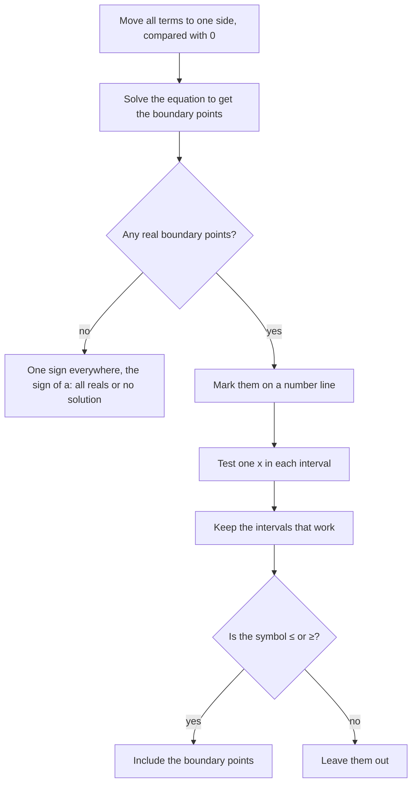

Lesson 6 solved linear inequalities such as $2x - 3 > 7$, whose solutions form a single ray on the number line. Lessons 22–25 solved quadratic equations and graphed parabolas. This honors lesson puts the two together. A **quadratic inequality** compares a quadratic expression with a number, as in $x^2 - x - 6 < 0$ or $-16t^2 + 64t + 5 > 53$. Its solutions usually form an interval between two numbers, or two rays pointing away from each other, and the graph of the parabola shows which.

## Why the roots split the number line

Take $f(x) = x^2 - x - 6 = (x + 2)(x - 3)$. Its graph is an unbroken curve, so it can't jump from above the $x$-axis to below it: to change sign, $f(x)$ has to pass through 0. That happens only at the roots, $x = -2$ and $x = 3$. These are the **boundary points** of the inequality. Between consecutive boundary points the sign of $f(x)$ can't change, so one test value in each interval tells you the sign on the whole interval.

```plot
{"x": [-5, 6], "y": [-8, 10], "functions": [{"f": "x^2 - x - 6", "label": "y = x² - x - 6", "from": -3.6, "to": 4.6}], "shade": [{"f": "x^2 - x - 6", "from": -2, "to": 3}], "points": [{"at": [-2, 0], "label": "-2"}, {"at": [3, 0], "label": "3"}], "caption": "The parabola is below the x-axis exactly between its roots"}
```

The shaded part of the graph lies below the $x$-axis: there $x^2 - x - 6 < 0$. Outside the roots the parabola is above the axis, and $x^2 - x - 6 > 0$.

## Method 1: read the graph

You don't need an accurate graph, only the roots and the direction the parabola opens. Suppose $ax^2 + bx + c = 0$ has two real roots $r < s$.

| | $a > 0$ (opens up) | $a < 0$ (opens down) |
|---|---|---|
| $ax^2 + bx + c < 0$ | between: $r < x < s$ | outside: $x < r$ or $x > s$ |
| $ax^2 + bx + c > 0$ | outside: $x < r$ or $x > s$ | between: $r < x < s$ |

For $\le$ or $\ge$, include the boundary points themselves, since there the expression equals 0.

### Example 1

Solve $x^2 - x - 6 < 0$.

1. Boundary points: $(x + 2)(x - 3) = 0$ gives $x = -2$ and $x = 3$.
2. $a = 1 > 0$, so the parabola opens up and is below the axis between its roots.
3. Solution: $-2 < x < 3$, or $(-2, 3)$ in interval notation. The boundary points are left out because the inequality is strict.

```numberline
{"x": [-5, 6], "points": [{"at": [-2, 0], "open": true, "label": "-2"}, {"at": [3, 0], "open": true, "label": "3"}], "segments": [{"from": [-2, 0], "to": [3, 0]}], "caption": "-2 < x < 3"}
```

## Method 2: a sign chart

A **sign chart** records the sign of each factor on each interval, then multiplies the signs. A product of two negatives is positive, and a product of one positive and one negative is negative.


The chart gives the same answer as the graph: $(x + 2)(x - 3)$ is negative only in the middle interval. Instead of factor signs you can also just substitute one test point per interval into the original expression. Either way, here is the whole procedure.



### Example 2

Solve $2x^2 + 3x \ge 5$.

1. One side compared with 0: $2x^2 + 3x - 5 \ge 0$.
2. Boundary points: $(2x + 5)(x - 1) = 0$ gives $x = -\tfrac52$ and $x = 1$.
3. Test a point in each interval: $x = -3$ gives $18 - 9 - 5 = 4 \ge 0$, true; $x = 0$ gives $-5$, false; $x = 2$ gives $8 + 6 - 5 = 9$, true.
4. Keep the outer intervals and include the boundary points ($\ge$): $x \le -\tfrac52$ or $x \ge 1$, that is $\left(-\infty, -\tfrac52\right] \cup [1, \infty)$.

```numberline
{"x": [-5, 4], "points": [{"at": [-2.5, 0], "label": "-5/2"}, {"at": [1, 0], "label": "1"}], "segments": [{"from": [-2.5, 0], "to": [-5, 0], "arrow": true}, {"from": [1, 0], "to": [4, 0], "arrow": true}], "caption": "x ≤ -5/2 or x ≥ 1"}
```

Step 1 matters. With $2x^2 + 3x \ge 5$ as written, the roots of $2x^2 + 3x = 0$ (0 and $-\tfrac32$) have nothing to do with the answer.

### Example 3

Solve $-x^2 + 4x + 5 > 0$.

Two ways:

- Graph: $a = -1 < 0$, so the parabola opens down. Its roots solve $-x^2 + 4x + 5 = 0$, that is $x^2 - 4x - 5 = (x - 5)(x + 1) = 0$: $x = -1$ and $x = 5$. A downward parabola is above the axis between its roots.
- Algebra: multiply both sides by $-1$ and reverse the symbol, as in Lesson 6: $x^2 - 4x - 5 < 0$. Now $a > 0$, and "less than 0" means between the roots.

Both give $-1 < x < 5$.

## Fewer than two boundary points

If the discriminant is negative, the parabola never meets the $x$-axis, so the expression has the same sign for every $x$: the sign of $a$.

- $x^2 + 2x + 5$ has $D = 4 - 20 = -16 < 0$ and $a > 0$. So $x^2 + 2x + 5 > 0$ for all real $x$, and $x^2 + 2x + 5 \le 0$ has no solution. Completing the square confirms it: $x^2 + 2x + 5 = (x + 1)^2 + 4$, which is at least 4.

If the discriminant is 0, the parabola touches the axis at one point. For $x^2 - 6x + 9 = (x - 3)^2$:

| Inequality | Solution |
|---|---|
| $(x - 3)^2 > 0$ | every real number except 3 |
| $(x - 3)^2 \ge 0$ | all real numbers |
| $(x - 3)^2 < 0$ | no solution |
| $(x - 3)^2 \le 0$ | only $x = 3$ |

### Example 4

Solve $x^2 - 4x - 1 \le 0$.

1. The roots don't factor nicely. From Lesson 24 (Example 2), they are $2 - \sqrt5$ and $2 + \sqrt5$.
2. $a > 0$ and "$\le 0$" means between the roots, inclusive.
3. Solution: $2 - \sqrt5 \le x \le 2 + \sqrt5$, about $-0.236 \le x \le 4.236$.

Give the exact form unless the problem asks for decimals; the decimals are rounded.

## A warning about square roots

It's tempting to solve $x^2 > 9$ by "taking square roots" and writing $x > \pm 3$. That statement has no clear meaning, and both readings are wrong: $x > 3$ misses $x = -4$, which works, and $x > -3$ includes $x = 0$, which doesn't. Do it properly: $x^2 - 9 > 0$ means $(x - 3)(x + 3) > 0$, so $x < -3$ or $x > 3$.

This matches Lesson 7. Because $\sqrt{x^2} = |x|$, the inequality $x^2 > 9$ is the same as $|x| > 3$, and $x^2 \le 9$ is the same as $|x| \le 3$, that is $-3 \le x \le 3$.

## Applications

### Example 5

A ball's height in feet is $h(t) = -16t^2 + 64t + 5$, $t$ seconds after it's thrown. When is it higher than 53 feet?

1. Set up: $-16t^2 + 64t + 5 > 53$, so $-16t^2 + 64t - 48 > 0$.
2. Divide by $-16$ and reverse the symbol: $t^2 - 4t + 3 < 0$.
3. Factor: $(t - 1)(t - 3) < 0$, so $1 < t < 3$.
4. The ball is above 53 ft from $t = 1$ to $t = 3$ seconds, for 2 seconds in all. Check: $h(1) = -16 + 64 + 5 = 53$ and $h(2) = 69 > 53$.

```plot
{"x": [-0.3, 4.5], "y": [-5, 80], "functions": [{"f": "-16*x^2 + 64*x + 5", "label": "h(t)", "from": 0, "to": 4.07}, {"f": "53", "label": "53 ft", "dashed": true}], "points": [{"at": [1, 53], "label": "(1, 53)"}, {"at": [3, 53], "label": "(3, 53)"}], "xLabel": "t (s)", "yLabel": "height (ft)", "caption": "The ball is above the 53 ft line for 1 < t < 3"}
```

### Example 6

The theater of Lesson 26 earns $R(n) = (20 + n)(500 - 20n)$ dollars when it raises its \$20 price by $n$ dollars. For which increases is revenue at least the original \$10,000?

1. Expand: $R(n) = 10000 + 100n - 20n^2$. Require $10000 + 100n - 20n^2 \ge 10000$.
2. Simplify: $100n - 20n^2 \ge 0$, so $20n(5 - n) \ge 0$.
3. Boundary points $n = 0$ and $n = 5$; the expression $-20n^2 + 100n$ opens down, so it is $\ge 0$ between them: $0 \le n \le 5$.
4. Any price from \$20 to \$25 keeps revenue at or above \$10,000 (if prices may only go up). The best price, \$22.50, sits in the middle.

## Common mistakes

- Solving before moving everything to one side. The boundary points come from the expression compared with 0.
- Forgetting to reverse the symbol when multiplying or dividing by a negative number.
- Writing $x > \pm 3$ for $x^2 > 9$. The answer is two rays: $x < -3$ or $x > 3$.
- Joining two outer rays with "and". No number is both less than $-3$ and greater than 3; the word is "or".
- Including boundary points for $<$ or $>$, or leaving them out for $\le$ or $\ge$.
- Dividing both sides by $x$, as in $x^2 < 4x$. The sign of $x$ is unknown, so you can't tell whether to reverse the symbol. Write $x^2 - 4x < 0$, so $x(x - 4) < 0$ and $0 < x < 4$.

## Key points

- Move every term to one side and compare a quadratic with 0.
- The roots are the boundary points; the sign can change only there.
- With $a > 0$: "$< 0$" means between the roots, "$> 0$" means outside them. With $a < 0$ it's the reverse.
- Use a graph, a sign chart, or one test point per interval; all agree.
- No real roots: the expression always has the sign of $a$.
- Use $\le$/$\ge$ to decide whether the boundary points are included.
