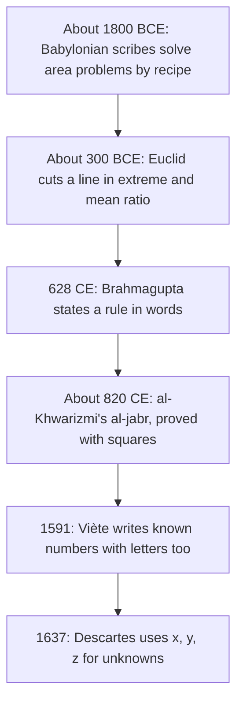

In Lesson 23 you completed the square with a picture: a square, two strips, and a missing corner. The idea behind that picture may be close to four thousand years old. People solved quadratic problems long before anyone wrote $x$, $=$ or a minus sign, and their methods were the same completing-the-square steps you know, told as recipes or proved with drawings. This honors lesson follows quadratic equations through a few landmarks, solves the old problems with the tools of Lessons 22–24, and ends with the most famous quadratic of all, the one behind the golden ratio.

A word on sources: we know these methods from surviving texts, and historians still debate how the ancient authors *thought* about them. Where this lesson describes their reasoning rather than their written steps, it says so.

## Babylon: recipes on clay

In the Old Babylonian period (roughly 2000–1600 BCE), scribes in Mesopotamia wrote mathematics on clay tablets. They had no letters for unknowns and no equations, only a problem in words and a numbered recipe of steps. They also had no negative numbers. Their numbers were written in **sexagesimal** notation, base 60: just as 0.75 means $\tfrac{75}{100}$ in base 10, the Babylonian number written today as 0;45 means $\tfrac{45}{60} = \tfrac34$. (We still use base 60 for minutes and seconds.)

One tablet, catalogued BM 13901 at the British Museum, opens with this problem: *I added the area and the side of my square, and got 0;45. What is the side?* In modern notation, with $x$ for the side:

$$x^2 + x = \tfrac34.$$

The scribe's recipe, in modern words: take 1, the coefficient of the side. Halve it: 0;30. Multiply 0;30 by itself: 0;15. Add that to 0;45: the result is 1. The square root of 1 is 1. Take away the 0;30 you multiplied: 0;30 is the side.

### Example 1

Match the recipe to completing the square.

1. Halve the coefficient of $x$: $\tfrac12$ (that's 0;30).
2. Square it: $\tfrac14$ (that's 0;15).
3. Add it to both sides: $x^2 + x + \tfrac14 = \tfrac34 + \tfrac14 = 1$, that is $\left(x + \tfrac12\right)^2 = 1$.
4. Take the square root: $x + \tfrac12 = 1$.
5. Subtract the half: $x = \tfrac12$, which is 0;30.

Every step is a step of Lesson 23. The scribe gives only the positive root; the other root, $-\tfrac32$, would be a negative length. Many historians (Jens Høyrup is the best known) read the recipe as cut-and-paste geometry: the "side" is a strip of width 1 attached to the square, the scribe cuts it in half, moves one half to another side, and fills the missing corner. That reading is a reconstruction from the wording of the tablets, and its details are debated.

## Greek geometry and Indian rules

Euclid's *Elements* (about 300 BCE) states many results as facts about areas. Book II, Proposition 4, says that the square on a line cut into two parts equals the squares on the parts plus twice the rectangle on the parts; today we read that as $(a + b)^2 = a^2 + 2ab + b^2$. (Whether Greek mathematicians thought of such results as "algebra in disguise" is itself a long-running debate among historians.) Euclid also shows how to cut a line in "extreme and mean ratio", which leads to the golden ratio at the end of this lesson.

In India, Brahmagupta's *Brāhmasphuṭasiddhānta* (628 CE) gave a rule in words for problems we would write as $ax^2 + bx = c$. In modern symbols his rule says

$$x = \frac{\sqrt{4ac + b^2} - b}{2a}.$$

Compare it with the quadratic formula for $ax^2 + bx - c = 0$: it is exactly the root with the plus sign. Brahmagupta also stated rules for computing with negative numbers ("debts") and zero.

## al-Khwarizmi and al-jabr

Around 820 CE, Muhammad ibn Musa al-Khwarizmi, a scholar in Baghdad, wrote *The Compendious Book on Calculation by Completion and Balancing*. Its Arabic title contains the word **al-jabr**, "restoring" or "completion", the operation of moving a subtracted quantity to the other side of an equation, where it becomes added. Latin translations turned al-jabr into our word *algebra*, and his name into *algorithm*.

al-Khwarizmi wrote everything in words, even the numbers. He called the unknown's square a "square", the unknown itself a "root", and a plain number "dirhams" (a coin). Because he used only positive numbers, he could not write one general equation like $ax^2 + bx + c = 0$; each term had to sit on whichever side kept it positive. So he sorted problems into six types:

| His wording | Modern form |
|---|---|
| squares equal roots | $ax^2 = bx$ |
| squares equal numbers | $ax^2 = c$ |
| roots equal numbers | $bx = c$ |
| squares and roots equal numbers | $x^2 + bx = c$ |
| squares and numbers equal roots | $x^2 + c = bx$ |
| roots and numbers equal squares | $bx + c = x^2$ |

For each type he gave a rule and proved it with a geometric figure.

### Example 2

al-Khwarizmi's first worked problem is "a square and ten roots equal thirty-nine dirhams": $x^2 + 10x = 39$.

His rule: halve the roots (5), multiply it by itself (25), add it to 39 (64), take the root (8), and subtract the half of the roots (5). The answer is 3.

One of his proofs splits the $10x$ into four rectangles of $2\tfrac12$ by $x$, one on each side of the square. Four corner squares of $2\tfrac12$ by $2\tfrac12$, each $6\tfrac14$, are missing; together they make 25.

The big square has area $39 + 25 = 64$, so its side is 8. That side is $2\tfrac12 + x + 2\tfrac12 = x + 5$, so $x = 3$. Check: $9 + 30 = 39$. In modern terms this is $(x + 5)^2 = 64$; the other root, $x = -13$, didn't count, since a square's side can't be negative.

### Example 3

"A square and twenty-one dirhams equal ten roots": $x^2 + 21 = 10x$.

al-Khwarizmi's rule for this type: halve the roots (5), square it (25), subtract 21 (4), take the root (2). Then $5 - 2 = 3$ and $5 + 2 = 7$ both work, and he says so. He also warns that if the square of half the roots is less than the number, the problem is impossible.

In modern terms: $x^2 - 10x + 21 = 0$ factors as $(x - 3)(x - 7) = 0$. And his warning is a discriminant test. The quantity he computes, $\left(\tfrac{b}{2}\right)^2 - c$ for $x^2 + c = bx$, is one quarter of the discriminant of $x^2 - bx + c = 0$: if it is negative, there are no real solutions.

## From words to symbols

Symbols arrived slowly. In 1591 François Viète (whose formulas appear in the previous honors lesson) used letters for known quantities as well as unknowns, so that one statement could cover a whole family of problems. In 1637 René Descartes's *La Géométrie* used $x$, $y$, $z$ for unknowns and $a$, $b$, $c$ for known quantities, close to what we write today. Once negative numbers and zero were accepted as ordinary numbers, al-Khwarizmi's six types collapsed into one equation, $ax^2 + bx + c = 0$, with one formula for all of them. That is the real power of the notation you've been using.

## The golden ratio

Cut a segment into a longer part and a shorter part so that

$$\frac{\text{whole}}{\text{longer}} = \frac{\text{longer}}{\text{shorter}}.$$

This is Euclid's "extreme and mean ratio"; today the common value of the two ratios is called the **golden ratio**, written $\varphi$ (the Greek letter phi). To find it, make the shorter part 1 and the longer part $\varphi$. The whole is $\varphi + 1$, so

$$\frac{\varphi + 1}{\varphi} = \frac{\varphi}{1}, \quad\text{so}\quad \varphi^2 = \varphi + 1, \quad\text{so}\quad \varphi^2 - \varphi - 1 = 0.$$

### Example 4

Solve $\varphi^2 - \varphi - 1 = 0$.

1. Quadratic formula with $a = 1$, $b = -1$, $c = -1$: $D = 1 + 4 = 5$, so $\varphi = \dfrac{1 \pm \sqrt5}{2}$.
2. A length is positive, so $\varphi = \dfrac{1 + \sqrt5}{2} \approx 1.618$.
3. The other root, $\tfrac{1 - \sqrt5}{2} \approx -0.618$, is $-\tfrac{1}{\varphi}$. Vieta's formulas predict this: the product of the roots is $\tfrac ca = -1$.

The equation $\varphi^2 = \varphi + 1$ gives two handy facts. Dividing by $\varphi$: $\varphi = 1 + \tfrac1\varphi$, so $\tfrac1\varphi = \varphi - 1 \approx 0.618$. And $\varphi^2 = \varphi + 1 \approx 2.618$.

A **golden rectangle** has sides in the ratio $\varphi : 1$. Cut a square off one end and the strip that remains is again a golden rectangle, because its sides are 1 and $\varphi - 1$, and $\tfrac{1}{\varphi - 1} = \varphi$.

### Example 5

Cut a 10 cm segment in the golden ratio. How long is each part?

1. Let the longer part be $x$, so the shorter is $10 - x$. Then $\dfrac{10}{x} = \dfrac{x}{10 - x}$.
2. Cross-multiply: $x^2 = 10(10 - x)$, so $x^2 + 10x - 100 = 0$.
3. Quadratic formula: $x = \dfrac{-10 + \sqrt{100 + 400}}{2} = -5 + 5\sqrt5 \approx 6.18$ cm (the negative root is rejected).
4. The shorter part is about $3.82$ cm. Check: $10 \div 6.18 \approx 1.618$ and $6.18 \div 3.82 \approx 1.618$.

Notice that the longer part is $\tfrac{10}{\varphi}$: dividing any length by $\varphi$ gives the longer part of its golden cut.

### Fact and fiction

The golden ratio has a real connection to the Fibonacci numbers 1, 1, 2, 3, 5, 8, 13, 21, 34, …, where each number is the sum of the two before it. The ratios of neighbors, $\tfrac85 = 1.6$, $\tfrac{13}{8} = 1.625$, $\tfrac{21}{13} \approx 1.615$, $\tfrac{34}{21} \approx 1.619$, get closer and closer to $\varphi$. In many plants, such as sunflower heads and pine cones, the numbers of spirals in the two directions are often neighboring Fibonacci numbers.

Many popular claims go further: that the Parthenon, the pyramids or the *Mona Lisa* were designed with $\varphi$, or that the most beautiful faces and rectangles have golden proportions. Treat these with suspicion. Careful measurements usually don't support them, any measured ratio near 1.6 can be made to look "golden", and studies of whether people prefer golden rectangles have given mixed results.

## Common mistakes

- Reading 0;45 as the decimal 0.45. In base 60 it means $\tfrac{45}{60} = \tfrac34$.
- Expecting old solutions to include negative roots. Babylonian scribes and al-Khwarizmi worked only with positive numbers, so they report one root where we find two (except in types like $x^2 + 21 = 10x$, where both roots are positive).
- Mixing up $\varphi \approx 1.618$ and $\tfrac1\varphi \approx 0.618$. They differ by exactly 1.
- Treating every ratio near 1.6 as the golden ratio.

## Key points

- Completing the square is ancient: Babylonian recipes (about 1800 BCE) and al-Khwarizmi's geometric proofs (about 820 CE) follow the same steps as Lesson 23.
- al-Khwarizmi's "al-jabr" gave algebra its name; with only positive numbers he needed six types of quadratic problems.
- Brahmagupta's rule (628 CE) is the quadratic formula's positive root, stated in words.
- Symbols (Viète 1591, Descartes 1637) and negative numbers turned many cases into the single equation $ax^2 + bx + c = 0$.
- The golden ratio $\varphi = \tfrac{1 + \sqrt5}{2} \approx 1.618$ solves $\varphi^2 = \varphi + 1$; $\tfrac1\varphi = \varphi - 1$.
