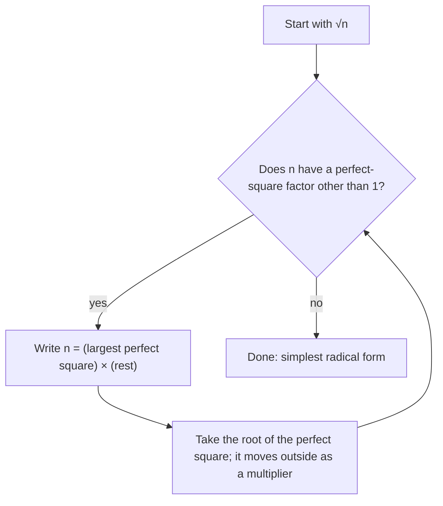

Square roots have already appeared in this course: the square root property and the quadratic formula both end with a $\sqrt{\phantom{x}}$, and Lesson 23 quietly rewrote $\sqrt{20}$ as $2\sqrt5$. This lesson explains what a square root is, why $\sqrt{20}$ and $2\sqrt5$ are the same number, how to add and multiply square roots, and how to tell whether an answer is rational or irrational. It opens Module 7, which moves from squaring toward the other big family of Algebra 1 functions: exponential functions. The next lesson turns $\sqrt x$ into a function and graphs it.

## What a square root is

Squaring and taking a square root undo each other. Both $5^2$ and $(-5)^2$ equal 25, so 25 has two square roots, $5$ and $-5$. The symbol $\sqrt{25}$ means only the nonnegative one, called the **principal square root**:

$$\sqrt{a} = \text{the number } r \ge 0 \text{ with } r^2 = a, \qquad a \ge 0.$$

So $\sqrt{25} = 5$, $-\sqrt{25} = -5$, and when you need both roots you write $\pm\sqrt{25}$. In $\sqrt{a}$, the symbol is the **radical** sign and $a$ is the **radicand**. A negative radicand has no real square root, because no real number squares to a negative.

A number written in front of a radical multiplies it. In $5\sqrt{12}$, the 5 is the coefficient, so the expression means $5 \times \sqrt{12}$:


The numbers $1, 4, 9, 16, 25, 36, 49, 64, 81, 100, 121, 144, \dots$ are the **perfect squares**: squares of whole numbers. Their square roots are whole numbers. Every other positive whole number has a square root that lies between two whole numbers. Since $36 < 40 < 49$, for example, $6 < \sqrt{40} < 7$.

A picture makes this concrete: $\sqrt a$ is the side length of a square whose area is $a$. A square of area 40 is a little bigger than one of area 36 and smaller than one of area 49, so its side is between 6 and 7.


```plot
{"x": [0, 50], "y": [0, 8], "functions": [{"f": "sqrt(x)", "label": "y = √x", "from": 0, "to": 50}], "points": [{"at": [36, 6], "label": "(36, 6)"}, {"at": [49, 7], "label": "(49, 7)"}, {"at": [40, 6.32], "label": "(40, √40 ≈ 6.32)"}], "caption": "√40 sits between √36 = 6 and √49 = 7"}
```

## Rational or irrational?

Lesson 1 split the real numbers into rational numbers (fractions of integers) and irrational numbers (decimals that never end and never repeat). Square roots give the most common irrational numbers. The fact to remember:

> For a whole number $n$, $\sqrt{n}$ is rational exactly when $n$ is a perfect square. Otherwise it is irrational.

So $\sqrt{49} = 7$ is rational, while $\sqrt{2}, \sqrt{3}, \sqrt{40}$ are irrational. A calculator shows $\sqrt2 \approx 1.41421356$, but no decimal, however long, is exactly $\sqrt2$.

Two more facts help classify answers:

- rational + irrational is irrational (for example $3 + \sqrt2$);
- a nonzero rational times an irrational is irrational (for example $5\sqrt3$).

Why the first one: if $3 + \sqrt2$ were some fraction $q$, then $\sqrt2 = q - 3$ would also be a fraction, which it isn't. The second works the same way with division. Be careful with two irrationals, though: they can combine to something rational, as in $\sqrt2 \cdot \sqrt2 = 2$ or $\sqrt3 + (-\sqrt3) = 0$.

## The product rule and simplest form

For $a, b \ge 0$, the **product rule for square roots** says

$$\sqrt{ab} = \sqrt{a}\,\sqrt{b}.$$

It holds because both sides are nonnegative and both square to $ab$: $(\sqrt a\sqrt b)^2 = (\sqrt a)^2(\sqrt b)^2 = ab$. There is a matching quotient rule, $\sqrt{\tfrac ab} = \tfrac{\sqrt a}{\sqrt b}$ for $b > 0$.

The product rule lets you pull perfect squares out from under the radical. A square root is in **simplest radical form** when its radicand has no perfect-square factor other than 1. To simplify $\sqrt n$:

1. Find the largest perfect square that divides $n$.
2. Write $n$ as (that perfect square) × (what's left).
3. Split with the product rule and take the root of the perfect square.

The flowchart shows the same procedure, including what to do if you didn't spot the largest square the first time: just repeat.



### Example 1

Simplify $\sqrt{72}$, $\sqrt{45}$ and $3\sqrt{50}$.

1. $\sqrt{72}$: the perfect squares dividing 72 are 4, 9 and 36; the largest is 36. So $\sqrt{72} = \sqrt{36 \cdot 2} = \sqrt{36}\sqrt2 = 6\sqrt2$.
2. $\sqrt{45} = \sqrt{9 \cdot 5} = 3\sqrt5$. The 5 has no square factor, so this is simplest.
3. $3\sqrt{50} = 3\sqrt{25 \cdot 2} = 3 \cdot 5\sqrt2 = 15\sqrt2$. The 3 in front just multiplies along.

Check the first with a calculator: $\sqrt{72} \approx 8.485$ and $6\sqrt2 \approx 6(1.4142) \approx 8.485$.

If you miss the largest square, you can still finish, just in more steps: $\sqrt{72} = \sqrt{4 \cdot 18} = 2\sqrt{18} = 2\sqrt{9 \cdot 2} = 2 \cdot 3\sqrt2 = 6\sqrt2$. Keep going until no square factor is left.

## Adding and subtracting radicals

Square roots with the same radicand are **like radicals**, and they combine the way like terms do: $4\sqrt3 + 2\sqrt3 = 6\sqrt3$, just as $4x + 2x = 6x$. Radicals with different radicands, such as $\sqrt2$ and $\sqrt3$, don't combine; $\sqrt2 + \sqrt3$ is already as simple as it gets.

There is no rule that splits a sum: $\sqrt{a + b} \ne \sqrt a + \sqrt b$. A quick test: $\sqrt{9 + 16} = \sqrt{25} = 5$, but $\sqrt9 + \sqrt{16} = 3 + 4 = 7$.

Radicals that look unlike sometimes become like after simplifying, so always simplify first.

### Example 2

Simplify $\sqrt{12} + 5\sqrt{3} - \sqrt{75}$.

1. Simplify each term: $\sqrt{12} = \sqrt{4 \cdot 3} = 2\sqrt3$ and $\sqrt{75} = \sqrt{25 \cdot 3} = 5\sqrt3$.
2. Now all three are like radicals: $2\sqrt3 + 5\sqrt3 - 5\sqrt3$.
3. Combine the coefficients: $(2 + 5 - 5)\sqrt3 = 2\sqrt3$.

## Multiplying radicals

To multiply, multiply the numbers outside the roots together and the radicands together (the product rule run backward), then simplify:

$$(m\sqrt a)(n\sqrt b) = mn\sqrt{ab}.$$

### Example 3

Simplify $\sqrt6 \cdot \sqrt{15}$, $(2\sqrt5)(3\sqrt{10})$ and $\sqrt3(4 + \sqrt3)$.

1. $\sqrt6 \cdot \sqrt{15} = \sqrt{90} = \sqrt{9 \cdot 10} = 3\sqrt{10}$.
2. $(2\sqrt5)(3\sqrt{10}) = 6\sqrt{50} = 6 \cdot 5\sqrt2 = 30\sqrt2$.
3. Distribute: $\sqrt3 \cdot 4 + \sqrt3 \cdot \sqrt3 = 4\sqrt3 + 3$, since $\sqrt3 \cdot \sqrt3 = 3$.

The last line uses a fact worth memorizing: $\sqrt a \cdot \sqrt a = a$ for $a \ge 0$. The result $3 + 4\sqrt3$ is irrational (rational plus irrational), while in part 1 a product of two irrationals stayed irrational, and $\sqrt8 \cdot \sqrt2 = \sqrt{16} = 4$ would come out rational.

## Square roots in equations and formulas

Square roots show up whenever you undo a square. The classic case is the Pythagorean theorem from geometry: in a right triangle with legs $a$ and $b$ and hypotenuse (the side opposite the right angle) $c$, $a^2 + b^2 = c^2$.

### Example 4

A 12-foot ladder leans against a wall with its base 4 feet from the wall. How high up the wall does it reach? Give the exact answer in simplest form and a decimal.

```shape
{"equal": true, "polygons": [{"points": [[0, 0], [4, 0], [0, 11.31]]}], "rightAngles": [[[0, 0], [4, 0], [0, 11.31]]], "segments": [{"from": [0, 0], "to": [4, 0], "label": "4 ft"}, {"from": [0, 0], "to": [0, 11.31], "label": "h"}], "labels": [{"at": [4.2, 6.2], "text": "ladder 12 ft"}], "caption": "The wall, the ground and the ladder form a right triangle with hypotenuse 12"}
```

1. With height $h$: $h^2 + 4^2 = 12^2$, so $h^2 = 144 - 16 = 128$.
2. Height is positive, so $h = \sqrt{128}$.
3. Simplify: $128 = 64 \cdot 2$, so $h = 8\sqrt2 \approx 11.31$ feet.

The exact answer $8\sqrt2$ is irrational; the decimal is a rounded approximation, which is what you'd use to mark the wall.

## Common mistakes

- Writing $\sqrt{25} = \pm 5$. The symbol means the nonnegative root; use $\pm$ only when solving $x^2 = 25$.
- Splitting a sum: $\sqrt{x + 9}$ is not $\sqrt x + 3$.
- Adding unlike radicals: $\sqrt2 + \sqrt3 \ne \sqrt5$.
- Stopping too soon: $2\sqrt{18}$ still has a perfect-square factor (9) under the root.
- Multiplying the outside number by the radicand: $3\sqrt2$ is $3 \times \sqrt2$, not $\sqrt6$.
- Assuming any root is irrational: $\sqrt{0.25} = 0.5$ and $\sqrt{\tfrac{4}{9}} = \tfrac23$ are rational.

## Key points

- $\sqrt a$ is the nonnegative number whose square is $a$; negative radicands have no real square root.
- $\sqrt n$ (whole $n$) is rational only when $n$ is a perfect square.
- Product rule: $\sqrt{ab} = \sqrt a\sqrt b$. Simplify by pulling out the largest perfect-square factor.
- Only like radicals add: $m\sqrt a + n\sqrt a = (m + n)\sqrt a$.
- Multiply outside numbers together and radicands together, then simplify; $\sqrt a \cdot \sqrt a = a$.
