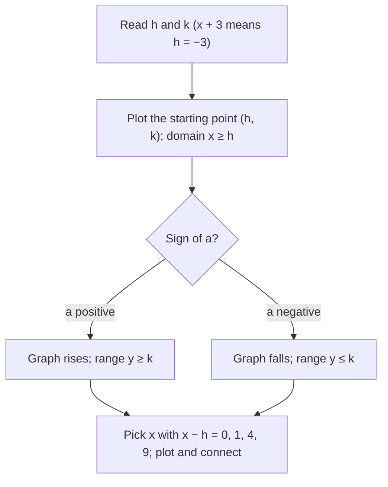

The previous lesson treated square roots as numbers to simplify. This lesson treats them as a function: feed in $x$, get out $\sqrt x$. You'll graph $y = \sqrt x$ and its partner $y = \sqrt[3]{x}$, see why their domains differ, and use the shifts and stretches from Lesson 25 to graph equations like $y = 2\sqrt{x + 3} - 1$ without plotting dozens of points.

## The square root function

The **square root function** is $f(x) = \sqrt x$. Its domain is $[0, \infty)$, because a negative number has no real square root, and its range is $[0, \infty)$, because the principal root is never negative. Inputs that are perfect squares give whole-number outputs, so they are the easiest points to plot:

| $x$ | 0 | 1 | 4 | 9 | 16 |
|---|---|---|---|---|---|
| $\sqrt x$ | 0 | 1 | 2 | 3 | 4 |

The graph starts at the origin and rises forever, but more and more slowly. To raise the output from 1 to 2 the input must go from 1 to 4, a step of 3; to raise it from 3 to 4 the input must go from 9 to 16, a step of 7. In terms of rates, the average rate of change is $\tfrac{2 - 0}{4 - 0} = 0.5$ on $[0, 4]$ but only $\tfrac{4 - 2}{16 - 4} = \tfrac16$ on $[4, 16]$.

There is another way to see the shape. Swapping the columns of the table gives points of $y = x^2$, so the graph of $y = \sqrt x$ is the right half of the parabola $y = x^2$ reflected across the line $y = x$: the top half of the sideways parabola from Lesson 8.

## Cube roots and the cube root function

The **cube root** of a number $a$, written $\sqrt[3]{a}$, is the number whose cube is $a$. Since $2^3 = 8$, $\sqrt[3]{8} = 2$. Unlike square roots, cube roots of negative numbers are real: $(-2)^3 = -8$, so $\sqrt[3]{-8} = -2$. Every real number has exactly one real cube root, with the same sign as the number. The perfect cubes $1, 8, 27, 64, 125$ have whole-number cube roots.

The **cube root function** is $g(x) = \sqrt[3]{x}$. Because any real number can go in and any real number can come out, its domain and range are both $(-\infty, \infty)$. Its graph passes through $(-8, -2)$, $(-1, -1)$, $(0, 0)$, $(1, 1)$ and $(8, 2)$. It is symmetric about the origin (since $\sqrt[3]{-x} = -\sqrt[3]{x}$), it always increases, and it is steepest at the origin, where it briefly stands nearly vertical.

```plot
{"x": [-9, 11], "y": [-3, 4], "functions": [{"f": "sqrt(x)", "label": "y = √x", "from": 0, "to": 11}, {"f": "cbrt(x)", "label": "y = ∛x", "dashed": true}], "points": [{"at": [0, 0], "label": "(0, 0)"}, {"at": [4, 2], "label": "(4, 2)"}, {"at": [9, 3], "label": "(9, 3)"}, {"at": [8, 2]}, {"at": [-8, -2], "label": "(-8, -2)"}, {"at": [1, 1], "label": "(1, 1)"}, {"at": [-1, -1], "label": "(-1, -1)"}], "caption": "√x starts at the origin; ∛x runs through it in both directions"}
```

| | $y = \sqrt x$ | $y = \sqrt[3]{x}$ |
|---|---|---|
| Domain | $[0, \infty)$ | $(-\infty, \infty)$ |
| Range | $[0, \infty)$ | $(-\infty, \infty)$ |
| Key point | starting point $(0, 0)$ | center $(0, 0)$ |
| Easy inputs | perfect squares | perfect cubes and their negatives |

## Transformations

Lesson 25 showed that $y = a\,f(x - h) + k$ moves the graph of $y = f(x)$ right $h$ and up $k$, after stretching it vertically by $|a|$ and flipping it when $a < 0$. Applied to the two root functions:

$$y = a\sqrt{x - h} + k \qquad\qquad y = a\sqrt[3]{x - h} + k$$

- For the square root, the starting point moves from $(0, 0)$ to $(h, k)$. The domain is $x \ge h$. The range is $y \ge k$ if $a > 0$ and $y \le k$ if $a < 0$ (the graph heads downward).
- For the cube root, the center moves from $(0, 0)$ to $(h, k)$; the domain and range stay all real numbers.
- As always, $x + 3$ means $x - (-3)$: a shift *left* 3.

To plot points quickly, choose inputs that make $x - h$ a perfect square (or a perfect cube), so the root comes out whole.

Here is the whole procedure for a square root graph as a flowchart:



### Example 1

Graph $g(x) = 2\sqrt{x + 3} - 1$ and state its domain and range.

1. Here $a = 2$, $h = -3$, $k = -1$. The starting point is $(-3, -1)$.
2. Choose $x$ so that $x + 3 = 0, 1, 4, 9$: that is, $x = -3, -2, 1, 6$.
3. Compute: $\sqrt{x + 3} = 0, 1, 2, 3$, so $g(x) = 2(0) - 1 = -1$, then $1$, $3$, $5$. Points: $(-3, -1)$, $(-2, 1)$, $(1, 3)$, $(6, 5)$.
4. Domain: $x + 3 \ge 0$, so $[-3, \infty)$. Range: $a > 0$, so the graph rises from height $-1$: $[-1, \infty)$.

### Example 2

Graph $h(x) = -\sqrt[3]{x - 2} + 4$.

1. $a = -1$, $h = 2$, $k = 4$: the center is $(2, 4)$, and the negative $a$ flips the graph, so it decreases.
2. Choose $x$ so that $x - 2 = -8, -1, 0, 1, 8$: $x = -6, 1, 2, 3, 10$.
3. The cube roots are $-2, -1, 0, 1, 2$; negate and add 4: $h(x) = 6, 5, 4, 3, 2$.
4. Points: $(-6, 6)$, $(1, 5)$, $(2, 4)$, $(3, 3)$, $(10, 2)$. Domain and range are all real numbers.

```plot
{"x": [-8, 12], "y": [-3, 8], "functions": [{"f": "2*sqrt(x + 3) - 1", "label": "y = 2√(x + 3) - 1", "from": -3, "to": 12}, {"f": "-cbrt(x - 2) + 4", "label": "y = -∛(x - 2) + 4", "dashed": true}], "points": [{"at": [-3, -1], "label": "(-3, -1)"}, {"at": [1, 3], "label": "(1, 3)"}, {"at": [6, 5], "label": "(6, 5)"}, {"at": [2, 4], "label": "center (2, 4)"}, {"at": [-6, 6], "label": "(-6, 6)"}, {"at": [10, 2]}], "caption": "Example 1 (solid) starts at (-3, -1); Example 2 (dashed) is centered at (2, 4)"}
```

A number multiplying $x$ inside the root changes the domain too. For $y = \sqrt{2x - 6}$, the radicand must be nonnegative: $2x - 6 \ge 0$, so $x \ge 3$, and the graph starts at $(3, 0)$. For $y = \sqrt{-x}$, the domain is $x \le 0$: the graph of $\sqrt x$ reflected across the $y$-axis.

The picture puts the two reflections of $\sqrt x$ next to the original and the cube root. A minus sign outside the root, $-\sqrt x$, flips the graph across the $x$-axis; a minus sign inside, $\sqrt{-x}$, flips it across the $y$-axis. The cube root needs neither: it already covers both sides.


### Example 3

A square root graph starts at $(1, 2)$ and passes through $(5, 6)$. Find its equation.

1. Starting point $(h, k) = (1, 2)$: $y = a\sqrt{x - 1} + 2$.
2. Substitute $(5, 6)$: $6 = a\sqrt{4} + 2 = 2a + 2$, so $a = 2$.
3. $y = 2\sqrt{x - 1} + 2$. Check another point: $x = 10$ gives $2(3) + 2 = 8$, which should also lie on the graph.

## A square root model

Square roots appear whenever a formula has to undo a square. An object dropped from rest falls about $16t^2$ feet in $t$ seconds, so the time to fall $d$ feet satisfies $16t^2 = d$. Taking the positive root, $t = \sqrt{d/16} = \tfrac{\sqrt d}{4}$.

### Example 4

How long does an object take to fall 64 feet? 256 feet?

1. $t = \tfrac{\sqrt{64}}{4} = \tfrac{8}{4} = 2$ seconds.
2. $t = \tfrac{\sqrt{256}}{4} = \tfrac{16}{4} = 4$ seconds.
3. Four times the height only doubles the time. That is the slowing growth of $\sqrt d$: multiplying the input by 4 multiplies the output by $\sqrt4 = 2$.

## Common mistakes

- Shifting the wrong way: $\sqrt{x + 3}$ starts at $x = -3$, not $x = 3$.
- Giving $\sqrt{x - h} + k$ the domain $x \ge k$; the domain comes from the inside, $x \ge h$.
- Saying a cube root function has domain $x \ge 0$, or that $\sqrt[3]{-8}$ is undefined. Cube roots of negatives are negative.
- Forgetting that $a < 0$ turns a square root graph downward, so its range is $y \le k$.
- Plotting with awkward inputs. Pick $x$ so that $x - h$ is a perfect square or cube.

## Key points

- $\sqrt x$: domain and range $[0, \infty)$; it rises ever more slowly from $(0, 0)$.
- $\sqrt[3]{x}$: domain and range all reals; symmetric about the origin, through $(\pm 8, \pm 2)$ and $(\pm 1, \pm 1)$.
- $y = a\sqrt{x - h} + k$ starts at $(h, k)$, with domain $x \ge h$; the range is $y \ge k$ when $a > 0$ and $y \le k$ when $a < 0$.
- $y = a\sqrt[3]{x - h} + k$ is centered at $(h, k)$; domain and range stay all reals.
- To find $a$ from a graph, write the form with $(h, k)$ and substitute one more point.
