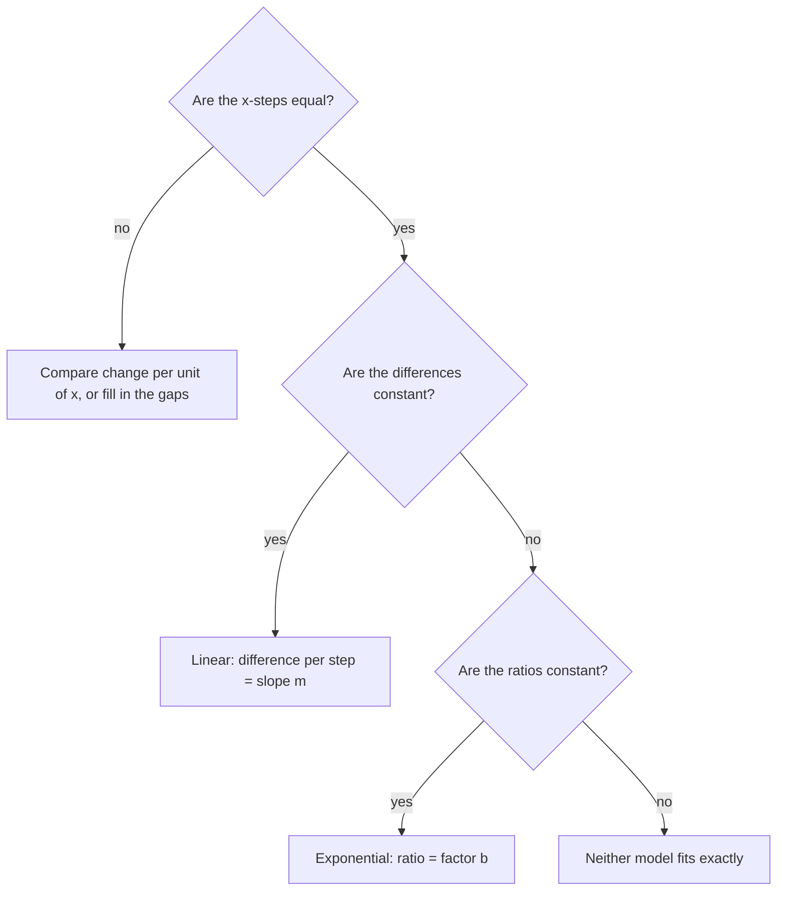

You now know two families of functions that model change over time: linear functions (Module 3) and exponential functions (the previous lesson). Real problems rarely tell you which one to use. This lesson shows how to decide from a table, a graph or a verbal description, and explains a fact with big practical consequences: a growing exponential always overtakes a growing linear function eventually, no matter how far ahead the linear one starts.

## Add or multiply?

The whole difference fits in one sentence each:

- A **linear model** changes by a **constant difference**: over equal steps in $x$, the same amount is *added* (the slope $m$).
- An **exponential model** changes by a **constant ratio**: over equal steps in $x$, the output is *multiplied* by the same factor (the base $b$).

Why: for $L(x) = mx + c$, $L(x + 1) - L(x) = m(x + 1) + c - (mx + c) = m$, the same at every $x$. For $E(x) = a \cdot b^x$, $\dfrac{E(x + 1)}{E(x)} = \dfrac{a b^{x+1}}{a b^x} = b$, also the same at every $x$.

So to classify a table with equally spaced inputs, compute successive differences and successive ratios. Whichever is constant tells you the model. If neither is, the data are neither linear nor exponential.



### Example 1

Classify each table, and write the function when there is one.

| $x$ | 0 | 1 | 2 | 3 |
|---|---|---|---|---|
| A | 4 | 7 | 10 | 13 |
| B | 4 | 6 | 9 | 13.5 |
| C | 2 | 3 | 5 | 8 |

1. A: differences $3, 3, 3$, constant. Linear with slope 3 and starting value 4: $y = 3x + 4$.
2. B: differences $2, 3, 4.5$, not constant. Ratios $\tfrac64 = 1.5$, $\tfrac96 = 1.5$, $\tfrac{13.5}{9} = 1.5$, constant. Exponential: $y = 4(1.5)^x$.
3. C: differences $1, 2, 3$; ratios $1.5, 1.67, 1.6$. Neither is constant, so neither model fits exactly.

The inputs must be equally spaced for this test. If a table jumps from $x = 1$ to $x = 4$, compare the change per unit of $x$, or fill in the gap first.

## Reading the words

Verbal descriptions usually give the model away:

| Description | Model | Why |
|---|---|---|
| "increases by \$50 per month" | linear | adds 50 each step |
| "decreases by 12 students per year" | linear | subtracts 12 each step |
| "grows 3% per month" | exponential | multiplies by 1.03 |
| "loses half its mass every 5 days" | exponential | multiplies by 0.5 per 5 days |
| "triples every week" | exponential | multiplies by 3 |

The test is whether the change is a fixed *amount* (linear) or a fixed *percent or fraction of the current value* (exponential).

### Example 2

A gym has 200 members. Plan 1 predicts it will gain 20 members per month. Plan 2 predicts 8% growth per month. Write both models and compare them after 1 year.

1. Plan 1 adds 20 each month: $L(t) = 200 + 20t$. After 12 months, $L(12) = 440$.
2. Plan 2 multiplies by 1.08 each month: $E(t) = 200(1.08)^t$. After 12 months, $E(12) = 200(1.08)^{12} \approx 200(2.5182) \approx 504$.
3. In the first month the predictions are close ($220$ vs $216$), so the linear plan is actually ahead at first. By month 12 the exponential plan is ahead by about 64 members, and the gap keeps widening.

## Same start, different futures

Take the two models through the points $(0, 100)$ and $(1, 120)$: the linear one $L(x) = 100 + 20x$ and the exponential one $E(x) = 100(1.2)^x$.

| $x$ | 0 | 1 | 2 | 4 | 6 | 8 | 10 |
|---|---|---|---|---|---|---|---|
| $L(x)$ | 100 | 120 | 140 | 180 | 220 | 260 | 300 |
| $E(x)$ | 100 | 120 | 144 | 207.4 | 298.6 | 430.0 | 619.2 |

```plot
{"x": [0, 10], "y": [0, 650], "functions": [{"f": "100 + 20*x", "label": "L(x) = 100 + 20x"}, {"f": "100*1.2^x", "label": "E(x) = 100(1.2)^x", "dashed": true}], "points": [{"at": [0, 100], "label": "(0, 100)"}, {"at": [1, 120], "label": "(1, 120)"}], "caption": "Same first two points; the exponential curve bends upward and pulls away"}
```

The linear function's average rate of change is 20 per step on every interval. The exponential one's rate of change keeps growing: from $x = 0$ to 1 it gains 20, but from $x = 9$ to 10 it gains about 103. Each step adds 20% of a bigger number.

## Exponential growth eventually wins

> An increasing exponential function eventually exceeds any increasing linear function, and in fact any polynomial function, however large its head start.

The reason is the difference between adding and multiplying. A linear function adds the same amount forever. An exponential function with $b > 1$ adds a fixed percent of its current value, and once that value is large, the percent is a bigger number than any fixed amount.

### Example 3

Job offer A pays a bonus of $L(x) = 1000 + 500x$ dollars in year $x$. Offer B pays $E(x) = 10 \cdot 2^x$ dollars. In what year does B first pay more?

1. B starts far behind: in year 0, A pays 1,000 and B pays 10.
2. Make a table:

| $x$ | 6 | 7 | 8 | 9 | 10 |
|---|---|---|---|---|---|
| $L(x)$ | 4,000 | 4,500 | 5,000 | 5,500 | 6,000 |
| $E(x)$ | 640 | 1,280 | 2,560 | 5,120 | 10,240 |

3. In year 9 A still leads (5,500 vs 5,120), but in year 10 B pays 10,240, far more. B first pays more in year 10, and from then on it leads by more every year.

The graph shows the race. The line starts far ahead, but the exponential curve, tiny at first, bends upward and crosses it between years 9 and 10.

```plot
{"x": [0, 11], "y": [0, 12], "functions": [{"f": "1 + 0.5*x"}, {"f": "0.01*2^x", "dashed": true}], "points": [{"at": [9, 5.5], "color": "var(--fig-0)"}, {"at": [9, 5.12], "color": "var(--fig-1)"}, {"at": [10, 6], "color": "var(--fig-0)"}, {"at": [10, 10.24], "color": "var(--fig-1)"}], "labels": [{"at": [3, 4.7], "text": "A: L(x) = 1000 + 500x"}, {"at": [6.6, 9.3], "text": "B: E(x) = 10 · 2^x (dashed)"}], "xLabel": "year x", "yLabel": "bonus (thousands of dollars)", "caption": "Offer B starts at 10 dollars but passes offer A in year 10 (dots: years 9 and 10)"}
```

The same thing happens against a quadratic. Compare $x^2$ and $2^x$: they're equal at $x = 2$ and $x = 4$, $x^2$ is larger between them, and for every $x > 4$, $2^x$ is larger and races ahead ($2^{10} = 1024$ vs $10^2 = 100$).

## Decreasing models

Decreasing models differ in a similar way. A decreasing linear function falls by the same amount each step, so it reaches zero and then goes negative. Exponential decay removes a percent of what's left, so it slows down and approaches zero without reaching it. That matters for modeling: a linear model of a cooling cup of coffee predicts it eventually gets colder than the room, which can't happen.

### Example 4

A phone's resale value is recorded each year: \$600, \$480, \$384, \$307.20. Which model fits, and what does it predict for year 5 (the first value is year 0)?

1. Differences: $-120, -96, -76.80$; not constant.
2. Ratios: $\tfrac{480}{600} = 0.8$, $\tfrac{384}{480} = 0.8$, $\tfrac{307.2}{384} = 0.8$; constant.
3. Exponential decay of 20% per year: $V(t) = 600(0.8)^t$.
4. $V(5) = 600(0.8)^5 = 600(0.32768) \approx 196.61$ dollars. A linear model with slope $-120$ would have predicted 0 dollars in year 5.

## Common mistakes

- Checking only differences. Data that "go up a bit more each time" may be exponential; check ratios too.
- Comparing tables with unequal input steps as if they were equal.
- Reading "increases by 5%" as linear, or "increases by 5 units" as exponential.
- Concluding that the linear model wins because it's ahead early. Look far enough out.
- Using a linear model for a percent decline and predicting negative values.

## Key points

- Linear: equal steps in $x$ give equal differences in $y$ (add $m$).
- Exponential: equal steps in $x$ give equal ratios of $y$ (multiply by $b$).
- Fixed amount per step means linear; fixed percent per step means exponential.
- A growing exponential eventually overtakes any growing linear or quadratic function.
- Linear decrease reaches zero; exponential decay only approaches it.
