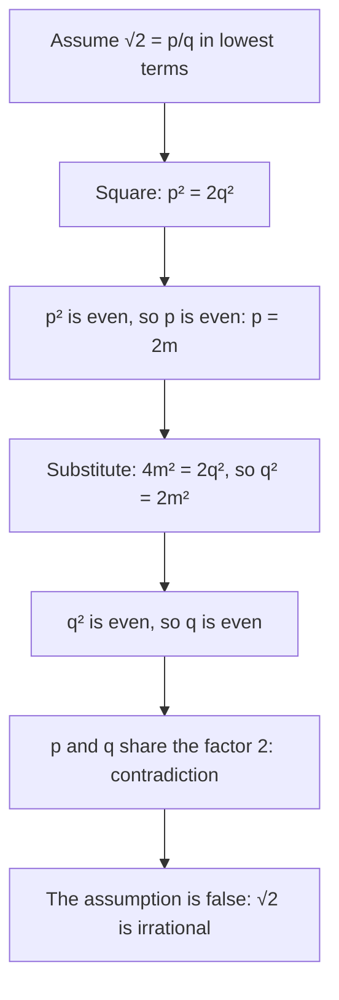

Lesson 28 stated a fact without proving it: the square root of a whole number is irrational unless the number is a perfect square. A calculator can't settle that question. It shows $\sqrt2 \approx 1.41421356$, but a fraction could in principle agree with $\sqrt2$ to a million decimal places and still not be it. This honors lesson gives the classic proof that $\sqrt2$ is irrational, shows why the same argument fails for $\sqrt4$ (as it must), and then turns to a skill that uses irrational roots constantly: **rationalizing the denominator**, rewriting a fraction so that no square root remains below the fraction bar.

## A fact about even numbers

The proof needs one small fact first.

> If $n^2$ is even, then $n$ is even.

Look at it from the other side. Every whole number is even or odd. An odd number has the form $n = 2k + 1$, and its square is
$$n^2 = 4k^2 + 4k + 1 = 2(2k^2 + 2k) + 1,$$
which is one more than an even number, so it is odd. Odd numbers have odd squares. So if $n^2$ is even, $n$ cannot be odd: it must be even. (Proving a statement by proving that its opposite conclusion leads to the opposite hypothesis is called proving the *contrapositive*.)

## Why √2 is irrational

The proof is a **proof by contradiction**, the method you first used in the Module 1 honors lesson "Inside the real numbers" to show there is no smallest positive fraction. As a reminder: assume the opposite of what you want to prove, reason correctly from that assumption, and arrive at something impossible. Since correct reasoning from a true statement can't produce an impossibility, the assumption must have been false.

Suppose $\sqrt2$ were rational. Then $\sqrt2 = \dfrac{p}{q}$ for whole numbers $p$ and $q$, and we may take the fraction in lowest terms, so $p$ and $q$ have no common factor other than 1.

1. Square both sides: $2 = \dfrac{p^2}{q^2}$, so $p^2 = 2q^2$.
2. $p^2$ is 2 times a whole number, so it is even. By the fact above, $p$ is even: $p = 2m$ for some whole number $m$.
3. Substitute: $(2m)^2 = 2q^2$, so $4m^2 = 2q^2$ and $q^2 = 2m^2$.
4. Now $q^2$ is even, so $q$ is even too.
5. Both $p$ and $q$ are even, so they share the factor 2. That contradicts "lowest terms."

Every step followed from the one before, so the only thing that can be wrong is the starting assumption. Therefore $\sqrt2$ is not a fraction of whole numbers: it is irrational.

Some history, with the usual caution. The discovery that the diagonal of a square can't be measured as a whole-number ratio of its side is usually credited to the Pythagoreans in ancient Greece, around the 5th century BCE, and an argument based on odd and even numbers is mentioned by Aristotle. The often-repeated story that a Pythagorean named Hippasus was drowned for revealing the secret is a legend, not history.

Geometry shows where $\sqrt2$ lives. A right triangle with legs 1 and 1 has hypotenuse $\sqrt{1^2 + 1^2} = \sqrt2$. Add a new leg of length 1 at right angles to that hypotenuse and the next hypotenuse is $\sqrt{2 + 1} = \sqrt3$; keep going and you get every $\sqrt n$. The picture is called the spiral of Theodorus, after Theodorus of Cyrene, who, according to Plato's dialogue *Theaetetus*, showed that the square roots of 3, 5 and the other non-square numbers up to 17 are irrational.

### Example 1

Prove that $\sqrt3$ is irrational.

The same plan works, but "even" becomes "divisible by 3," so we need: if $n^2$ is divisible by 3, then $n$ is divisible by 3.

1. A whole number not divisible by 3 has the form $3k + 1$ or $3k + 2$. Their squares are $9k^2 + 6k + 1 = 3(3k^2 + 2k) + 1$ and $9k^2 + 12k + 4 = 3(3k^2 + 4k + 1) + 1$. Both leave remainder 1 when divided by 3. So if $n^2$ is divisible by 3, $n$ must be.
2. Suppose $\sqrt3 = \dfrac pq$ in lowest terms. Then $p^2 = 3q^2$, so $p^2$ is divisible by 3, and so is $p$: $p = 3m$.
3. Substitute: $9m^2 = 3q^2$, so $q^2 = 3m^2$. Then $q^2$, and so $q$, is divisible by 3.
4. Now $p$ and $q$ share the factor 3, contradicting lowest terms. So $\sqrt3$ is irrational.

### Example 2

The same argument "proves" that $\sqrt4$ is irrational, which is false since $\sqrt4 = 2$. Find where it breaks.

1. Suppose $\sqrt4 = \dfrac pq$ in lowest terms, so $p^2 = 4q^2$. Then $p^2$ is even, so $p$ is even: $p = 2m$.
2. Substitute: $4m^2 = 4q^2$, so $q^2 = m^2$ and $q = m$.
3. Nothing forces $q$ to be even. With $q = 1$ and $p = 2$, every step is satisfied, and there is no contradiction.

The step that made the $\sqrt2$ proof work was $q^2 = 2m^2$: the leftover factor 2 on one side is what pushed $q$ to be even. With 4, that factor is a perfect square and cancels completely. A good proof uses exactly the property that separates true cases from false ones.

## The general rule, in outline

The full statement, that $\sqrt n$ is irrational whenever the whole number $n$ is not a perfect square, uses the fact that every whole number greater than 1 factors into primes in exactly one way (the Fundamental Theorem of Arithmetic). Here is the idea. In a perfect square such as $p^2$, every prime appears an even number of times, because each prime in $p$ appears twice. If $\sqrt n = \tfrac pq$, then $n q^2 = p^2$. Every prime appears an even number of times in $q^2$ and in $p^2$, so it must appear an even number of times in $n$ as well, and that makes $n$ a perfect square. This is a sketch: a complete proof writes out the prime-counting carefully, which a later course does.

## Rationalizing a denominator

Before calculators, dividing by $\sqrt2 \approx 1.41421$ by hand meant long division by a long decimal. Multiplying by it was far easier: $\tfrac{1}{\sqrt2} = \tfrac{\sqrt2}{2} \approx \tfrac{1.41421}{2} = 0.707105$. That convenience is the origin of a convention many teachers and tests still use: a simplified answer has no radical in the denominator. Both forms are correct and equal; the rationalized one is simply the expected final form, and it makes answers easy to compare.

The trick is to multiply by a form of 1. If the denominator is $\sqrt b$, multiply the top and bottom by $\sqrt b$, using $\sqrt b \cdot \sqrt b = b$:
$$\frac{a}{\sqrt b} = \frac{a}{\sqrt b} \cdot \frac{\sqrt b}{\sqrt b} = \frac{a\sqrt b}{b}.$$

### Example 3

Rationalize: (a) $\dfrac{6}{\sqrt3}$, (b) $\dfrac{5}{\sqrt8}$, (c) $\sqrt{\dfrac{5}{12}}$.

1. (a) $\dfrac{6}{\sqrt3} \cdot \dfrac{\sqrt3}{\sqrt3} = \dfrac{6\sqrt3}{3} = 2\sqrt3$. Reduce the whole numbers last.
2. (b) Simplify first: $\sqrt8 = 2\sqrt2$. Then $\dfrac{5}{2\sqrt2} \cdot \dfrac{\sqrt2}{\sqrt2} = \dfrac{5\sqrt2}{2 \cdot 2} = \dfrac{5\sqrt2}{4}$. (Multiplying by $\sqrt8$ also works, giving $\tfrac{5\sqrt8}{8} = \tfrac{10\sqrt2}{8}$, which reduces to the same answer.)
3. (c) Split with the quotient rule: $\dfrac{\sqrt5}{\sqrt{12}} = \dfrac{\sqrt5}{2\sqrt3} \cdot \dfrac{\sqrt3}{\sqrt3} = \dfrac{\sqrt{15}}{6}$.
4. Check (c) with a calculator: $\sqrt{5/12} \approx 0.6455$ and $\sqrt{15}/6 \approx 3.8730/6 \approx 0.6455$.

## Conjugates

Multiplying by $\sqrt b$ doesn't clear a denominator like $3 - \sqrt5$: $(3 - \sqrt5)\sqrt5 = 3\sqrt5 - 5$ still has a root. The tool here is the difference of squares from Lesson 19, $(x - y)(x + y) = x^2 - y^2$. The expressions $a + \sqrt b$ and $a - \sqrt b$ are **conjugates**, and their product has no root:
$$(a + \sqrt b)(a - \sqrt b) = a^2 - (\sqrt b)^2 = a^2 - b.$$
The middle terms $+a\sqrt b$ and $-a\sqrt b$ cancel, which is the whole point. To rationalize a denominator with two terms, multiply the top and bottom by the conjugate of the denominator.

### Example 4

Rationalize $\dfrac{4}{3 - \sqrt5}$.

1. The conjugate of $3 - \sqrt5$ is $3 + \sqrt5$.
2. Denominator: $(3 - \sqrt5)(3 + \sqrt5) = 9 - 5 = 4$.
3. Numerator: $4(3 + \sqrt5)$.
4. $\dfrac{4(3 + \sqrt5)}{4} = 3 + \sqrt5$.
5. Check: $\tfrac{4}{3 - 2.2361} = \tfrac{4}{0.7639} \approx 5.236$, and $3 + \sqrt5 \approx 5.236$. ✓

### Example 5

Simplify $\dfrac{\sqrt6 + \sqrt2}{\sqrt6 - \sqrt2}$.

1. Multiply top and bottom by the conjugate $\sqrt6 + \sqrt2$.
2. Denominator: $(\sqrt6)^2 - (\sqrt2)^2 = 6 - 2 = 4$.
3. Numerator: $(\sqrt6 + \sqrt2)^2 = 6 + 2\sqrt{12} + 2 = 8 + 2 \cdot 2\sqrt3 = 8 + 4\sqrt3$.
4. Divide each term by 4: $\dfrac{8 + 4\sqrt3}{4} = 2 + \sqrt3 \approx 3.732$.

Rationalizing also settles questions of rational versus irrational. Is $\tfrac{1}{\sqrt2 - 1}$ rational? Multiplying by the conjugate gives $\tfrac{\sqrt2 + 1}{2 - 1} = \sqrt2 + 1$, a rational number plus an irrational one, so it is irrational.

## Common mistakes

- Starting a contradiction proof without "lowest terms." The contradiction is that $p$ and $q$ share a factor, which only contradicts something if you assumed they didn't.
- Thinking "every $\sqrt n$ looks irrational on a calculator" is a proof. A decimal display can never prove irrationality.
- Multiplying only the denominator by $\sqrt b$. You must multiply the top too, or the value changes.
- Using $\sqrt b$ instead of the conjugate for a two-term denominator: $(3 - \sqrt5)\sqrt5$ still contains a root.
- Forgetting to reduce: $\tfrac{6\sqrt3}{3}$ is $2\sqrt3$. But reduce only whole factors of every term: $\tfrac{8 + 4\sqrt3}{4} = 2 + \sqrt3$, not $8 + \sqrt3$.
- Squaring a sum term by term: $(\sqrt6 + \sqrt2)^2$ is $8 + 4\sqrt3$, not $6 + 2$.

## Key points

- If $n^2$ is even, $n$ is even; if $n^2$ is divisible by 3, so is $n$.
- Proof by contradiction: assume the opposite, reason correctly, reach an impossibility. Assuming $\sqrt2 = \tfrac pq$ in lowest terms forces both $p$ and $q$ to be even.
- The argument fails for perfect squares like 4, exactly as it should; in general $\sqrt n$ is irrational unless $n$ is a perfect square.
- To rationalize $\tfrac{a}{\sqrt b}$, multiply top and bottom by $\sqrt b$: $\tfrac{a\sqrt b}{b}$.
- For $a \pm \sqrt b$ in the denominator, multiply top and bottom by the conjugate: $(a + \sqrt b)(a - \sqrt b) = a^2 - b$.
