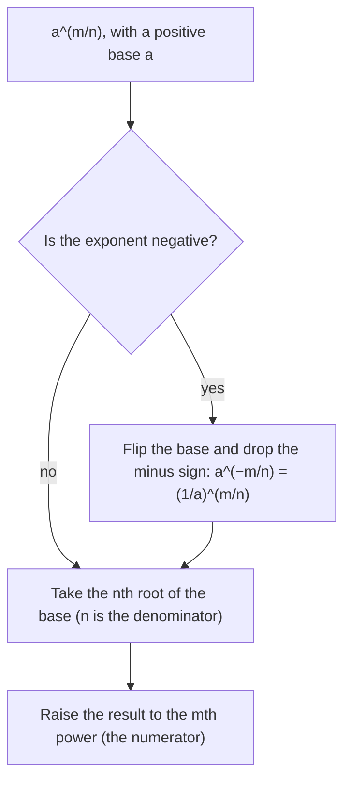

This module has used two ideas side by side: roots (Lessons 28 and 29) and exponential functions (Lesson 30). Lesson 30 even mixed them, rewriting growth of 21% per year (factor $1.21$) as 10% per half-year (factor $1.1 = \sqrt{1.21}$). This honors lesson makes that precise. It defines $n$th roots in general, then gives a meaning to exponents like $\tfrac12$, $\tfrac23$ and $-\tfrac34$ by the same method Lesson 18 used for zero and negative exponents: choose the only definition that keeps the exponent rules working. The payoff is a set of tools for exponential models at any time, not just whole-number times: monthly rates from yearly ones, half-lives, and a famous law of planetary motion.

## nth roots

For a whole number $n \ge 2$, an **nth root** of $a$ is a number whose $n$th power is $a$. It is written $\sqrt[n]{a}$, and $n$ is the **index** of the radical. A square root has index 2, which is usually left unwritten.

- **Even index** ($n = 2, 4, 6, \dots$): every even power is nonnegative, so a negative number has no real even root. A positive number has two real even roots, such as $3$ and $-3$, the two fourth roots of 81, and the symbol means the nonnegative one: $\sqrt[4]{81} = 3$.
- **Odd index** ($n = 3, 5, \dots$): every real number has exactly one real odd root, with the same sign: $\sqrt[5]{-32} = -2$ because $(-2)^5 = -32$.

So $\sqrt[4]{16} = 2$, $\sqrt[3]{-125} = -5$, $\sqrt[5]{1} = 1$, and $\sqrt[4]{-16}$ is not a real number.

## What should a^(1/n) mean?

Lesson 18 gave the **power rule** $(a^m)^n = a^{mn}$ for whole-number exponents. Suppose we want it to keep working when an exponent is a fraction. Then
$$\left(a^{1/2}\right)^2 = a^{\frac12 \cdot 2} = a^1 = a.$$
So $a^{1/2}$ must be a number whose square is $a$: a square root of $a$. Likewise $\left(a^{1/3}\right)^3 = a$ forces $a^{1/3}$ to be a cube root. Choosing the principal root gives the definition
$$a^{1/n} = \sqrt[n]{a}.$$
Nobody "discovered" that $a^{1/2}$ is a square root; it is the only choice that keeps the old rules true, exactly as $a^0 = 1$ and $a^{-n} = \tfrac{1}{a^n}$ were.

Now any fraction $\tfrac mn$ follows from the power rule, because $\tfrac mn = \tfrac1n \cdot m$:
$$a^{m/n} = \left(\sqrt[n]{a}\right)^m = \sqrt[n]{a^m}.$$
Exponents written as fractions are called **rational exponents**. The denominator is the root and the numerator is the power. The two forms give the same value, but taking the root first keeps the numbers small: $8^{2/3} = (\sqrt[3]8)^2 = 2^2 = 4$, while $\sqrt[3]{8^2} = \sqrt[3]{64}$ is also 4 but needs a bigger cube root.



**A warning about negative bases.** In this lesson every base with a fractional exponent is positive. With a negative base the rules can contradict each other: $(-8)^{1/3} = \sqrt[3]{-8} = -2$, but rewriting the exponent as $\tfrac26$ and taking the root last gives $\sqrt[6]{(-8)^2} = \sqrt[6]{64} = 2$. Textbooks and calculators handle negative bases in different ways, so the safe habit is to keep fractional exponents on positive bases and write odd roots of negatives with the radical sign.

### Example 1

Evaluate $16^{3/4}$, $27^{-2/3}$, $32^{0.6}$ and $\left(\tfrac{9}{4}\right)^{3/2}$.

1. $16^{3/4} = \left(\sqrt[4]{16}\right)^3 = 2^3 = 8$.
2. $27^{-2/3} = \dfrac{1}{27^{2/3}} = \dfrac{1}{(\sqrt[3]{27})^2} = \dfrac{1}{3^2} = \dfrac19$. A negative exponent means reciprocal; it never makes the answer negative.
3. $0.6 = \tfrac35$, so $32^{0.6} = \left(\sqrt[5]{32}\right)^3 = 2^3 = 8$.
4. $\left(\tfrac94\right)^{3/2} = \left(\sqrt{\tfrac94}\right)^3 = \left(\tfrac32\right)^3 = \tfrac{27}{8}$.

## The exponent rules still work

For positive bases, all the rules of Lesson 18 hold with rational exponents: add exponents to multiply, subtract to divide, multiply to raise a power to a power. That turns radical problems into fraction arithmetic.

### Example 2

Simplify, for $x > 0$ and $y > 0$: (a) $x^{1/2} \cdot x^{1/3}$, (b) $\left(x^6y^9\right)^{2/3}$, (c) $\sqrt{x}\,\sqrt[3]{x}$ as a single radical, (d) $\dfrac{x^{3/4}}{x^{1/4}}$.

1. (a) Add exponents: $\tfrac12 + \tfrac13 = \tfrac36 + \tfrac26 = \tfrac56$, so $x^{5/6}$.
2. (b) Multiply each exponent by $\tfrac23$: $x^{6 \cdot \frac23} y^{9 \cdot \frac23} = x^4y^6$.
3. (c) This is part (a) in radical form: $x^{5/6} = \sqrt[6]{x^5}$.
4. (d) Subtract: $x^{3/4 - 1/4} = x^{1/2} = \sqrt x$.

To solve an equation like $x^{3/2} = 27$ for $x > 0$, raise both sides to the reciprocal power $\tfrac23$, since $\left(x^{3/2}\right)^{2/3} = x^1$:
$$x = 27^{2/3} = (\sqrt[3]{27})^2 = 9.$$
Check: $9^{3/2} = (\sqrt9)^3 = 27$.

## Exponential functions between the whole numbers

Lesson 30 drew $f(x) = 3 \cdot 2^x$ as a smooth curve but only computed it at whole numbers. Rational exponents fill the gaps: $f\!\left(\tfrac12\right) = 3 \cdot 2^{1/2} = 3\sqrt2 \approx 4.24$, and $f\!\left(\tfrac32\right) = 3 \cdot 2^{3/2} = 3 \cdot 2\sqrt2 \approx 8.49$. Each half-step multiplies by $\sqrt2 \approx 1.414$, and two half-steps multiply by $\sqrt2 \cdot \sqrt2 = 2$, one full step. (Irrational inputs such as $2^{\sqrt2}$ are defined by taking closer and closer rational approximations; that detail belongs to a later course.)

```plot
{"x": [-1, 3.5], "y": [0, 30], "functions": [{"f": "3*2^x", "label": "y = 3 · 2^x"}], "points": [{"at": [0, 3], "color": "var(--fig-0)"}, {"at": [0.5, 4.243], "color": "var(--fig-0)"}, {"at": [1, 6], "color": "var(--fig-0)"}, {"at": [1.5, 8.485], "color": "var(--fig-0)"}, {"at": [2, 12], "color": "var(--fig-0)"}, {"at": [2.5, 16.971], "color": "var(--fig-0)"}, {"at": [3, 24], "color": "var(--fig-0)"}], "labels": [{"at": [-0.4, 4.6], "text": "(0, 3)"}, {"at": [0.85, 2.2], "text": "4.24"}, {"at": [1.85, 6.4], "text": "8.49"}, {"at": [2.88, 14.6], "text": "16.97"}], "caption": "At x = 1/2, 3/2 and 5/2 the values are 3√2 ≈ 4.24, 6√2 ≈ 8.49 and 12√2 ≈ 16.97: each half-step multiplies by √2 ≈ 1.414, and two half-steps double the output"}
```

### Example 3

A savings account grows 12% per year, with growth spread evenly through the year. What is its monthly growth factor, and what percent is that per month?

1. The yearly factor is 1.12. A year is 12 months, so if the monthly factor is $m$, then $m^{12} = 1.12$.
2. $m = 1.12^{1/12} = \sqrt[12]{1.12} \approx 1.009489$.
3. That is about 0.949% per month, not 1%. Check the other way: $1.01^{12} \approx 1.1268$, which would be 12.68% a year, too much.
4. In a formula, the balance after $t$ months is $A = P(1.12)^{t/12}$: exponent $\tfrac{t}{12}$ counts years.

### Example 4

A medical tracer has a **half-life** of 8 days: every 8 days, half of what remains decays. (Iodine-131, used in thyroid treatment, has a half-life of about 8 days.) A patient receives 100 mg. How much remains after 20 days?

1. In $t$ days there are $\tfrac{t}{8}$ half-lives, so $A(t) = 100\left(\tfrac12\right)^{t/8}$.
2. $A(20) = 100\left(\tfrac12\right)^{2.5}$. Here $\left(\tfrac12\right)^{2.5} = \left(\tfrac12\right)^2 \cdot \left(\tfrac12\right)^{1/2} = \tfrac14 \cdot \tfrac{1}{\sqrt2} \approx 0.17678$.
3. About 17.7 mg remains. Sanity check: after 16 days (2 half-lives) there would be 25 mg, and after 24 days 12.5 mg; 17.7 mg sits between them.

The same form describes a **doubling time** $D$: an amount that doubles every $D$ years follows $A = A_0 \cdot 2^{t/D}$.

### Example 5

Johannes Kepler, in a book published in 1619, stated that a planet's orbital period $T$ (in Earth years) and its average distance from the Sun $a$ (in astronomical units, where 1 AU is Earth's average distance) satisfy $T^2 = a^3$, to a very good approximation. Mars is about 1.524 AU from the Sun. Find its period. Then find the distance of a planet whose period is 8 years.

1. Take the positive square root: $T = \left(a^3\right)^{1/2} = a^{3/2}$.
2. Mars: $T = 1.524^{3/2} \approx 1.881$ years, matching the observed 1.88 years.
3. Reverse it with the reciprocal power: $a = T^{2/3}$. For $T = 8$: $a = 8^{2/3} = (\sqrt[3]8)^2 = 4$ AU.
4. Check: $4^{3/2} = (\sqrt4)^3 = 8$. ✓

The law is a simplified form: it treats each planet's mass as tiny compared with the Sun's, which is very nearly true.

## Common mistakes

- Multiplying the base by the exponent: $8^{2/3}$ is 4, not $8 \cdot \tfrac23$.
- Treating a negative exponent as a negative answer: $27^{-2/3} = \tfrac19$, which is positive.
- Mixing up the parts: in $a^{m/n}$ the denominator $n$ is the root and the numerator $m$ is the power.
- Splitting a sum: $(9 + 16)^{1/2} = 5$, not $9^{1/2} + 16^{1/2} = 7$.
- Dividing a yearly rate by 12: 12% a year is about 0.949% a month, not 1%, because months compound.
- Using fractional exponents on negative bases without care; keep the base positive.

## Key points

- $\sqrt[n]{a}$ is the number whose $n$th power is $a$; even roots need $a \ge 0$, odd roots exist for every real $a$.
- $a^{1/n} = \sqrt[n]{a}$ and $a^{m/n} = (\sqrt[n]{a})^m$: the only definitions that keep the power rule true.
- For positive bases every exponent rule works with fractions; undo $x^{m/n}$ by raising to $\tfrac nm$.
- A factor $B$ per period is $B^{1/k}$ per $\tfrac1k$ of the period; half-lives give $A = A_0\left(\tfrac12\right)^{t/h}$.
