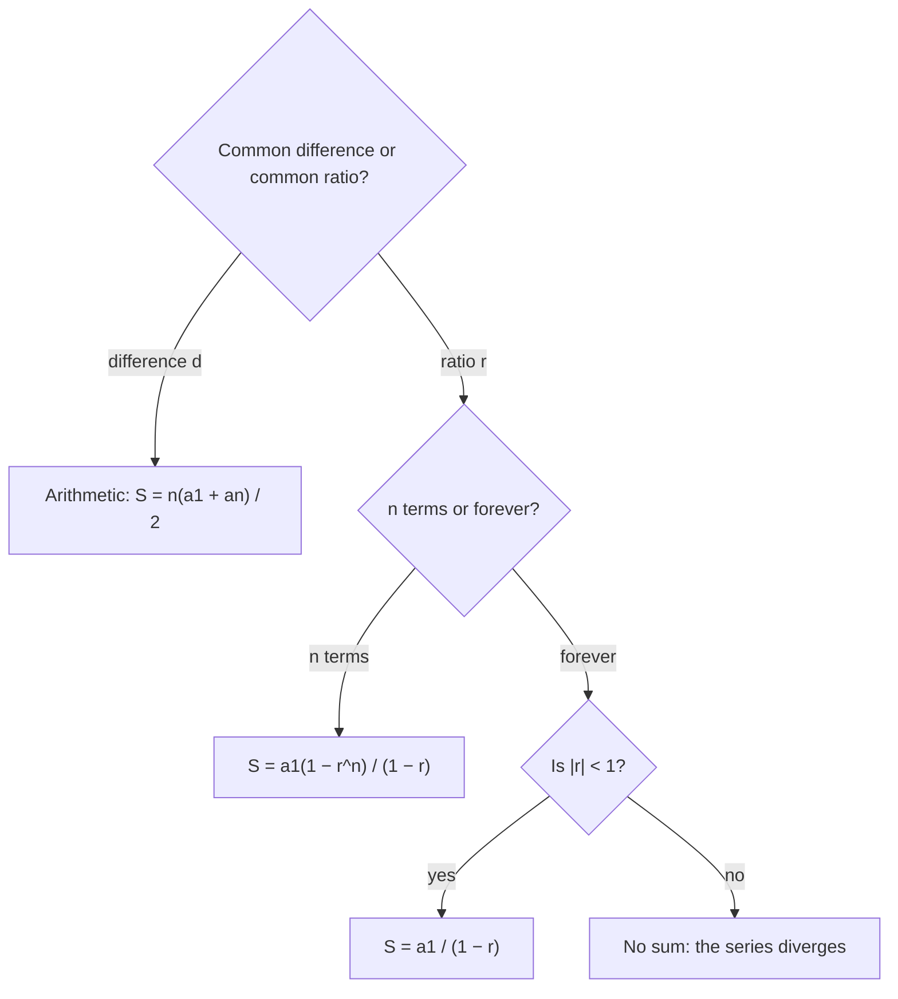

Lesson 32 found single terms of arithmetic and geometric sequences: how many seats are in row 20, how high the ball rises on the 4th bounce. Often the question is about a total instead: how many seats in the whole theater, how far the ball travels before it stops, how much a savings plan holds after 10 years of deposits. Adding up the terms of a sequence gives a **series**. This honors lesson derives formulas for arithmetic and geometric series, and then does something that sounds impossible: adds infinitely many numbers and gets a finite answer.

## Series and summation notation

For a sequence $a_1, a_2, a_3, \dots$, the sum of the first $n$ terms is the $n$th **partial sum**,
$$S_n = a_1 + a_2 + \dots + a_n.$$
Long sums are written compactly with **summation notation** (also called sigma notation, after the Greek capital letter $\Sigma$):
$$\sum_{k=1}^{n} a_k = a_1 + a_2 + \dots + a_n.$$
Read it as "the sum of $a_k$ for $k$ from 1 to $n$." The letter $k$ is the index: it starts at the number below the $\Sigma$, goes up by 1 each time, and stops at the number on top. For example,
$$\sum_{k=1}^{4} (3k - 1) = 2 + 5 + 8 + 11 = 26, \qquad \sum_{k=1}^{3} 5 \cdot 2^{k} = 10 + 20 + 40 = 70.$$
The first is a sum of 4 terms of an arithmetic sequence, the second a sum of 3 terms of a geometric one.

## Arithmetic series

An **arithmetic series** adds the terms of an arithmetic sequence. A well-known story says that the young Carl Friedrich Gauss, asked by a schoolteacher to add the whole numbers from 1 to 100, wrote the answer almost at once. The story comes from a memoir written soon after Gauss died in 1855, and its details (including the numbers 1 to 100) change from one retelling to the next, so treat it as a legend. The idea in it is real.

Write the sum forward and backward and add the two lines:
$$\begin{aligned} S &= 1 + 2 + 3 + \dots + 99 + 100 \\ S &= 100 + 99 + 98 + \dots + 2 + 1 \\ 2S &= 101 + 101 + 101 + \dots + 101 + 101 \end{aligned}$$
Each column adds to 101, and there are 100 columns, so $2S = 100 \cdot 101$ and $S = 5050$.


The same pairing works for any arithmetic series, because stepping forward from $a_1$ and backward from $a_n$ changes the two terms by $+d$ and $-d$, so every pair has the same total $a_1 + a_n$:
$$S_n = \frac{n(a_1 + a_n)}{2}.$$
In words: the number of terms times the average of the first and last term. Substituting $a_n = a_1 + (n - 1)d$ gives a second form for when you don't know the last term:
$$S_n = \frac{n}{2}\big[2a_1 + (n - 1)d\big].$$

### Example 1

A theater has 20 rows. The first row has 16 seats and each row has 2 more than the row in front of it. How many seats are there in all?

1. The rows form an arithmetic sequence with $a_1 = 16$, $d = 2$ and $n = 20$.
2. Last row: $a_{20} = 16 + 19 \cdot 2 = 54$.
3. $S_{20} = \dfrac{20(16 + 54)}{2} = 10 \cdot 70 = 700$ seats.
4. Check with the second form: $\tfrac{20}{2}[2(16) + 19(2)] = 10(32 + 38) = 700$. ✓

### Example 2

Find $\displaystyle\sum_{k=1}^{40} (5k - 3)$.

1. The terms are $2, 7, 12, \dots$, an arithmetic sequence with $d = 5$.
2. First term $k = 1$: $5 - 3 = 2$. Last term $k = 40$: $200 - 3 = 197$. There are 40 terms.
3. $S = \dfrac{40(2 + 197)}{2} = 20 \cdot 199 = 3980$.

## Geometric series

A **geometric series** adds the terms of a geometric sequence. Pairing doesn't help here, but a different trick does: multiply by $r$ and subtract. Let
$$S_n = a_1 + a_1r + a_1r^2 + \dots + a_1r^{n-1}.$$
Multiplying by $r$ shifts every term one place:
$$rS_n = a_1r + a_1r^2 + \dots + a_1r^{n-1} + a_1r^n.$$
Subtracting, everything cancels except the first term of the top line and the last term of the bottom line: $S_n - rS_n = a_1 - a_1r^n$. Factor and divide (when $r \ne 1$):
$$S_n = \frac{a_1(1 - r^n)}{1 - r}.$$
(If $r = 1$, every term is $a_1$ and $S_n = na_1$.)

### Example 3

A legend tells of a ruler who offered a reward of rice on a chessboard: 1 grain on the first square, 2 on the second, 4 on the third, doubling across all 64 squares. How many grains is that?

1. $a_1 = 1$, $r = 2$, $n = 64$.
2. $S_{64} = \dfrac{1(1 - 2^{64})}{1 - 2} = 2^{64} - 1 = 18{,}446{,}744{,}073{,}709{,}551{,}615$.
3. That is about $1.8 \times 10^{19}$ grains, hundreds of times the rice the whole world harvests in a year (at roughly 25 mg per grain). Doubling 63 times is exponential growth at work.

### Example 4

At the end of each year for 10 years you deposit \$100 in an account earning 5% interest per year, compounded once a year. How much is in the account just after the last deposit?

1. The last deposit has earned nothing: \$100. The one before has earned one year of interest: $100(1.05)$. The first deposit has earned 9 years: $100(1.05)^9$.
2. Total: $100 + 100(1.05) + \dots + 100(1.05)^9$, a geometric series with $a_1 = 100$, $r = 1.05$, $n = 10$.
3. $S_{10} = \dfrac{100(1 - 1.05^{10})}{1 - 1.05} = \dfrac{100(1.05^{10} - 1)}{0.05} \approx 1257.79$ dollars.
4. You deposited \$1,000; the other \$257.79 is interest, including interest earned on earlier interest.

## Infinite geometric series

Cut a square of area 1 in half, then cut the remaining half in half, and keep going. The pieces have areas $\tfrac12, \tfrac14, \tfrac18, \tfrac1{16}, \dots$, and together they never spill outside the square, while the uncovered part shrinks toward nothing.


The partial sums show it in numbers: $S_n = \dfrac{\tfrac12\left(1 - (\tfrac12)^n\right)}{1 - \tfrac12} = 1 - \left(\tfrac12\right)^n$, which is $0.5, 0.75, 0.875, 0.9375, \dots$ The missing piece $\left(\tfrac12\right)^n$ shrinks toward 0, so the partial sums get as close to 1 as you like. We say the **infinite geometric series** $\tfrac12 + \tfrac14 + \tfrac18 + \dots$ **converges** to 1 and write the sum as 1.

```plot
{"x": [0, 10.5], "y": [0, 1.2], "functions": [{"f": "1", "label": "sum = 1", "dashed": true}], "points": [[1, 0.5], [2, 0.75], [3, 0.875], [4, 0.9375], [5, 0.96875], [6, 0.984375], [7, 0.9921875], [8, 0.99609375], [9, 0.998046875], [10, 0.9990234375]], "xLabel": "n (number of terms)", "yLabel": "partial sum Sₙ", "caption": "Partial sums of 1/2 + 1/4 + 1/8 + … climb toward 1 without passing it"}
```

The same thing happens whenever $|r| < 1$: then $r^n$ gets closer and closer to 0 as $n$ grows, and the partial-sum formula approaches
$$S = \frac{a_1}{1 - r}, \qquad |r| < 1.$$
When $|r| \ge 1$, the terms don't shrink toward 0, the partial sums never settle, and the series has no sum: it **diverges**. For example, $1 + 2 + 4 + \dots$ grows without bound, and $1 - 1 + 1 - 1 + \dots$ keeps jumping between 1 and 0.



### Example 5

Write the repeating decimal $0.777\ldots$ as a fraction.

1. $0.777\ldots = 0.7 + 0.07 + 0.007 + \dots$, a geometric series with $a_1 = 0.7$ and $r = 0.1$.
2. $|r| < 1$, so $S = \dfrac{0.7}{1 - 0.1} = \dfrac{0.7}{0.9} = \dfrac79$.
3. Check: $7 \div 9 = 0.777\ldots$ ✓ This is why every repeating decimal is a rational number, as Lesson 1 claimed.

### Example 6

A ball is dropped from 10 feet, and each bounce reaches 60% of the previous height (the ball from Lesson 32). If it kept bouncing forever, how far would it travel up and down in total?

1. The first fall is 10 feet.
2. After that, each bounce height is traveled twice, once up and once down. The heights are $6, 3.6, 2.16, \dots$, with $a_1 = 6$ and $r = 0.6$.
3. Sum of the heights: $\dfrac{6}{1 - 0.6} = \dfrac{6}{0.4} = 15$ feet.
4. Total distance: $10 + 2(15) = 40$ feet.

This is a model. A real ball stops after a finite number of small bounces, but those last bounces are so tiny that 40 feet is an excellent estimate of the total.

## Common mistakes

- Using $n$ for the number of terms without counting them. From $k = 3$ to $k = 10$ is 8 terms, not 7.
- Mixing up the formulas: $\tfrac{n(a_1 + a_n)}{2}$ is for arithmetic series only.
- Writing $r^{n-1}$ in the sum formula. The sum of $n$ terms uses $r^n$; the $n$th term uses $r^{n-1}$.
- Using $\tfrac{a_1}{1 - r}$ when $|r| \ge 1$. Then the infinite series has no sum.
- In bounce problems, forgetting that each bounce is traveled up and down, or doubling the first drop.

## Key points

- A series adds the terms of a sequence; $S_n$ is the sum of the first $n$ terms, written $\sum_{k=1}^{n} a_k$.
- Arithmetic: $S_n = \tfrac{n(a_1 + a_n)}{2}$, found by pairing first with last.
- Geometric: $S_n = \tfrac{a_1(1 - r^n)}{1 - r}$ for $r \ne 1$, found by subtracting $rS_n$ from $S_n$.
- Infinite geometric: converges to $\tfrac{a_1}{1 - r}$ when $|r| < 1$; diverges when $|r| \ge 1$.
- Repeating decimals are infinite geometric series, which is why they are rational.
